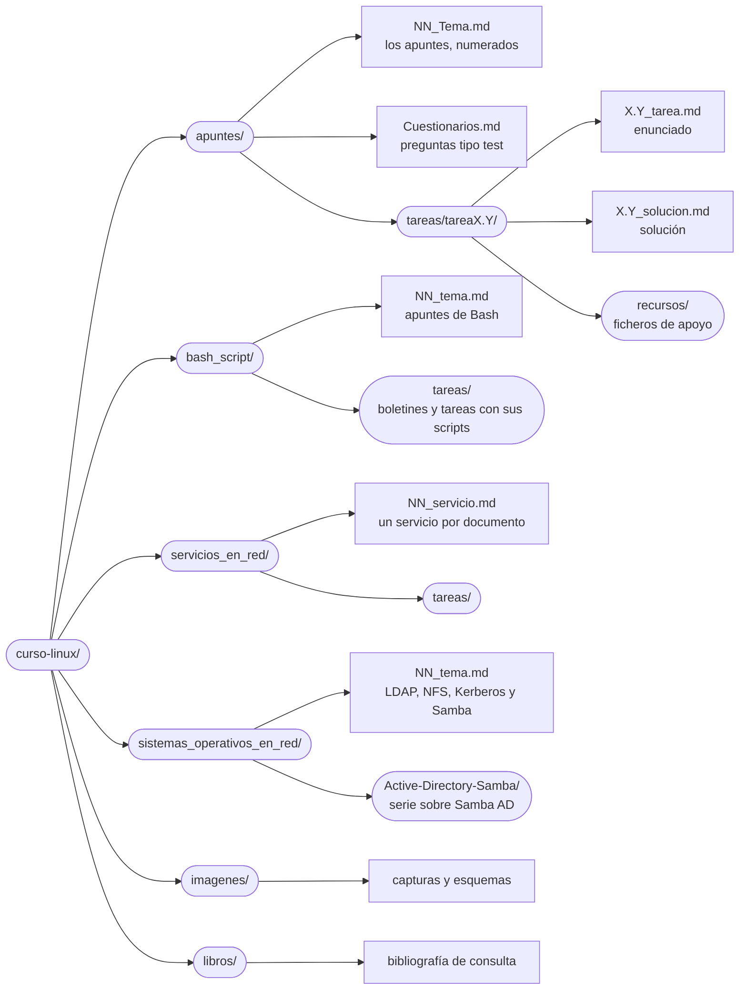

# Curso de Linux

  

  
  
  
  
  
  

Apuntes, tareas con solución y laboratorios para aprender a **usar y administrar Linux**, desde los primeros comandos hasta montar los servicios de una red completa. Todo está escrito en Markdown para leerse directamente en GitHub, con ejemplos reales sobre **Debian 13** y **Ubuntu Server 26.04** en máquinas virtuales de VirtualBox.

El repositorio se organiza en cuatro bloques:

| Bloque | Qué contiene | Documentos |
|---|---|:-:|
| [Linux: manejo, comandos y administración](#apuntes-de-linux) | El sistema desde cero: comandos, ficheros, almacenamiento, usuarios, procesos, arranque, redes y seguridad. | 49 apuntes · 26 tareas |
| [Scripting en Bash](#scripting-en-bash) | Programación de *scripts* para automatizar tareas. | 4 apuntes · 5 boletines · 4 tareas |
| [Servicios en red](#servicios-en-red) | Los servicios de una red: web, DHCP, DNS, correo, FTP, proxy y acceso remoto. | 9 apuntes · 1 tarea |
| [Sistemas operativos en red](#sistemas-operativos-en-red) | Gestión centralizada de usuarios y recursos: LDAP, NFS, Kerberos y Samba. | 17 apuntes |

> [!TIP]
> Los apuntes de Linux están numerados en el orden recomendado de estudio. Cada tarea tiene el **enunciado** y la **solución** en documentos separados: conviene intentarla primero y consultar la solución después. Los laboratorios se montan en VirtualBox, así que no hace falta ningún equipo dedicado.

---

## Qué es Linux

**Linux** es un sistema operativo de código abierto creado por Linus Torvalds en 1991, inicialmente como un proyecto personal para desarrollar un sistema gratuito basado en Unix. A diferencia de sistemas como Windows o macOS, su código fuente es público: cualquier persona puede verlo, modificarlo y distribuirlo. Esto ha dado lugar a una gran cantidad de **distribuciones**, como Debian, Ubuntu o Fedora, adaptadas a necesidades distintas.

Linux es conocido por su **seguridad, estabilidad y flexibilidad**, características que lo hacen ideal para servidores y sistemas críticos. Funciona en la gran mayoría de los servidores web y de la infraestructura en la nube, en todos los superordenadores más potentes del mundo y en dispositivos como routers, televisores o teléfonos Android. Aunque ofrece entornos gráficos similares a los de otros sistemas operativos, su gran fuerza es la **línea de comandos**, la herramienta de trabajo diaria de los administradores de sistemas, y la que se aprende a dominar en estos apuntes.

---

## Apuntes de Linux

### Primeros pasos

| | Documento | De qué trata |
|:-:|---|---|
| 00 | [Instalación de Debian](./apuntes/00_Instalacion_Debian.md) | Instalación paso a paso en una máquina virtual: idioma, red, usuarios, particionado y programas. |
| 01 | [Sistema de ficheros de Linux](./apuntes/01_Sistema_De_Ficheros.md) | La jerarquía de directorios (FHS), qué contiene cada carpeta, `/proc` y `/sys`, y criterios de particionado. |
| 02 | [Entorno y variables de entorno](./apuntes/02_Entorno_y_variables_de_entorno_en_Linux.md) | Variables de shell y de entorno, `PATH` y los ficheros de configuración de Bash. |
| 43 | [El editor vi y vim](./apuntes/43_Editor_vi_vim.md) | Modos, movimientos, edición, búsqueda y sustitución. |
| 39 | [Herramienta tmux](./apuntes/39_Herramienta_tmux.md) | Sesiones, ventanas y paneles en una misma terminal. |
| 48 | [Entorno gráfico en Ubuntu Server](./apuntes/48_Entorno_grafico_Ubuntu_Server.md) | Instalar un escritorio, terminales virtuales (TTY) y objetivos de arranque. |

### Comandos y tratamiento de texto

| | Documento | De qué trata |
|:-:|---|---|
| 03 | [Comandos básicos](./apuntes/03_Comandos_Basicos.md) | Navegación, visualización de ficheros, búsqueda de ejecutables y ayuda. |
| 04 | [Comandos ls, lspci, lsusb y lsmod](./apuntes/04_Comando_ls_lspci_lsusb_lsmod.md) | Listado de ficheros, del hardware y de los módulos del núcleo. |
| 05 | [Comandos head y tail](./apuntes/05_Comando_head_y_tail.md) | Principio y final de un fichero, y seguimiento de registros en tiempo real. |
| 06 | [Comandos who, whoami, id y groups](./apuntes/06_Comando_who_whoami_id_y_groups.md) | Usuarios conectados, identidad y grupos. |
| 07 | [Comandos which y type](./apuntes/07_Comando_whitch_y_type.md) | Dónde está un comando y de qué tipo es. |
| 08 | [Comando sort](./apuntes/08_Comando_sort.md) | Ordenación de líneas por distintos criterios. |
| 09 | [grep, egrep y expresiones regulares](./apuntes/09_Comando_grep_egre_expresiones_regulares_y_metacaracteres.md) | Búsqueda de patrones, expresiones regulares básicas y extendidas. |
| 10 | [Redirecciones](./apuntes/10_Redirecciones.md) | Entrada, salida y errores, tuberías y descriptores de fichero. |
| 11 | [Comando wc](./apuntes/11_Comando_wc.md) | Contar líneas, palabras y caracteres. |
| 15 | [Comando sed](./apuntes/15_Comando_sed.md) | Edición de texto en flujo: sustituir, borrar e insertar. |
| 16 | [Comando alias](./apuntes/16_Comando_alias.md) | Atajos para comandos y cómo hacerlos permanentes. |
| 17 | [Comando find](./apuntes/17_Comando_find.md) | Búsqueda de ficheros por nombre, tipo, tamaño, fechas y permisos. |
| 18 | [Comando cut](./apuntes/18_Comando_cut.md) | Extracción de campos y columnas. |
| 19 | [Comando awk](./apuntes/19_Comando_awk.md) | Procesamiento de texto por campos. |
| 20 | [Comando tr](./apuntes/20_Comando_tr.md) | Sustitución y borrado de caracteres. |
| 21 | [Comando history](./apuntes/21_Comando_history.md) | El historial de comandos y su configuración. |
| 24 | [Marcas de tiempo y touch](./apuntes/24_Comando_atime_mtime_ctime_y_touch.md) | `atime`, `mtime` y `ctime` de un fichero, y cómo modificarlas. |
| 26 | [Comandos command y builtin](./apuntes/26_Comando_command_y_builting.md) | Orden de precedencia entre alias, funciones, órdenes internas y programas. |

### Almacenamiento y sistemas de ficheros

| | Documento | De qué trata |
|:-:|---|---|
| 12 | [Comando dd](./apuntes/12_Comando_dd.md) | Copias a bajo nivel, imágenes de disco y el sector de arranque. |
| 13 | [Comando df](./apuntes/13_Comando_df.md) | Espacio libre de los sistemas de ficheros. |
| 14 | [Comando du](./apuntes/14_Comando_du.md) | Espacio ocupado por ficheros y carpetas. |
| 23 | [Compresión de archivos](./apuntes/23_Compresion_de_archivos.md) | `tar`, `gzip`, `bzip2`, `xz`, `zip` y `rar`. |
| 25 | [Comandos mount y umount](./apuntes/25_Comando_mount_y_umount.md) | Montar y desmontar sistemas de ficheros. |
| 37 | [Particionado con fdisk y parted](./apuntes/37_Particionado_con_fdisk_y_parted.md) | MBR y GPT, qué es un sistema de ficheros y sus tipos, formateo, `fstab` y *swap*. |
| 38 | [RAID con mdadm](./apuntes/38_Raid_con_mdadm.md) | Niveles de RAID y arrays por software. |
| 42 | [LVM: gestión de volúmenes lógicos](./apuntes/42_LVM_Gestion_de_volumenes_logicos.md) | Volúmenes físicos, grupos y volúmenes lógicos; ampliar sin reparticionar. |
| 45 | [Comando rsync](./apuntes/45_Comando_rsync.md) | Sincronización y copias de seguridad incrementales. |
| 47 | [Cuotas de disco](./apuntes/47_Cuotas_de_disco.md) | Límites de espacio y de ficheros por usuario y por grupo. |

### Administración del sistema

| | Documento | De qué trata |
|:-:|---|---|
| 22 | [Gestión de procesos](./apuntes/22_Gestion_de_procesos.md) | `ps`, `top`, señales, prioridades y trabajos en segundo plano. |
| 27 | [Gestión de paquetes](./apuntes/27_Gestion_de_paquetes.md) | `dpkg`, `apt` y repositorios, `rpm` y `dnf`, e instalación desde código fuente. |
| 28 | [Gestión de usuarios y permisos](./apuntes/28_Gestion_de_usuarios_y_permisos.md) | Cuentas y grupos, `sudo`, permisos, máscara, permisos especiales y ACL. |
| 29 | [Iniciadores del sistema](./apuntes/29_Iniciadores_del_sistema_SysVinit_Systemd_Upstart.md) | SysVinit y systemd, servicios, `journalctl` y apagado. |
| 30 | [Localización e internacionalización](./apuntes/30_Localizacion_e_internacionalizacion.md) | Hora y sincronización con chrony, configuración regional y codificación. |
| 35 | [Cron y at](./apuntes/35_Cron_y_at.md) | Tareas programadas periódicas y puntuales. |
| 36 | [Secuencia de arranque](./apuntes/36_Secuencia_De_Arranque.md) | Del firmware al sistema en marcha: GRUB, núcleo, *initramfs* e init. |
| 40 | [Configuración de logs](./apuntes/40_Configuracion_logs.md) | rsyslog y el envío de registros a un servidor central. |

### Redes y seguridad

| | Documento | De qué trata |
|:-:|---|---|
| 31 | [Configuración de red](./apuntes/31_Configuracion_de_red.md) | `ip`, Netplan, `/etc/network/interfaces`, DNS, diagnóstico y proxy. |
| 32 | [Comandos ss y netstat](./apuntes/32_Comando_ss_y_netstat.md) | Puertos en escucha y conexiones abiertas. |
| 33 | [Comandos wget y curl](./apuntes/33_Comando_wget_y_curl.md) | Descargas y peticiones HTTP desde la terminal. |
| 34 | [Comandos ssh, scp y sftp](./apuntes/34_Comando_ssh_scp_y_sftp.md) | Cifrado, autenticación por clave, túneles y PuTTY. |
| 41 | [Retos de SSH: OverTheWire Bandit](./apuntes/41_Retos_Bandit_OverTheWire.md) | Resolución de los retos Bandit por SSH. |
| 44 | [Cortafuegos: nftables y ufw](./apuntes/44_Cortafuegos_nftables_y_ufw.md) | Cortafuegos para proteger un servidor. |
| 46 | [Cortafuegos con iptables](./apuntes/46_Cortafuegos_iptables.md) | Tablas y cadenas, estados, NAT y cortafuegos perimetral. |

### Autoevaluación

| Documento | De qué trata |
|---|---|
| [Cuestionarios](./apuntes/Cuestionarios.md) | Unas 500 preguntas tipo test, con su respuesta, sobre los contenidos de los exámenes 101 y 102 de LPIC-1. |

---

## Tareas de Linux

### Repaso de comandos

| | Tarea | Enunciado | Solución |
|:-:|---|:-:|:-:|
| 0.1 | Repaso de comandos 1 | [Ver](./apuntes/tareas/tarea0.1/0.1_tarea.md) | [Ver](./apuntes/tareas/tarea0.1/0.1_solucion.md) |
| 0.2 | Repaso de comandos 2 | [Ver](./apuntes/tareas/tarea0.2/0.2_tarea.md) | [Ver](./apuntes/tareas/tarea0.2/0.2_solucion.md) |
| 0.3 | Repaso de comandos 3 | [Ver](./apuntes/tareas/tarea0.3/0.3_tarea.md) | [Ver](./apuntes/tareas/tarea0.3/0.3_solucion.md) |
| 0.4 | Repaso de comandos 4 | [Ver](./apuntes/tareas/tarea0.4/0.4_tarea.md) | [Ver](./apuntes/tareas/tarea0.4/0.4_solucion.md) |
| 0.5 | Repaso de comandos 5 | [Ver](./apuntes/tareas/tarea0.5/0.5_tarea.md) | [Ver](./apuntes/tareas/tarea0.5/0.5_solucion.md) |

### Comandos y software

| | Tarea | Enunciado | Solución |
|:-:|---|:-:|:-:|
| 1.1 | Creación de una copia de seguridad de los datos | [Ver](./apuntes/tareas/tarea1.1/1.1_tarea.md) | [Ver](./apuntes/tareas/tarea1.1/1.1_solucion.md) |
| 1.2 | Administración de procesos y trabajos en segundo plano | [Ver](./apuntes/tareas/tarea1.2/1.2_tarea.md) | [Ver](./apuntes/tareas/tarea1.2/1.2_solucion.md) |
| 1.3 | Manipulación y extracción de información en listados de archivos | [Ver](./apuntes/tareas/tarea1.3/1.3_tarea.md) | [Ver](./apuntes/tareas/tarea1.3/1.3_solucion.md) |
| 1.4 | Creación de un shell restringido | [Ver](./apuntes/tareas/tarea1.4/1.4_tarea.md) | [Ver](./apuntes/tareas/tarea1.4/1.4_solucion.md) |
| 1.5 | Gestión de módulos del núcleo | [Ver](./apuntes/tareas/tarea1.5/1.5_tarea.md) | [Ver](./apuntes/tareas/tarea1.5/1.5_solucion.md) |
| 1.6 | Instalación de software en el sistema: Webmin | [Ver](./apuntes/tareas/tarea1.6/1.6_tarea.md) | [Ver](./apuntes/tareas/tarea1.6/1.6_solucion.md) |
| 1.7 | Formateo, búsqueda y procesamiento avanzado de texto | [Ver](./apuntes/tareas/tarea1.7/1.7_tarea.md) | [Ver](./apuntes/tareas/tarea1.7/1.7_solucion.md) |

### Almacenamiento y sistemas de ficheros

| | Tarea | Enunciado | Solución |
|:-:|---|:-:|:-:|
| 2.1 | Práctica de particionado | [Ver](./apuntes/tareas/tarea2.1/2.1_tarea.md) | [Ver](./apuntes/tareas/tarea2.1/2.1_solucion.md) |
| 2.2 | Configuración de un RAID 5 con mdadm | [Ver](./apuntes/tareas/tarea2.2/2.2_tarea.md) | [Ver](./apuntes/tareas/tarea2.2/2.2_solucion.md) |
| 2.3 | Montado de un sistema de ficheros con chroot | [Ver](./apuntes/tareas/tarea2.3/2.3_tarea.md) | [Ver](./apuntes/tareas/tarea2.3/2.3_solucion.md) |

### Usuarios y permisos

| | Tarea | Enunciado | Solución |
|:-:|---|:-:|:-:|
| 3.1 | Práctica de permisos y ACL | [Ver](./apuntes/tareas/tarea3.1/3.1_tarea.md) | [Ver](./apuntes/tareas/tarea3.1/3.1_solucion.md) |
| 3.2 | Creación de usuarios y grupos | [Ver](./apuntes/tareas/tarea3.2/3.2_tarea.md) | [Ver](./apuntes/tareas/tarea3.2/3.2_solucion.md) |
| 3.3 | Uso de loginctl para supervisar sesiones y usuarios conectados | [Ver](./apuntes/tareas/tarea3.3/3.3_tarea.md) | [Ver](./apuntes/tareas/tarea3.3/3.3_solucion.md) |

### SysVinit y systemd

| | Tarea | Enunciado | Solución |
|:-:|---|:-:|:-:|
| 4.1 | Iniciar un servicio en SysVinit | [Ver](./apuntes/tareas/tarea4.1/4.1_tarea.md) | [Ver](./apuntes/tareas/tarea4.1/4.1_solucion.md) |
| 4.2 | Gestión de servicios con systemd | [Ver](./apuntes/tareas/tarea4.2/4.2_tarea.md) | [Ver](./apuntes/tareas/tarea4.2/4.2_solucion.md) |
| 4.3 | Instalación de Apache Tomcat como servicio de systemd | [Ver](./apuntes/tareas/tarea4.3/4.3_tarea.md) | [Ver](./apuntes/tareas/tarea4.3/4.3_solucion.md) |

### SSH y SCP

| | Tarea | Enunciado | Solución |
|:-:|---|:-:|:-:|
| 5.1 | SSH y SCP | [Ver](./apuntes/tareas/tarea5.1/5.1_tarea.md) | [Ver](./apuntes/tareas/tarea5.1/5.1_solucion.md) |
| 5.2 | Autenticación por clave pública y securización del servidor SSH | [Ver](./apuntes/tareas/tarea5.2/5.2_tarea.md) | [Ver](./apuntes/tareas/tarea5.2/5.2_solucion.md) |

### Redes

| | Tarea | Enunciado | Solución |
|:-:|---|:-:|:-:|
| 6.1 | Configuración de red | [Ver](./apuntes/tareas/tarea6.1/6.1_tarea.md) | [Ver](./apuntes/tareas/tarea6.1/6.1_solucion.md) |
| 6.2 | Cortafuegos perimetral con iptables | [Ver](./apuntes/tareas/tarea6.2/6.2_tarea.md) | [Ver](./apuntes/tareas/tarea6.2/6.2_solucion.md) |
| 6.3 | Repaso de configuración de red | [Ver](./apuntes/tareas/tarea6.3/6.3_tarea.md) | [Ver](./apuntes/tareas/tarea6.3/6.3_solucion.md) |

---

## Scripting en Bash

### Apuntes

| | Documento | De qué trata |
|:-:|---|---|
| 01 | [Uso avanzado de shell](./bash_script/01_uso_avanzado_de_shell.md) | Alias, palabras clave, funciones, órdenes internas y variables del shell. |
| 02 | [Scripts en Linux](./bash_script/02_scripts_en_linux.md) | Ejecución de *scripts*, variables locales y globales, y las diferencias entre `[` y `[[`. |
| 03 | [Estructuras de scripts](./bash_script/03_estructuras_de_scripts.md) | Control de flujo, menús, funciones, código de salida y contadores. |
| 04 | [Arrays en Bash](./bash_script/04_arrays_en_bash.md) | Declarar, recorrer y pasar arrays a funciones. |

### Boletines y tareas

| | Ejercicio | Enunciado | Solución |
|:-:|---|:-:|:-:|
| B1 | Boletín 1 | [Ver](./bash_script/tareas/boletines/01_boletin/boletin1.md) | [Scripts](./bash_script/tareas/boletines/01_boletin/) |
| B2 | Boletín 2 | [Ver](./bash_script/tareas/boletines/02_boletin/boletin2.md) | [Scripts](./bash_script/tareas/boletines/02_boletin/) |
| B3 | Boletín 3 | [Ver](./bash_script/tareas/boletines/03_boletin/boletin3.md) | [Scripts](./bash_script/tareas/boletines/03_boletin/) |
| B4 | Boletín 4 | [Ver](./bash_script/tareas/boletines/04_boletin/boletin4.md) | [Scripts](./bash_script/tareas/boletines/04_boletin/) |
| B5 | Boletín 5 | [Ver](./bash_script/tareas/boletines/05_boletin/boletin5.md) | [Scripts](./bash_script/tareas/boletines/05_boletin/) |
| 4.1 | Comprobar los datos de una página web | [Ver](./bash_script/tareas/tareas/tarea4.1/4.1_tarea.md) | [Script](./bash_script/tareas/tareas/tarea4.1/4.1_solucion.sh) |
| 4.2 | Comprobación del sistema | [Ver](./bash_script/tareas/tareas/tarea4.2/4.2_tarea.md) | [Script](./bash_script/tareas/tareas/tarea4.2/4.2_solucion.sh) |
| 4.3 | Importar y exportar usuarios en el sistema | [Ver](./bash_script/tareas/tareas/tarea4.3/4.3_tarea.md) | [Script](./bash_script/tareas/tareas/tarea4.3/4.3_solucion.sh) |
| 4.4 | Configuración avanzada del shell | [Ver](./bash_script/tareas/tareas/tarea4.4/4.4_tarea.md) | [Ver](./bash_script/tareas/tareas/tarea4.4/4.4_solucion.md) |

---

## Servicios en red

| | Documento | De qué trata |
|:-:|---|---|
| 01 | [Apache como servidor web](./servicios_en_red/01_apache_como_servidor_web.md) | *VirtualHosts*, módulos, `.htaccess`, control de acceso, autenticación, registros y HTTPS. |
| 02 | [DHCP](./servicios_en_red/02_dhcp.md) | Servidor DHCP para varias subredes. |
| 03 | [FTP](./servicios_en_red/03_ftp.md) | Servidor ProFTPD, cliente FTP y seguridad. |
| 04 | [DNS con BIND9](./servicios_en_red/04_dns_bind9.md) | Servidor caché, zonas directa e inversa, servidor secundario y `dig`. |
| 05 | [Correo electrónico con Postfix y Dovecot](./servicios_en_red/05_correo_postfix_dovecot.md) | SMTP, IMAP y POP3, buzones Maildir, y SPF, DKIM y DMARC. |
| 06 | [Proxy web con Squid](./servicios_en_red/06_proxy_squid.md) | Listas de control, bloqueo de sitios, autenticación, caché y proxy transparente. |
| 07 | [Nginx: servidor web, proxy inverso y HTTPS](./servicios_en_red/07_nginx_proxy_inverso_https.md) | Sitios, PHP con MariaDB, proxy inverso, balanceo de carga y certificados. |
| 08 | [Acceso remoto gráfico](./servicios_en_red/08_acceso_remoto_grafico.md) | Escritorio remoto con xrdp y VNC a través de un túnel SSH. |
| 09 | [Laboratorio: router con DHCP y DNS, servidor web y cliente](./servicios_en_red/09_laboratorio_router_dhcp_dns_web.md) | Una red completa en VirtualBox: NAT, Kea, BIND9 con DNS dinámico y Apache. |

| | Tarea | Enunciado | Solución |
|:-:|---|:-:|:-:|
| 01 | Servidor web Apache | [Ver](./servicios_en_red/tareas/tarea01/01_tarea.md) | [Ver](./servicios_en_red/tareas/tarea01/01_solucion.md) |

---

## Sistemas operativos en red

### Servicios, herramientas y protocolos

| | Documento | De qué trata |
|:-:|---|---|
| 01 | [LDAP con OpenLDAP (slapd)](./sistemas_operativos_en_red/01_ldap-slapd.md) | Directorio LDAP: conceptos, árbol del directorio, instalación y gestión. |
| 02 | [NFS](./sistemas_operativos_en_red/02_NFS.md) | Carpetas compartidas entre equipos Linux y el problema de los UID. |
| 03 | [Perfiles móviles con LDAP y NFS](./sistemas_operativos_en_red/03_perfiles_moviles.md) | La misma carpeta personal en cualquier equipo de la red. |
| 04 | [Seguridad del escenario y Kerberos](./sistemas_operativos_en_red/04_seguridad_del_escenario_y_kerberos.md) | Debilidades del escenario y autenticación con Kerberos. |
| 05 | [Samba como servidor independiente](./sistemas_operativos_en_red/05_samba_standalone.md) | Recursos compartidos, usuarios, permisos e impresoras con Samba. |
| 06 | [Samba como controlador de dominio](./sistemas_operativos_en_red/06_samba_ad_dc.md) | Active Directory con Samba en Debian: dominio, usuarios, clientes, ACL y cuotas. |

### Active Directory con Samba (serie sobre Ubuntu)

| | Documento |
|:-:|---|
| 00 | [Consideraciones iniciales y preparación del entorno](./sistemas_operativos_en_red/Active-Directory-Samba/00_consideraciones.md) |
| 01 | [Configuración de red estática y Netplan](./sistemas_operativos_en_red/Active-Directory-Samba/01_configuracion_red_interna.md) |
| 02 | [Instalación y promoción a controlador de dominio](./sistemas_operativos_en_red/Active-Directory-Samba/02_promover_samba_AD.md) |
| 03 | [Unión de clientes Windows 10 al dominio](./sistemas_operativos_en_red/Active-Directory-Samba/03_unir_windows10_dominio.md) |
| 04 | [Unión de clientes Ubuntu Desktop al dominio](./sistemas_operativos_en_red/Active-Directory-Samba/04_unir_ubuntu_desktop_dominio.md) |
| 05 | [Enrutamiento y SNAT con nftables](./sistemas_operativos_en_red/Active-Directory-Samba/05_snat_con_nftables_ubuntu_server.md) |
| 06 | [Gestión remota con las herramientas RSAT](./sistemas_operativos_en_red/Active-Directory-Samba/06_rsat_administrar_servidor_samba.md) |
| 07 | [Servicio DHCP para varias subredes](./sistemas_operativos_en_red/Active-Directory-Samba/07_servidor_dhcp_dos_subredes.md) |
| 08 | [Administración y mantenimiento del servidor Samba](./sistemas_operativos_en_red/Active-Directory-Samba/08_administrar_servidor_samba.md) |
| 09 | [Carpetas compartidas y permisos](./sistemas_operativos_en_red/Active-Directory-Samba/09_recurso_compartido.md) |
| 10 | [Script de creación de usuarios](./sistemas_operativos_en_red/Active-Directory-Samba/10_crear_usuarios.md) |

---

## Cómo está organizado el repositorio

Las cajas redondeadas son carpetas; las rectangulares, documentos.

### Cómo están hechos los documentos

- Todos los apuntes abren con un **índice** enlazado y se dividen en apartados numerados, para poder citarlos con precisión («apartado 3.2 del documento 31»).
- Las explicaciones se apoyan en **ejemplos reales**, con el *prompt* de la máquina en la que se ejecuta cada orden (`usuario@debian:~$`, `root@srv:~#`) y la salida que se obtiene.
- Los avisos se distinguen por su tipo: **Nota**, **Importante**, **Advertencia** y **Recuerda**.
- Los conceptos que lo necesitan se acompañan de **diagramas** (Mermaid), que GitHub muestra directamente.
- Las **tareas** separan el enunciado de la solución, y las soluciones explican el porqué de cada paso, no solo el comando.
- Los laboratorios usan **Debian 13** y **Ubuntu Server 26.04** sobre VirtualBox, y avisan de lo que cambia entre versiones respecto a las guías antiguas.

---

## Bibliografía de consulta

La carpeta [`libros/`](./libros/) reúne manuales en PDF de apoyo:

| Libro | Contenido |
|---|---|
| [Linux](<libros/libros de linux/Linux - Martín Gil Blanco.pdf>) | Manual propio de Linux, de Martín Gil Blanco. |
| [Material de aprendizaje LPI 101](<libros/libros de linux/LPI-Learning-Material-101-500-es.pdf>) y [102](<libros/libros de linux/LPI-Learning-Material-102-500-es.pdf>) | Materiales oficiales del Linux Professional Institute para la certificación LPIC-1. |
| [Manual de preparación de LPIC-1](<libros/libros de linux/Manual LINUX - Preparación a la certificación LPIC-1.pdf>) | Preparación de la certificación LPIC-1. |
| [Manual del editor vi](<libros/libros de linux/Manual editor VI.pdf>) | Referencia del editor vi. |
| [Advanced Bash-Scripting Guide](<libros/libros de bash/abs-guide.pdf>) | Guía avanzada de programación en Bash. |
| [Curso de Bash Scripting](<libros/libros de bash/Curso de Bash Scripting.pdf>) | Curso de programación de *scripts*. |
| [Ejercicios de shell script resueltos](<libros/libros de bash/ejercicios-shell-script-solucion.pdf>) | Ejercicios con su solución. |
| [Programación shell en Unix y Linux](<libros/libros de bash/Programacion_Shell_en_Unix_Linux_sh_ksh.pdf>) | Programación de *scripts* en `sh` y `ksh`. |

---

## Agradecimientos

Parte de los conocimientos adquiridos para la elaboración de estos materiales han sido posibles gracias a las contribuciones y materiales de los recursos que se detallan a continuación. Han sido una referencia fundamental para el desarrollo y la comprensión de los temas tratados, por lo que expreso mi profundo agradecimiento a sus autores y fuentes.

- [Manuais IES San Clemente](https://manuais.pages.iessanclemente.net/apuntes/)
- [Ricardo Feijoo Costa](https://ricardofc.github.io/repoEDU-CCbySA/)
- [Juan Alberto García Fernández](https://github.com/agarciafer)
- [José Ramón Méndez Reboredo](https://github.com/moncho-mendez)
- [Pablo Gallego Falcón](https://github.com/pagafa)

---

## Licencia y autoría

© 2025-2026 **Martín Gil Blanco**.

Los apuntes, tareas y soluciones elaborados para este repositorio se publican bajo la **[licencia MIT](LICENSE)**: puedes usarlos, copiarlos, modificarlos y redistribuirlos, incluso adaptándolos a tus propias necesidades, conservando el aviso de copyright y la licencia.

| | |
|---|---|
| **Qué cubre la licencia** | Los documentos propios del repositorio: apuntes, tareas, soluciones, *scripts* y esquemas. |
| **Excepciones** | Los documentos [05](./sistemas_operativos_en_red/05_samba_standalone.md) y [06](./sistemas_operativos_en_red/06_samba_ad_dc.md) de *Sistemas operativos en red* adaptan materiales de Ricardo Feijoo Costa y se distribuyen bajo la licencia **[CC BY-SA 4.0](https://creativecommons.org/licenses/by-sa/4.0/deed.es)**, como sus originales. |
| **Qué no cubre** | Los libros de la carpeta `libros/` escritos por terceros, que pertenecen a sus autores. |
| **Marcas citadas** | Linux es una marca registrada de Linus Torvalds; Debian, de Software in the Public Interest; Ubuntu, de Canonical Ltd.; Red Hat, de Red Hat, Inc.; Windows, de Microsoft Corporation; y VirtualBox, de Oracle Corporation. Este repositorio no está relacionado con ninguna de ellas ni cuenta con su respaldo. |
