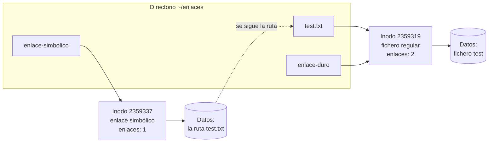

# Comandos básicos

## Índice

1. [Identidad del usuario](#1-identidad-del-usuario)
   1. [Comando whoami](#11-comando-whoami)
   2. [Comando id](#12-comando-id)
   3. [Comando groups](#13-comando-groups)
2. [Navegación por el sistema de ficheros](#2-navegación-por-el-sistema-de-ficheros)
   1. [Comando pwd](#21-comando-pwd)
   2. [Comando cd](#22-comando-cd)
   3. [Comando ls](#23-comando-ls)
   4. [Comando mkdir](#24-comando-mkdir)
3. [Visualización del contenido de ficheros](#3-visualización-del-contenido-de-ficheros)
   1. [Comandos cat, more, less y tac](#31-comandos-cat-more-less-y-tac)
   2. [Comandos head y tail](#32-comandos-head-y-tail)
4. [Búsqueda de texto y localización de ejecutables](#4-búsqueda-de-texto-y-localización-de-ejecutables)
   1. [Comando grep](#41-comando-grep)
   2. [Comando which](#42-comando-which)
5. [Mostrar texto por pantalla](#5-mostrar-texto-por-pantalla)
6. [Ayuda y documentación del sistema](#6-ayuda-y-documentación-del-sistema)
7. [Información del sistema y de la sesión](#7-información-del-sistema-y-de-la-sesión)
   1. [Comando w](#71-comando-w)
   2. [Comando tty](#72-comando-tty)
   3. [Comando cal](#73-comando-cal)
   4. [Comando date](#74-comando-date)
   5. [Comando uname](#75-comando-uname)
8. [Enlaces duros y simbólicos](#8-enlaces-duros-y-simbólicos)
   1. [Qué es un inodo](#81-qué-es-un-inodo)
   2. [Qué es un enlace](#82-qué-es-un-enlace)
   3. [Enlaces duros](#83-enlaces-duros)
   4. [Enlaces simbólicos](#84-enlaces-simbólicos)
   5. [Comparativa](#85-comparativa)
9. [Cambio de usuario](#9-cambio-de-usuario)

---

## 1. Identidad del usuario

El primer grupo de comandos responde a una pregunta básica en cualquier sesión: con qué identidad estamos trabajando y qué permisos nos otorga.

### 1.1 Comando whoami

```bash
usuario@debian:~$ whoami
usuario
```

**Explicación:** El comando `whoami` (del inglés *who am I*, "quién soy yo") muestra el nombre del usuario efectivo con el que estás operando actualmente, que en este caso es `usuario`. Es útil en scripts para verificar si se está ejecutando como `root`.

### 1.2 Comando id

```bash
usuario@debian:~$ id
uid=1000(usuario) gid=1000(usuario) grupos=1000(usuario),24(cdrom),25(floppy),27(sudo),29(audio),30(dip),44(video),46(plugdev),100(users),106(netdev),112(bluetooth),114(lpadmin),117(scanner)
```

**Explicación:** El comando `id` muestra la información detallada del usuario actual. En este caso, el UID (*User Identifier*) y GID (*Group Identifier* principal) del usuario `usuario` son 1000. También muestra todos los grupos secundarios a los que pertenece, lo cual determina a qué recursos de hardware o archivos tiene acceso por permisos de grupo.

Para revisar la información de un usuario diferente, o en este caso del superusuario mediante `sudo`, ejecutamos lo siguiente:

```bash
usuario@debian:~$ sudo id
[sudo] contraseña para usuario:
uid=0(root) gid=0(root) grupos=0(root)
```

**Explicación:** Al ejecutar `sudo id` logramos ejecutar la herramienta bajo el contexto temporal de administrador. El UID y GID de `root` son siempre 0, indicando que se trata del superusuario absoluto del sistema.

### 1.3 Comando groups

```bash
usuario@debian:~$ groups
usuario cdrom floppy sudo audio dip video plugdev users netdev bluetooth lpadmin scanner
```

**Explicación:** El comando `groups` muestra únicamente el nombre de todos los grupos (principales y secundarios) a los que pertenece el usuario `usuario` actual, sin mostrar identificadores numéricos.

---

## 2. Navegación por el sistema de ficheros

Estos comandos permiten saber dónde estamos, desplazarnos por el árbol de directorios y crear nuevas carpetas.

### 2.1 Comando pwd

```bash
usuario@debian:~$ pwd
/home/usuario
```

**Explicación:** El comando `pwd` (*Print Working Directory*) muestra la ruta absoluta del directorio de trabajo en el que te encuentras posicionado actualmente. En este caso, el usuario está en el directorio `/home/usuario`.

### 2.2 Comando cd

```bash
usuario@debian:~$ cd /
usuario@debian:/$
```

**Explicación:** El comando `cd` (*Change Directory*) nos permite navegar por el sistema de ficheros. Ejecutando `cd /` cambia de inmediato al directorio raíz `/`, la parte más alta de la jerarquía.

Para volver rápidamente a nuestra carpeta personal desde cualquier ubicación:

```bash
usuario@debian:/$ cd ~
usuario@debian:~$
```

**Explicación:** La tilde (`~`) es un atajo universal que representa el directorio *home* del usuario actual (ej. `/home/usuario`).

Una alternativa aún más rápida es simplemente ejecutar el comando sin parámetros:

```bash
usuario@debian:~$ cd
usuario@debian:~$
```

**Explicación:** El comando `cd` introducido sin argumentos siempre redirige por defecto al directorio personal del usuario.

### 2.3 Comando ls

```bash
usuario@debian:~$ ls
Descargas  Documentos  Escritorio  Imágenes  Música  Plantillas  Público  Vídeos
```

**Explicación:** El comando `ls` lista los archivos y subdirectorios presentes en el directorio de trabajo actual (o el indicado). Aquí muestra las carpetas estándar de perfil de usuario.

Para obtener más información, podemos pasarle opciones:

```bash
usuario@debian:~$ ls -l
total 32
drwxr-xr-x 2 usuario usuario 4096 may  2 17:03 Descargas
drwxr-xr-x 2 usuario usuario 4096 may  2 16:53 Documentos
drwxr-xr-x 2 usuario usuario 4096 may  2 16:53 Escritorio
drwxr-xr-x 2 usuario usuario 4096 may  2 16:53 Imágenes
drwxr-xr-x 2 usuario usuario 4096 may  2 16:53 Música
drwxr-xr-x 2 usuario usuario 4096 may  2 16:53 Plantillas
drwxr-xr-x 2 usuario usuario 4096 may  2 16:53 Público
drwxr-xr-x 2 usuario usuario 4096 may  2 16:53 Vídeos
```

| Parámetro | Descripción |
|-----------|-------------|
| `-l`      | Muestra la lista en formato largo, incluyendo permisos, enlaces, propietario, grupo, tamaño en bytes y fecha de última modificación. |
| `-a`      | (No mostrado) Muestra también los archivos y carpetas ocultos que comienzan con un punto (`.`). |
| `-h`      | (No mostrado) Muestra el tamaño de forma legible por humanos (*human-readable*, ej. 4K, 2M) cuando se combina con `-l`. |

### 2.4 Comando mkdir

```bash
usuario@debian:/tmp$ mkdir uno
usuario@debian:/tmp$ mkdir -p uno/dos/tres/cuatro
```

**Explicación:** El comando `mkdir` (*Make Directory*) permite crear nuevas carpetas. 

| Parámetro | Descripción |
|-----------|-------------|
| `-p`      | (*Parents* o "padres") Si los directorios padre (`uno`, `dos`, `tres`) no existen, los crea automáticamente en la misma instrucción sin devolver error. |

---

## 3. Visualización del contenido de ficheros

Existen varias herramientas para leer ficheros de texto, y la elección depende sobre todo del tamaño del fichero y de si necesitamos movernos por él.

### 3.1 Comandos cat, more, less y tac

**Explicación comparativa de herramientas de lectura de texto:**
- El comando `cat` muestra o concatena el contenido del archivo completo por la salida estándar, ideal para archivos pequeños.
- El comando `more` actúa como paginador. Muestra el archivo pantalla por pantalla, avanzando con la tecla Espacio, pero solo permite moverse hacia adelante.
- El comando `less` es un paginador avanzado. Muestra el archivo por páginas y permite moverse de forma interactiva tanto hacia adelante como hacia atrás utilizando las flechas del teclado y buscar palabras internamente. ("*Less is more*").
- El comando `tac` es el inverso de `cat`. Muestra las líneas del archivo en orden inverso, leyendo desde la última línea hasta la primera (muy útil para leer *logs* cronológicos donde el final es lo más reciente).

Ejemplo de lectura de un fichero completo con `cat`:

```bash
usuario@debian:~$ cat .profile
# ~/.profile: executed by the command interpreter for login shells.
...
# set PATH so it includes user's private bin if it exists
if [ -d "$HOME/.local/bin" ] ; then
    PATH="$HOME/.local/bin:$PATH"
fi
```

**Explicación:** El comando `cat .profile` vuelca el contenido completo del archivo de texto `.profile` por la salida estándar. Su nombre procede de *concatenate*, porque admite varios ficheros y los muestra encadenados uno tras otro.

### 3.2 Comandos head y tail

```bash
usuario@debian:~$ head -n 3 /etc/passwd
root:x:0:0:root:/root:/bin/bash
daemon:x:1:1:daemon:/usr/sbin:/usr/sbin/nologin
bin:x:2:2:bin:/bin:/usr/sbin/nologin

usuario@debian:~$ head -3 /etc/passwd
root:x:0:0:root:/root:/bin/bash
...
```

Y su equivalente para el final del archivo:

```bash
usuario@debian:~$ tail -n 3 /etc/passwd
vboxadd:x:999:1::/var/run/vboxadd:/bin/false
_chrony:x:104:109:Chrony daemon,,,:/var/lib/chrony:/usr/sbin/nologin
usuario:x:1001:1001::/home/usuario:/bin/bash

usuario@debian:~$ tail -3 /etc/passwd
...
```

**Explicación**: Los comandos `head` y `tail` permiten mostrar rápidamente fragmentos iniciales o finales de un documento. Por defecto muestran las 10 primeras o últimas líneas, respectivamente. 

| Parámetro | Descripción |
|-----------|-------------|
| `-n [NUM]`| Define la cantidad exacta de líneas a mostrar. También puede indicarse pasando directamente el número precedido de un guion (ej. `-3`). |
| `-f`      | (Solo `tail`) "Sigue" (*follow*) los cambios en vivo del archivo, mostrando las nuevas líneas según se van escribiendo. Es imprescindible para monitorizar ficheros de *logs*. |

---

## 4. Búsqueda de texto y localización de ejecutables

Dos herramientas complementarias: una busca dentro del contenido de los ficheros y la otra busca el fichero ejecutable de un comando.

### 4.1 Comando grep

```bash
usuario@debian:~$ grep usuario /etc/passwd
usuario:x:1000:1000:usuario,,,:/home/usuario:/bin/bash
```

**Explicación:** El comando `grep` permite buscar patrones dentro de archivos o salidas de comandos. En este ejemplo, filtra y muestra únicamente la línea del archivo `/etc/passwd` que contiene exactamente la palabra `usuario`.

### 4.2 Comando which

```bash
usuario@debian:~$ which whoami
/usr/bin/whoami
```

**Explicación:** El comando `which whoami` muestra la ubicación o ruta absoluta del ejecutable del comando `whoami` en el sistema. Para encontrarlo, la herramienta `which` lee los directorios definidos en tu variable de entorno `$PATH` y devuelve la primera coincidencia.

---

## 5. Mostrar texto por pantalla

```bash
usuario@debian:~$ echo $PATH
/usr/local/bin:/usr/bin:/bin:/usr/local/games:/usr/games
```

**Explicación:** El comando `echo` imprime en pantalla el texto o variables que se le pasen por argumento. Aquí se emplea `echo $PATH` para mostrar el valor almacenado en la variable de entorno `$PATH`, la cual contiene los directorios en los que el sistema busca los ejecutables.

A continuación, vemos cómo usar caracteres de escape especiales añadiendo el parámetro `-e`:

```bash
usuario@debian:~$ echo -e "Hola\n que tal\t estás"
Hola
 que tal         estás
```

**Explicación:** El parámetro `-e` habilita la interpretación de secuencias de escape como `\n` (nueva línea) y `\t` (tabulación).

> **Nota:** Es muy importante tener en cuenta la diferencia del uso de las comillas dobles y simples en el comando `echo` al evaluar variables:

```bash
usuario@debian:~$ echo "$PWD"
/root
usuario@debian:~$ echo '$PWD'
$PWD
```

**Explicación:** Las comillas dobles (`" "`) permiten la expansión de variables (reemplazando `$PWD` por `/root`), mientras que las comillas simples (`' '`) interpretan todo el contenido de forma estrictamente literal.

---

## 6. Ayuda y documentación del sistema

```bash
usuario@debian:~$ manpath
/usr/local/man:/usr/local/share/man:/usr/share/man
```

**Explicación**: El comando `man` (*Manual*) invoca el manual interno del sistema. Ejecutar `man ls` nos mostraría la documentación completa sobre el comando `ls`. El comando `manpath` desvela los directorios donde se almacenan físicamente las páginas del manual. La ruta principal base suele ser `/usr/share/man`.

Para investigar un comando y sus diferentes secciones en el manual:

```bash
usuario@debian:~$ man -f passwd
sslpasswd (1ssl)     - compute password hashes
passwd (5)           - password file
passwd (1)           - update user's authentication tokens
```

La salida revela que existen **tres páginas distintas** con el mismo nombre, cada una en una sección diferente del manual. Para abrir una en concreto se indica el número de sección:

```bash
usuario@debian:~$ man 5 passwd    # sección 5: describe el formato del fichero /etc/passwd
usuario@debian:~$ man 1 passwd    # sección 1: describe el comando passwd para cambiar contraseñas
```

> **Importante:** Si se omite el número de sección, `man` muestra la primera coincidencia siguiendo su orden de búsqueda, que empieza por la sección 1. Por eso `man passwd` a secas abre la página del **comando** y no la del **fichero**, un despiste muy habitual al consultar formatos de ficheros de configuración.

Estas son las secciones en las que se divide el manual:

| Sección | Contenido |
|---|---|
| 1 | Comandos ejecutables por cualquier usuario. |
| 2 | Llamadas al sistema proporcionadas por el núcleo. |
| 3 | Funciones de las bibliotecas de C. |
| 4 | Ficheros especiales, normalmente los de `/dev`. |
| 5 | Formatos de fichero y convenios, como `/etc/passwd` o `/etc/fstab`. |
| 6 | Juegos. |
| 7 | Miscelánea: convenios, protocolos, conjuntos de caracteres. |
| 8 | Comandos de administración, reservados normalmente a `root`. |

> **Nota:** También existen otras opciones de ayuda rápida. Casi todos los comandos aceptan la flag `<comando> --help` para imprimir un resumen de uso en la consola. Asimismo, si no sabes el nombre de un comando pero sabes qué hace, puedes usar `apropos [palabra_clave]` para buscar por descripción en todo el sistema de manuales.

---

## 7. Información del sistema y de la sesión

Este grupo reúne comandos que informan sobre el estado de la máquina, la sesión activa y el núcleo en ejecución.

### 7.1 Comando w

```bash
usuario@debian:~$ w
 07:23:39 up 19 min,  2 users,  load average: 0,01, 0,01, 0,00
USER     TTY      DESDE            LOGIN@   IDLE   JCPU   PCPU WHAT
usuario  tty2     tty2             07:05   19:36   0.02s  0.02s /usr/libexec/gnome-session-binary
usuario  pts/2    10.0.2.2         07:06    0.00s  0.15s  0.01s w
```

**Explicación**: El comando `w` condensa información vital del sistema. Muestra el tiempo de actividad (*uptime*), la carga promedio y el estado detallado de todos los usuarios actualmente conectados al sistema, desde qué terminal operan y qué procesos concretos están ejecutando. Existen comandos complementarios como `loginctl` o `who` que también permiten administrar o revisar las sesiones activas.

### 7.2 Comando tty

```bash
usuario@debian:~$ tty
/dev/pts/2
```

**Explicación**: El comando `tty` (*Teletype*) imprime en pantalla el archivo de dispositivo especial que representa tu terminal o pseudoterminal actual en la que estás escribiendo. En el ejemplo anterior, estás en una pseudoterminal (`/dev/pts/2`).

Dado que cada terminal es un "archivo", podemos enviar o redirigir mensajes directamente hacia otras terminales, como se muestra a continuación enviando un texto hacia `/dev/pts/0`. 

```bash
usuario@debian:~$ echo "Envio mensaje" > /dev/pts/0
```

Si hubiese una sesión abierta en la pseudoterminal `/dev/pts/0`, su usuario vería aparecer el mensaje en pantalla:

```bash
usuario@debian:~$ Envio mensaje
```

> **Nota:** Conviene distinguir los dos tipos de terminal que aparecen en el sistema:
>
> | Dispositivo | Tipo | Origen |
> |---|---|---|
> | `/dev/tty1` … `/dev/tty6` | Consolas virtuales reales, gestionadas por el núcleo. | Se accede a ellas pulsando `Ctrl + Alt + F1` hasta `F6`. |
> | `/dev/pts/0`, `/dev/pts/1`… | Pseudoterminales, creadas bajo demanda por software. | Las genera cada ventana de un emulador de terminal gráfico, cada sesión de `ssh` y cada panel de `tmux`. |
>
> El ejemplo anterior devolvió `/dev/pts/2`, de modo que se trata de una pseudoterminal y no de una consola virtual.

> **Advertencia:** Escribir en el terminal de otro usuario requiere permiso de escritura sobre su dispositivo, algo que por defecto solo tiene `root`. Para la comunicación entre usuarios existen las herramientas `write`, `wall` y `mesg`, que respetan la preferencia de cada usuario sobre si desea o no recibir mensajes.

### 7.3 Comando cal

```bash
usuario@debian:~$ sudo apt install ncal
usuario@debian:~$ cal
  Septiembre 2025
do lu ma mi ju vi sá
    1  2  3  4  5  6
 7  8  9 10 11 12 13
14 15 16 17 18 19 20
21 22 23 24 25 26 27
28 29 30
```

**Explicación**: El comando `cal` (*Calendar*) imprime un pequeño calendario formateado en la terminal. En una instalación mínima puede no venir incluido y hay que instalarlo.

> **Nota:** El paquete que proporciona `cal` ha cambiado con las versiones de Debian. Si el comando no está disponible, lo más fiable es averiguar qué paquete lo aporta en tu sistema concreto con `apt-file search bin/cal`, o comprobar de dónde salió el que ya tienes instalado con `dpkg -S $(which cal)`.

**Sintaxis y variantes de `cal`:**

| Comando               | Resultado |
|-----------------------|-----------|
| `cal`                 | Muestra el calendario del mes actual. |
| `cal [año]`           | Muestra el calendario completo del año especificado (ej. `cal 2024`). |
| `cal [mes] [año]`     | Muestra el calendario de un mes y año concretos (ej. `cal 10 2024` para octubre). |
| `cal -y`              | Muestra todo el calendario del año en curso. |
| `cal -3`              | Muestra el mes actual, el mes anterior y el mes posterior al mismo tiempo. |

### 7.4 Comando date

```bash
usuario@debian:~$ date
vie 05 sep 2025 07:37:29 CEST
```

**Explicación**: El comando `date` sin argumentos despliega la hora y la fecha actual leída de los relojes del sistema. El formato de salida es altamente personalizable concatenando una cadena precedida por un signo de suma `+`.

El comando también sirve para configurar el reloj local, pero esto **solo** lo puede realizar el usuario `root` usando las flags `-s` o `--set`:

```bash
root@debian:~# date --set "2014-11-13 9:30:01"
root@debian:~# date -s "2014-11-13 9:30:01"
root@debian:~# date +%D
```

> **Advertencia:** En un sistema con sincronización horaria activa (`systemd-timesyncd`, `chrony` o `ntpd`), el cambio realizado con `date -s` será revertido en cuanto el servicio contacte con su servidor NTP. Para fijar la hora manualmente hay que desactivar primero la sincronización con `timedatectl set-ntp false`. Este asunto se trata en detalle en el documento 30.

A continuación, se muestra una lista de algunos especificadores útiles de formato para extraer fracciones específicas de fecha y hora (`date +%<letra>`):

- `%Y`: Año completo con siglo (ej.: 2025).
- `%m`: Mes numérico (01-12).
- `%d`: Día del mes numérico (01-31).
- `%H`: Hora en formato 24 horas (00-23).
- `%M`: Minutos (00-59).
- `%S`: Segundos (00-60).
- `%F`: Fecha estandarizada ISO 8601: `aaaa-mm-dd`.
- `%T`: Hora estandarizada: `HH:MM:SS`.

### 7.5 Comando uname

```bash
usuario@debian:~$ uname
Linux
usuario@debian:~$ uname -a
Linux debian 6.1.0-34-amd64 #1 SMP PREEMPT_DYNAMIC Debian 6.1.135-1 (2025-04-25) x86_64 GNU/Linux
usuario@debian:~$ uname -r
6.1.0-34-amd64
```

**Explicación**: El comando `uname` (*Unix Name*) muestra la información del propio núcleo (Kernel) en ejecución y sobre el sistema anfitrión. Con la opción `-a` (*all*) arroja todos los detalles como la arquitectura (`x86_64`), y con `-r` (*release*) devuelve concretamente la versión de compilación del núcleo de forma limpia.

> **Nota:** La información completa comercial sobre la distribución de Linux que tenemos instalada no suele figurar en `uname`. Para ello podemos inspeccionar ficheros como `cat /etc/debian_version` o `cat /etc/os-release`. Por otro lado, para confirmar rápidamente si el procesador es de 32 o 64 bits, podemos usar el comando de atajo `arch`.

---

## 8. Enlaces duros y simbólicos

Un **enlace** permite que un mismo fichero sea accesible con varios nombres o desde varias rutas. Linux tiene dos tipos de enlaces, los **duros** y los **simbólicos**, que funcionan de forma muy distinta. Para entender esa diferencia hace falta saber antes cómo guarda Linux los ficheros en el disco, y para eso hay que conocer los **inodos**.

### 8.1 Qué es un inodo

En los sistemas de ficheros de Linux, cada fichero se guarda en dos partes:

- Sus **datos**, es decir, su contenido, que se reparten en **bloques** del disco.
- Su **inodo** (*index node*), una ficha con toda la información **sobre** el fichero. Cada inodo se identifica con un **número**, único dentro de su sistema de ficheros.

| Lo que guarda el inodo | Lo que **no** guarda el inodo |
|---|---|
| El tipo de fichero: regular, directorio, enlace simbólico, dispositivo... | El **nombre** del fichero. |
| Los permisos, el propietario y el grupo. | |
| El tamaño. | |
| Las fechas `atime`, `mtime` y `ctime` (documento 24). | |
| El **número de enlaces**: cuántos nombres apuntan a este inodo. | |
| En qué bloques del disco están los datos. | |

El nombre del fichero no está en el inodo, sino en el **directorio** que lo contiene. Un directorio es, en realidad, una tabla con dos columnas: cada nombre y el número de inodo al que corresponde.

```text
Directorio ~/enlaces
┌──────────────┬───────────────┐
│ Nombre       │ Número inodo  │
├──────────────┼───────────────┤
│ test.txt     │ 2359319       │──▶ Inodo 2359319 ──▶ Bloques de datos
│ notas.txt    │ 2359402       │──▶ Inodo 2359402 ──▶ Bloques de datos
└──────────────┴───────────────┘
```

Cuando se abre `test.txt`, el sistema busca ese nombre en el directorio, obtiene el número de inodo, lee en el inodo los permisos y la ubicación de los datos, y por último lee los datos.

El número de inodo se ve con `ls -i`, y el resto de la información del inodo, con `stat`:

```bash
usuario@debian:~$ mkdir enlaces && cd enlaces
usuario@debian:~/enlaces$ echo "fichero test" > test.txt
usuario@debian:~/enlaces$ ls -li test.txt
2359319 -rw-r--r-- 1 usuario usuario 13 sep  5 07:51 test.txt
usuario@debian:~/enlaces$ stat -c 'Inodo: %i  Enlaces: %h  Tamaño: %s bytes' test.txt
Inodo: 2359319  Enlaces: 1  Tamaño: 13 bytes
```

En `ls -li`, la primera columna es el número de inodo y la tercera, el número de enlaces.

> **Nota:** Dos consecuencias de cómo funcionan los inodos que se ven en otros documentos:
>
> - El número de inodos de un sistema de ficheros como ext4 se fija al formatearlo. Si se agotan, no se pueden crear más ficheros aunque quede espacio libre. `df -i` muestra cuántos quedan (documento 13).
> - Cambiar el nombre de un fichero o moverlo dentro del mismo sistema de ficheros con `mv` es instantáneo, aunque el fichero ocupe gigas: solo se modifica la tabla del directorio, y ni el inodo ni los datos se mueven.

### 8.2 Qué es un enlace

Como el nombre está en el directorio y no en el inodo, **nada impide que dos nombres distintos apunten al mismo inodo**. Eso es un **enlace duro**. De hecho, cualquier nombre de fichero ya es un enlace duro a su inodo: por eso `test.txt` aparece con un `1` en la columna de enlaces.

La otra forma de dar un segundo nombre a un fichero es crear un fichero especial cuyo contenido sea **la ruta** del fichero original. Eso es un **enlace simbólico**.



- `test.txt` y `enlace-duro` son **dos nombres del mismo inodo**: son el mismo fichero, y ninguno de los dos es «el original».
- `enlace-simbolico` es **otro fichero**, con su propio inodo, que solo contiene el texto `test.txt`. Al abrirlo, el sistema lee esa ruta y la sigue.

Los dos se crean con la orden `ln` (*link*):

| Orden | Qué crea |
|---|---|
| `ln origen nombre` | Un enlace duro llamado `nombre`. |
| `ln -s origen nombre` | Un enlace simbólico llamado `nombre`. |

### 8.3 Enlaces duros

Se crea un enlace duro a `test.txt`:

```bash
usuario@debian:~/enlaces$ ln test.txt enlace-duro
usuario@debian:~/enlaces$ ls -li test.txt enlace-duro
2359319 -rw-r--r-- 2 usuario usuario 13 sep  5 07:51 enlace-duro
2359319 -rw-r--r-- 2 usuario usuario 13 sep  5 07:51 test.txt
```

Los dos nombres tienen el mismo número de inodo (`2359319`), y el número de enlaces ha pasado a `2`. No hay una copia: hay **un solo fichero con dos nombres**, así que el espacio no se duplica y cualquier cambio hecho a través de un nombre se ve a través del otro, tanto en el contenido como en los permisos:

```bash
usuario@debian:~/enlaces$ echo "segunda línea" >> enlace-duro
usuario@debian:~/enlaces$ cat test.txt
fichero test
segunda línea
usuario@debian:~/enlaces$ chmod 755 test.txt
usuario@debian:~/enlaces$ ls -li test.txt enlace-duro
2359319 -rwxr-xr-x 2 usuario usuario 28 sep  5 07:53 enlace-duro
2359319 -rwxr-xr-x 2 usuario usuario 28 sep  5 07:53 test.txt
```

**Qué pasa al borrar**

`rm` no borra el fichero, sino **un nombre**: quita la entrada del directorio y resta uno al número de enlaces del inodo. El inodo y los datos solo se liberan cuando el número de enlaces llega a `0` (y ningún programa tiene el fichero abierto, como se explica en el documento 13). Por eso, al borrar `test.txt`, el contenido sigue accesible a través de `enlace-duro`:

```bash
usuario@debian:~/enlaces$ rm test.txt
usuario@debian:~/enlaces$ ls -li enlace-duro
2359319 -rwxr-xr-x 1 usuario usuario 28 sep  5 07:53 enlace-duro
usuario@debian:~/enlaces$ cat enlace-duro
fichero test
segunda línea
```

> **Recuerda:** Por esto mismo, para borrar un fichero no hace falta ningún permiso sobre él, sino permiso de escritura en el **directorio**: borrar es modificar la tabla del directorio (documento 28, sección 6).

**Limitaciones de los enlaces duros**

- **No se pueden crear sobre directorios.** Si se pudiera, un directorio podría acabar dentro de sí mismo y órdenes como `find` o `du` entrarían en un bucle infinito. Los únicos enlaces duros a directorios son `.` y `..`, que crea el propio sistema. Por eso el número de enlaces de un directorio es `2` más el número de subdirectorios que contiene: su nombre en el directorio padre, su propio `.` y el `..` de cada subdirectorio:

  ```bash
  usuario@debian:~/enlaces$ mkdir -p carpeta/sub1 carpeta/sub2
  usuario@debian:~/enlaces$ stat -c '%h %n' carpeta carpeta/sub1
  4 carpeta
  2 carpeta/sub1
  ```

- **No pueden cruzar sistemas de ficheros.** Un enlace duro es un número de inodo, y cada sistema de ficheros tiene su propia numeración: el inodo `2359319` de una partición no tiene nada que ver con el `2359319` de otra o de un *pendrive*. Al intentarlo, `ln` falla con un error de enlace entre dispositivos (*cross-device link*).

**Cómo encontrar los otros nombres de un fichero**

Como todos los nombres son equivalentes, no hay un «original» al que preguntar. Para encontrar todos los nombres de un mismo inodo, se busca por número de inodo dentro del mismo sistema de ficheros (documento 17):

```bash
usuario@debian:~/enlaces$ ln enlace-duro otro-nombre
usuario@debian:~/enlaces$ find ~ -samefile enlace-duro
/home/usuario/enlaces/enlace-duro
/home/usuario/enlaces/otro-nombre
usuario@debian:~/enlaces$ find ~ -inum 2359319
/home/usuario/enlaces/enlace-duro
/home/usuario/enlaces/otro-nombre
```

### 8.4 Enlaces simbólicos

Un enlace simbólico es un **fichero especial cuyo contenido es una ruta**. La mejor comparación es un **acceso directo** de Windows: no contiene los datos, solo indica dónde están. Se crea con `ln -s`:

```bash
usuario@debian:~/enlaces$ echo "fichero test" > test.txt
usuario@debian:~/enlaces$ ln -s test.txt enlace-simbolico
usuario@debian:~/enlaces$ ls -li test.txt enlace-simbolico
2359337 lrwxrwxrwx 1 usuario usuario  8 sep  5 07:55 enlace-simbolico -> test.txt
2359336 -rw-r--r-- 1 usuario usuario 13 sep  5 07:55 test.txt
usuario@debian:~/enlaces$ cat enlace-simbolico
fichero test
```

En el listado se ven todas sus características:

- **Tiene su propio inodo** (`2359337`), distinto del de `test.txt`: es otro fichero.
- **Su tipo es `l`** (*link*), la primera letra de los permisos (documento 28, sección 5).
- **Su tamaño es `8`**: los 8 caracteres de la ruta `test.txt`, que es todo lo que contiene.
- **La flecha** `-> test.txt` indica adónde apunta.
- **Sus permisos son siempre `rwxrwxrwx`** y no se tienen en cuenta: lo que cuenta son los permisos del fichero de destino.
- El número de enlaces de `test.txt` sigue siendo `1`: un enlace simbólico no cuenta como enlace del inodo de destino.

A diferencia de los duros, los enlaces simbólicos **pueden apuntar a directorios**, a ficheros de **otros sistemas de ficheros** e incluso a rutas que **no existen**.

**Enlaces rotos**

Como el enlace solo guarda una ruta, si el destino se borra, se mueve o se renombra, el enlace sigue existiendo pero apunta a algo que ya no está. Es un **enlace roto**:

```bash
usuario@debian:~/enlaces$ rm test.txt
usuario@debian:~/enlaces$ ls -l enlace-simbolico
lrwxrwxrwx 1 usuario usuario 8 sep  5 07:55 enlace-simbolico -> test.txt
usuario@debian:~/enlaces$ cat enlace-simbolico
cat: enlace-simbolico: No existe el fichero o el directorio
```

Si se vuelve a crear un fichero `test.txt`, el enlace vuelve a funcionar, porque lo único que hace es seguir esa ruta. Para localizar los enlaces rotos de una carpeta se usa `find` con `-xtype l`, que encuentra los enlaces cuyo destino no existe:

```bash
usuario@debian:~/enlaces$ find . -xtype l
./enlace-simbolico
```

**Rutas relativas y absolutas**

La ruta que se guarda en el enlace puede ser absoluta o relativa, y en este segundo caso se interpreta **desde la carpeta donde está el enlace**, no desde donde se creó. Es un error muy habitual:

```bash
usuario@debian:~/enlaces$ echo "fichero test" > test.txt
usuario@debian:~/enlaces$ mkdir docs
usuario@debian:~/enlaces$ ln -s test.txt docs/enlace-mal
usuario@debian:~/enlaces$ cat docs/enlace-mal
cat: docs/enlace-mal: No existe el fichero o el directorio
```

El enlace guarda la ruta `test.txt`, y desde la carpeta `docs` eso significa `docs/test.txt`, que no existe. Hay dos formas correctas de hacerlo:

```bash
usuario@debian:~/enlaces$ ln -s ../test.txt docs/enlace-relativo
usuario@debian:~/enlaces$ ln -s /home/usuario/enlaces/test.txt docs/enlace-absoluto
usuario@debian:~/enlaces$ ls -l docs
total 0
lrwxrwxrwx 1 usuario usuario 30 sep  5 07:58 enlace-absoluto -> /home/usuario/enlaces/test.txt
lrwxrwxrwx 1 usuario usuario  8 sep  5 07:58 enlace-mal -> test.txt
lrwxrwxrwx 1 usuario usuario 11 sep  5 07:58 enlace-relativo -> ../test.txt
```

| Tipo de ruta | Ventaja | Inconveniente |
|---|---|---|
| Absoluta | Funciona aunque el enlace se mueva a otra carpeta. | Se rompe si se mueve o se renombra la carpeta de destino. |
| Relativa | Sigue funcionando si se mueve **todo el conjunto** (enlace y destino) a otra ubicación. | Se rompe si se mueve solo el enlace. |

**Órdenes útiles con enlaces simbólicos**

| Orden | Qué hace |
|---|---|
| `readlink enlace` | Muestra la ruta que guarda el enlace, tal cual. |
| `readlink -f enlace` o `realpath enlace` | Muestra la ruta absoluta final, siguiendo todos los enlaces que haya por el camino. |
| `ln -sf destino enlace` | Crea el enlace y, si ya existe uno con ese nombre, lo sustituye. Si el enlace apunta a un directorio, hay que añadir `-n` (`ln -sfn`) para que se sustituya el enlace en lugar de crear uno nuevo dentro de ese directorio. |
| `rm enlace` o `unlink enlace` | Borra el enlace. El destino no se toca. |

```bash
usuario@debian:~/enlaces$ readlink docs/enlace-relativo
../test.txt
usuario@debian:~/enlaces$ readlink -f docs/enlace-relativo
/home/usuario/enlaces/test.txt
```

**Cómo tratan las órdenes a los enlaces simbólicos**

Algunas órdenes actúan sobre el **destino** del enlace y otras sobre el **propio enlace**:

| Orden | Actúa sobre |
|---|---|
| `cat`, `less`, `nano`, `vim` y, en general, leer o escribir | El destino: se lee o se modifica el fichero al que apunta. |
| `chmod` | El destino. Los permisos de un enlace no se pueden cambiar. |
| `chown` | El destino. Con `chown -h`, el propio enlace. |
| `cp enlace copia` | El destino: `copia` es un fichero normal con su contenido. Con `cp -P` o `cp -a`, se copia el enlace. |
| `rm`, `mv` | El propio enlace. |
| `ls -l` | El propio enlace. Con `ls -lL`, muestra los datos del destino. |

> **Advertencia:** Para borrar un enlace a un directorio se usa `rm enlace` o `unlink enlace`, **sin barra final**. Con la barra, `rm -r enlace/` entra en el directorio de destino y borra **su contenido**, que no es lo que se pretendía.

**Enlaces simbólicos en el propio sistema**

Linux usa enlaces simbólicos constantemente. Algunos ejemplos que aparecen en otros documentos:

| Enlace | Para qué sirve |
|---|---|
| `/bin -> usr/bin`, `/sbin -> usr/sbin`, `/lib -> usr/lib` | Mantienen las rutas antiguas tras la unificación de `/usr` (documento 01). |
| `/etc/alternatives/` | Deciden qué programa se ejecuta cuando hay varios que hacen lo mismo, como los editores o las versiones de `sudo` de Ubuntu (`update-alternatives`). |
| `/etc/apache2/sites-enabled/` | Los sitios web activos son enlaces a los ficheros de `sites-available` (documento 01 de servicios en red). |
| `/etc/systemd/system/*.wants/` | `systemctl enable` activa un servicio creando un enlace a su unidad (documento 29). |

### 8.5 Comparativa

| | Enlace duro | Enlace simbólico |
|---|---|---|
| Qué es | Otro nombre para el **mismo inodo**. | Un fichero distinto cuyo contenido es **una ruta**. |
| Número de inodo | El mismo que el destino. | Uno propio. |
| Orden para crearlo | `ln origen nombre` | `ln -s origen nombre` |
| Cómo se reconoce en `ls -li` | Mismo inodo y número de enlaces mayor que `1`. | Tipo `l` y una flecha `->` hacia el destino. |
| ¿Puede apuntar a directorios? | No. | Sí. |
| ¿Puede cruzar sistemas de ficheros? | No. | Sí. |
| ¿Puede apuntar a algo que no existe? | No. | Sí: queda roto. |
| Si se borra el fichero original | Los datos siguen accesibles por el otro nombre. | El enlace queda roto. |
| Espacio que ocupa | Ninguno: solo una entrada más en el directorio. | Un inodo y el texto de la ruta. |
| Uso habitual | Copias de seguridad que no duplican ficheros iguales (`rsync --link-dest`, documento 45). | Accesos directos, rutas de compatibilidad y activar configuraciones. |

---

## 9. Cambio de usuario

**Explicación**: El comando `su` (*Substitute User* o *Switch User*) se utiliza para saltar temporalmente a la cuenta de otro usuario interactivo (generalmente `root`) aportando su contraseña, pero existen matices cruciales en su comportamiento según se acompañe o no del guion:

- **`su` (sin guion):** Cambia tus privilegios, pero **no** carga el entorno natural del nuevo usuario. Tu sesión heredará el entorno que tenías (variables como `$PATH`, alias, y lo más notorio: te quedarás en el mismo directorio de trabajo donde estabas posicionado).

```bash
usuario@debian:~$ echo $PWD
/home/usuario
usuario@debian:~$ su
Contraseña:
root@debian:/home/usuario# echo $PWD
/home/usuario
```

- **`su -` (con guion):** Simula un inicio de sesión completo y limpio (*login shell*). Carga todos los perfiles (`.profile`, `.bashrc`), renueva por completo el entorno y sitúa la sesión en el directorio personal del usuario destino, que en el caso de `root` es `/root` y no `/home`. Es la forma más predecible y recomendada de cambiar a `root` en administración de sistemas.

```bash
usuario@debian:~$ echo $PWD
/home/usuario
usuario@debian:~$ su -
Contraseña:
root@debian:~# echo $PWD
/root
```
