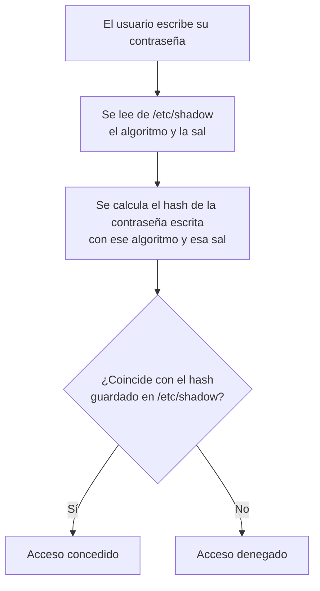
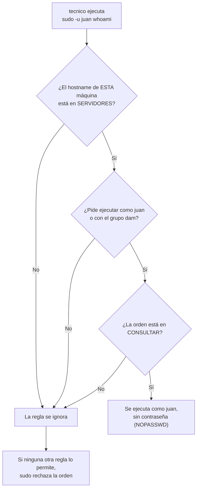
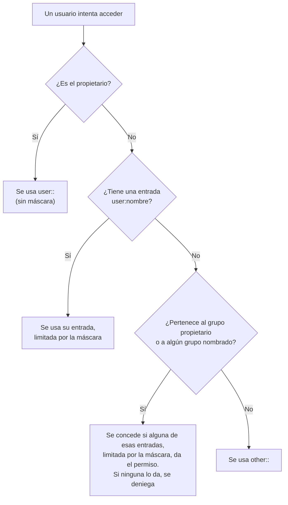

# Gestión de usuarios y permisos

## Índice

1. [Archivos de configuración](#1-archivos-de-configuración)
   1. [/etc/passwd](#11-etcpasswd)
   2. [/etc/shadow](#12-etcshadow)
   3. [/etc/group](#13-etcgroup)
   4. [/etc/gshadow](#14-etcgshadow)
2. [su y sudo](#2-su-y-sudo)
   1. [Diferencia entre `sudo -i` y `sudo su -`](#21-diferencia-entre-sudo--i-y-sudo-su--)
   2. [Opciones útiles de sudo y errores habituales](#22-opciones-útiles-de-sudo-y-errores-habituales)
3. [visudo y sudoers](#3-visudo-y-sudoers)
   1. [Ejemplo práctico: la misma regla en varias máquinas](#31-ejemplo-práctico-la-misma-regla-en-varias-máquinas)
   2. [id, groups, passwd](#32-id-groups-passwd)
4. [useradd, usermod, userdel, groupadd, groupdel](#4-useradd-usermod-userdel-groupadd-groupdel)
   1. [chage, chfn, chsh y passwd](#41-chage-chfn-chsh-y-passwd)
   2. [/etc/nologin](#42-etcnologin)
   3. [gpasswd](#43-gpasswd)
   4. [ulimit](#44-ulimit)
5. [Campo tipo](#5-campo-tipo)
6. [Permisos](#6-permisos)
   1. [Cómo se leen los permisos](#61-cómo-se-leen-los-permisos)
   2. [Significado en ficheros y en directorios](#62-significado-en-ficheros-y-en-directorios)
   3. [Cambiar los permisos: `chmod`](#63-cambiar-los-permisos-chmod)
   4. [Cambiar el propietario y el grupo: `chown` y `chgrp`](#64-cambiar-el-propietario-y-el-grupo-chown-y-chgrp)
7. [Máscara de permisos en Linux](#7-máscara-de-permisos-en-linux)
   1. [Cómo se calcula](#71-cómo-se-calcula)
   2. [Comando `umask`](#72-comando-umask)
   3. [Valores habituales y cómo hacerla permanente](#73-valores-habituales-y-cómo-hacerla-permanente)
8. [Permisos especiales: Setuid, Setgid, Sticky Bit](#8-permisos-especiales-setuid-setgid-sticky-bit)
   1. [Setuid (Set User ID - SUID)](#81-setuid-set-user-id---suid)
   2. [Setgid (Set Group ID - SGID)](#82-setgid-set-group-id---sgid)
   3. [Sticky bit](#83-sticky-bit)
9. [Comando install](#9-comando-install)
   1. [Opciones](#91-opciones)
   2. [Usos comunes](#92-usos-comunes)
   3. [Ejemplo completo: despliegue de una aplicación](#93-ejemplo-completo-despliegue-de-una-aplicación)
10. [Atributos de fichero y atributos extendidos](#10-atributos-de-fichero-y-atributos-extendidos)
    1. [Atributos de fichero: `chattr` y `lsattr`](#101-atributos-de-fichero-chattr-y-lsattr)
    2. [Atributos extendidos (xattr)](#102-atributos-extendidos-xattr)
11. [ACLs](#11-acls)
    1. [Soporte de ACL en el sistema de ficheros](#111-soporte-de-acl-en-el-sistema-de-ficheros)
    2. [Cómo funcionan las ACL](#112-cómo-funcionan-las-acl)
    3. [Órdenes setfacl y getfacl](#113-órdenes-setfacl-y-getfacl)
    4. [Prácticas](#114-prácticas)
    5. [Explicación paso a paso](#115-explicación-paso-a-paso)
    6. [Resumen](#116-resumen)
12. [Capabilities](#12-capabilities)
    1. [Principales capabilities](#121-principales-capabilities)
    2. [Capabilities de un fichero: los conjuntos `e`, `p` e `i`](#122-capabilities-de-un-fichero-los-conjuntos-e-p-e-i)
    3. [Órdenes para gestionar capabilities](#123-órdenes-para-gestionar-capabilities)
    4. [Ejemplo: abrir el puerto 80 sin ser root](#124-ejemplo-abrir-el-puerto-80-sin-ser-root)
    5. [Riesgos: escalada de privilegios con capabilities](#125-riesgos-escalada-de-privilegios-con-capabilities)
13. [Comandos para ver a usuarios conectados en el sistema](#13-comandos-para-ver-a-usuarios-conectados-en-el-sistema)
14. [Comando loginctl](#14-comando-loginctl)

---

## 1. Archivos de configuración

Linux guarda toda la información de usuarios y grupos en cuatro ficheros de texto dentro de `/etc`, con una línea por usuario o por grupo y los campos separados por dos puntos (`:`). Dos de ellos son públicos y los puede leer cualquier usuario; los otros dos guardan las contraseñas y solo los puede leer `root` y el grupo `shadow`:

| Fichero | Qué contiene | Permisos |
|---|---|---|
| `/etc/passwd` | Las cuentas de usuario. | `rw-r--r--` `root:root`, legible por todos. |
| `/etc/shadow` | Las contraseñas de los usuarios y su caducidad. | `rw-r-----` `root:shadow`. |
| `/etc/group` | Los grupos y sus miembros. | `rw-r--r--` `root:root`, legible por todos. |
| `/etc/gshadow` | Las contraseñas y los administradores de los grupos. | `rw-r-----` `root:shadow`. |

> **Nota:** Estos ficheros no se suelen editar a mano, sino con las órdenes de la sección 4 (`useradd`, `usermod`, `passwd`, `gpasswd`...). Si hay que hacerlo, se usan `vipw` y `vigr` (`vipw -s` y `vigr -s` para `shadow` y `gshadow`), que bloquean el fichero mientras se edita para que ninguna otra orden lo modifique a la vez.

Además de estos cuatro, hay otros ficheros que intervienen en la gestión de usuarios:

| Fichero | Qué contiene |
|---|---|
| `/etc/login.defs` | Los valores por defecto de las cuentas: rangos de UID y GID, caducidad de las contraseñas, `umask` (sección 7), algoritmo de cifrado de las contraseñas de grupo... |
| `/etc/default/useradd` | Los valores por defecto de `useradd`, como la shell (sección 4). |
| `/etc/skel/` | La plantilla del directorio personal de los usuarios nuevos (sección 4). |
| `/etc/shells` | Las shells que los usuarios pueden elegir con `chsh` (apartado 4.1). |
| `/etc/sudoers` | Quién puede usar `sudo` y para qué (sección 3). |

### 1.1 /etc/passwd

Almacena información sobre los usuarios del sistema, como el nombre de usuario, sus identificadores, el directorio personal y la shell. Tiene una línea por usuario, con siete campos:

```bash
martin:x:1000:1000:Martin Gil,23,666777888,981234567:/home/martin:/bin/bash
```

| Campo | Valor | Significado |
|:-:|---|---|
| 1 | `martin` | El **nombre de usuario** (*login*). |
| 2 | `x` | Antiguamente, la contraseña cifrada. Como este fichero lo puede leer cualquiera, hoy la contraseña se guarda en `/etc/shadow` y aquí solo queda una `x`. |
| 3 | `1000` | El **UID**, el número que identifica al usuario. El sistema trabaja siempre con este número, no con el nombre (sección 4). |
| 4 | `1000` | El **GID** de su **grupo principal**: el grupo con el que se crean sus ficheros. El nombre de ese grupo se busca en `/etc/group`. |
| 5 | `Martin Gil,23,666777888,981234567` | El **comentario** o campo GECOS: nombre completo, despacho, teléfono del trabajo y teléfono de casa, separados por comas. Es informativo; se modifica con `chfn` (apartado 4.1). |
| 6 | `/home/martin` | El **directorio personal**, en el que empieza la sesión. |
| 7 | `/bin/bash` | La **shell** que se ejecuta al iniciar sesión. Si es `/usr/sbin/nologin` o `/bin/false`, el usuario no puede iniciar sesión (sección 4). |

Como es un fichero de texto con los campos separados por `:`, se puede consultar con las órdenes de tratamiento de texto (documentos 18 y 19):

```bash
usuario@debian:~$ cut -d: -f1 /etc/passwd                     # todos los nombres de usuario
usuario@debian:~$ awk -F: '$3 >= 1000 {print $1}' /etc/passwd   # solo los usuarios normales
usuario@debian:~$ grep '^martin:' /etc/passwd                    # la línea de un usuario
```

> **Nota:** Los usuarios no tienen por qué estar en `/etc/passwd`: pueden venir de un directorio LDAP o de un dominio de Active Directory (documentos de sistemas operativos en red). La orden `getent passwd martin` busca un usuario en **todas** las fuentes configuradas, no solo en el fichero, por eso es la forma más fiable de consultarlo. Lo mismo ocurre con los grupos: `getent group dam`.

### 1.2 /etc/shadow

Contiene las contraseñas cifradas de los usuarios y los datos de su caducidad.

```bash
martin:$6$QeYgJjn3$WUebH8Ku2cb3ZOUVpqA3c.zrCzH38hJrM7m3cE8HQitQBr6FF/4Ussq/gnGzBomMBmCxgjyQamLE8V3GHe.rn1:18792:0:99999:7:::
```

1. `martin`: Nombre de usuario.
2. `$6$QeYgJjn3$WUebH8Ku2cb3ZOUVpqA3c.zrCzH38hJrM7m3cE8HQitQBr6FF/4Ussq/gnGzBomMBmCxgjyQamLE8V3GHe.rn1`: Contraseña cifrada. Se explica en detalle a continuación.
3. `18792`: Fecha del último cambio de contraseña, en días desde el 1 de enero de 1970. En este caso, el 14 de junio de 2021.
4. `0`: Días mínimos requeridos antes de poder cambiar la contraseña nuevamente.
5. `99999`: Días máximos que puede usarse la contraseña antes de que expire.
6. `7`: Días de aviso antes de que la contraseña expire.
7. ``: Días de inactividad permitidos después de que la contraseña ha expirado (vacío significa sin restricción).
8. ``: Fecha de expiración de la cuenta (vacío significa que la cuenta no expira).
9. ``: Campo reservado para uso futuro.

> **Recuerda:** La orden `sudo chage -l martin` muestra los campos 3 a 8 de forma legible, con las fechas ya convertidas.

**La contraseña cifrada en detalle**

El segundo campo no guarda la contraseña, sino un **hash** de ella: el resultado de pasarla por una función matemática que funciona **en un solo sentido**. A partir de la contraseña es fácil calcular el hash, pero a partir del hash es imposible obtener la contraseña. Por eso, aunque se suele decir «contraseña cifrada», en realidad no está cifrada: nadie, ni siquiera `root`, puede descifrarla.

El campo tiene tres partes separadas por el carácter `$`:

```text
$6$QeYgJjn3$WUebH8Ku...GHe.rn1
 │    │          │
 │    │          └── hash: el resultado de aplicar SHA-512 a la contraseña junto con la sal
 │    └── sal: cadena aleatoria generada al establecer la contraseña
 └── identificador del algoritmo: 6 = SHA-512
```

| Parte | Valor en el ejemplo | Significado |
|---|---|---|
| Algoritmo | `6` | Indica qué función se ha usado para calcular el hash. `6` es SHA-512. |
| Sal | `QeYgJjn3` | Caracteres aleatorios que se mezclan con la contraseña antes de calcular el hash. Puede tener hasta 16 caracteres. |
| Hash | `WUebH8Ku2cb3...GHe.rn1` | El resultado: 512 bits escritos como 86 caracteres del alfabeto `./0-9A-Za-z`. |

Los identificadores de algoritmo más habituales son:

| Identificador | Algoritmo | Uso |
|---|---|---|
| `$1$` | MD5 | Obsoleto e inseguro. |
| `$5$` | SHA-256 | Poco habitual. |
| `$6$` | SHA-512 | El predeterminado en Debian hasta la versión 10. |
| `$y$` | yescrypt | El predeterminado desde Debian 11 y Ubuntu 22.04. |

Por eso las contraseñas de los demás ejemplos del documento, creadas en sistemas más modernos, empiezan por `$y$`. En yescrypt aparece una parte más, por ejemplo `$y$j9T$sal$hash`, donde `j9T` codifica el **coste** del algoritmo: cuánta memoria y cuánto tiempo hace falta para calcular cada hash. Cuanto más lento es calcularlo, más lento es también probar contraseñas por fuerza bruta. SHA-512 consigue el mismo efecto repitiendo el cálculo 5000 veces por defecto, un número que se puede aumentar con un campo `rounds=N` (`$6$rounds=100000$sal$hash`).

**Cómo se comprueba la contraseña al iniciar sesión**

Como el hash no se puede descifrar, el sistema hace el mismo cálculo con la contraseña que escribe el usuario y compara los resultados:



**Para qué sirve la sal**

Si el hash se calculara solo a partir de la contraseña, **dos usuarios con la misma contraseña tendrían el mismo hash**, y bastaría ver `/etc/shadow` para saber que comparten contraseña. Además, un atacante podría calcular por adelantado los hashes de millones de contraseñas habituales (las llamadas **tablas arcoíris**, *rainbow tables*) y buscar en ellas el hash robado, sin calcular nada en el momento.

La sal evita las dos cosas: cada vez que se establece una contraseña se genera una sal aleatoria nueva, de modo que **la misma contraseña produce un hash diferente cada vez**. Se puede comprobar con `openssl passwd`, que calcula hashes con el mismo formato que `/etc/shadow`. Al generar dos veces el hash de `abc123.`, se obtienen dos resultados distintos, porque cada uno tiene su propia sal:

```bash
martin@debian:~$ openssl passwd -6 'abc123.'
$6$/p7eH13yizrc9Gi9$cUx/1LW2nZJkznTGFlcj2kAgDc6WZuzLKKoePKsHW.Hr4Ogf9GgQvyYQJ0z68xkKSmZcrrUkMy5Erbr1W/23w.
martin@debian:~$ openssl passwd -6 'abc123.'
$6$ogVb0EeeJv5pbjq0$9dQ9dOc8/jKV39QInqp3TwKWi8/IRFPTcHOm8C.912XV2yFLk4/zUi37aGX5vR6KWYPTVIuWGr8ZKV2MIRuYE1
```

En cambio, si se fija la sal con `-salt`, el resultado es siempre el mismo. Es exactamente lo que hace el sistema al iniciar sesión, cuando reutiliza la sal guardada en `/etc/shadow`:

```bash
martin@debian:~$ openssl passwd -6 -salt QeYgJjn3 'abc123.'
$6$QeYgJjn3$ZjZp0qtOZNxkXunHcyiuTCMGCjx0TUk935RjRuwzjOsljN.CPlQkOp..O2CP4uSK/onh5c/dPiAhJNh0kWUX4/
martin@debian:~$ openssl passwd -6 -salt QeYgJjn3 'abc123.'
$6$QeYgJjn3$ZjZp0qtOZNxkXunHcyiuTCMGCjx0TUk935RjRuwzjOsljN.CPlQkOp..O2CP4uSK/onh5c/dPiAhJNh0kWUX4/
```

Con la misma sal que la línea de `martin`, el hash sale distinto del suyo, lo que indica que su contraseña no es `abc123.`.

> **Importante:** La sal **no es secreta**: se guarda a la vista, junto al hash. Su función no es ocultar nada, sino hacer que cada hash sea único. Así, un atacante que robe `/etc/shadow` no sabe qué usuarios comparten contraseña, no le sirven las tablas precalculadas y tiene que atacar cada hash por separado.

Además de un hash, el segundo campo puede contener algunos valores especiales:

| Valor | Significado |
|---|---|
| `!` delante del hash | Cuenta **bloqueada** con `passwd -l` o `usermod -L` (apartado 3.2). Al desbloquearla se quita el `!` y vuelve a valer la contraseña de antes. |
| `!` o `*` solos | La cuenta **no tiene contraseña válida**: no se puede entrar con contraseña. Es lo habitual en las cuentas de sistema de los servicios. |
| Vacío | La cuenta **no tiene contraseña** y se entra sin escribir nada. Es peligroso y no se debe dejar así. |

### 1.3 /etc/group

Guarda los grupos del sistema y la lista de usuarios que pertenecen a cada uno.

```bash
dam:x:1001:martin,lucas
```

1. `dam`: Nombre del grupo.
2. `x`: Contraseña del grupo. La `x` indica que, si existe, está en `/etc/gshadow`.
3. `1001`: GID (identificador de grupo).
4. `martin,lucas`: Usuarios que tienen este grupo como grupo **secundario**, separados por comas. Los usuarios que lo tienen como grupo principal no aparecen aquí, sino en el cuarto campo de su línea de `/etc/passwd`.

### 1.4 /etc/gshadow

Es el equivalente a `/etc/shadow` para los grupos: guarda la contraseña de cada grupo y quién lo administra.

```bash
dam:$6$7fHs2LqA$qGa/DnpLlxgvYmtx5VLx/xp.Raj4AETiQecwAxqBdo7BZzS5MBYofFY./3UodNGWmZCvrcKkgTZ.OEjRPz4nJ0:moncho:martin,lucas
```

1. `dam`: Nombre del grupo.
2. `$6$7fHs2LqA$qGa/...nJ0`: Contraseña cifrada del grupo, con el mismo formato que en `/etc/shadow`. Si vale `!` o `*`, el grupo no tiene contraseña.
3. `moncho`: Administradores del grupo, separados por comas. Pueden añadir y quitar miembros y cambiar la contraseña del grupo con `gpasswd` sin ser `root`.
4. `martin,lucas`: Miembros del grupo. Debe coincidir con el cuarto campo de `/etc/group`.

**Para qué sirve la contraseña de un grupo**

La contraseña de un grupo permite que un usuario que **no es miembro** del grupo se una a él **temporalmente**, si la conoce. Para ello usa la orden `newgrp`, que abre una shell nueva en la que el grupo indicado pasa a ser su grupo principal. Los miembros del grupo pueden usar `newgrp` sin que se les pida contraseña. Si el grupo no tiene contraseña (`!`), solo los miembros pueden usarlo.

Ejemplo: la carpeta `/srv/dam` solo es accesible para el grupo `dam`, y `ana`, que no es miembro, necesita dejar en ella un fichero. Primero, `root` prepara la carpeta y asigna una contraseña al grupo con `gpasswd`:

```bash
root@debian:~# mkdir /srv/dam
root@debian:~# chown root:dam /srv/dam
root@debian:~# chmod 770 /srv/dam
root@debian:~# gpasswd dam
Changing the password for group dam
New Password:
Re-enter new password:
```

`ana` no puede escribir en la carpeta hasta que se une al grupo con `newgrp` y escribe la contraseña del grupo:

```bash
ana@debian:~$ id
uid=1003(ana) gid=1003(ana) groups=1003(ana)
ana@debian:~$ touch /srv/dam/informe.txt
touch: cannot touch '/srv/dam/informe.txt': Permission denied
ana@debian:~$ newgrp dam
Password:
ana@debian:~$ id
uid=1003(ana) gid=1001(dam) groups=1001(dam),1003(ana)
ana@debian:~$ touch /srv/dam/informe.txt
ana@debian:~$ stat -c '%U %G' /srv/dam/informe.txt
ana dam
ana@debian:~$ exit
exit
ana@debian:~$ id
uid=1003(ana) gid=1003(ana) groups=1003(ana)
```

Dentro de la shell que abre `newgrp`, el grupo principal de `ana` es `dam`, así que puede escribir en la carpeta y el fichero que crea pertenece a ese grupo. Al salir con `exit`, vuelve a la shell anterior con sus grupos de siempre. `ana` no se ha convertido en miembro: `/etc/group` no ha cambiado.

Otras órdenes relacionadas:

| Orden | Para qué sirve |
|---|---|
| `sg dam -c "touch /srv/dam/otro.txt"` | Ejecuta una sola orden con el grupo `dam`, sin abrir una shell nueva. Pide la contraseña igual que `newgrp`. |
| `gpasswd -r dam` | Elimina la contraseña del grupo. A partir de ese momento, solo los miembros pueden usar `newgrp dam`. |
| `gpasswd -A moncho dam` | Nombra a `moncho` administrador del grupo (apartado 4.3). |

> **Nota:** El algoritmo con el que se cifra la contraseña de grupo depende de la directiva `ENCRYPT_METHOD` de `/etc/login.defs`, ya que `gpasswd` la cifra por su cuenta, sin pasar por el mismo sistema que `passwd`.

> **Advertencia:** Las contraseñas de grupo apenas se usan en la práctica: es una contraseña **compartida** por todos los que la conocen, que no deja rastro de quién la usa y que hay que cambiar cada vez que alguien deja de necesitarla. Lo habitual es añadir al usuario al grupo de forma permanente con `sudo gpasswd -a ana dam` o `sudo usermod -aG dam ana`. El cambio se aplica en el siguiente inicio de sesión de `ana`, aunque mientras tanto puede usar `newgrp dam`, que ya no le pedirá contraseña porque es miembro.

---

## 2. su y sudo

Muchas tareas de administración solo las puede hacer `root`, pero no es buena idea iniciar sesión directamente como `root`. Lo habitual es trabajar con un usuario normal y obtener privilegios solo cuando hacen falta. Para eso existen dos órdenes, `su` y `sudo`, que permiten actuar como otro usuario. En esta sección se ve qué hace cada una y en qué se diferencian sus variantes.

**`su`** (*substitute user*, «sustituir usuario») **abre una shell como otro usuario**. Si no se indica ningún usuario, abre una shell de `root`. Pide la **contraseña del usuario de destino**: para ser `root` con `su` hay que conocer la contraseña de `root`.

```bash
martin@debian:~$ su -
Contraseña:
root@debian:~#
```

La contraseña que se escribe aquí es la de `root`. Solo `root` puede usar `su` sin que se le pida ninguna contraseña. Si `root` no tiene contraseña, como en Ubuntu, `su -` falla con `su: Authentication failure`.

**`sudo`** (*superuser do*, «hacer como superusuario») **ejecuta una orden como otro usuario**, que por defecto es `root`. Pide la **contraseña del propio usuario**, no la de `root`, y solo deja hacerlo si el fichero `/etc/sudoers` lo autoriza (sección 3). Después de escribir la contraseña, no la vuelve a pedir durante 15 minutos.

```bash
martin@debian:~$ sudo apt update
[sudo] contraseña para martin:
```

La contraseña que se escribe aquí es la de `martin`.

| | `su` | `sudo` |
|---|---|---|
| Qué hace | Abre una shell como otro usuario. | Ejecuta una orden como otro usuario. También puede abrir una shell (`sudo -i`, `sudo -s`). |
| Contraseña que pide | La del usuario de destino. | La del propio usuario. |
| Quién puede usarlo | Cualquiera que conozca la contraseña de destino. | Solo quien esté autorizado en `/etc/sudoers`. |
| Control | Todo o nada: quien conoce la contraseña de `root` lo puede hacer todo. | Se puede limitar por usuario, por orden y por equipo. |
| Registro | Solo queda constancia del cambio de usuario. | Cada orden ejecutada con `sudo` queda registrada en el *journal* (`journalctl`). |

> **Nota:** En **Ubuntu**, la cuenta de `root` no tiene contraseña, así que `su -` no funciona y todo se hace con `sudo`. En **Debian**, depende de la instalación: si se escribió una contraseña para `root`, el usuario creado no queda en el grupo `sudo` y se usa `su`; si se dejó en blanco, `root` queda bloqueado y el usuario recibe permisos de `sudo`, igual que en Ubuntu.

Las variantes más habituales son:

```bash
martin@debian:~$ sudo su -
martin@debian:~$ sudo su
martin@debian:~$ sudo -i
martin@debian:~$ sudo -s
martin@debian:~$ su juan
martin@debian:~$ su - juan
martin@debian:~$ su - juan -c "pwd"
martin@debian:~$ su -l juan
martin@debian:~$ su -c "pwd"
```

1. `sudo su -`: Inicia una shell de `root` cargando su entorno de inicio de sesión. Se explica junto con `sudo -i` en el apartado 2.1.
2. `sudo su`: Inicia una shell de `root` **sin** cargar su entorno de inicio de sesión: se queda en el directorio actual y no lee los ficheros de inicio de `root`, como `/root/.profile`.
3. `sudo -i`: Inicia una shell de `root` cargando su entorno de inicio de sesión (apartado 2.1).
4. `sudo -s`: Inicia una shell de `root` sin cargar su entorno de inicio de sesión. Es el equivalente directo de `sudo su`.
5. `su juan`: Cambia al usuario `juan` iniciando una nueva shell, pero sin cargar su entorno de inicio de sesión.
6. `su - juan`: Cambia al usuario `juan` iniciando una nueva shell y cargando su entorno de inicio de sesión.
7. `su - juan -c "pwd"`: Ejecuta la orden `pwd` como el usuario `juan` y vuelve al usuario actual.
8. `su -l juan`: Equivalente a `su - juan`.
9. `su -c "pwd"`: Ejecuta la orden `pwd` como `root`, pidiendo la contraseña de `root`, y vuelve al usuario actual.

> **Recuerda:** Cargar el **entorno de inicio de sesión** significa empezar como si el usuario acabara de iniciar sesión: el directorio de trabajo pasa a ser su directorio personal y se leen sus ficheros de inicio (`~/.profile`, `~/.bashrc`), con sus variables y alias. Sin el guion, la shell nueva conserva el directorio actual y buena parte del entorno del usuario anterior.

### 2.1 Diferencia entre `sudo -i` y `sudo su -`

Las dos órdenes llegan al **mismo resultado**: una shell de `root` con su entorno de inicio de sesión. Lo que cambia es el camino:

```text
sudo -i     martin ──▶ sudo ──────────▶ bash de root (con entorno de inicio de sesión)
sudo su -   martin ──▶ sudo ──▶ su ───▶ bash de root (con entorno de inicio de sesión)
```

- Con **`sudo -i`**, es `sudo` quien abre directamente la shell de `root`.
- Con **`sudo su -`**, `sudo` ejecuta como `root` la orden `su -`, y es `su` quien abre la shell. Como `su` lo ejecuta `root`, no pide la contraseña de `root`. Solo se escribe una vez la contraseña de `martin`, la que pide `sudo`.

Por eso `sudo su -` funciona en Ubuntu, donde `root` no tiene contraseña: `su -` a secas fallaría, pero precedido de `sudo` no necesita ninguna contraseña de `root`.

| | `sudo -i` | `sudo su -` |
|---|---|---|
| Quién abre la shell | `sudo`. | `su`, ejecutado por `sudo`. |
| Contraseña que se pide | La de `martin`. | La de `martin`. |
| Qué queda registrado | Que `martin` ejecutó una shell (`COMMAND=/bin/bash`). | Que `martin` ejecutó `su` (`COMMAND=/usr/bin/su -`). |
| Permiso necesario en `sudoers` | Ejecutar la shell de `root`. | Ejecutar `/usr/bin/su`. |
| Como otro usuario | `sudo -i -u juan` | `sudo su - juan` |
| Una sola orden con el entorno de inicio de sesión | `sudo -i orden` | `sudo su - -c "orden"` |

En la práctica son equivalentes. `sudo su -` es una costumbre heredada de los sistemas en los que se usaba `su`; `sudo -i` es la forma directa, con un programa menos de por medio, y la que se recomienda.

La diferencia que sí se nota es la del guion, es decir, entre cargar o no el entorno de inicio de sesión. Se ve en el directorio en el que empieza la shell. Desde `~/Documentos`, con `sudo -i` la shell de `root` empieza en su directorio personal:

```bash
martin@debian:~/Documentos$ sudo -i
root@debian:~# pwd
/root
```

Con `sudo su`, en cambio, se queda en el directorio en el que estaba `martin`:

```bash
martin@debian:~/Documentos$ sudo su
root@debian:/home/martin/Documentos# pwd
/home/martin/Documentos
```

`sudo -i` y `sudo su -` se comportan como el primer caso; `sudo -s` y `sudo su`, como el segundo.

> **Importante:** Ni `sudo -i` ni `sudo su -` registran las órdenes que se escriben **dentro** de la shell de `root`: en el registro solo consta que se abrió una shell. Si interesa saber qué hace cada administrador, es mejor usar `sudo orden` para cada tarea en lugar de abrir una shell de `root`.

Para salir de cualquiera de estas shells y volver al usuario anterior se usa `exit` (o `Ctrl+D`).

### 2.2 Opciones útiles de sudo y errores habituales

| Orden | Qué hace |
|---|---|
| `sudo orden` | Ejecuta la orden como `root`. |
| `sudo -u juan orden` | Ejecuta la orden como el usuario `juan` (sección 3). |
| `sudo -g dam orden` | Ejecuta la orden con el grupo `dam`. |
| `sudo -l` | Muestra qué puede hacer el usuario actual con `sudo` en esta máquina. |
| `sudo -v` | Renueva los 15 minutos durante los que `sudo` no vuelve a pedir la contraseña. |
| `sudo -k` | Olvida la contraseña: la próxima orden con `sudo` la volverá a pedir. |
| `sudo -e fichero` o `sudoedit fichero` | Edita un fichero del sistema de forma segura (sección 3, «Los argumentos de las órdenes»). |
| `sudo !!` | Repite la última orden, esta vez con `sudo`. Útil cuando se ha olvidado ponerlo. `!!` es una expansión del historial de Bash (documento 21). |

```bash
martin@debian:~$ cat /etc/shadow
cat: /etc/shadow: Permiso denegado
martin@debian:~$ sudo !!
sudo cat /etc/shadow
[sudo] contraseña para martin:
```

**Error habitual: `sudo` y las redirecciones**

`sudo` solo da privilegios a la **orden** que va detrás, no a la redirección. La redirección (`>`, `>>`) la hace la shell del usuario **antes** de ejecutar `sudo`, y por tanto sin privilegios:

```bash
martin@debian:~$ sudo echo "192.168.1.10 servidor" >> /etc/hosts
-bash: /etc/hosts: Permiso denegado
```

La forma correcta es que quien escriba en el fichero sea un programa ejecutado con `sudo`. Se usa `tee`, que escribe en un fichero lo que recibe; con `-a`, lo añade al final:

```bash
martin@debian:~$ echo "192.168.1.10 servidor" | sudo tee -a /etc/hosts
192.168.1.10 servidor
```

`tee` muestra además el texto por pantalla; para evitarlo se añade `> /dev/null` al final. Otra opción es ejecutar toda la orden en una shell de `root`: `sudo sh -c 'echo "192.168.1.10 servidor" >> /etc/hosts'`.

**Error habitual: «orden no encontrada» con `sudo`**

`sudo` no usa el `PATH` del usuario, sino el que fija la opción `secure_path` de `sudoers` (sección 3), que solo incluye las carpetas del sistema. Un programa o *script* que esté en `~/bin` o en otra carpeta personal se encuentra sin `sudo`, pero no con él. La solución es indicar su ruta completa: `sudo ~/bin/copia.sh`.

**Ver qué se ha hecho con `sudo`**

Cada uso de `sudo` queda registrado en el *journal* (documento 40), con el usuario, la terminal, el directorio y la orden ejecutada:

```bash
root@debian:~# journalctl _COMM=sudo
nov 02 12:40:11 debian sudo[2817]:   martin : TTY=pts/0 ; PWD=/home/martin ; USER=root ; COMMAND=/usr/bin/apt update
```

> **Nota:** En Ubuntu 26.04, que usa `sudo-rs` (sección 3), los mensajes cambian ligeramente: la contraseña se pide con `[sudo: authenticate] Password:` y el formato del registro es distinto, pero las opciones de esta tabla funcionan igual.

---

## 3. visudo y sudoers

En esta sección se ve cómo se decide quién puede usar `sudo`, como qué usuario y para ejecutar qué órdenes.

`sudoers` (`/etc/sudoers`) es el fichero donde se especifican esas reglas: quién puede ejecutar qué órdenes, como qué usuario y en qué equipos.

`visudo` es la orden que se usa para modificarlo. Abre el fichero en un editor y, al guardar, **comprueba la sintaxis** antes de aplicar los cambios. Esto es importante porque un error en `sudoers` deja `sudo` inutilizable y, en sistemas como Ubuntu, sin otra forma de obtener privilegios de `root`. En lugar de modificar el fichero principal, se pueden crear ficheros propios en `/etc/sudoers.d/`, que también se editan con `visudo`:

```bash
martin@debian:~$ sudo visudo
martin@debian:~$ sudo visudo -f /etc/sudoers.d/martin
martin@debian:~$ sudo visudo -c
```

La última orden, `visudo -c`, solo comprueba la sintaxis de `sudoers` y de los ficheros de `/etc/sudoers.d/`, sin abrir el editor. `visudo` usa el editor que indique la variable `EDITOR`, o el predeterminado del sistema, que en Debian y Ubuntu suele ser `nano`; para usar otro: `sudo EDITOR=vim visudo`.

> **Advertencia:** Los ficheros de `/etc/sudoers.d/` cuyo nombre **contiene un punto** o **termina en `~`** se ignoran, para que no se carguen por error copias de seguridad como `martin.bak` o `martin~`. Un fichero llamado `martin.conf` no tendría ningún efecto, y no se mostraría ningún error: hay que llamarlo simplemente `martin`.

> **Nota:** Para que un usuario sea **administrador** no hace falta editar `sudoers`: basta con añadirlo al grupo `sudo` (`usermod -aG sudo ana`, sección 4), que ya tiene una regla que se lo permite todo. En Red Hat y Fedora, ese grupo se llama `wheel`. Editar `sudoers` solo es necesario para dar permisos **limitados**, como en los ejemplos que siguen.

**Estructura del fichero**

Lo esencial del fichero `/etc/sudoers` que trae Debian es lo siguiente:

```text
Defaults        env_reset
Defaults        mail_badpass
Defaults        secure_path="/usr/local/sbin:/usr/local/bin:/usr/sbin:/usr/bin:/sbin:/bin"
Defaults        use_pty

# User privilege specification
root    ALL=(ALL:ALL) ALL

# Allow members of group sudo to execute any command
%sudo   ALL=(ALL:ALL) ALL

@includedir /etc/sudoers.d
```

| Parte | Qué hace |
|---|---|
| Líneas `Defaults` | Opciones generales. `env_reset` limpia las variables de entorno del usuario antes de ejecutar la orden, y `secure_path` fija las carpetas en las que `sudo` busca los programas, sin usar el `PATH` del usuario. |
| `root ALL=(ALL:ALL) ALL` | `root` puede ejecutar cualquier orden. |
| `%sudo ALL=(ALL:ALL) ALL` | Los miembros del grupo `sudo` también. Es la regla que hace administradores a los miembros de ese grupo. |
| `@includedir /etc/sudoers.d` | Carga además todos los ficheros de `/etc/sudoers.d/`. Va al final, así que sus reglas quedan detrás de las anteriores. |

En la regla `%sudo ALL=(ALL:ALL) ALL`, cada `ALL` tiene un significado distinto, según su posición:

```text
%sudo   ALL   =   (ALL   :   ALL)   ALL
  │      │          │         │      │
  │      │          │         │      └── cualquier orden
  │      │          │         └── como cualquier grupo
  │      │          └── como cualquier usuario
  │      └── en cualquier máquina
  └── los miembros del grupo sudo
```

> **Recuerda:** Cuando varias reglas se aplican a la misma orden, **gana la última** que aparece en el fichero. Se ve con un ejemplo en el apartado 3.1.

Un ejemplo de reglas:

```bash
# Alias
Cmnd_Alias RECARGAR_SSH = /usr/bin/systemctl restart ssh.service
Host_Alias SERVIDORES = srv1, srv2, srv3

# User privilege specification
root    ALL=(ALL:ALL) ALL

# Allow members of group sudo to execute any command
%sudo   ALL=(ALL:ALL) ALL

martin srv1,srv2=(juan:dam) NOPASSWD: /bin/pwd

%asir srv1,srv2=(juan:dam) /bin/pwd

martin SERVIDORES=(root) NOPASSWD: RECARGAR_SSH
```

**Desglose de la línea**

```text
martin   srv1,srv2 = (juan:dam)      NOPASSWD:   /bin/pwd
usuario  host(s)     (usuario:grupo) etiqueta    orden
```

- `martin`: el usuario al que se aplica la regla. Si empieza por `%`, como `%asir`, es un **grupo**, y la regla se aplica a todos sus miembros.
- `srv1,srv2`: las **máquinas en las que la regla es válida**, indicadas por su nombre. Se explica en detalle a continuación.
- `(juan:dam)`: puede ejecutar la orden como el usuario `juan`, opcionalmente con el grupo `dam`.
- `NOPASSWD:`: no se le pedirá contraseña al ejecutarla.
- `/bin/pwd`: la única orden permitida. Las órdenes se escriben siempre con la ruta completa.

**Cómo funciona el campo del host**

El campo del host existe porque `sudoers` se pensó para ser **un único fichero compartido entre muchas máquinas**, distribuido con LDAP, Ansible, NFS... El host sirve para decir «esta regla solo vale en estos equipos». En un fichero que solo se usa en una máquina, lo normal es poner `ALL`.

`sudo` **no traduce esos nombres a direcciones IP** ni consulta `/etc/hosts` o el DNS. Cada máquina se compara **solo consigo misma**: cuando `martin` ejecuta `sudo`, la máquina lee la regla y comprueba si **su propio nombre** está en la lista. Ese nombre es el que muestra la orden `hostname`, y está guardado en `/etc/hostname`:

```bash
martin@srv1:~$ hostname
srv1
```

Si el mismo fichero `sudoers` se copia a varias máquinas, la regla `martin srv1,srv2=...` da resultados distintos en cada una:

| Máquina en la que se ejecuta `sudo` | Su `hostname` | ¿Está en la lista? | Resultado |
|---|---|:-:|---|
| Primer servidor | `srv1` | Sí | La regla se aplica. |
| Segundo servidor | `srv2` | Sí | La regla se aplica. |
| Un equipo de usuario | `cliente` | No | La regla se ignora. |

La IP de cada máquina no interviene. Si a `srv2` se le cambia el nombre con `sudo hostnamectl set-hostname web01`, la regla deja de aplicarse en ella aunque conserve su IP. Tampoco importa desde dónde se haya conectado `martin`: por SSH desde otra máquina, en la consola local...

> **Nota:** Para probar las reglas cambiando el nombre de la máquina, hay que tener en cuenta que `sudo hostname web01` solo cambia el nombre **hasta el siguiente reinicio**. Para que el cambio sea **persistente** se usa `sudo hostnamectl set-hostname web01`, que lo guarda en `/etc/hostname`, y se actualiza también la línea `127.0.1.1` de `/etc/hosts`. Se explica en el apartado 4.6 del documento 31.

**¿Nombres de máquina o direcciones IP? Depende del `sudo`**

En el campo del host, el `sudo` clásico admite también direcciones IP y redes, como `192.168.1.14` o `192.168.1.0/24`. En ese caso, compara la IP de la regla con las de **sus propias interfaces de red**, nunca con la IP desde la que se conecta el usuario. Pero desde la versión 25.10, **Ubuntu usa `sudo-rs`**, una reimplementación de `sudo` en el lenguaje Rust, que es compatible en casi todo pero **solo admite nombres de máquina** (o `ALL`) en ese campo:

| Sistema | `sudo` que trae | ¿IP en el campo del host? | ¿Nombre de máquina? |
|---|---|:-:|:-:|
| Debian 13 | `sudo` clásico | Sí | Sí |
| Ubuntu 24.04 y anteriores | `sudo` clásico | Sí | Sí |
| Ubuntu 25.10, 26.04 y posteriores | `sudo-rs` | **No** | Sí |

Para saber cuál de los dos se está usando, basta con `sudo --version`: el clásico empieza por `Sudo version` y el nuevo, por `sudo-rs`.

En Ubuntu Server 26.04, `visudo` rechaza cualquier regla con una IP en el campo del host:

```bash
usuario@servidor:~$ sudo visudo
The provided sudoers file format is not recognized or contains syntax errors. Please review:

/tmp/sudoers-lmt5Pf/sudoers:48:7: syntax error: hosts cannot be specified using an IPv4 address
admin   192.168.100.5=(juan:dam) /bin/pwd
        ^~~~~~~~~~~~~

What now? e(x)it without saving / (e)dit again:
```

La solución es escribir el nombre de la máquina, en este caso `servidor`:

```bash
admin   servidor=(juan:dam) /bin/pwd
```

> **Recuerda:** Los nombres de máquina funcionan con los dos `sudo`, así que son la opción a usar si una misma regla tiene que servir en Debian y en Ubuntu. Las IP solo funcionan con el `sudo` clásico. En Ubuntu 26.04 todavía se puede volver a él con `sudo update-alternatives --config sudo`, pero es una solución temporal: Ubuntu planea retirarlo de su repositorio principal.

**Cómo lo usaría `martin` en el servidor**

La orden no es `sudo juan`, sino:

```bash
martin@srv1:~$ sudo -u juan /bin/pwd            # como juan
martin@srv1:~$ sudo -u juan -g dam /bin/pwd     # como juan, con el grupo dam
```

Como la regla de `martin` tiene `NOPASSWD`, no se le pedirá ninguna contraseña. En cambio, la regla del grupo `asir` no lo tiene, así que a sus miembros `sudo` les pedirá **su propia contraseña**, la de cada uno, nunca la de `juan`.

**Para comprobarlo**

- Como `martin`: `sudo -l` muestra las reglas que se le aplican **en esa máquina**. En una máquina que no se llame `srv1` ni `srv2`, la regla no aparecerá.
- Como `root`, con el `sudo` clásico (Debian): `sudo -V` muestra, entre otras cosas, el apartado `Local IP address and netmask pairs`, que son las IP con las que `sudo` compara el campo del host cuando se escriben direcciones IP.

**Si lo que se busca es limitar desde qué IP se conecta `martin`**

Eso no se hace en `sudoers`. Las opciones habituales son:

- **SSH**: en `/etc/ssh/sshd_config`, con `AllowUsers martin@192.168.1.14 martin@192.168.1.15` (documento 34).
- **PAM**: con el módulo `pam_access` y el fichero `/etc/security/access.conf`.
- **Cortafuegos**: filtrando por la IP de origen (documentos 44 y 46).

**Los alias**

Las dos primeras líneas del ejemplo definen **alias**, nombres que agrupan varios valores para no repetirlos en cada regla. `Cmnd_Alias` agrupa órdenes, `Host_Alias` agrupa equipos, `User_Alias` agrupa usuarios y `Runas_Alias` agrupa usuarios de destino. Sus nombres se escriben en mayúsculas.

Los alias son opcionales. `Host_Alias SERVIDORES = srv1, srv2, srv3` no dice nada de IP: solo le pone un nombre a esa lista de nombres de máquina. Usar `SERVIDORES` en una regla equivale a escribir `srv1,srv2,srv3`.

La última regla del ejemplo dice que, en las máquinas `srv1`, `srv2` y `srv3`, `martin` puede reiniciar el servicio SSH como `root` sin escribir contraseña:

```bash
martin@srv3:~$ sudo /usr/bin/systemctl restart ssh.service
```

**Los argumentos de las órdenes**

En una regla, una orden escrita **sin argumentos** permite ejecutarla **con cualquier argumento**; si se escriben argumentos, solo se permiten exactamente esos:

| En la regla | Permite |
|---|---|
| `/usr/bin/systemctl` | Cualquier uso de `systemctl`: reiniciar, parar o desactivar cualquier servicio. |
| `/usr/bin/systemctl restart ssh.service` | Solo reiniciar el servicio SSH. |
| `/usr/bin/systemctl ""` | Solo `systemctl` sin ningún argumento. |

Por eso conviene indicar siempre los argumentos cuando se da permiso para una tarea concreta, como hace el alias `RECARGAR_SSH`.

> **Advertencia:** Dar permiso de `sudo` sobre ciertos programas equivale a dar `root` completo, porque permiten ejecutar otras órdenes desde dentro. Es el caso de los editores (`vim`, `nano`), de los paginadores (`less`, `more`), de `find` (con `-exec`), de `awk`, de los intérpretes como `python3`... Desde `sudo vim`, por ejemplo, basta con escribir `:!bash` para abrir una shell de `root`. Para permitir que alguien edite un fichero del sistema se usa `sudoedit` (por ejemplo, `martin ALL=(root) sudoedit /etc/hosts`), que edita una copia con los permisos del propio usuario y solo después la guarda en su sitio. El recurso [GTFOBins](https://gtfobins.github.io/) recoge estos casos (apartado 12.5).

### 3.1 Ejemplo práctico: la misma regla en varias máquinas

En este ejemplo se comprueba, paso a paso, cómo decide `sudo` si una regla se aplica o no. Se usan dos máquinas virtuales con Ubuntu Server 26.04, llamadas `servidor` y `cliente`, y en las dos se configura **exactamente el mismo `sudoers`**, como ocurriría si el fichero se distribuyera a todos los equipos de una red. La única diferencia entre ellas será su nombre.

**Los usuarios**

En las dos máquinas existen los mismos usuarios:

| Usuario | Grupos | Papel en el ejemplo |
|---|---|---|
| `admin` | `admin`, `sudo` | El administrador: prepara las máquinas. |
| `tecnico` | `tecnico` | Un usuario **sin privilegios**: es a quien se le aplica la regla. |
| `juan` | `juan`, `dam` | El usuario de destino: `tecnico` ejecutará órdenes **como** `juan`. |

La regla no se prueba con `admin`, sino con un usuario sin privilegios. `admin` pertenece al grupo `sudo` y, gracias a la regla `%sudo ALL=(ALL:ALL) ALL`, puede ejecutar cualquier orden en cualquier máquina, así que con él no se vería cuándo se aplica la regla y cuándo no. Su caso se analiza al final.

**Paso 1. Crear los usuarios**

En las dos máquinas, como `admin` (si `juan` y el grupo `dam` ya existen, se omiten las dos primeras órdenes):

```bash
admin@servidor:~$ sudo groupadd dam
admin@servidor:~$ sudo useradd -m -s /bin/bash -G dam juan
admin@servidor:~$ sudo useradd -m -s /bin/bash tecnico
admin@servidor:~$ sudo passwd tecnico
```

**Paso 2. Escribir la regla**

En las dos máquinas, se abre `sudoers` con `sudo visudo` y se añade al final:

```bash
# Alias
Cmnd_Alias CONSULTAR = /usr/bin/whoami, /usr/bin/id
Host_Alias SERVIDORES = servidor, srv1

# Reglas
tecnico   SERVIDORES=(juan:dam) NOPASSWD: CONSULTAR
```

Leída en voz alta, la regla dice: «`tecnico`, **en las máquinas que se llamen `servidor` o `srv1`**, puede ejecutar `whoami` e `id` **como `juan`** (y con el grupo `dam`), **sin escribir contraseña**».

Se usan `whoami` e `id` porque muestran **con qué usuario y grupo** se está ejecutando la orden, que es justo lo que se quiere comprobar. Una orden como `pwd` solo mostraría el directorio, y su salida sería la misma la ejecutara quien la ejecutara.

**Paso 3. Cómo decide `sudo`**

Cada vez que `tecnico` ejecuta `sudo`, la máquina recorre la regla haciéndose tres preguntas. Solo si las tres se cumplen, la regla se aplica:



**Paso 4. Pruebas en `servidor`**

Se inicia sesión como `tecnico` en `servidor`. Su nombre está en `SERVIDORES`, así que la regla se aplica:

```bash
tecnico@servidor:~$ hostname
servidor
tecnico@servidor:~$ whoami
tecnico
tecnico@servidor:~$ sudo -u juan whoami
juan
tecnico@servidor:~$ sudo -u juan id
uid=1001(juan) gid=1002(juan) groups=1002(juan),1001(dam)
tecnico@servidor:~$ sudo -u juan id -Gn
juan dam
tecnico@servidor:~$ sudo -u juan -g dam id -gn
dam
```

- `whoami` sin `sudo` muestra `tecnico`; con `sudo -u juan`, muestra `juan`: la orden se ha ejecutado como `juan`.
- `id -gn` muestra el grupo con el que se ejecuta la orden. Con `-g dam`, es `dam`.
- En ningún momento se pide contraseña, por la etiqueta `NOPASSWD`.

La regla solo permite **esas órdenes** y **como ese usuario**. Cualquier otra cosa se rechaza, incluso en `servidor`:

```bash
tecnico@servidor:~$ sudo -u juan ls
sudo: I'm sorry tecnico. I'm afraid I can't do that
tecnico@servidor:~$ sudo whoami
sudo: I'm sorry tecnico. I'm afraid I can't do that
```

- `sudo -u juan ls`: `ls` no está en `CONSULTAR`.
- `sudo whoami`: sin `-u`, `sudo` intenta ejecutar la orden como `root`, y la regla solo permite hacerlo como `juan`.

**Paso 5. Pruebas en `cliente`**

Se inicia sesión como `tecnico` en `cliente` y se repite exactamente la misma orden:

```bash
tecnico@cliente:~$ hostname
cliente
tecnico@cliente:~$ sudo -u juan whoami
sudo: I'm sorry tecnico. I'm afraid I can't do that
```

El fichero `sudoers` es idéntico, los usuarios son los mismos y la orden también. Lo único que cambia es el nombre de la máquina: `cliente` no está en `SERVIDORES`, así que la primera pregunta del diagrama ya falla, la regla se ignora y `tecnico` no tiene ninguna otra regla que se lo permita.

**Paso 6. Convertir `cliente` en `srv1`**

Para comprobar que lo único que importa es el nombre, se cambia el nombre de la máquina `cliente` a `srv1`, que sí está en `SERVIDORES`, sin tocar su IP ni el fichero `sudoers`:

```bash
admin@cliente:~$ sudo hostnamectl set-hostname srv1
admin@cliente:~$ su - tecnico
Password:
tecnico@srv1:~$ sudo -u juan whoami
juan
```

Ahora la regla se aplica: la misma máquina, con la misma IP y el mismo `sudoers`, deja hacer a `tecnico` lo que antes le negaba. `su - tecnico` abre una sesión nueva, por eso su *prompt* ya muestra el nombre `srv1`; el de `admin` seguirá mostrando `cliente` hasta que abra otra sesión.

Al terminar, se devuelve a la máquina su nombre:

```bash
admin@cliente:~$ sudo hostnamectl set-hostname cliente
```

> **Nota:** `hostnamectl set-hostname` hace el cambio persistente. Si se va a dejar el nombre nuevo, hay que actualizar también la línea `127.0.1.1` de `/etc/hosts`, como se explica en el apartado 4.6 del documento 31.

**Paso 7. ¿Y qué pasa con `admin`?**

Si se repite la prueba como `admin`, la orden funciona **en todas las máquinas**, pero **pidiendo contraseña**:

```bash
admin@cliente:~$ sudo -u juan whoami
[sudo: authenticate] Password:
juan
```

La regla de `SERVIDORES` es solo para `tecnico`, así que a `admin` no se le aplica en ninguna máquina. Lo que le deja hacerlo es la regla de su grupo:

```bash
%sudo   ALL=(ALL:ALL) ALL
```

Permite a los miembros de `sudo` ejecutar **cualquier orden** (`ALL`), **como cualquier usuario o grupo** (`(ALL:ALL)`), **en cualquier máquina** (el primer `ALL`), pidiendo su contraseña.

| Orden: `sudo -u juan whoami` | En `servidor` | En `srv1` | En `cliente` |
|---|---|---|---|
| Como `tecnico` | Se ejecuta **sin contraseña** (regla de `SERVIDORES`). | Se ejecuta **sin contraseña** (regla de `SERVIDORES`). | **Se rechaza**: ninguna regla lo permite. |
| Como `admin` | Se ejecuta **pidiendo contraseña** (regla `%sudo`). | Se ejecuta **pidiendo contraseña** (regla `%sudo`). | Se ejecuta **pidiendo contraseña** (regla `%sudo`). |

> **Nota:** Después de escribir la contraseña, `sudo` no la vuelve a pedir durante 15 minutos. Para repetir la prueba desde cero, se usa `sudo -k`, que olvida la contraseña recordada.

Si también se quisiera que `admin` no escribiera contraseña en `servidor` y `srv1`, se añadiría una regla para él **después** de la línea `%sudo`:

```bash
admin     SERVIDORES=(juan:dam) NOPASSWD: CONSULTAR
```

En `servidor` y `srv1` se le aplicarían entonces dos reglas, `%sudo` y esta. Cuando varias reglas se aplican a la misma orden, **gana la última que aparece en el fichero**, que sería la que no pide contraseña. En `cliente` solo se le aplicaría `%sudo`, que sí la pide. Si la regla de `admin` estuviera **antes** de `%sudo`, ganaría `%sudo` y se pediría contraseña en todas las máquinas.

**¿Y si `tecnico` se conecta por SSH desde `cliente` a `servidor`?**

La regla se aplica, porque `sudo` se ejecuta **en `servidor`**, que es la máquina a la que se ha conectado. El *prompt* lo indica: la orden se escribe en `tecnico@servidor`, aunque físicamente se esté delante de `cliente`.

```bash
tecnico@cliente:~$ ssh tecnico@servidor
tecnico@servidor:~$ sudo -u juan whoami
juan
```

> **Recuerda:** Lo que decide si una regla se aplica es el **nombre de la máquina en la que se ejecuta `sudo`**. No importa su IP, ni desde qué máquina se ha conectado el usuario.

> **Nota:** Los mensajes de error de este ejemplo son los de `sudo-rs`, el `sudo` de Ubuntu 26.04. En Debian, con el `sudo` clásico, el comportamiento de las reglas es el mismo, pero los mensajes son distintos.

### 3.2 id, groups, passwd

Estas tres órdenes ayudan a comprobar y gestionar las cuentas con las que se trabaja con `sudo`: con quién se está ejecutando cada orden, a qué grupos pertenece un usuario (y, por tanto, si está en el grupo `sudo`) y cómo bloquear una cuenta.

**id**: Muestra el UID, el grupo principal (GID) y **todos** los grupos a los que pertenece el usuario, con sus números. Sin argumentos, los del usuario actual; con un nombre, los de ese usuario (`id ana`).

**groups**: Muestra solo los **nombres** de todos los grupos del usuario, empezando por el principal.

```bash
martin@debian:~$ id
uid=1000(martin) gid=1000(martin) grupos=1000(martin),24(cdrom),25(floppy),27(sudo),29(audio),30(dip),44(video),46(plugdev),100(users),106(netdev),113(bluetooth),116(lpadmin),119(scanner)
martin@debian:~$ groups
martin cdrom floppy sudo audio dip video plugdev users netdev bluetooth lpadmin scanner

martin@debian:~$ sudo su -
root@debian:~# id
uid=0(root) gid=0(root) grupos=0(root)
root@debian:~# groups
root
```

`martin` pertenece al grupo `sudo` (GID 27), y por eso puede usar `sudo` gracias a la regla `%sudo` del fichero `sudoers`. Tras `sudo su -`, las mismas órdenes muestran que se está trabajando como `root`, cuyo UID y GID son `0`. El documento 06 explica `id` y sus opciones con más detalle.

> **Nota:** `id` y `groups` muestran los grupos con los que se **inició la sesión**. Si a un usuario se le añade a un grupo mientras tiene la sesión abierta, `id` (sin argumentos) no lo mostrará hasta que vuelva a iniciarla, aunque `id martin` ya lo muestre, porque consulta directamente `/etc/group`.

**passwd**: Permite modificar la contraseña, y también bloquear y desbloquear la cuenta. Sus opciones se resumen en el apartado 4.1; las dos más usadas son:

- `-l`: Bloquea la contraseña del usuario (equivalente a `usermod -L`). Pone un `!` delante del hash en `/etc/shadow` (apartado 1.2), de modo que ninguna contraseña coincide con él.
- `-u`: Desbloquea la contraseña (equivalente a `usermod -U`). Quita el `!`, y vuelve a valer la contraseña de antes.

```bash
martin@debian:~$ sudo passwd -l martin && sudo grep '^martin:' /etc/shadow
passwd: contraseña cambiada.
martin:!$y$j9T$D1YstIGhwPXktsEmolZg./$I7fKcY0m9yE2LYgGBEn8yolExy5PLvBTIlZf5keudM3:19770:0:99999:7:::
martin@debian:~$ sudo passwd -u martin && sudo grep '^martin:' /etc/shadow
passwd: contraseña cambiada.
martin:$y$j9T$D1YstIGhwPXktsEmolZg./$I7fKcY0m9yE2LYgGBEn8yolExy5PLvBTIlZf5keudM3:19770:0:99999:7:::
```

> **Advertencia:** Bloquear la contraseña de un usuario no le impide usar `sudo` si ya tiene una sesión abierta y no se le pide contraseña (por ejemplo, por una regla con `NOPASSWD`), ni entrar por SSH con clave pública. Para retirarle los privilegios hay que sacarlo también del grupo `sudo` (`gpasswd -d martin sudo`) y, para impedir cualquier acceso, bloquear la cuenta completa como se explica en el apartado 4.1.

---

## 4. useradd, usermod, userdel, groupadd, groupdel

En esta sección se ven las órdenes que crean, modifican y eliminan usuarios y grupos. Todas ellas trabajan sobre los ficheros de la sección 1, así que su efecto se puede comprobar consultando `/etc/passwd`, `/etc/shadow` y `/etc/group`. Todas necesitan privilegios de `root`.

| Acción | Usuarios | Grupos |
|---|---|---|
| Crear | `useradd` | `groupadd` |
| Modificar | `usermod` | `groupmod` |
| Eliminar | `userdel` | `groupdel` |

**Usuarios del sistema y usuarios normales**

No todas las cuentas de `/etc/passwd` son de personas. Se distinguen por su UID, según los rangos que define `/etc/login.defs`:

| UID | Tipo de cuenta | Ejemplos |
|---|---|---|
| `0` | El administrador. | `root` |
| `1` - `999` | **Usuarios del sistema**: los crean los paquetes para que cada servicio se ejecute con su propio usuario, sin privilegios de `root`. No inician sesión. | `www-data` (Apache), `sshd`, `_chrony` |
| `1000` en adelante | **Usuarios normales**: las personas. El primero que se crea en la instalación recibe el `1000`. | `usuario`, `ana` |
| `65534` | Un usuario especial sin privilegios, que se usa cuando hace falta «nadie». | `nobody` |

Los usuarios del sistema suelen tener como shell `/usr/sbin/nologin` o `/bin/false`, para que nadie pueda iniciar sesión con ellos aunque conozca su contraseña. `nologin` muestra un mensaje (`This account is currently not available.`) y cierra la conexión; `/bin/false` simplemente termina sin decir nada.

**useradd**: Permite añadir nuevos usuarios al sistema.

```bash
useradd -m -d /home/juan -p "$(mkpasswd 'abc123..')" -g sistemas -G dam -s /bin/bash juan
```

| Parámetro | Qué hace |
|---|---|
| `-m` | Crea el directorio personal del usuario y copia en él el contenido de `/etc/skel` (ficheros como `.bashrc` o `.profile`). Sin esta opción, el directorio no se crea, aunque figure en `/etc/passwd`. |
| `-d /home/juan` | Indica cuál es el directorio personal. Aquí no haría falta, porque `/home/juan` es el valor por defecto (`/home/` seguido del nombre del usuario); es útil para usar otra ruta, como `-d /srv/juan`. |
| `-p "$(mkpasswd 'abc123..')"` | Establece la contraseña. `-p` no recibe la contraseña en claro, sino **ya cifrada**, con el formato de `/etc/shadow` (apartado 1.2). Por eso se genera con `mkpasswd`, que cifra `abc123..` y devuelve el hash. |
| `-g sistemas` | Establece el **grupo principal** del usuario, el que se guarda en el cuarto campo de `/etc/passwd` y con el que se crean sus ficheros. El grupo debe existir. Si se omite, se crea un grupo nuevo con el mismo nombre que el usuario (`juan`). |
| `-G dam` | Añade el usuario a uno o varios **grupos secundarios**, separados por comas y sin espacios (`-G dam,asir`). Se guardan en el cuarto campo de `/etc/group`. Los grupos deben existir. |
| `-s /bin/bash` | Establece la shell que se abre al iniciar sesión. Si se omite, se usa la de `/etc/default/useradd`, que en Debian y Ubuntu es `/bin/sh`, una shell mucho más limitada. |
| `juan` | El nombre del nuevo usuario. Va siempre al final. |

El resultado se puede comprobar en los ficheros de la sección 1 o con `id`:

```bash
root@debian:~# id juan
uid=1001(juan) gid=1002(sistemas) grupos=1002(sistemas),1003(dam)
```

> **Nota:** `mkpasswd` forma parte del paquete `whois` (`sudo apt install whois`). Si no se indica el algoritmo, usa el suyo por defecto; con `-m sha-512` o `-m yescrypt` se elige. Las comillas de `"$(mkpasswd ...)"` son recomendables: el resultado contiene caracteres `$` y `/`, y entre comillas la shell lo pasa a `useradd` tal cual, como un único argumento.

> **Advertencia:** Si se escribe `-p abc123..` directamente, `useradd` guarda el texto tal cual en `/etc/shadow`. Como no es un hash válido, ninguna contraseña coincidirá con él y el usuario no podrá iniciar sesión. Además, la contraseña escrita en la línea de órdenes queda en el historial (`history`). Por eso, fuera de los *scripts*, es habitual crear el usuario sin `-p` y asignarle la contraseña después con `passwd juan`.

Otras opciones útiles de `useradd`:

| Opción | Qué hace |
|---|---|
| `-u 1500` | Asigna un UID concreto, en lugar del siguiente libre. |
| `-c "Juan Pérez"` | Añade un comentario, normalmente el nombre completo (el quinto campo de `/etc/passwd`). |
| `-e 2027-06-30` | Fecha en la que **caduca la cuenta**: a partir de ese día el usuario no puede iniciar sesión. Útil para cuentas temporales, como las de un alumno en prácticas. |
| `-r` | Crea un **usuario del sistema**, con un UID por debajo de 1000. |
| `-k directorio` | Usa otro directorio en lugar de `/etc/skel` como plantilla del directorio personal. |
| `-D` | Muestra los valores por defecto de `useradd` (los de `/etc/default/useradd`). |

**El directorio personal: `-d`, `-m` y `/etc/skel`**

Los parámetros `-d` y `-m` hacen cosas distintas: `-d` decide **qué ruta** se anota como directorio personal en `/etc/passwd`, y `-m` decide **si ese directorio se crea**. El contenido de `/etc/skel` solo se copia cuando el directorio se crea, es decir, **solo con `-m`**.

| Parámetros | Ruta en `/etc/passwd` | ¿Se crea el directorio? | ¿Se copia `/etc/skel`? |
|---|---|:-:|:-:|
| Ninguno | `/home/juan` | No | No |
| `-d /srv/juan` | `/srv/juan` | No | No |
| `-m` | `/home/juan` | Sí | Sí |
| `-m -d /srv/juan` | `/srv/juan` | Sí | Sí |
| `-M` | `/home/juan` | No | No |

- **`-m`** se usa siempre que el usuario vaya a iniciar sesión, porque necesita un sitio donde guardar sus ficheros, su configuración y su historial.
- **`-d`** solo hace falta cuando el directorio **no** debe estar en `/home/<usuario>`, por ejemplo `-d /srv/juan`. Si se omite, se anota `/home/<usuario>`.
- **Sin `-m`** (o con `-M`) se crean las cuentas que no inician sesión, como las de los servicios, que no necesitan directorio personal.

Si se crea un usuario sin `-m`, la ruta queda anotada en `/etc/passwd` pero el directorio no existe. El usuario puede iniciar sesión, pero entra en `/` y con un aviso:

```bash
root@debian:~# useradd -s /bin/bash juan
root@debian:~# su - juan
su: warning: cannot change directory to /home/juan: No such file or directory
juan@debian:/$
```

Para arreglarlo sin borrar el usuario, `mkhomedir_helper` crea el directorio con los permisos correctos y copia en él `/etc/skel`:

```bash
root@debian:~# mkhomedir_helper juan
```

> **Nota:** Que el directorio no se cree sin `-m` es lo que ocurre en Debian y Ubuntu, porque su `/etc/login.defs` no activa la directiva `CREATE_HOME`. Otras distribuciones, como Fedora o Red Hat, la activan y crean el directorio aunque no se indique `-m`; en ellas, `-M` sirve para evitarlo. Ante la duda, lo más seguro es indicar siempre `-m`.

`/etc/skel` es la **plantilla** de los directorios personales: todo lo que se ponga en él aparecerá en el directorio de cada usuario nuevo creado con `-m`. Normalmente solo contiene ficheros ocultos (`.bashrc`, `.profile`, `.bash_logout`), pero se puede añadir lo que se quiera. En este ejemplo se ha añadido a `/etc/skel` una carpeta `scripts_bash`, y aparece en el directorio de `user1`:

```bash
usuario@debian:~$ ls -A /etc/skel/
.bash_logout  .bashrc  .profile  scripts_bash
usuario@debian:~$ sudo useradd -m -s /bin/bash -p "$(mkpasswd -m sha-512 'abc123.')" user1
usuario@debian:~$ sudo ls -A /home/user1/
.bash_logout  .bashrc  .profile  scripts_bash
usuario@debian:~$ tail -1 /etc/passwd && sudo tail -1 /etc/shadow
user1:x:1011:1011::/home/user1:/bin/bash
user1:$6$j0kV4V7Uc2t9RDrY$XHh4NJsZA73bCXMDPkNtU.6D1TC2snGxByWwlwyyaedOd8GMPwG.6jiBxe2ecIIDbOCdBKj04oWUA.77Vrbjo/:19890:0:99999:7:::
```

Con `-M`, en cambio, el directorio no se crea aunque figure en `/etc/passwd`:

```bash
usuario@debian:~$ sudo useradd -M -s /bin/bash -p "$(mkpasswd -m sha-512 'abc123.')" user2
usuario@debian:~$ tail -1 /etc/passwd
user2:x:1012:1012::/home/user2:/bin/bash
usuario@debian:~$ sudo ls /home/user2
ls: cannot access '/home/user2': No such file or directory
```

> **Nota:** Debian y Ubuntu incluyen también **`adduser`**, una orden más amigable que `useradd`: crea el directorio personal y el grupo, y pregunta de forma interactiva la contraseña y los datos del usuario. `adduser ana dam` añade a `ana` al grupo `dam`, y `deluser` es su equivalente para borrar. Para uso manual es más cómoda; en los *scripts* se usa `useradd`, que no hace preguntas y existe en todas las distribuciones.

**usermod**: Permite modificar las propiedades de un usuario existente. Muchas de sus opciones son las mismas que las de `useradd`:

| Opción | Qué hace |
|---|---|
| `-aG dam ana` | **Añade** a `ana` al grupo secundario `dam`, conservando los que ya tenía. |
| `-G dam ana` | **Sustituye** todos los grupos secundarios de `ana` por `dam`. |
| `-g sistemas ana` | Cambia el grupo principal. |
| `-s /bin/zsh ana` | Cambia la shell. |
| `-d /home/ana2 -m ana` | Cambia el directorio personal y, con `-m`, **mueve** a él el contenido del antiguo. Sin `-m`, solo cambia la ruta en `/etc/passwd`. |
| `-l anagarcia ana` | Cambia el nombre de usuario (*login*). No cambia ni el directorio personal ni el grupo, que hay que cambiar aparte. |
| `-c "Ana García" ana` | Cambia el comentario. |
| `-e 2027-06-30 ana` | Cambia la fecha de caducidad de la cuenta. |
| `-L ana` / `-U ana` | Bloquea o desbloquea la contraseña (como `passwd -l` y `passwd -u`). |

> **Advertencia:** El error más habitual con `usermod` es olvidar la `-a`. `usermod -G dam ana` deja a `ana` **solo** en el grupo `dam` y la saca de todos los demás grupos secundarios, incluido `sudo` si lo tenía, con lo que perdería los privilegios de administración. Para añadir un grupo sin quitar los otros, siempre `usermod -aG`.

```bash
root@debian:~# id ana
uid=1001(ana) gid=1001(ana) grupos=1001(ana),27(sudo)
root@debian:~# usermod -G dam ana
root@debian:~# id ana
uid=1001(ana) gid=1001(ana) grupos=1001(ana),1003(dam)
```

> **Recuerda:** Los cambios de grupo no afectan a las sesiones que el usuario ya tiene abiertas: hay que cerrar sesión y volver a entrar, o usar `newgrp` (apartado 1.4). Además, `usermod` no deja cambiar algunos datos, como el nombre o el UID, mientras el usuario tiene procesos en marcha.

**userdel**: Permite eliminar un usuario del sistema.

```bash
userdel -r juan
```

| Opción | Qué hace |
|---|---|
| (ninguna) | Elimina la cuenta de `/etc/passwd`, `/etc/shadow` y `/etc/group`, pero **conserva** su directorio personal. |
| `-r` | Elimina también su directorio personal y su buzón de correo. |
| `-f` | Fuerza el borrado aunque el usuario esté conectado. |

> **Nota:** `-r` solo borra el directorio personal y el buzón. Los ficheros que el usuario tuviera **en otros sitios** (en `/tmp`, en carpetas compartidas...) no se borran: quedan con su antiguo UID como propietario, sin nombre asociado. Se localizan con `find / -nouser` (documento 17). Si más adelante se crea otro usuario con ese mismo UID, pasará a ser el propietario de esos ficheros, así que conviene revisarlos.

**groupadd**: Permite crear un nuevo grupo en el sistema.

```bash
groupadd dam
```

Igual que `useradd`, admite `-g` para indicar un GID concreto y `-r` para crear un grupo del sistema.

Un grupo recién creado no tiene contraseña: en `/etc/gshadow` aparece con un `!` en el segundo campo. Para qué sirve la contraseña de un grupo se explica en el apartado 1.4. Hay dos formas de ponérsela.

**1. Después de crear el grupo, con `gpasswd`.** Es la forma recomendada, porque pide la contraseña de forma interactiva y no queda escrita en ningún sitio:

```bash
root@debian:~# groupadd dam
root@debian:~# grep '^dam:' /etc/gshadow
dam:!::
root@debian:~# gpasswd dam
Changing the password for group dam
New Password:
Re-enter new password:
```

**2. Al crear el grupo, con la opción `-p` de `groupadd`.** Igual que en `useradd`, la opción `-p` no recibe la contraseña en claro, sino **ya cifrada**, así que se genera con `mkpasswd`:

```bash
root@debian:~# groupadd -p "$(mkpasswd -m sha-512 'abc123.')" dam
root@debian:~# grep '^dam:' /etc/gshadow
dam:$6$/p7eH13yizrc9Gi9$cUx/1LW2nZJkznTGFlcj2kAgDc6WZuzLKKoePKsHW.Hr4Ogf9GgQvyYQJ0z68xkKSmZcrrUkMy5Erbr1W/23w.::
```

> **Advertencia:** Si se escribe la contraseña en claro, sin `mkpasswd` (`groupadd -p abc123. dam`), `groupadd` la guarda tal cual en `/etc/gshadow`. Como no es un hash válido, ninguna contraseña coincidirá con ella y el grupo quedará inservible para `newgrp`. Además, la contraseña escrita en la línea de órdenes queda guardada en el historial (`history`), por eso es preferible `gpasswd`.

Para quitarle la contraseña al grupo se usa `gpasswd -r dam` (apartado 4.3).

**groupmod**: Permite modificar un grupo: `groupmod -n daw2 daw` le cambia el nombre y `groupmod -g 2000 dam`, el GID.

**groupdel**: Permite eliminar un grupo del sistema.

```bash
groupdel dam
```

> **Nota:** No se puede eliminar un grupo que sea el **grupo principal** de algún usuario: `groupdel` falla con `cannot remove the primary group of user`. Primero hay que cambiar el grupo principal de ese usuario con `usermod -g`, o eliminar el usuario.

### 4.1 chage, chfn, chsh y passwd

Estas órdenes modifican datos concretos de una cuenta. Las tres primeras las puede usar cada usuario sobre su propia cuenta, con limitaciones; sobre las cuentas de otros, solo `root`.

| Orden | Qué modifica |
|---|---|
| `chage` | La **caducidad de la contraseña**: los campos 3 a 8 de `/etc/shadow` (apartado 1.2). |
| `chfn` | Los **datos personales** del usuario (nombre completo, teléfono...): el quinto campo de `/etc/passwd`. |
| `chsh` | La **shell** del usuario: `chsh -s /bin/zsh`. Solo admite las shells que aparecen en `/etc/shells`. |
| `passwd` | La **contraseña**, y también su estado (bloqueo, caducidad). |

**chage**

| Opción | Qué hace |
|---|---|
| `chage -l ana` | Muestra la información de caducidad de forma legible. Es la única que puede usar un usuario normal, sobre su propia cuenta. |
| `chage -d 0 ana` | Marca la contraseña como caducada: `ana` tendrá que cambiarla en su próximo inicio de sesión. |
| `chage -M 90 ana` | La contraseña caduca a los 90 días de cada cambio. |
| `chage -m 1 ana` | Hay que esperar al menos 1 día entre dos cambios de contraseña. |
| `chage -W 7 ana` | Avisa 7 días antes de que caduque. |
| `chage -I 5 ana` | Tras caducar, la cuenta se bloquea si no se cambia en 5 días. |
| `chage -E 2027-06-30 ana` | La **cuenta** caduca ese día (igual que `useradd -e`). |

> **Nota:** Supongamos que creamos un usuario y queremos que en el próximo inicio de sesión, el usuario modifique su contraseña. Para ello podemos usar los comandos `chage -d 0 usuario` o `passwd -e usuario`.

**passwd**

Sin opciones, `passwd` cambia la contraseña del usuario actual, pidiendo antes la actual. `root` puede cambiar la de cualquier usuario sin conocerla: `passwd ana`.

| Orden | Qué hace |
|---|---|
| `passwd -l ana` | Bloquea la contraseña de la cuenta: pone un `!` delante del hash en `/etc/shadow` (apartado 3.2). |
| `passwd -u ana` | Desbloquea la cuenta, quitando el `!`. |
| `passwd -S ana` | Muestra el estado de la contraseña en una línea: si está activa (`P`), bloqueada (`L`) o no tiene (`NP`), la fecha del último cambio y los datos de caducidad. |
| `passwd -e ana` | Hace caducar la contraseña de inmediato: `ana` tendrá que cambiarla en su próximo inicio de sesión. |
| `passwd -d ana` | Elimina la contraseña: la cuenta queda sin contraseña. Es peligroso. |

> **Advertencia:** `passwd -l` bloquea solo la **contraseña**: el usuario no puede entrar escribiéndola, pero sí podría entrar por SSH con una clave pública (documento 34). Para bloquear la cuenta por completo, hay que hacerla caducar también: `usermod -L -e 1 ana`, o cambiarle la shell a `/usr/sbin/nologin`.

Para asignar contraseñas desde un *script*, sin interacción, se usa `chpasswd`, que lee líneas con el formato `usuario:contraseña` y las cifra:

```bash
root@debian:~# echo 'user1:abc123.' | chpasswd
```

> **Nota:** En muchas guías aparece `echo 000000 | passwd --stdin user1`. La opción `--stdin` solo existe en las distribuciones de la familia Red Hat; en Debian y Ubuntu no funciona, y hay que usar `chpasswd`.

### 4.2 /etc/nologin

El archivo `/etc/nologin` se utiliza para **impedir que inicien sesión los usuarios normales**, por ejemplo durante tareas de mantenimiento. Mientras el archivo existe, ningún usuario salvo `root` puede iniciar sesión, y el sistema les muestra el contenido del fichero como mensaje. Las sesiones que ya estaban abiertas no se cierran.

Para bloquear el acceso y personalizar el mensaje:

```bash
usuario@debian:~$ echo "El sistema está en mantenimiento. Inténtelo más tarde." | sudo tee /etc/nologin
```

Un usuario que intenta conectarse por SSH ve el mensaje y la conexión se cierra:

```bash
alex@portatil:~$ ssh alex@192.168.100.3
alex@192.168.100.3's password:
El sistema está en mantenimiento. Inténtelo más tarde.

Connection closed by 192.168.100.3 port 22
```

Una vez completado el mantenimiento, se elimina el archivo para permitir el acceso de nuevo:

```bash
usuario@debian:~$ sudo rm /etc/nologin
```

> **Nota:** No hay que confundir el **fichero** `/etc/nologin`, que bloquea a todos los usuarios normales a la vez, con la **shell** `/usr/sbin/nologin`, que se asigna a una cuenta concreta para que esa no pueda iniciar sesión. `systemd` crea también un fichero `/run/nologin` unos minutos antes de un apagado programado con `shutdown`, para que nadie entre mientras tanto.

### 4.3 gpasswd

Este comando administra los grupos: establece su contraseña y añade o elimina miembros. Lo puede usar `root` y también los **administradores del grupo** (apartado 1.4), aunque no sean `root`. Los usuarios y grupos deben existir.

| Orden | Qué hace |
|---|---|
| `gpasswd dam` | Establece la contraseña del grupo. |
| `gpasswd -r dam` | Elimina la contraseña. |
| `gpasswd -a ana dam` | Añade a `ana` al grupo `dam`. |
| `gpasswd -d ana dam` | Saca a `ana` del grupo `dam`. |
| `gpasswd -M ana,luis dam` | Establece la lista completa de miembros, sustituyendo la anterior. |
| `gpasswd -A moncho dam` | Nombra a `moncho` administrador del grupo: podrá añadir o eliminar miembros y cambiar la contraseña del grupo. |

```bash
root@debian:~# gpasswd -a ana dam
Adding user ana to group dam
root@debian:~# gpasswd -d ana dam
Removing user ana from group dam
```

La contraseña de grupo le permite a los usuarios añadirse al mismo y poder usar los permisos de este, para ello pueden hacer uso del comando `newgrp`. Se explica con un ejemplo en el apartado 1.4.

> **Nota:** `gpasswd -a ana dam` y `usermod -aG dam ana` hacen lo mismo. La diferencia es que `usermod` solo lo puede usar `root`, mientras que `gpasswd` lo pueden usar también los administradores del grupo.

### 4.4 ulimit

`ulimit` controla los **límites de recursos** que puede usar la shell y los procesos que se lanzan desde ella: cuántos ficheros pueden tener abiertos, cuántos procesos pueden crear, qué tamaño máximo pueden tener los ficheros que escriban... Sirve para evitar que un usuario o un programa con fallos acapare los recursos de la máquina.

| Opción | Límite |
|---|---|
| `-a` | Muestra todos los límites. |
| `-n` | Número máximo de ficheros abiertos a la vez. |
| `-u` | Número máximo de procesos del usuario. |
| `-f` | Tamaño máximo de los ficheros que se creen, en bloques de 1 KB. |
| `-v` | Memoria virtual máxima de cada proceso, en KB. |
| `-c` | Tamaño máximo de los volcados de memoria (*core dumps*) que se generan cuando un programa falla. |

```bash
usuario@debian:~$ ulimit -n
1024
usuario@debian:~$ ulimit -u 200
```

**Límites blandos y duros**

Cada límite tiene dos valores:

- El **límite blando** (*soft*, opción `-S`) es el que se aplica realmente. Un usuario puede subirlo, pero nunca por encima del duro.
- El **límite duro** (*hard*, opción `-H`) es el techo. Un usuario normal puede bajarlo, pero no subirlo; solo `root` puede aumentarlo.

```bash
usuario@debian:~$ ulimit -Sn          # límite blando de ficheros abiertos
usuario@debian:~$ ulimit -Hn          # límite duro de ficheros abiertos
usuario@debian:~$ ulimit -Sn 2048     # sube el blando, si el duro lo permite
```

Al llegar a un límite, la operación que lo supera **falla**: el programa no puede abrir más ficheros o crear más procesos, y recibe un error (por ejemplo, `Too many open files`).

**Hacer los límites permanentes**

`ulimit` solo afecta a la shell actual y a lo que se lance desde ella. Para fijar límites permanentes para usuarios o grupos se usa el fichero **`/etc/security/limits.conf`** (o un fichero en `/etc/security/limits.d/`), que aplica el módulo `pam_limits` al iniciar sesión:

```text
# usuario/@grupo  tipo   recurso   valor
ana               hard   nproc     100
@dam              soft   nofile    4096
@dam              hard   nofile    8192
```

La primera línea impide que `ana` tenga más de 100 procesos; las otras dos fijan los límites de ficheros abiertos para los miembros del grupo `dam`. Los servicios de `systemd` no inician sesión, así que no les afecta este fichero: sus límites se fijan en su unidad con directivas como `LimitNOFILE=` (documento 29).

---

## 5. Campo tipo

En Linux se suele decir que **«todo es un fichero»**: además de los ficheros normales y los directorios, también los discos, las terminales, las tuberías entre programas o los canales de comunicación entre servicios aparecen en el sistema de ficheros como si fueran ficheros. Así se pueden manejar con las mismas órdenes y proteger con los mismos permisos.

Para distinguirlos, el **primer carácter** de cada línea de `ls -l`, justo antes de los permisos (apartado 6.1), indica el **tipo de fichero**:

| Símbolo | Tipo | Qué es | Ejemplo típico |
|---|---|---|---|
| `-` | Fichero regular | Un fichero normal: texto, imágenes, programas... | `/etc/passwd` |
| `d` | Directorio | Una carpeta: la tabla de nombres de los ficheros que contiene (documento 03, apartado 8.1). | `/home` |
| `l` | Enlace simbólico | Un fichero que apunta a otro (documento 03, apartado 8.4). | `/bin -> usr/bin` |
| `b` | Dispositivo de bloque | Un dispositivo al que se accede por bloques de datos, con almacenamiento intermedio. Son los discos y sus particiones. | `/dev/sda`, `/dev/sda1` |
| `c` | Dispositivo de carácter | Un dispositivo al que se accede byte a byte, como un flujo de datos. Son las terminales, el ratón, el puerto serie... | `/dev/tty0`, `/dev/null` |
| `p` | Tubería con nombre | Una tubería (*named pipe* o FIFO) que comunica dos programas: lo que uno escribe en ella, el otro lo lee. | Se crea con `mkfifo` |
| `s` | *Socket* | Un canal de comunicación entre procesos de la misma máquina, que usan muchos servicios. | `/run/dbus/system_bus_socket` |

Este es el aspecto real de cada uno en un listado. Se usa `ls -ld` para que `ls` muestre los directorios en sí, en lugar de su contenido:

```bash
root@debian:~# ls -ld /etc/passwd /home /bin /dev/sda /dev/tty0 /dev/null
lrwxrwxrwx 1 root root       7 may  2 16:27 /bin -> usr/bin
crw-rw-rw- 1 root root    1,   3 sep 18 08:12 /dev/null
brw-rw---- 1 root disk    8,   0 sep 18 08:12 /dev/sda
crw--w---- 1 root tty     4,   0 sep 18 08:12 /dev/tty0
-rw-r--r-- 1 root root    1738 sep 18 09:14 /etc/passwd
drwxr-xr-x 3 root root    4096 may  2 16:46 /home
```

> **Nota:** En los ficheros de dispositivo, la columna que en un fichero normal indica el tamaño muestra en su lugar dos números separados por coma: el **número mayor**, que identifica qué controlador del núcleo lo gestiona, y el **número menor**, que distingue el dispositivo concreto dentro de ese controlador. Por eso `/dev/sda` aparece como `8, 0` y `/dev/null` como `1, 3`. Los ficheros de `/dev` no ocupan espacio en el disco: los crea automáticamente el sistema (`udev`) al detectar cada dispositivo.

**Tuberías con nombre y *sockets***

Son los dos tipos menos conocidos. Una **tubería con nombre** funciona como la tubería `|` de la shell (documento 10), pero con un nombre en el sistema de ficheros, de modo que la pueden usar dos programas que no se han lanzado juntos. Se crea con `mkfifo` y se prueba con dos terminales:

```bash
usuario@debian:~$ mkfifo tuberia
usuario@debian:~$ ls -l tuberia
prw-r--r-- 1 usuario usuario 0 nov  2 12:30 tuberia
usuario@debian:~$ echo "hola desde la terminal 1" > tuberia
```

El `echo` se queda esperando hasta que alguien lea de la tubería. En la segunda terminal:

```bash
usuario@debian:~$ cat tuberia
hola desde la terminal 1
```

En ese momento el mensaje pasa de un programa a otro y el `echo` de la primera terminal termina. La tubería no guarda nada: su tamaño siempre es `0`.

Los ***sockets*** los crean los propios servicios para que otros programas de la misma máquina se comuniquen con ellos. Se pueden buscar con `find`:

```bash
usuario@debian:~$ find /run -type s 2>/dev/null
/run/dbus/system_bus_socket
/run/systemd/journal/stdout
...
```

**Otras formas de ver el tipo**

> **Recuerda:** El comando `file` identifica el tipo sin necesidad de interpretar la primera letra del listado, y en los ficheros regulares indica además qué contienen:
>
> ```bash
> root@debian:~# file /dev/sda /bin /etc/passwd /usr/bin/ls
> /dev/sda:    block special (8/0)
> /bin:        symbolic link to usr/bin
> /etc/passwd: ASCII text
> /usr/bin/ls: ELF 64-bit LSB pie executable, x86-64, ...
> ```

| Orden | Qué muestra |
|---|---|
| `ls -l` | El tipo en el primer carácter. |
| `ls -F` | Añade un símbolo al final de cada nombre: `/` directorio, `@` enlace simbólico, `\|` tubería, `=` *socket* y `*` ejecutable. |
| `stat -c '%F' fichero` | El tipo escrito con palabras, como `fichero regular` o `directorio` (documento 24). |
| `file fichero` | El tipo y, si es un fichero regular, su contenido. |
| `find -type f`, `-type d`... | Busca ficheros de un tipo concreto, con las mismas letras que `ls` (documento 17). |

---

## 6. Permisos

Todo fichero y directorio de Linux tiene un **propietario**, un **grupo propietario** y unos **permisos** que indican qué puede hacer cada usuario con él. En esta sección se ve cómo se leen esos permisos, qué significan en ficheros y en directorios, y cómo se cambian con `chmod`, `chown` y `chgrp`.

### 6.1 Cómo se leen los permisos

`ls -l` muestra los permisos en la primera columna y el propietario y el grupo en la tercera y la cuarta:

```bash
usuario@debian:~$ ls -l documento.txt
-rw-r--r-- 1 usuario dam 1024 nov  2 12:00 documento.txt
```

```text
 -    rw-    r--    r--     usuario   dam
 │     │      │      │         │       │
 │     │      │      │         │       └── grupo propietario
 │     │      │      │         └── propietario
 │     │      │      └── permisos de los otros (o, others): el resto de usuarios
 │     │      └── permisos del grupo (g, group): los miembros del grupo propietario
 │     └── permisos del propietario (u, user)
 └── tipo de fichero (sección 5)
```

Cada grupo de tres letras indica, en este orden, los permisos de **lectura** (`r`), **escritura** (`w`) y **ejecución** (`x`). Un guion significa que ese permiso no está. En el ejemplo, el propietario `usuario` puede leer y escribir (`rw-`), y los miembros de `dam` y el resto de usuarios solo pueden leer (`r--`). Por las iniciales de las tres clases, a estos permisos se les suele llamar **permisos `ugo`**.

**Qué clase se aplica a cada usuario**

Cuando un usuario accede a un fichero, el sistema comprueba **una sola** de las tres clases, la primera que encaja con él, en este orden:

1. Si es el **propietario**, se usan los permisos del propietario.
2. Si no, y pertenece al **grupo propietario**, se usan los del grupo.
3. Si no, se usan los de los **otros**.

Los permisos **no se suman**. Esto tiene una consecuencia que sorprende: un fichero con permisos `---r--r--` no lo puede leer su propietario, aunque lo pueda leer cualquier otro usuario, porque al propietario solo se le aplican los tres primeros permisos. Las ACL de la sección 11 siguen la misma lógica.

> **Nota:** `root` no está sujeto a los permisos: puede leer y modificar cualquier fichero aunque sus permisos no se lo concedan. La única excepción es el permiso de ejecución: `root` solo puede ejecutar un fichero si alguna de las tres clases tiene `x`.

### 6.2 Significado en ficheros y en directorios

Las tres letras significan cosas distintas en un fichero y en un directorio:

| Permiso | En un fichero | En un directorio |
|---|---|---|
| `r` (*read*) | Leer su contenido. | **Listar** los nombres de las entradas que contiene, es decir, ejecutar `ls` sobre él. |
| `w` (*write*) | Modificar su contenido. | **Crear, borrar y renombrar** entradas dentro del directorio. |
| `x` (*execute*) | Ejecutarlo como un programa o *script*. | **Atravesarlo**: entrar en él con `cd` y acceder a su contenido, o usarlo como parte de una ruta. |

> **Importante:** Los permisos de un directorio y los de los ficheros que contiene son independientes, y de ahí nacen dos comportamientos que sorprenden:
>
> - **Se puede borrar un fichero sobre el que no se tiene ningún permiso.** Borrar no consiste en modificar el fichero, sino en quitar su nombre del directorio (documento 03, apartado 8.3), de modo que lo único que hace falta es permiso de escritura **en el directorio**. Un fichero `r--------` propiedad de `root` puede ser eliminado por cualquiera que pueda escribir en la carpeta que lo aloja. Es justamente el problema que resuelve el *sticky bit* (apartado 8.3).
> - **No basta con `r` para leer un directorio de forma útil.** Con `r` pero sin `x` se obtienen los nombres, pero no se puede consultar ningún dato de los ficheros ni acceder a ellos:
>
> ```bash
> usuario@debian:~$ chmod 400 carpeta    # r-- : solo lectura, sin x
> usuario@debian:~$ ls carpeta
> documento.txt
> usuario@debian:~$ ls -l carpeta
> ls: no se puede acceder a 'carpeta/documento.txt': Permiso denegado
> total 0
> -????????? ? ? ? ?            ? documento.txt
> usuario@debian:~$ cat carpeta/documento.txt
> cat: carpeta/documento.txt: Permiso denegado
> ```
>
> El caso inverso también es útil: con `x` pero sin `r` (`--x`) no se puede listar el contenido, pero sí acceder a un fichero **si se conoce su nombre exacto**. Se usa, por ejemplo, en los directorios personales de algunos servidores compartidos (`711`): los demás usuarios no pueden ver qué contienen, pero un servidor web puede llegar a una carpeta concreta de su interior, como `~/public_html`.

> **Nota:** Para acceder a un fichero hace falta además permiso `x` en **todos los directorios de su ruta**. Si `/home/ana` tiene permisos `700`, nadie más que `ana` puede leer `/home/ana/notas.txt`, aunque ese fichero tenga permisos `644`.

### 6.3 Cambiar los permisos: `chmod`

`chmod` (*change mode*) cambia los permisos de un fichero o directorio. Solo pueden usarlo su **propietario** y `root`. Los permisos se pueden indicar de dos formas: con **números** (notación octal) o con **letras** (notación simbólica).

**Notación octal**

Cada permiso tiene un valor, y los permisos de cada clase se representan con un dígito, que es la **suma** de los valores de sus permisos:

| Permiso | Valor |
|---|:-:|
| `r` | 4 |
| `w` | 2 |
| `x` | 1 |

| Dígito | Permisos | Suma |
|:-:|:-:|---|
| 0 | `---` | |
| 1 | `--x` | 1 |
| 2 | `-w-` | 2 |
| 3 | `-wx` | 2 + 1 |
| 4 | `r--` | 4 |
| 5 | `r-x` | 4 + 1 |
| 6 | `rw-` | 4 + 2 |
| 7 | `rwx` | 4 + 2 + 1 |

Los tres dígitos se escriben en el orden propietario, grupo y otros. Así, `rw-r--r--` es `644` y `rwxr-x---` es `750`. Los permisos de un fichero en octal se pueden consultar con `stat -c '%a %A' fichero` (documento 24).

**Notación simbólica**

Se indica a **quién** se le cambian los permisos, **cómo** y **qué** permisos:

| Letra | Destinatario |
|---|---|
| `u` | *User*: el propietario. |
| `g` | *Group*: el grupo propietario. |
| `o` | *Others*: el resto de usuarios. |
| `a` | *All*: los tres anteriores a la vez. Equivale a `ugo`. |

| Operador | Efecto |
|---|---|
| `+` | Añade el permiso indicado y conserva los demás. |
| `-` | Retira el permiso indicado y conserva los demás. |
| `=` | Establece exactamente los permisos indicados y **elimina los no mencionados**. |

Se pueden combinar varios cambios separándolos con comas, sin espacios: `chmod u+x,g-w,o= fichero`.

La gran diferencia entre las dos notaciones es que la octal **fija** siempre los nueve permisos, mientras que la simbólica con `+` y `-` permite cambiar **uno solo** sin tocar los demás.

**Ejemplo 1:** el archivo `documento.txt` debe tener permisos de lectura y escritura para el propietario, y de lectura para el grupo y para los otros.

- Propietario: lectura y escritura (`rw-`, 4 + 2 = 6).
- Grupo: lectura (`r--`, 4).
- Otros: lectura (`r--`, 4).

```bash
chmod 644 documento.txt
chmod u=rw,g=r,o=r documento.txt      # equivalente, en notación simbólica
```

**Ejemplo 2:** el script `copia.sh` debe tener todos los permisos para el propietario, lectura y ejecución para el grupo, y solo ejecución para los otros.

- Propietario: lectura, escritura y ejecución (`rwx`, 4 + 2 + 1 = 7).
- Grupo: lectura y ejecución (`r-x`, 4 + 1 = 5).
- Otros: ejecución (`--x`, 1).

```bash
chmod 751 copia.sh
chmod u=rwx,g=rx,o=x copia.sh         # equivalente, en notación simbólica
```

**Ejemplo 3:** partiendo de `rw-r--r--` (644):

```bash
chmod u-r,g+rw,o=w documento.txt
```

Retira la lectura al propietario, añade lectura y escritura al grupo, y deja a los otros exclusivamente con escritura. El resultado es `-w-rw--w-` (262). Nótese que el propietario se queda sin poder leer su propio fichero, aunque siempre podría devolverse el permiso, ya que `chmod` lo puede ejecutar el dueño con independencia de los permisos actuales.

**Ejemplo 4:**

```bash
chmod u=rwx,g=rw,o=w documento.txt
```

Fija los tres grupos de permisos de forma absoluta: `rwxrw--w-`, es decir, `762`.

**Ejemplo 5:** partiendo de nuevo de `rw-r--r--` (644):

```bash
chmod u+wx,g-rw,a=w documento.txt
```

Aquí conviene fijarse en el orden, porque las cláusulas se aplican **de izquierda a derecha** y la última anula a las anteriores. Tras `u+wx` y `g-rw` tendríamos `rwx---r--`, pero el `a=w` final fija los tres a `-w-`, de modo que el resultado es `--w--w--w-` (222). Es un buen recordatorio de que mezclar `=` con `+` y `-` en la misma orden suele llevar a resultados no deseados.

> **Nota:** Tres opciones de `chmod` que conviene conocer:
>
> | Opción | Descripción |
> |---|---|
> | `-R` | Aplica el cambio de forma recursiva a todo el árbol. |
> | `--reference=FICHERO` | Copia los permisos de otro fichero en lugar de indicarlos. |
> | `X` (mayúscula) | Añade el permiso de ejecución **solo a los directorios y a los ficheros que ya fueran ejecutables** para alguien. |
>
> Esa `X` mayúscula resuelve el problema clásico de `chmod -R a+x`, que dejaría ejecutables también todos los ficheros de texto. La forma correcta de dar acceso recursivo a un árbol es:
>
> ```bash
> usuario@debian:~$ chmod -R a+rX carpeta/
> ```

> **Nota:** Si en la notación simbólica se omite el destinatario (`chmod +x fichero`), el cambio se aplica a todos, pero respetando la `umask` (sección 7): con `umask 022`, `chmod +w fichero` solo da escritura al propietario. Para no depender de la `umask`, es mejor indicar siempre el destinatario: `chmod a+x`, `chmod u+w`...

### 6.4 Cambiar el propietario y el grupo: `chown` y `chgrp`

| Orden | Qué hace |
|---|---|
| `chown ana fichero` | Cambia el propietario a `ana`. |
| `chown ana:dam fichero` | Cambia el propietario a `ana` y el grupo a `dam`. |
| `chown :dam fichero` | Cambia solo el grupo, igual que `chgrp`. |
| `chown ana: fichero` | Cambia el propietario a `ana` y el grupo al grupo principal de `ana`. |
| `chgrp dam fichero` | Cambia solo el grupo. |
| `chown -R ana:dam carpeta/` | Cambia el propietario y el grupo de todo el árbol. |
| `chown --reference=otro fichero` | Copia el propietario y el grupo de otro fichero. |

```bash
usuario@debian:~$ ls -l informe.txt
-rw-r--r-- 1 usuario usuario 120 nov  2 12:10 informe.txt
usuario@debian:~$ sudo chown ana:dam informe.txt
usuario@debian:~$ ls -l informe.txt
-rw-r--r-- 1 ana dam 120 nov  2 12:10 informe.txt
```

> **Importante:** Solo `root` puede cambiar el **propietario** de un fichero. Si cualquier usuario pudiera regalar sus ficheros a otro, podría, por ejemplo, saltarse las cuotas de disco (documento 47) haciendo que su espacio contara a otra persona. El **grupo**, en cambio, lo puede cambiar el propietario del fichero, pero solo a un grupo al que él mismo pertenezca.

> **Nota:** Al cambiar el propietario o el grupo de un fichero, el sistema le quita los permisos SUID y SGID (sección 8), por seguridad.

---

## 7. Máscara de permisos en Linux

Cuando se crea un fichero o un directorio, ¿con qué permisos se crea? Los decide la **máscara de permisos** (`umask`): un valor que indica **qué permisos se quitan** a todo lo que se cree a partir de ese momento. Cada proceso tiene su propia `umask`, que hereda del proceso que lo lanzó, de modo que la de la shell se aplica a todo lo que se haga desde ella.

### 7.1 Cómo se calcula

El permiso final de un fichero nuevo sale de dos cosas:

1. Los **permisos base** que pide el programa que lo crea. Casi todos los programas (la shell al redirigir con `>`, `touch`, los editores...) piden **`666`** (`rw-rw-rw-`) para los ficheros, y `mkdir` pide **`777`** (`rwxrwxrwx`) para los directorios.
2. La **`umask`**, que **quita** de esos permisos base los bits que tenga activados.

```text
                  Fichero                    Directorio
Permisos base     666   rw- rw- rw-          777   rwx rwx rwx
umask 022         022   --- -w- -w-          022   --- -w- -w-   ← bits que se quitan
                  ─────────────────          ─────────────────
Resultado         644   rw- r-- r--          755   rwx r-x r-x
```

Por eso los ficheros normales **nunca se crean con permiso de ejecución**: no es que la `umask` lo quite, es que los programas no lo piden. Solo lo piden los programas que crean ejecutables: un compilador como `gcc` pide `777` para el programa que genera, y por eso el resultado sale con permisos `755`.

> **Importante:** Pese a que en los ejemplos habituales lo parezca, la `umask` **no se resta**: se aplica como una máscara que *apaga bits*. La operación real es `permisos_base AND NOT umask`. La diferencia no se aprecia mientras los dígitos sean compatibles, pero aflora en cuanto la máscara pide quitar un permiso que la base no concedía:
>
> | Base | umask | Resta aritmética | Resultado real |
> |---|---|---|---|
> | 666 | 022 | 644 | 644 |
> | 666 | 027 | 639 (imposible) | 640 |
> | 666 | 077 | 589 (imposible) | 600 |
> | 777 | 022 | 755 | 755 |
>
> Con `umask 027`, el dígito `7` intenta retirar `rwx` de un `6` que solo tenía `rw`, y el resultado es sencillamente `0`. Por eso conviene razonar bit a bit y no restando:
>
> ```text
> Permisos base     666   rw- rw- rw-
> umask 027         027   --- -w- rwx   ← bits que se quitan
>                   ─────────────────
> Resultado         640   rw- r-- ---
> ```

> **Nota:** La `umask` solo actúa al **crear** ficheros, nunca sobre los que ya existen, y no impide nada: el propietario siempre puede dar después los permisos que quiera con `chmod`. Tampoco se aplica cuando el directorio tiene una ACL por defecto (apartado 11.2), ni a órdenes que fijan los permisos de forma explícita, como `mkdir -m 700` o `install -m` (sección 9).

### 7.2 Comando `umask`

| Orden | Qué hace |
|---|---|
| `umask` | Muestra la máscara actual en octal. |
| `umask -S` | Muestra la máscara en notación simbólica. |
| `umask 027` | Cambia la máscara, en octal. |
| `umask u=rwx,g=rx,o=` | Cambia la máscara, en notación simbólica. |

```bash
usuario@debian:~$ umask
0022
usuario@debian:~$ umask -S
u=rwx,g=rx,o=rx
```

`umask` muestra cuatro dígitos: el primero corresponde a los permisos especiales de la sección 8 y casi siempre es `0`, así que `0022` es lo mismo que `022`.

> **Importante:** Las dos notaciones dicen cosas **opuestas**. En octal, `022` indica los permisos que se **quitan**. En simbólico, `u=rwx,g=rx,o=rx` indica los permisos que se **permiten**. Son la misma máscara vista desde los dos lados: se quita la escritura al grupo y a los otros, y se permite todo lo demás. Por eso `umask u=rwx,g=rx,o=` equivale a `umask 027`.

Se puede comprobar el efecto creando un fichero y un directorio con una máscara más restrictiva:

```bash
usuario@debian:~$ umask 027
usuario@debian:~$ touch fichero
usuario@debian:~$ mkdir carpeta
usuario@debian:~$ ls -ld fichero carpeta
drwxr-x--- 2 usuario usuario 4096 nov  2 12:00 carpeta
-rw-r----- 1 usuario usuario    0 nov  2 12:00 fichero
```

Con `027`, el grupo pierde la escritura y los otros lo pierden todo: el fichero queda `640` y el directorio, `750`.

### 7.3 Valores habituales y cómo hacerla permanente

| `umask` | Ficheros | Directorios | Cuándo se usa |
|---|---|---|---|
| `022` | `644` `rw-r--r--` | `755` `rwxr-xr-x` | El valor clásico. Todos pueden leer lo que se crea, pero solo el propietario puede modificarlo. Es el de `root`. |
| `002` | `664` `rw-rw-r--` | `775` `rwxrwxr-x` | El grupo también puede modificar. Pensado para los grupos privados de usuario (ver la nota). |
| `027` | `640` `rw-r-----` | `750` `rwxr-x---` | El grupo puede leer y los demás no pueden hacer nada. Habitual en servidores. |
| `077` | `600` `rw-------` | `700` `rwx------` | Solo el propietario. La opción más restrictiva. |

> **Nota:** En Debian y Ubuntu, cada usuario tiene un **grupo privado** con su mismo nombre, del que es el único miembro. Con ese esquema, una `umask` `002` no supone ningún riesgo, porque el grupo propietario de sus ficheros es él mismo, y en cambio facilita el trabajo en carpetas compartidas con SGID (apartado 8.2). Por eso algunos sistemas aplican `002` a los usuarios normales y `022` a `root`. Depende de la distribución y de su configuración, así que lo seguro es comprobarlo con `umask`.

> **Advertencia:** Una `umask` fijada desde la línea de órdenes afecta únicamente a la shell actual y a los procesos que esta lance después, y se pierde al cerrar la sesión. Para hacerla permanente hay que declararla en un fichero de configuración:

| Dónde | Para quién |
|---|---|
| `~/.bashrc` o `~/.profile` | Solo para ese usuario, en sus sesiones de Bash (documento 02). |
| `/etc/login.defs`, directiva `UMASK` | Para todos los usuarios. La aplica el módulo de PAM `pam_umask` al iniciar sesión, y si está activada la directiva `USERGROUPS_ENAB`, convierte la máscara en `002` para los usuarios con grupo privado. |
| `UMask=` en la unidad de un servicio | Para un servicio de `systemd` concreto (documento 29). Los servicios no inician sesión, así que no les afectan los ficheros anteriores. |

```bash
usuario@debian:~$ echo "umask 027" >> ~/.bashrc
```

---

## 8. Permisos especiales: Setuid, Setgid, Sticky Bit

Además de los permisos `rwx` de la sección 6, existen tres **permisos especiales** que cambian el comportamiento normal de los ficheros y directorios. En esta sección se ve qué hace cada uno, cómo se reconoce en un listado y cómo se asigna:

| Permiso | Valor octal | Letra | Se aplica a | Efecto |
|---|:-:|:-:|---|---|
| Setuid (SUID) | `4` | `s` en el propietario | Ejecutables | El programa se ejecuta con los privilegios de su **propietario**. |
| Setgid (SGID) | `2` | `s` en el grupo | Ejecutables y directorios | En un ejecutable, el programa se ejecuta con los privilegios de su **grupo**. En un directorio, lo que se crea dentro hereda el **grupo del directorio**. |
| Sticky bit | `1` | `t` en los otros | Directorios | Solo el propietario de cada fichero puede borrarlo o renombrarlo. |

**Cómo se asignan**

Igual que los permisos normales, se asignan con `chmod` en notación octal o simbólica:

| Octal | Simbólica | Efecto |
|---|---|---|
| `chmod 4755 fichero` | `chmod u+s fichero` | Activa el SUID. |
| `chmod 2770 directorio` | `chmod g+s directorio` | Activa el SGID. |
| `chmod 1777 directorio` | `chmod +t directorio` o `chmod o+t directorio` | Activa el *sticky bit*. |
| `chmod 6755 fichero` | `chmod u+s,g+s fichero` | Activa el SUID y el SGID a la vez (4 + 2 = 6). |

En octal, el permiso especial se escribe como un **cuarto dígito delante** de los tres habituales, y se suman igual que los demás: `4` SUID, `2` SGID y `1` *sticky*.

**Cómo se reconocen: minúscula o mayúscula**

Los permisos especiales no tienen una posición propia en `ls -l`: ocupan el lugar del permiso de ejecución (`x`) del propietario, del grupo o de los otros. Por eso la letra se escribe en minúscula o en mayúscula según haya o no permiso de ejecución en esa posición:

| Se ve | Significa |
|---|---|
| `s` en el propietario o el grupo | SUID o SGID **con** permiso de ejecución. Es lo normal. |
| `S` en el propietario o el grupo | SUID o SGID **sin** permiso de ejecución. En un fichero no tiene ningún efecto y suele indicar un error. |
| `t` en los otros | *Sticky bit* **con** permiso de ejecución para los otros. Es lo normal. |
| `T` en los otros | *Sticky bit* **sin** permiso de ejecución para los otros: los otros no pueden entrar en el directorio. |

### 8.1 Setuid (Set User ID - SUID)

Normalmente, un programa se ejecuta con los privilegios **del usuario que lo ejecuta**. Si un ejecutable tiene el permiso SUID, se ejecuta con los privilegios **de su propietario**. Se denota por la letra `s` en el lugar del bit de ejecución del propietario, y su nombre viene de *set user ID upon execution*, «cambiar el identificador de usuario al ejecutar».

Este permiso es fundamental para que un usuario pueda hacer cosas tan simples como cambiar su contraseña. Cambiar la contraseña implica modificar el fichero `/etc/shadow` (apartado 1.2), que tiene permisos `rw-r-----` y pertenece a `root` y al grupo `shadow`: solo `root` puede modificarlo. Para cambiar la contraseña se usa la orden `passwd`, que tiene el permiso SUID (`rwsr-xr-x`) y pertenece a `root`:

```bash
usuario@debian:~$ ls -l /usr/bin/passwd
-rwsr-xr-x 1 root root 59976 feb  6 13:54 /usr/bin/passwd
usuario@debian:~$ ls -l /etc/shadow
-rw-r----- 1 root shadow 1536 abr  9 13:07 /etc/shadow
```

En los permisos del propietario aparece una `s` en lugar de la `x`. **Cualquier usuario que ejecute `passwd`, lo ejecuta como `root`**, y por eso el programa puede escribir en `/etc/shadow`. Es el propio programa `passwd` el que se encarga de que cada usuario solo pueda cambiar su propia contraseña.

Se puede comprobar mientras `passwd` está esperando a que se escriba la contraseña. Desde otra terminal, `ps` muestra los dos usuarios del proceso: el **real** (`RUSER`), quien lo ha lanzado, y el **efectivo** (`EUSER`), con cuyos privilegios se ejecuta:

```bash
usuario@debian:~$ ps -C passwd -o pid,ruser,euser,cmd
    PID RUSER    EUSER    CMD
   2817 usuario  root     passwd
```

Cuando un fichero tiene el permiso SUID pero no tiene permiso de ejecución, Linux lo marca con una `S` mayúscula:

```bash
usuario@debian:~$ echo "Permisos" > fichero.txt
usuario@debian:~$ ls -l fichero.txt
-rw-rw-r-- 1 usuario usuario 9 jun 12 09:23 fichero.txt

usuario@debian:~$ chmod 4700 fichero.txt
usuario@debian:~$ ls -l fichero.txt
-rws------ 1 usuario usuario 9 jun 12 09:23 fichero.txt

usuario@debian:~$ chmod u-x fichero.txt
usuario@debian:~$ ls -l fichero.txt
-rwS------ 1 usuario usuario 9 jun 12 09:23 fichero.txt
```

> **Advertencia:** Un programa con SUID de `root` es un riesgo de seguridad: si tiene un fallo, o si permite ejecutar otras órdenes, cualquier usuario puede aprovecharlo para obtener privilegios de `root`. Por eso hay que conocer qué programas lo tienen y revisar que no aparezcan otros nuevos:
>
> ```bash
> usuario@debian:~$ find / -type f -perm -4000 2>/dev/null
> ```
>
> Cuando un programa solo necesita una parte de los privilegios de `root`, la alternativa más segura son las *capabilities* (sección 12).

> **Nota:** Tres detalles del SUID que conviene conocer:
>
> - **Linux ignora el SUID en los *scripts*** (de Bash, Python...): solo tiene efecto en programas compilados. Un *script* con `chmod u+s` se sigue ejecutando con los privilegios de quien lo lanza.
> - **El SUID se pierde si el fichero se modifica o cambia de propietario**, como medida de seguridad.
> - Los sistemas de ficheros montados con la opción **`nosuid`** (documento 25) ignoran el SUID y el SGID. Se usa en particiones como `/tmp` o en las memorias USB, para que nadie pueda llevar a la máquina un programa con SUID de `root`.

### 8.2 Setgid (Set Group ID - SGID)

El SGID tiene dos usos distintos según se aplique a un fichero ejecutable o a un directorio. Se denota por la letra `s` en el lugar del bit de ejecución del grupo.

**SGID en un fichero ejecutable**

Igual que el SUID, pero con el grupo: el programa se ejecuta con los privilegios del **grupo propietario del fichero**, en lugar de con los del grupo principal del usuario que lo ejecuta.

El ejemplo más conocido está relacionado también con `/etc/shadow`. El programa `unix_chkpwd` comprueba las contraseñas de los usuarios cuando inician sesión o desbloquean la pantalla, como parte del sistema de autenticación PAM. Para comprobar una contraseña solo necesita **leer** `/etc/shadow`, no modificarlo. Por eso no tiene SUID de `root`, sino SGID del grupo `shadow`, que tiene permiso de lectura sobre `/etc/shadow`:

```bash
usuario@debian:~$ ls -l /usr/sbin/unix_chkpwd /etc/shadow
-rw-r----- 1 root shadow  1536 abr  9 13:07 /etc/shadow
-rwxr-sr-x 1 root shadow 31184 jun 30  2024 /usr/sbin/unix_chkpwd
```

Es un buen ejemplo de dar **solo los privilegios necesarios**: con el grupo `shadow`, el programa puede leer las contraseñas, pero no cambiarlas ni hacer nada más como `root`.

Cuando el fichero tiene SGID pero no tiene permiso de ejecución para el grupo, se marca con una `S` mayúscula:

```bash
usuario@debian:~$ echo "Permisos" > fichero.txt
usuario@debian:~$ ls -l fichero.txt
-rw-rw-r-- 1 usuario usuario 9 jun 12 10:50 fichero.txt

usuario@debian:~$ chmod 2070 fichero.txt
usuario@debian:~$ ls -l fichero.txt
----rws--- 1 usuario usuario 9 jun 12 10:50 fichero.txt

usuario@debian:~$ chmod g-x fichero.txt
usuario@debian:~$ ls -l fichero.txt
----rwS--- 1 usuario usuario 9 jun 12 10:50 fichero.txt
```

**SGID en un directorio: carpetas compartidas**

Es el uso más habitual del SGID. Normalmente, un fichero nuevo pertenece al **grupo principal de quien lo crea**. Si el directorio tiene SGID, todo lo que se cree dentro pertenece al **grupo del directorio**, lo cree quien lo cree. Además, los subdirectorios que se creen dentro heredan también el SGID, así que la regla se mantiene en todo el árbol.

Es justo lo que hace falta en una carpeta compartida por un equipo: sin el SGID, cada fichero quedaría con el grupo personal de su autor, y los compañeros no podrían modificarlo.

```bash
root@debian:~# groupadd dam
root@debian:~# usermod -aG dam ana
root@debian:~# usermod -aG dam brais
root@debian:~# mkdir /srv/proyecto
root@debian:~# chown root:dam /srv/proyecto
root@debian:~# chmod 2770 /srv/proyecto
root@debian:~# ls -ld /srv/proyecto
drwxrws--- 2 root dam 4096 nov  2 11:00 /srv/proyecto
```

`ana`, cuyo grupo principal es `ana`, crea un fichero y una carpeta en `/srv/proyecto`. Los dos pertenecen al grupo `dam`, y la carpeta ha heredado el SGID:

```bash
ana@debian:~$ touch /srv/proyecto/informe.txt
ana@debian:~$ mkdir /srv/proyecto/fotos
ana@debian:~$ ls -l /srv/proyecto
total 4
drwxrwsr-x 2 ana dam 4096 nov  2 11:05 fotos
-rw-rw-r-- 1 ana dam    0 nov  2 11:05 informe.txt
```

Como `informe.txt` pertenece al grupo `dam` y tiene permiso de escritura para el grupo, `brais` puede modificarlo. Ese permiso de escritura depende de la `umask` de `ana` (sección 7): con `002` el grupo tiene escritura, pero con `022` no la tendría. Para no depender de la `umask` de cada usuario, se combina el SGID con una ACL por defecto (sección 11).

> **Nota:** `ana` y `brais` tienen que iniciar una sesión nueva después de añadirlos al grupo `dam` para que el cambio tenga efecto. El documento 47 usa esta misma técnica para que los ficheros de una carpeta compartida cuenten en la cuota del grupo.

> **Advertencia:** En los directorios, `chmod` en octal con **tres** dígitos **no quita** el SGID: `chmod 770 /srv/proyecto` deja el directorio como `drwxrws---`. Para quitarlo hay que hacerlo de forma explícita, con `chmod g-s /srv/proyecto` o con cinco dígitos, `chmod 00770 /srv/proyecto`.

### 8.3 Sticky bit

El *sticky bit* es un permiso especial que se aplica a **directorios**. Cuando un directorio lo tiene, **solo el propietario de cada fichero, el propietario del directorio o `root` pueden borrar o renombrar ese fichero**, aunque otros usuarios tengan permiso de escritura en el directorio. Se denota por la letra `t` en el lugar del bit de ejecución de los otros.

Sin él, cualquiera que pueda escribir en un directorio puede borrar cualquier fichero que contenga, aunque no sea suyo ni tenga ningún permiso sobre él (sección 6). El caso típico es `/tmp`, donde todos los usuarios pueden crear ficheros: el *sticky bit* impide que un usuario borre los ficheros temporales de los demás.

```bash
usuario@debian:~$ ls -ld /tmp
drwxrwxrwt 12 root root 260 nov  2 10:00 /tmp
```

La `t` minúscula indica que, además del *sticky bit*, los otros tienen permiso de ejecución, es decir, pueden entrar en el directorio. Una `T` mayúscula indicaría que tiene el *sticky bit* pero los otros no pueden entrar.

En el siguiente ejemplo, dos usuarios, `juan` y `mateo`, comparten un directorio en el que todos pueden escribir. Con el *sticky bit*, `mateo` no puede borrar el fichero de `juan`; sin él, sí:

```bash
usuario@debian:~$ sudo groupadd secundaria
usuario@debian:~$ sudo useradd -m -d /home/juan -p $(mkpasswd 'abc123.') -s /bin/bash -g secundaria juan
usuario@debian:~$ sudo useradd -m -d /home/mateo -p $(mkpasswd 'abc123.') -s /bin/bash -g secundaria mateo

usuario@debian:~$ id juan
uid=1001(juan) gid=1001(secundaria) groups=1001(secundaria)
usuario@debian:~$ id mateo
uid=1002(mateo) gid=1001(secundaria) groups=1001(secundaria)

usuario@debian:~$ mkdir /tmp/sticky
usuario@debian:~$ ls -ld /tmp/sticky/
drwxrwxr-x 2 usuario usuario 4096 jun 12 10:58 /tmp/sticky/

usuario@debian:~$ chmod 1777 /tmp/sticky/
usuario@debian:~$ ls -ld /tmp/sticky/
drwxrwxrwt 2 usuario usuario 4096 jun 12 10:58 /tmp/sticky/

usuario@debian:~$ su - juan -c "touch /tmp/sticky/fi1.txt"
Password:
usuario@debian:~$ su - mateo -c "rm /tmp/sticky/fi1.txt"
Password:
rm: remove write-protected regular empty file '/tmp/sticky/fi1.txt'? yes
rm: cannot remove '/tmp/sticky/fi1.txt': Operation not permitted
usuario@debian:~$ tree /tmp/sticky/
/tmp/sticky/
└── fi1.txt

0 directories, 1 file
```

Ahora se quita el *sticky bit* y se repite la prueba:

```bash
usuario@debian:~$ chmod o-t /tmp/sticky/
usuario@debian:~$ ls -ld /tmp/sticky/
drwxrwxrwx 2 usuario usuario 4096 jun 12 11:04 /tmp/sticky/

usuario@debian:~$ su - mateo -c "rm /tmp/sticky/fi1.txt"
Password:
rm: remove write-protected regular empty file '/tmp/sticky/fi1.txt'? yes

usuario@debian:~$ tree /tmp/sticky/
/tmp/sticky/

0 directories, 0 files
```

Sin el *sticky bit*, `mateo` ha podido borrar el fichero de `juan`, porque el directorio tiene permiso de escritura para todos. La pregunta de `rm` (*write-protected*) solo avisa de que `mateo` no tiene permiso de escritura sobre el **fichero**, pero para borrarlo basta con tenerlo sobre el **directorio**.

> **Nota:** El *sticky bit* también se puede activar con `chmod +t`. En ficheros normales, Linux lo ignora: solo tiene efecto en directorios.

---

## 9. Comando install

El comando `install` se utiliza para **copiar ficheros y asignarles a la vez permisos, propietario y grupo**. Aunque su nombre puede llevar a confusión, no instala paquetes (para eso están `apt` y `dpkg`, documento 27): solo copia ficheros a su ubicación definitiva con los permisos adecuados. Lo que con `cp` serían tres órdenes:

```bash
sudo cp saludo.sh /usr/local/bin/
sudo chown root:root /usr/local/bin/saludo.sh
sudo chmod 755 /usr/local/bin/saludo.sh
```

con `install` es una sola:

```bash
sudo install -o root -g root -m 755 saludo.sh /usr/local/bin/
```

Por eso es la orden que usan los `Makefile` de los programas que se compilan desde el código fuente: el paso `make install` (documento 27) consiste, sobre todo, en ejecutar `install` para colocar cada fichero en su sitio con sus permisos.

Su sintaxis tiene tres formas:

```text
install [opciones] origen destino            # copia un fichero
install [opciones] origen... directorio      # copia uno o varios ficheros a un directorio
install -d [opciones] directorio...          # crea directorios
```

### 9.1 Opciones

| Opción | Qué hace |
|---|---|
| `-m modo` | Establece los permisos, en octal (`644`) o simbólicos (`u=rw,go=r`). |
| `-o usuario` | Establece el propietario. Solo puede usarla `root`. |
| `-g grupo` | Establece el grupo. |
| `-d` | Crea directorios, incluidos los intermedios que falten, como `mkdir -p`. |
| `-D` | Crea los directorios intermedios del destino que falten y copia el fichero en él. |
| `-t directorio` | Indica el directorio de destino **antes** de los ficheros, como en `cp -t`. |
| `-p` | Conserva las fechas de acceso y de modificación del original. |
| `-b` | Si el destino ya existe, guarda una copia de seguridad (con `~` al final del nombre) antes de sustituirlo. |
| `-C` | Solo copia si el destino no existe o es distinto del origen. |
| `-v` | Muestra cada fichero que copia o directorio que crea. |

> **Importante:** Si no se indica `-m`, `install` pone los permisos **`755`** (`rwxr-xr-x`), es decir, **con permiso de ejecución**, aunque el fichero original no lo tuviera. Es lo adecuado para programas y *scripts*, pero no para ficheros de configuración o de datos, a los que hay que indicar `-m 644` o `-m 640`. Y si se ejecuta con `sudo` sin `-o` ni `-g`, el fichero copiado pertenece a `root`.

Se ve bien comparándolo con `cp`, partiendo de un *script* sin permiso de ejecución:

```bash
usuario@debian:~$ ls -l saludo.sh
-rw-r--r-- 1 usuario usuario 35 nov  2 10:00 saludo.sh
usuario@debian:~$ sudo cp saludo.sh /usr/local/bin/saludo-cp.sh
usuario@debian:~$ sudo install saludo.sh /usr/local/bin/saludo-install.sh
usuario@debian:~$ ls -l /usr/local/bin/saludo-*
-rw-r--r-- 1 root root 35 nov  2 10:05 /usr/local/bin/saludo-cp.sh
-rwxr-xr-x 1 root root 35 nov  2 10:05 /usr/local/bin/saludo-install.sh
```

`cp` conserva los permisos del original, así que la copia sigue sin poder ejecutarse; `install` aplica los `755` por defecto.

> **Nota:** Al sustituir un fichero que ya existe, `install` **borra el antiguo y crea uno nuevo**, en lugar de sobrescribir su contenido como hace `cp`. Es importante al actualizar un programa que se está ejecutando en ese momento: `cp` fallaría con el error `Text file busy` (fichero de texto ocupado), mientras que `install` funciona, y el programa en marcha sigue usando el fichero antiguo hasta que se reinicia.

### 9.2 Usos comunes

**Instalar un *script* o un programa**, con permisos de ejecución:

```bash
sudo install -m 755 script.sh /usr/local/bin/
```

**Instalar un fichero de configuración**, con el propietario, el grupo y los permisos adecuados:

```bash
sudo install -o root -g root -m 644 archivo.conf /etc/mi_archivo.conf
```

**Crear un directorio con su propietario y sus permisos** en un solo paso. Así se prepara, por ejemplo, un directorio para Samba en el documento 06 de sistemas operativos en red:

```bash
sudo install -d -o root -g _chrony -m 750 /var/lib/samba/ntp_signd
```

**Copiar un fichero creando las carpetas que falten** en la ruta de destino:

```bash
sudo install -D -m 644 app.conf /etc/mi_app/conf.d/app.conf
```

**Copiar varios ficheros a un directorio**, mostrando lo que hace:

```bash
usuario@debian:~$ sudo install -v -m 755 -t /usr/local/bin uno.sh dos.sh
'uno.sh' -> '/usr/local/bin/uno.sh'
'dos.sh' -> '/usr/local/bin/dos.sh'
```

### 9.3 Ejemplo completo: despliegue de una aplicación

Se quiere instalar una pequeña aplicación formada por un *script* y su fichero de configuración, que contiene una contraseña. El *script* lo puede ejecutar cualquier usuario, pero la configuración solo la pueden leer `root` y los miembros del grupo `app`:

| Fichero | Destino | Propietario y grupo | Permisos |
|---|---|---|---|
| `copia.sh` | `/usr/local/bin/copia.sh` | `root:root` | `755` |
| `copia.conf` | `/etc/copia/copia.conf` | `root:app` | `640` |
| Directorio de registros | `/var/log/copia/` | `root:app` | `770` |

```bash
usuario@debian:~$ sudo groupadd app
usuario@debian:~$ sudo install -m 755 copia.sh /usr/local/bin/
usuario@debian:~$ sudo install -D -o root -g app -m 640 copia.conf /etc/copia/copia.conf
usuario@debian:~$ sudo install -d -o root -g app -m 770 /var/log/copia
usuario@debian:~$ ls -ld /usr/local/bin/copia.sh /etc/copia/copia.conf /var/log/copia
-rw-r----- 1 root app  120 nov  2 10:20 /etc/copia/copia.conf
-rwxr-xr-x 1 root root 512 nov  2 10:20 /usr/local/bin/copia.sh
drwxrwx--- 2 root app 4096 nov  2 10:20 /var/log/copia
```

Con tres órdenes, cada fichero queda en su sitio con los permisos correctos, sin ningún `chmod` ni `chown` posterior. Además, si el despliegue se repite, el resultado es siempre el mismo, por lo que es habitual usar `install` en los *scripts* de instalación.

---

## 10. Atributos de fichero y atributos extendidos

Además de los permisos `rwx` (sección 6) y los permisos especiales (sección 8), Linux tiene otros mecanismos que controlan qué se puede hacer con un fichero. En esta sección se ven dos de ellos: los **atributos de fichero**, que se gestionan con `chattr` y `lsattr`, y los **atributos extendidos** (*xattr*), sobre los que se construyen las ACL y las *capabilities* de las secciones siguientes.

| Mecanismo | Qué controla | Dónde se explica |
|---|---|---|
| Permisos `rwx` | Qué pueden hacer el propietario, el grupo y los demás. | Sección 6 |
| Permisos especiales | SUID, SGID y *sticky bit*. | Sección 8 |
| Atributos de fichero | Restricciones que se aplican **incluso a `root`**: inmutable, solo añadir... | Apartado 10.1 |
| Atributos extendidos | Datos adicionales asociados al fichero, en pares nombre-valor. | Apartado 10.2 |
| ACL | Permisos para usuarios y grupos concretos. Se guardan como atributos extendidos. | Sección 11 |
| *Capabilities* | Privilegios concretos de `root` asignados a un ejecutable. Se guardan como atributos extendidos. | Sección 12 |

> **Nota:** Por encima de todos ellos, Debian y Ubuntu incluyen **AppArmor**, un sistema de control de acceso obligatorio que limita qué ficheros puede usar cada programa, independientemente de los permisos. Red Hat y Fedora usan **SELinux** con el mismo fin. Su configuración queda fuera de este documento.

### 10.1 Atributos de fichero: `chattr` y `lsattr`

Los **atributos de fichero** son marcas que se guardan en el inodo y que cambian cómo trata el sistema de ficheros a ese fichero. Se consultan con `lsattr` y se modifican con `chattr`, con una sintaxis parecida a la de `chmod`:

| Sintaxis | Efecto |
|---|---|
| `chattr +atributo fichero` | Añade el atributo. |
| `chattr -atributo fichero` | Quita el atributo. |
| `chattr =atributos fichero` | Deja exactamente esos atributos. |

Los dos atributos más importantes son:

- `i` (*immutable*): el fichero **no se puede modificar, borrar, renombrar ni enlazar**, y no se pueden cambiar sus permisos ni su propietario. Es útil para proteger ficheros críticos del sistema.
- `a` (*append only*): solo se pueden **añadir datos al final**; no se puede sobrescribir, truncar ni borrar. Es útil para ficheros de registro, para que nadie pueda borrar lo que ya está escrito.

> **Importante:** La gran diferencia con los permisos es que estos atributos **restringen también a `root`**. Un fichero `rw-rw-rw-` con el atributo `i` no lo puede modificar nadie, ni siquiera `root`, mientras no se quite el atributo. Además, solo `root` puede poner o quitar los atributos `i` y `a`.

Como ejemplos tenemos:

```bash
usuario@debian:~/prueba$ ls -l fichero1.txt
-rw-rw-r-- 1 usuario usuario 9 abr 13 22:42 fichero1.txt

usuario@debian:~/prueba$ lsattr fichero1.txt
--------------e------- fichero1.txt

usuario@debian:~/prueba$ sudo chattr +a fichero1.txt
[sudo] password for usuario:

usuario@debian:~/prueba$ lsattr fichero1.txt
-----a--------e------- fichero1.txt

usuario@debian:~/prueba$ echo "Otra linea" > fichero1.txt
-bash: fichero1.txt: Operation not permitted

usuario@debian:~/prueba$ echo "Otra linea" >> fichero1.txt

usuario@debian:~/prueba$ cat fichero1.txt
Fichero1
Otra linea
```

Con el atributo `a`, sobrescribir con `>` falla, pero añadir con `>>` funciona, aunque el usuario tenga permiso de escritura. Ahora se añade también el atributo `i`:

```bash
usuario@debian:~/prueba$ sudo chattr +i fichero1.txt

usuario@debian:~/prueba$ echo "Otra nueva linea" >> fichero1.txt
-bash: fichero1.txt: Operation not permitted

usuario@debian:~/prueba$ sudo sh -c 'echo "Otra nueva linea" >> fichero1.txt'
sh: 1: cannot create fichero1.txt: Operation not permitted

usuario@debian:~/prueba$ sudo rm fichero1.txt
rm: cannot remove 'fichero1.txt': Operation not permitted

usuario@debian:~/prueba$ lsattr fichero1.txt
----ia--------e------- fichero1.txt

usuario@debian:~/prueba$ sudo chattr -ai fichero1.txt

usuario@debian:~/prueba$ lsattr fichero1.txt
--------------e------- fichero1.txt
```

Con el atributo `i`, ni siquiera `root` puede escribir en el fichero ni borrarlo. Para comprobarlo con la escritura hay que usar `sudo sh -c '...'`: con `sudo echo "..." >> fichero1.txt`, la redirección `>>` la haría la shell del usuario, no `root`, y la prueba no demostraría nada.

**Atributos en directorios**

Los dos atributos también se pueden aplicar a directorios. En ese caso afectan a las **entradas** del directorio, es decir, a crear, borrar y renombrar ficheros dentro de él, pero no al contenido de los ficheros que ya existen:

```bash
usuario@debian:~/prueba$ mkdir COMUN && echo "texto" > COMUN/existente.txt
usuario@debian:~/prueba$ sudo chattr +i COMUN/
usuario@debian:~/prueba$ lsattr -d COMUN/
----i---------e------- COMUN/

usuario@debian:~/prueba$ touch COMUN/nuevo.txt
touch: cannot touch 'COMUN/nuevo.txt': Operation not permitted
usuario@debian:~/prueba$ rm COMUN/existente.txt
rm: cannot remove 'COMUN/existente.txt': Operation not permitted
usuario@debian:~/prueba$ echo "más texto" >> COMUN/existente.txt
usuario@debian:~/prueba$ cat COMUN/existente.txt
texto
más texto
```

| Atributo en un directorio | Crear ficheros | Borrar o renombrar ficheros | Modificar los ficheros que ya hay |
|---|:-:|:-:|:-:|
| `i` | No | No | Sí, si sus permisos lo permiten |
| `a` | Sí | No | Sí, si sus permisos lo permiten |

**Otros atributos**

Además de `i` y `a`, existen otros atributos, aunque no todos los sistemas de ficheros los respetan:

| Atributo | Nombre | Efecto | Soporte |
|---|---|---|---|
| `A` | *No atime* | No se actualiza el `atime` al leer el fichero (documento 24). | ext4, XFS, Btrfs |
| `d` | *No dump* | La herramienta de copias de seguridad `dump` omite el fichero. | ext4, XFS, Btrfs |
| `S` | *Synchronous* | Los cambios se escriben en disco inmediatamente, sin pasar por la caché. | ext4, XFS, Btrfs |
| `C` | *No copy on write* | Desactiva la copia en escritura. Se usa en Btrfs para las imágenes de máquinas virtuales y las bases de datos. | Btrfs |
| `c` | *Compressed* | Comprime el fichero de forma transparente. | Btrfs |
| `e` | *Extents* | Indica que el fichero usa *extents* para localizar sus bloques. Lo pone ext4 en todos los ficheros y **no se debe quitar**. Por eso aparece en todos los ejemplos. | ext4 |

> **Advertencia:** `chattr` admite también los atributos `s` (borrado seguro) y `u` (recuperable tras borrar), pero **ext4 los ignora**: ponerlos no da error, pero no tienen ningún efecto. No hay que confiar en ellos.

Algunas opciones útiles de `lsattr`:

| Opción | Qué hace |
|---|---|
| `lsattr -d directorio` | Muestra los atributos del propio directorio, no de su contenido. |
| `lsattr -R directorio` | Muestra los atributos de todo el árbol. |
| `lsattr -a` | Incluye los ficheros ocultos. |

> **Nota:** Los atributos `i` y `a` son una herramienta de defensa, pero también los usan los atacantes: tras comprometer un sistema, marcan como inmutables sus programas maliciosos para que el administrador no pueda borrarlos aunque sea `root`. Si un fichero se resiste a ser borrado con `Operation not permitted` siendo `root`, lo primero es revisarlo con `lsattr`.

### 10.2 Atributos extendidos (xattr)

Los **atributos extendidos** (*extended attributes* o *xattr*) permiten guardar en un fichero **información adicional en forma de pares nombre-valor**, aparte de su contenido y de sus metadatos habituales. El nombre de cada atributo empieza por un **espacio de nombres** que indica para qué se usa:

| Espacio de nombres | Para qué se usa | Quién puede modificarlo |
|---|---|---|
| `user.` | Datos libres de los usuarios y los programas: el autor, una etiqueta, la URL de la que se descargó el fichero... | El propietario del fichero (con permiso de escritura). |
| `trusted.` | Datos reservados a procesos de confianza. | Solo `root`. |
| `security.` | Datos de seguridad: las *capabilities* (sección 12) y las etiquetas de SELinux. | El sistema, según sus propias reglas. |
| `system.` | Datos del sistema, como las **ACL** (sección 11). | El sistema, a través de órdenes como `setfacl`. |

Los atributos `user.` se gestionan con `setfattr` y `getfattr`, del paquete `attr` (`sudo apt install attr`):

```bash
usuario@debian:~/prueba$ echo "Datos del informe" > informe.txt
usuario@debian:~/prueba$ setfattr -n user.autor -v "Martin Gil" informe.txt
usuario@debian:~/prueba$ setfattr -n user.estado -v "revisado" informe.txt
usuario@debian:~/prueba$ getfattr -d informe.txt
# file: informe.txt
user.autor="Martin Gil"
user.estado="revisado"

usuario@debian:~/prueba$ getfattr -n user.estado informe.txt
# file: informe.txt
user.estado="revisado"

usuario@debian:~/prueba$ setfattr -x user.estado informe.txt
```

| Orden | Qué hace |
|---|---|
| `setfattr -n nombre -v valor fichero` | Crea o modifica un atributo. |
| `setfattr -x nombre fichero` | Elimina un atributo. |
| `getfattr -d fichero` | Muestra todos los atributos `user.` del fichero. |
| `getfattr -n nombre fichero` | Muestra un atributo concreto. |
| `getfattr -d -m - fichero` | Muestra los atributos de **todos** los espacios de nombres. |

Lo interesante de los atributos extendidos es que son la base de otros mecanismos del documento. Con `getfattr -d -m -` se ve que un fichero con ACL tiene un atributo `system.posix_acl_access`, y que un ejecutable con *capabilities* tiene un atributo `security.capability`. Samba también los usa para guardar los permisos de Windows de los ficheros compartidos (documento 06 de sistemas operativos en red).

> **Advertencia:** Los atributos extendidos **no siempre se conservan al copiar**. `cp` sin opciones los descarta, y lo mismo pasa con `tar` y `rsync` por defecto. Para conservarlos hay que usar `cp -a`, `tar --xattrs` o `rsync -X` (documento 45). Es la razón habitual por la que un fichero pierde sus ACL o sus *capabilities* al restaurarlo de una copia de seguridad.

---

## 11. ACLs

Los permisos `rwx` de la sección 6 solo permiten definir permisos para **tres clases**: el propietario, el grupo propietario y el resto de usuarios. Muchas veces no es suficiente. Por ejemplo, si el fichero `archivo.txt` pertenece a `clara` y al grupo `asir`, y `juan`, que no está en `asir`, necesita escribir en él, con los permisos `rwx` solo hay dos opciones, y ninguna es buena: dar escritura a todos los demás usuarios, o meter a `juan` en `asir`, con lo que tendría acceso a todo lo de ese grupo.

Una **ACL** (*Access Control List*, «lista de control de acceso») resuelve el problema: es una lista de permisos que se añade a un fichero o directorio y permite dar permisos a **usuarios y grupos concretos**, además de los tres de siempre. Las ACL se guardan en el fichero como un atributo extendido, `system.posix_acl_access` (apartado 10.2).

### 11.1 Soporte de ACL en el sistema de ficheros

Para usar ACL hacen falta dos cosas: que el **sistema de ficheros** las admita y tener instaladas las **órdenes** para gestionarlas.

**El sistema de ficheros.** Hoy en día el núcleo trae soporte para ACL en todos los sistemas de ficheros habituales. Se puede comprobar en su configuración:

```bash
root@debian:~# grep -i "posix_acl" /boot/config-$(uname -r)
CONFIG_EXT4_FS_POSIX_ACL=y
CONFIG_XFS_POSIX_ACL=y
CONFIG_BTRFS_FS_POSIX_ACL=y
CONFIG_FS_POSIX_ACL=y
CONFIG_TMPFS_POSIX_ACL=y
...
```

En **ext4**, además, la opción de montaje `acl` viene activada por defecto: forma parte de las opciones de montaje predeterminadas, que se guardan en el propio sistema de ficheros al formatearlo. XFS y Btrfs admiten ACL siempre.

```bash
root@debian:~# tune2fs -l /dev/sda1 | grep "Default mount options"
Default mount options:    user_xattr acl
```

Por tanto, en un sistema actual **no hay que tocar nada**. Solo en sistemas antiguos, o en un sistema de ficheros ext4 creado sin esa opción, habría que añadir `acl` en el cuarto campo de `/etc/fstab`, el de las opciones de montaje, y volver a montarlo:

```bash
root@debian:~# grep ' / ' /etc/fstab
UUID=3e1ae11e-dac7-4a58-8aec-d06a345171dc / ext4 acl,errors=remount-ro 0 1
root@debian:~# mount -o remount /
```

**Las órdenes.** `getfacl` y `setfacl` están en el paquete `acl`:

```bash
root@debian:~# apt install acl
```

### 11.2 Cómo funcionan las ACL

**Tipos de entradas**

Una ACL está formada por **entradas**, cada una con un tipo, un nombre (en algunos tipos) y unos permisos:

| Entrada | Forma corta en `setfacl` | A quién se aplica | ¿La limita la máscara? |
|---|---|---|:-:|
| `user::rw-` | `u::rw` | Al **propietario** del fichero. | No |
| `user:juan:rw-` | `u:juan:rw` | Al usuario **`juan`** (usuario nombrado). | Sí |
| `group::r--` | `g::r` | Al **grupo propietario**. | Sí |
| `group:daw:r--` | `g:daw:r` | Al grupo **`daw`** (grupo nombrado). | Sí |
| `mask::rw-` | `m::rw` | No es de nadie: es el **límite máximo** de las entradas marcadas con «Sí». | — |
| `other::r--` | `o::r` | Al **resto** de usuarios. | No |

Las entradas `user::`, `group::` y `other::` son los permisos `rwx` de siempre vistos de otra forma: todo fichero tiene esas tres entradas, aunque no tenga ACL. Lo que añaden las ACL son los **usuarios y grupos nombrados** y la **máscara**.

**Cómo se ve una ACL**

`getfacl` muestra la ACL completa de un fichero:

```bash
clara@debian:/mnt/datos/deClara$ getfacl archivo.txt
# file: archivo.txt
# owner: clara
# group: asir
user::rw-
user:juan:rw-
group::r--
mask::rw-
other::r--
```

`ls -l` indica con un **`+`** al final de los permisos que el fichero tiene una ACL, pero no la muestra:

```bash
clara@debian:/mnt/datos/deClara$ ls -l archivo.txt
-rw-rw-r--+ 1 clara asir 20 ene  5 09:47 archivo.txt
```

> **Importante:** Cuando un fichero tiene ACL, el segundo grupo de permisos de `ls -l` **ya no muestra los permisos del grupo propietario, sino los de la máscara**. En el ejemplo, `ls -l` muestra `rw-` en el grupo, pero el grupo `asir` solo tiene `r--` (`group::r--`); el `rw-` es la máscara. Del mismo modo, `chmod g=...` sobre un fichero con ACL **cambia la máscara**, no los permisos del grupo propietario. Por eso, en cuanto un fichero tiene `+`, hay que mirar sus permisos con `getfacl`, no con `ls -l`.

**Orden en que se comprueban los permisos**

Cuando un usuario intenta acceder a un fichero con ACL, el sistema **no suma** los permisos de todas las entradas que le corresponden. Recorre las entradas en un orden fijo y se queda con **la primera clase que encaja** con el usuario:



De este orden salen tres consecuencias que conviene tener muy claras, porque son las que más sorprenden:

1. **Al propietario solo le cuenta `user::`.** Si se añade una entrada `user:ana:rwx` para la propia propietaria `ana`, se ignora: `ana` sigue teniendo los permisos de `user::` (práctica 1 del apartado 11.4).
2. **Si un usuario tiene su propia entrada, sus grupos ya no cuentan.** Si `juan` tiene `user:juan:-w-` y además pertenece a un grupo con `r--`, solo puede escribir, no leer: su entrada personal es la primera que encaja y ahí se detiene la comprobación (apartado 11.5).
3. **Si un usuario encaja en un grupo, `other::` ya no cuenta.** Un usuario de un grupo con `---` no puede acceder aunque `other::` tenga permisos. Esto permite **quitar** el acceso a un grupo concreto (práctica 3 del apartado 11.4).

La única excepción a «la primera que encaja» son los grupos: si un usuario pertenece a varios grupos con entrada, basta con que **uno** de ellos le dé el permiso.

**La máscara**

La **máscara** (`mask::`) es el **límite máximo** de permisos para los usuarios nombrados, el grupo propietario y los grupos nombrados. Los permisos reales de esas entradas son los que tienen **en común** con la máscara. Cuando una entrada tiene permisos que la máscara no permite, `getfacl` lo indica con `#effective:`:

```text
user:juan:rw-                   #effective:r--
mask::r--
```

`juan` tiene `rw-` en su entrada, pero la máscara solo permite `r--`, así que en la práctica solo puede leer.

Cada vez que se añade o modifica una entrada con `setfacl`, la máscara **se recalcula sola** para que no limite a nadie: pasa a ser la unión de los permisos de todas las entradas que limita. Por eso normalmente no hace falta preocuparse por ella. Se puede cambiar a mano, con `setfacl -m m::r` o con `chmod g=r`, para recortar de golpe los permisos de todos los usuarios y grupos nombrados. Se explica con ejemplos en el apartado 11.5.

**ACL por defecto**

Un **directorio** puede tener, además de su ACL normal, una **ACL por defecto** (*default ACL*). No afecta al propio directorio: es una **plantilla** que se copia a todo lo que se cree dentro de él **a partir de ese momento**:

- Los **ficheros** nuevos reciben la ACL por defecto como su ACL normal.
- Los **subdirectorios** nuevos la reciben como ACL normal y también como ACL por defecto, así que la plantilla se hereda hacia abajo.
- Lo que ya existía no cambia.

Es lo que se usa en las carpetas compartidas, para que los ficheros nuevos tengan automáticamente los permisos correctos sin tener que ejecutar `setfacl` cada vez. En `getfacl` aparece con el prefijo `default:`.

> **Nota:** Cuando un directorio tiene ACL por defecto, los ficheros que se crean dentro **no aplican la `umask`** (sección 7): sus permisos salen de la ACL por defecto, limitados por los que pida el programa que crea el fichero. Por ejemplo, un editor crea los ficheros con `rw-rw-rw-`, así que nunca tendrán permiso de ejecución aunque la plantilla lo incluya.

### 11.3 Órdenes setfacl y getfacl

**`setfacl`** modifica la ACL de un fichero o directorio:

| Opción | Qué hace |
|---|---|
| `-m entradas` | Añade o modifica entradas (*modify*). |
| `-x entradas` | Elimina entradas concretas. Se indica la entrada sin permisos: `-x u:juan`. |
| `-b` | Elimina **todas** las entradas de la ACL y deja solo los permisos `rwx` de siempre. |
| `-k` | Elimina la ACL por defecto de un directorio. |
| `-d` | Las entradas indicadas se aplican a la ACL **por defecto**. Solo para directorios. |
| `-R` | Aplica el cambio de forma recursiva a todo el árbol. |
| `-n` | No recalcula la máscara. |
| `--set entradas` | Sustituye la ACL entera por la indicada. |

Los permisos se pueden escribir con letras (`rw-` o `rw`, da igual) o con un número octal (`6`), y siempre son **absolutos**: `setfacl -m g:dam:r-x` deja a `dam` exactamente con `r-x`, y si antes tenía escritura, la pierde. Igual que en `chmod`, una `X` mayúscula da ejecución solo a los directorios (y a los ficheros que ya fueran ejecutables), que es lo que normalmente se quiere al aplicar una ACL de forma recursiva.

Ejemplos:

```bash
setfacl -m u:mateo:rwx prueba/                  # el usuario mateo, rwx
setfacl -m g:dam:rX -R prueba/                  # el grupo dam, lectura en todo el árbol y paso por los directorios
setfacl -m u:ana:rw,u:luis:r,g:asir:r fichero   # varias entradas a la vez, separadas por comas
setfacl -d -m g:dam:rw prueba/                  # ACL por defecto: lo que se cree dentro dará rw a dam
setfacl -m m::r fichero                         # cambia la máscara
setfacl -m u::rwx,g::r,o::- fichero             # las entradas base: equivale a chmod 740
setfacl -x u:mateo prueba/                      # elimina la entrada de mateo
setfacl -x g:dam prueba/                        # elimina la entrada del grupo dam
setfacl -R -b -k datosEmpresa/                  # elimina todas las ACL, normales y por defecto, de todo el árbol
```

> **Advertencia:** En las entradas del propietario y del grupo propietario hay que escribir **dos veces los dos puntos** (`u::rw`, `g::r`), porque el campo del nombre va vacío. `setfacl -m u:rw prueba/` es un error: `setfacl` entiende que `rw` es el nombre de un usuario, y le faltan los permisos. En cambio, `o:rw` y `m:rw` sí funcionan, porque `other` y `mask` nunca llevan nombre, aunque por claridad es mejor escribir siempre `o::rw` y `m::rw`.

> **Nota:** Las opciones de una sola letra se pueden juntar, como en `chmod`: `setfacl -Rbk prueba/` equivale a `setfacl -R -b -k prueba/`.

**`getfacl`** muestra la ACL:

| Orden | Qué hace |
|---|---|
| `getfacl fichero` | Muestra la ACL completa. |
| `getfacl -e fichero` | Muestra los permisos efectivos (`#effective:`) en todas las entradas. |
| `getfacl -c fichero` | Omite las tres líneas de cabecera (`# file`, `# owner`, `# group`). |
| `getfacl -R directorio` | Muestra las ACL de todo el árbol. |

> **Nota:** Con rutas absolutas, `getfacl` avisa con `getfacl: Eliminando '/' inicial en nombres de ruta absolutos`. No es un error: quita la `/` inicial para que la salida se pueda restaurar en otra ubicación.

**Copias de seguridad de las ACL**

Las ACL de un árbol entero se pueden guardar en un fichero de texto y restaurar después:

```bash
root@debian:/srv# getfacl -R datosEmpresa > acl_datosEmpresa.txt
root@debian:/srv# setfacl --restore=acl_datosEmpresa.txt
```

> **Advertencia:** Igual que los demás atributos extendidos (apartado 10.2), las ACL **no siempre se conservan al copiar**. `cp` sin opciones las pierde; `cp -a` o `cp -p` las conservan. `mv` dentro del mismo sistema de ficheros las conserva. `tar` necesita la opción `--acls` y `rsync`, la opción `-A` (documento 45).

### 11.4 Prácticas

Generar 2 grupos: primaria y secundaria; generar 3 usuarios: ana, brais y juan, perteneciendo ana al grupo primaria y brais al grupo secundaria.

```bash
root@debian:~# groupadd primaria
root@debian:~# groupadd secundaria

root@debian:~# useradd -m -d /home/ana -s /bin/bash -g primaria -p $(mkpasswd abc123.) ana
root@debian:~# useradd -m -d /home/brais -s /bin/bash -g secundaria -p $(mkpasswd abc123.) brais
root@debian:~# useradd -m -d /home/juan -s /bin/bash -p $(mkpasswd abc123.) juan

root@debian:~# tail -3 /etc/passwd
ana:x:1001:1002::/home/ana:/bin/bash
brais:x:1002:1003::/home/brais:/bin/bash
juan:x:1003:1004::/home/juan:/bin/bash

root@debian:~# tail -2 /etc/group
primaria:x:1002:
secundaria:x:1003:
```

#### Práctica 1: al propietario solo le cuenta `user::`

Generar la carpeta /revisar perteneciente al usuario ana y grupo primaria con los permisos 550:

```bash
root@debian:~# rm -rf /revisar && mkdir /revisar && chown ana:primaria /revisar && chmod 550 /revisar

root@debian:~# ls -ld /revisar
dr-xr-x--- 2 ana primaria 4096 ene  4 15:34 /revisar
```

Con los permisos `rwx`, ana no puede crear ficheros ni carpetas dentro de /revisar. Se le intenta dar escritura con una entrada de usuario nombrado a su nombre:

```bash
root@debian:~# setfacl -m u:ana:rwx /revisar

root@debian:~# getfacl /revisar
getfacl: Eliminando '/' inicial en nombres de ruta absolutos
# file: revisar
# owner: ana
# group: primaria
user::r-x
user:ana:rwx
group::r-x
mask::rwx
other::---
```

La entrada `user:ana:rwx` existe, pero no sirve de nada: ana es la **propietaria**, así que el sistema usa la entrada `user::r-x` y no sigue mirando (apartado 11.2). Ana puede ver el contenido de /revisar y entrar en ella, pero no crear nada:

```bash
ana@debian:~$ ls /revisar
ana@debian:~$ cd /revisar
ana@debian:/revisar$ touch prueba.txt
touch: no se puede efectuar `touch' sobre 'prueba.txt': Permiso denegado
```

Para dar escritura a la propietaria, lo que hay que cambiar es `user::`, con `chmod u+w /revisar` o `setfacl -m u::rwx /revisar`.

En el listado se ve el `+` que indica la ACL. Además, el grupo aparece como `rwx` aunque `primaria` solo tiene `r-x`: lo que muestra `ls -l` en el grupo es la máscara.

```bash
root@debian:~# ls -ld /revisar
dr-xrwx---+ 2 ana primaria 4096 ene  4 15:34 /revisar
```

#### Práctica 2: dar permisos a un grupo que no es el propietario

Generar la carpeta /revisar perteneciente al usuario ana y grupo primaria con los permisos 550:

```bash
root@debian:~# rm -rf /revisar && mkdir /revisar && chown ana:primaria /revisar && chmod 550 /revisar

root@debian:~# ls -ld /revisar
dr-xr-x--- 2 ana primaria 4096 ene  4 15:46 /revisar
```

Brais no es el propietario ni pertenece a primaria, así que con los permisos `rwx` le corresponden los de `other`, que son `---`. Vamos a darle permisos al grupo secundaria, al que pertenece:

```bash
root@debian:~# setfacl -m g:secundaria:rwx /revisar

root@debian:~# getfacl /revisar
getfacl: Eliminando '/' inicial en nombres de ruta absolutos
# file: revisar
# owner: ana
# group: primaria
user::r-x
group::r-x
group:secundaria:rwx
mask::rwx
other::---
```

Ahora brais puede crear contenido dentro de /revisar. Siguiendo el orden del apartado 11.2: no es el propietario, no tiene entrada de usuario, pero pertenece a un grupo con entrada, `group:secundaria:rwx`, y la máscara (`rwx`) no lo limita:

```bash
root@debian:~# su - brais
brais@debian:~$ ls /revisar
brais@debian:~$ cd /revisar
brais@debian:/revisar$ touch prueba.txt
brais@debian:/revisar$ ls -l
total 0
-rw-r--r-- 1 brais secundaria 0 ene  4 15:52 prueba.txt
```

#### Práctica 3: los permisos no se suman

Esta vez la carpeta tiene permisos `755`, así que cualquier usuario puede ver su contenido. Se crea un fichero dentro y se añade una entrada que deja **sin ningún permiso** al grupo secundaria:

```bash
root@debian:~# rm -rf /revisar && mkdir /revisar && chown ana:primaria /revisar && chmod 755 /revisar
root@debian:~# touch /revisar/info.txt
root@debian:~# setfacl -m g:secundaria:--- /revisar

root@debian:~# getfacl /revisar
getfacl: Eliminando '/' inicial en nombres de ruta absolutos
# file: revisar
# owner: ana
# group: primaria
user::rwx
group::r-x
group:secundaria:---
mask::r-x
other::r-x
```

juan no pertenece a ningún grupo con entrada, así que le corresponde `other::r-x` y puede ver el contenido. Brais pertenece a secundaria: su grupo es la primera clase que encaja, y como no le da ningún permiso, se le deniega el acceso, **aunque `other` tenga `r-x`**:

```bash
root@debian:~# su - juan -c "ls /revisar"
info.txt
root@debian:~# su - brais -c "ls /revisar"
ls: no se puede abrir el directorio '/revisar': Permiso denegado
```

Los permisos de `other` **no se suman** a los de los grupos: solo se usan con quien no encaja en ninguna entrada anterior. Esto permite algo que con los permisos `rwx` es imposible: dejar entrar a todo el mundo **menos** a un grupo concreto.

### 11.5 Explicación paso a paso

Configuramos el sistema para realizar la práctica que nos llevará a entender las ACL en Linux.

- Creamos un usuario clara con grupo principal asir y usuario juan con grupo principal daw.
- Añadimos un sistema de archivos nuevo ext4 y lo montamos en `/mnt/datos` (apartado 11.1).
- En la raíz del sistema de ficheros `/mnt/datos` creamos el directorio `/mnt/datos/deClara`.
- También creamos algún directorio y archivo dentro de dicha carpeta: `/mnt/datos/deClara/archivos/agenda.txt`.
- Ahora cambiamos al usuario clara como usuario de trabajo y accedemos a `/mnt/datos/deClara`.

#### Escenario de partida

```bash
root@debian:~# mkdir -p /mnt/datos/deClara/archivos && touch /mnt/datos/deClara/archivos/agenda.txt
root@debian:~# cd /mnt/datos/
root@debian:/mnt/datos# tree -pug
[drwxr-xr-x root     root    ]  .
└── [drwxr-xr-x root     root    ]  deClara
    └── [drwxr-xr-x root     root    ]  archivos
        └── [-rw-r--r-- root     root    ]  agenda.txt

3 directories, 1 file
```

Creamos a los usuarios clara y juan:

```bash
root@debian:/mnt/datos# groupadd asir
root@debian:/mnt/datos# groupadd daw
root@debian:/mnt/datos# tail -2 /etc/group
asir:x:1001:
daw:x:1004:
```

```bash
root@debian:/mnt/datos# useradd -m -d /home/clara -s /bin/bash -p $(mkpasswd abc123.) -g asir clara
root@debian:/mnt/datos# useradd -m -d /home/juan -s /bin/bash -p $(mkpasswd abc123.) -g daw juan
```

Los directorios anteriormente creados en `/mnt/datos` tienen que tener como usuario a clara y grupo propietario asir siendo los permisos 755.

```bash
root@debian:/mnt/datos# chown -R clara:asir /mnt/datos/deClara/
root@debian:/mnt/datos# chmod -R 755 /mnt/datos/deClara/
root@debian:/mnt/datos# tree -pug
[drwxr-xr-x root     root    ]  .
└── [drwxr-xr-x clara    asir    ]  deClara
    └── [drwxr-xr-x clara    asir    ]  archivos
        └── [-rwxr-xr-x clara    asir    ]  agenda.txt

3 directories, 1 file
```

Creamos un archivo.txt en `/mnt/datos/deClara`. Se puede ver que el archivo pertenece a clara, grupo asir y tiene permisos `rw-r--r--` (lectura y escritura para la dueña, y solo lectura para el grupo asir y para el resto de usuarios).

```bash
root@debian:/mnt/datos# su - clara
clara@debian:~$ cd /mnt/datos/deClara/
clara@debian:/mnt/datos/deClara$ echo "Archivo interesante" > archivo.txt
clara@debian:/mnt/datos/deClara$ ls -l archivo.txt
-rw-r--r-- 1 clara asir 20 ene  5 09:47 archivo.txt
```

#### Otorgando permisos a usuarios y grupos

Ahora iniciamos sesión con el usuario juan, accedemos al directorio `/mnt/datos/deClara` y comprobamos que puede leer archivo.txt, porque `other` tiene lectura, pero no escribir en él:

```bash
clara@debian:/mnt/datos/deClara$ su - juan
Contraseña:
juan@debian:~$ cd /mnt/datos/deClara/
juan@debian:/mnt/datos/deClara$ ls -l
total 8
drwxr-xr-x 2 clara asir 4096 ene  5 09:28 archivos
-rw-r--r-- 1 clara asir   20 ene  5 09:47 archivo.txt
juan@debian:/mnt/datos/deClara$ cat archivo.txt
Archivo interesante
juan@debian:/mnt/datos/deClara$ echo "Otra linea" >> archivo.txt
-bash: archivo.txt: Permiso denegado
```

Supongamos que el usuario juan necesita también acceso de lectura y escritura al archivo archivo.txt. Como se explicaba al principio de la sección, con los permisos `rwx` no podríamos darle estos permisos sin hacerlo dueño, meterlo en el grupo asir o dar escritura a todos. Con ACL podemos otorgar estos permisos utilizando el comando setfacl y la opción `-m` (`--modify`):

```bash
root@debian:/mnt/datos/deClara# setfacl -m u:juan:rw- archivo.txt
```

Podemos ver ahora cómo quedan los permisos sobre el archivo.txt. Aparece también una entrada para la máscara (`mask`), que se ha calculado sola:

```bash
root@debian:/mnt/datos/deClara# ls -l archivo.txt
-rw-rw-r--+ 1 clara asir 20 ene  5 09:47 archivo.txt

root@debian:/mnt/datos/deClara# getfacl archivo.txt
# file: archivo.txt
# owner: clara
# group: asir
user::rw-
user:juan:rw-
group::r--
mask::rw-
other::r--
```

Ahora podemos comprobar como juan puede escribir una nueva línea en archivo.txt:

```bash
juan@debian:/mnt/datos/deClara$ echo "Otra linea" >> archivo.txt
juan@debian:/mnt/datos/deClara$ cat archivo.txt
Archivo interesante
Otra linea
```

#### Eliminando ACLs

Para eliminar una entrada de la ACL podemos utilizar la opción `-x` (`--remove`). Por ejemplo, si la entrada creada para el usuario juan fue creada por error, podemos eliminarla con el siguiente comando:

```bash
setfacl -x u:juan archivo.txt
```

También se pueden eliminar todas las entradas de la ACL de un archivo o directorio con la opción `-b` (`--remove-all`):

```bash
setfacl -b archivo.txt
```

Y la ACL por defecto de un directorio se elimina con `-k`:

```bash
setfacl -k deClara/
```

#### ACLs por defecto para archivos y directorios

Muchas veces es necesario que todos los elementos, archivos o directorios, que sean creados dentro de un directorio, obtengan unos permisos determinados. Esto puede lograrse con la ACL por defecto (apartado 11.2), que se configura con la opción `-d` (`--default`) de setfacl.

En el siguiente ejemplo retocamos los permisos del directorio deClara para que todos los usuarios que no sean clara, ni tampoco los pertenecientes al grupo asir, NO tengan ningún permiso sobre los archivos y directorios creados dentro de dicho directorio (los creados después de configurar este permiso).

Primeramente nos fijamos en que cualquier usuario (other) puede leer los archivos que se vayan a crear en el interior de deClara, pues other tiene permisos de lectura.

```bash
root@debian:/mnt/datos# getfacl deClara/
# file: deClara/
# owner: clara
# group: asir
user::rwx
group::r-x
other::r-x
```

Hacemos que no aparezca ese permiso en los próximos archivos o directorios que se creen en adelante dentro del directorio deClara:

```bash
root@debian:/mnt/datos# setfacl -dm o::- deClara/
root@debian:/mnt/datos# getfacl deClara/
# file: deClara/
# owner: clara
# group: asir
user::rwx
group::r-x
other::r-x
default:user::rwx
default:group::r-x
default:other::---
```

`setfacl` ha creado la ACL por defecto completa: como no existía, ha copiado las entradas `user::` y `group::` de la ACL normal y ha aplicado el cambio pedido en `other::`. La ACL normal del directorio (las tres primeras líneas) no cambia: el directorio sigue siendo legible por todos.

Pero sí queremos que los archivos nuevos que se creen aquí dentro de deClara tengan permiso de lectura para el usuario juan:

```bash
root@debian:/mnt/datos# setfacl -dm u:juan:r deClara/
```

Comprobamos cómo van los permisos:

```bash
root@debian:/mnt/datos# getfacl deClara/
# file: deClara/
# owner: clara
# group: asir
user::rwx
group::r-x
other::r-x
default:user::rwx
default:user:juan:r--
default:group::r-x
default:mask::r-x
default:other::---
```

Ahora podemos comprobar con qué permisos quedan los nuevos archivos creados dentro de deClara:

```bash
clara@debian:/mnt/datos/deClara$ echo "Hola" > archivoX.txt
clara@debian:/mnt/datos/deClara$ getfacl archivoX.txt
# file: archivoX.txt
# owner: clara
# group: asir
user::rw-
user:juan:r--
group::r-x                      #effective:r--
mask::r--
other::---
```

El fichero ha recibido la ACL por defecto, pero recortada: la shell crea los ficheros pidiendo `rw-rw-rw-`, sin ejecución, así que `user::` queda en `rw-` y la máscara en `r--`. Por eso el grupo tiene `r-x` en su entrada pero `#effective:r--`: la máscara le quita la ejecución, que en un fichero de texto no tiene sentido.

En este punto es importante notar que los subdirectorios de deClara/, creados antes de configurar la ACL por defecto del directorio padre, no la tienen. Para que tanto el directorio deClara/ como todos sus subdirectorios incorporen dicha ACL por defecto, deberíamos haber incorporado la opción -R en los comandos:

```bash
clara@debian:/mnt/datos$ setfacl -Rdm o::- deClara/
clara@debian:/mnt/datos$ setfacl -Rdm u:juan:r deClara/
```

#### Usuarios y grupos

Para comprobar cómo otorgar permisos a usuarios y grupos con más detalle, eliminemos el directorio deClara y volvamos a configurarlo como al principio:

```bash
root@debian:/mnt/datos# rm -rf deClara/
root@debian:/mnt/datos# mkdir deClara
root@debian:/mnt/datos# chown -R clara:asir /mnt/datos/deClara/
root@debian:/mnt/datos# chmod -R 755 /mnt/datos/deClara/
root@debian:/mnt/datos# getfacl deClara/
# file: deClara/
# owner: clara
# group: asir
user::rwx
group::r-x
other::r-x
```

```bash
clara@debian:/mnt/datos/deClara$ echo "Hola" > archivo.txt
clara@debian:/mnt/datos/deClara$ ls -l archivo.txt
-rw-r--r-- 1 clara asir 5 ene  5 11:10 archivo.txt
clara@debian:/mnt/datos/deClara$ getfacl archivo.txt
# file: archivo.txt
# owner: clara
# group: asir
user::rw-
group::r--
other::r--
```

Vemos que todos los usuarios del sistema tienen permiso de lectura sobre archivo.txt, por lo que vamos a empezar por quitar ese permiso:

```bash
clara@debian:/mnt/datos/deClara$ setfacl -m o::- archivo.txt
clara@debian:/mnt/datos/deClara$ getfacl archivo.txt
# file: archivo.txt
# owner: clara
# group: asir
user::rw-
group::r--
other::---
```

Como solo se han tocado las entradas base, el fichero no tiene ACL extendida: es lo mismo que haber hecho `chmod o-r archivo.txt`, y por eso no aparece máscara ni `+`. Podemos iniciar sesión como juan y ver que, efectivamente, el usuario juan no tiene permiso de lectura sobre archivo.txt.

```bash
juan@debian:~$ cd /mnt/datos/deClara/
juan@debian:/mnt/datos/deClara$ ls -l archivo.txt
-rw-r----- 1 clara asir 5 ene  5 11:10 archivo.txt
juan@debian:/mnt/datos/deClara$ cat archivo.txt
cat: archivo.txt: Permiso denegado
```

Vamos a dar a juan permiso de lectura, pero no directamente, sino a través de su grupo principal daw:

```bash
# Desde la sesión de clara
clara@debian:/mnt/datos/deClara$ setfacl -m g:daw:r archivo.txt
clara@debian:/mnt/datos/deClara$ getfacl archivo.txt
# file: archivo.txt
# owner: clara
# group: asir
user::rw-
group::r--
group:daw:r--
mask::r--
other::---
```

Podemos comprobar que ahora juan tiene permiso de lectura sobre archivo.txt:

```bash
juan@debian:/mnt/datos/deClara$ cat archivo.txt
Hola
```

Pero lo que no puede es escribir en dicho archivo.txt:

```bash
juan@debian:/mnt/datos/deClara$ echo "caracola" >> archivo.txt
-bash: archivo.txt: Permiso denegado
```

Podemos probar ahora a poner solo el permiso de escritura explícitamente al usuario juan, pensando que ya tiene lectura por pertenecer al grupo daw:

```bash
# Desde la sesión de clara
clara@debian:/mnt/datos/deClara$ setfacl -m u:juan:w archivo.txt
clara@debian:/mnt/datos/deClara$ getfacl archivo.txt
# file: archivo.txt
# owner: clara
# group: asir
user::rw-
user:juan:-w-
group::r--
group:daw:r--
mask::rw-
other::---
```

Si iniciamos sesión con juan y probamos, nos llevaremos la sorpresa de que juan **ya no puede leer** el archivo:

```bash
juan@debian:/mnt/datos/deClara$ cat archivo.txt
cat: archivo.txt: Permiso denegado
```

Es la segunda consecuencia del orden del apartado 11.2: ahora juan tiene su propia entrada, `user:juan:-w-`, que es la primera que encaja con él. El sistema se queda con ella y **ya no mira sus grupos**, así que la lectura que le daba `group:daw:r--` deja de contar. Los permisos no se suman. Por eso hay que darle a juan, en su propia entrada, todos los permisos que necesita:

```bash
clara@debian:/mnt/datos/deClara$ setfacl -m u:juan:rw- archivo.txt
clara@debian:/mnt/datos/deClara$ getfacl archivo.txt
# file: archivo.txt
# owner: clara
# group: asir
user::rw-
user:juan:rw-
group::r--
group:daw:r--
mask::rw-
other::---
```

Y comprobamos que juan ahora puede escribir y leer:

```bash
juan@debian:/mnt/datos/deClara$ cat archivo.txt
Hola
juan@debian:/mnt/datos/deClara$ echo "caracola" >> archivo.txt
juan@debian:/mnt/datos/deClara$ cat archivo.txt
Hola
caracola
```

#### La máscara de permisos en ACLs

En el punto anterior vimos que, en el momento de crear la primera entrada de usuario o grupo nombrado, apareció una nueva línea: `mask`. ¿Por qué hace falta?

Las ACL son una extensión de los permisos de siempre, y los usuarios y grupos nombrados se consideran parte de la **clase grupo**: la de en medio de `rwx`. Supongamos un archivo con permisos `rw-r--r--`, de clara y del grupo asir. Si juan, que no está en asir, necesita `rw-`, los permisos máximos de la clase grupo pasan a ser `rw-`, para incluir a juan. Ese máximo tiene que guardarse en algún sitio, pero no puede guardarse en los permisos del grupo asir, porque entonces asir también tendría escritura, que no es lo que se quiere. Ese «máximo de la clase grupo» se guarda aparte: es la **máscara**.

Podemos verlo con un ejemplo. Partimos de un archivo con los permisos 644 y sin ACL:

```bash
clara@debian:/mnt/datos/deClara$ touch archivo && chmod 644 archivo
clara@debian:/mnt/datos/deClara$ getfacl archivo
# file: archivo
# owner: clara
# group: asir
user::rw-
group::r--
other::r--
```

Si añadimos permisos de `rw-` al usuario juan mediante ACL:

```bash
clara@debian:/mnt/datos/deClara$ setfacl -m u:juan:rw- archivo
clara@debian:/mnt/datos/deClara$ getfacl archivo
# file: archivo
# owner: clara
# group: asir
user::rw-
user:juan:rw-
group::r--
mask::rw-
other::r--
```

El usuario juan ahora puede leer y escribir el archivo, pero los usuarios del grupo asir siguen manteniendo su permiso de solo lectura. La máscara es `rw-`: la unión de `r--` (asir) y `rw-` (juan). Se recalcula cada vez que se añade o modifica una entrada.

Por ejemplo, si a otro usuario del equipo, `usuario`, le damos permiso de ejecución, la máscara pasa a ser `rwx` para abarcar también ese permiso:

```bash
clara@debian:/mnt/datos/deClara$ setfacl -m u:usuario:x archivo
clara@debian:/mnt/datos/deClara$ getfacl archivo
# file: archivo
# owner: clara
# group: asir
user::rw-
user:usuario:--x
user:juan:rw-
group::r--
mask::rwx
other::r--
```

Lo mismo ocurre al cambiar los permisos del grupo propietario con `setfacl`. Las entradas base se modifican sin indicar nombre: `u::` para el propietario, `g::` para el grupo propietario y `o::` para el resto. Partiendo de nuevo de juan con `rw-`:

```bash
clara@debian:/mnt/datos/deClara$ setfacl -b archivo
clara@debian:/mnt/datos/deClara$ setfacl -m u:juan:rw archivo
clara@debian:/mnt/datos/deClara$ setfacl -m g::rwx archivo
clara@debian:/mnt/datos/deClara$ getfacl archivo
# file: archivo
# owner: clara
# group: asir
user::rw-
user:juan:rw-
group::rwx
mask::rwx
other::r--
```

La máscara ha pasado a `rwx`, lo esperado. Y si se vuelven a quitar al grupo la escritura y la ejecución, se recalcula de nuevo:

```bash
clara@debian:/mnt/datos/deClara$ setfacl -m g::r archivo
clara@debian:/mnt/datos/deClara$ getfacl archivo
# file: archivo
# owner: clara
# group: asir
user::rw-
user:juan:rw-
group::r--
mask::rw-
other::r--
```

##### Modificación de la máscara

La máscara también se puede modificar a mano, para **recortar de golpe** los permisos de todos los usuarios y grupos nombrados. Partimos de la situación anterior, con juan con `rw-`, y cambiamos la máscara a `r--`:

```bash
clara@debian:/mnt/datos/deClara$ setfacl -m m::r archivo
clara@debian:/mnt/datos/deClara$ getfacl archivo
# file: archivo
# owner: clara
# group: asir
user::rw-
user:juan:rw-                   #effective:r--
group::r--
mask::r--
other::r--
```

juan mantiene `rw-` en su entrada, pero el permiso de escritura deja de ser efectivo porque la máscara no lo permite. Así lo indica la leyenda `#effective:r--`: juan NO podrá escribir en el archivo, solamente leerlo.

```bash
juan@debian:/mnt/datos/deClara$ echo "Primera linea" > archivo
-bash: archivo: Permiso denegado
```

`chmod` hace lo mismo: en un fichero con ACL, `chmod g=...` cambia la máscara, no el grupo propietario (apartado 11.2). Por ejemplo, `chmod g=r archivo` tendría el mismo efecto que `setfacl -m m::r archivo`. En cambio, `chmod u=...` y `chmod o=...` cambian `user::` y `other::`, igual que sin ACL.

> **Advertencia:** Una máscara modificada a mano **no dura**: la siguiente vez que se añada o modifique una entrada con `setfacl -m`, la máscara se recalculará y volverá a dar los permisos completos. Para que se mantenga, hay que añadir la opción `-n` (`--no-mask`) en esos `setfacl`, o volver a fijarla después.

### 11.6 Resumen

| Idea | Detalle |
|---|---|
| Qué es una ACL | Permisos para usuarios y grupos concretos, además del propietario, el grupo y el resto. |
| Cómo se reconoce | Un `+` al final de los permisos en `ls -l`. Se consulta con `getfacl`. |
| Orden de comprobación | Propietario → usuario nombrado → grupos → resto. Se usa la primera clase que encaja y los permisos no se suman. |
| La máscara | Límite de los usuarios nombrados y de los grupos. Se recalcula sola; `#effective:` muestra lo que realmente queda. |
| `ls -l` y `chmod g` | Con ACL, el grupo de `ls -l` muestra la máscara, y `chmod g=` cambia la máscara. |
| ACL por defecto | Solo en directorios; plantilla para lo que se cree dentro a partir de ese momento. |
| Permisos absolutos | `setfacl -m g:dam:r-x` deja exactamente `r-x`, quitando lo que hubiera. |

---

## 12. Capabilities

En Linux, tradicionalmente solo había dos tipos de procesos: los de `root` (UID 0), que pueden hacerlo **todo**, y los del resto de usuarios, sujetos a los permisos. Un programa que necesitara hacer **una sola** tarea reservada a `root`, como abrir el puerto 80 o enviar paquetes de red especiales, tenía que ejecutarse como `root` o tener el permiso SUID de `root` (sección 8), y en ambos casos recibía **todos** los privilegios. Si ese programa tenía un fallo de seguridad, el atacante obtenía el control total del sistema.

Las **capabilities** («capacidades») resuelven el problema dividiendo los privilegios de `root` en unas **40 piezas independientes** (41 en los núcleos actuales). Cada una permite una tarea concreta: abrir puertos privilegiados, cambiar el propietario de los ficheros, cambiar la hora del sistema... Así, a un programa se le puede dar **solo la pieza que necesita**, sin convertirlo en `root`.

```text
                SUID root                                 Capability
  programa ──▶ TODOS los privilegios de root    programa ──▶ solo CAP_NET_BIND_SERVICE
               (puertos, ficheros, usuarios,                 (abrir puertos < 1024)
                módulos, hora, reinicio...)
```

Las capabilities se pueden asignar a **ficheros ejecutables**, de forma parecida al SUID, y también las tienen los **procesos** en ejecución. Las de un fichero se guardan en su atributo extendido `security.capability` (apartado 10.2).

### 12.1 Principales capabilities

Algunas de las capabilities más habituales son las siguientes. La lista completa está en `man 7 capabilities`.

| Capability | Qué permite |
|---|---|
| `CAP_NET_BIND_SERVICE` | Abrir puertos privilegiados, por debajo del 1024. Es la que necesita un servidor web para usar los puertos 80 y 443. |
| `CAP_NET_RAW` | Usar *sockets* de red en bruto (*raw*), para construir paquetes a medida. La usan herramientas como `nmap` o `tcpdump`. |
| `CAP_NET_ADMIN` | Configurar la red: interfaces, rutas, cortafuegos... |
| `CAP_CHOWN` | Cambiar el propietario de cualquier fichero. |
| `CAP_DAC_OVERRIDE` | **Saltarse los permisos** de lectura, escritura y ejecución de cualquier fichero. |
| `CAP_DAC_READ_SEARCH` | Saltarse los permisos de **lectura** de cualquier fichero y los de lectura y paso de cualquier directorio. |
| `CAP_FOWNER` | Hacer sobre cualquier fichero lo que normalmente solo puede hacer su propietario, como cambiar sus permisos con `chmod`. |
| `CAP_FSETID` | Evitar que se pierdan los bits SUID y SGID al modificar un fichero, y poner el SGID de un grupo al que no se pertenece. |
| `CAP_KILL` | Enviar señales a procesos de otros usuarios. |
| `CAP_SETUID` / `CAP_SETGID` | Cambiar el usuario o el grupo con el que se ejecuta el proceso. |
| `CAP_LINUX_IMMUTABLE` | Poner y quitar los atributos `i` y `a` (apartado 10.1). |
| `CAP_SYS_TIME` | Cambiar la hora del sistema. La usa el servicio de hora (documento 30). |
| `CAP_SYS_NICE` | Subir la prioridad de los procesos (documento 22). |
| `CAP_SYS_MODULE` | Cargar y descargar módulos del núcleo. |
| `CAP_SYS_PTRACE` | Inspeccionar y modificar la memoria de otros procesos, como hacen los depuradores. |
| `CAP_SYS_BOOT` | Reiniciar el sistema. |
| `CAP_SYS_ADMIN` | Un conjunto enorme de tareas de administración: montar sistemas de ficheros, configurar el núcleo... |

> **Advertencia:** No todas las capabilities son «pequeñas». Con `CAP_SETUID` un programa puede convertirse en `root`; con `CAP_DAC_OVERRIDE` puede modificar `/etc/passwd` o `/etc/shadow`; con `CAP_SYS_MODULE` puede cargar código en el núcleo; y `CAP_SYS_ADMIN` incluye tantas cosas que en la práctica equivale a ser `root`. Dar cualquiera de ellas a un programa equivale a darle el control del sistema, como se ve en el apartado 12.5.

### 12.2 Capabilities de un fichero: los conjuntos `e`, `p` e `i`

Cuando se asigna una capability a un fichero, se indica también en qué **conjuntos** se pone, con una o varias letras:

| Letra | Conjunto | Significado |
|---|---|---|
| `p` | *Permitted* (permitido) | El proceso que ejecute el fichero **tendrá** esa capability a su disposición. |
| `e` | *Effective* (efectivo) | La capability estará **activa** desde que arranca el programa. Sin `e`, el proceso la tiene, pero el propio programa tiene que activarla cuando la vaya a usar, y la mayoría de los programas no saben hacerlo. |
| `i` | *Inheritable* (heredable) | Solo se usa en una situación avanzada: cuando un proceso que ya tiene esa capability en su propio conjunto heredable ejecuta este fichero. |

Por eso, la combinación que se usa en la práctica es **`ep`**: el programa recibe la capability y la tiene activa desde el principio.

```bash
root@debian:~# setcap cap_net_bind_service=ep /usr/local/bin/servidor
```

> **Importante:** Es habitual encontrar escrito `=eip` explicando que la `i` hace que los procesos hijos hereden la capability. No es así: los procesos hijos creados con `fork` heredan siempre las capabilities del padre, y la `i` de un fichero no da ninguna capability por sí sola. Poner `eip` no es un error, pero la `i` sobra en casi todos los casos.

### 12.3 Órdenes para gestionar capabilities

Las órdenes `getcap` y `setcap` están en el paquete `libcap2-bin`, que Debian y Ubuntu instalan por defecto:

| Orden | Qué hace |
|---|---|
| `getcap fichero` | Muestra las capabilities de un fichero. Si no tiene, no muestra nada. |
| `getcap -r directorio` | Busca de forma recursiva todos los ficheros con capabilities. |
| `setcap cap_xxx=ep fichero` | Asigna la capability `cap_xxx` en los conjuntos `e` y `p`. Varias capabilities se separan con comas: `cap_net_raw,cap_net_admin=ep`. |
| `setcap -r fichero` | Elimina todas las capabilities del fichero. |
| `getpcaps PID` | Muestra las capabilities de un proceso en ejecución. |
| `capsh --print` | Muestra las capabilities de la shell actual. |

`setcap` necesita privilegios de `root`. `getcap` lo puede usar cualquiera, y es la herramienta básica para **auditar** un sistema: buscar qué programas tienen capabilities, igual que se buscan los que tienen SUID con `find / -perm -4000` (documento 17).

```bash
usuario@debian:~$ getcap -r / 2>/dev/null
/usr/lib/x86_64-linux-gnu/gstreamer1.0/gstreamer-1.0/gst-ptp-helper cap_net_bind_service,cap_net_admin,cap_sys_nice=ep
/usr/lib/nmap/nmap cap_net_bind_service,cap_net_admin,cap_net_raw=eip
/usr/bin/ping cap_net_raw=ep
/usr/bin/fping cap_net_raw=ep
/usr/bin/dumpcap cap_net_admin,cap_net_raw=eip
```

El resultado depende de lo que haya instalado; este es de un equipo con varias herramientas de red. Se ve, por ejemplo, que `dumpcap`, el programa que captura el tráfico para Wireshark, puede capturar paquetes sin ser `root` gracias a `cap_net_raw` y `cap_net_admin`.

> **Nota:** Antes, `ping` tenía el permiso SUID de `root`, porque necesita enviar paquetes ICMP. Después pasó a tener solo `cap_net_raw`, como en la salida anterior. En las versiones actuales de Debian y Ubuntu ya no necesita ninguna de las dos cosas: el núcleo permite a los usuarios normales enviar mensajes ICMP de eco a través de un tipo especial de *socket*, de modo que `ping` puede no aparecer en `getcap`.

Las capabilities de un proceso se ven también en `/proc/PID/status`, codificadas en hexadecimal. La línea `CapEff` es el conjunto efectivo: todo ceros en un proceso de un usuario normal, y todo unos en uno de `root`:

```bash
usuario@debian:~$ grep CapEff /proc/$$/status
CapEff:	0000000000000000
usuario@debian:~$ sudo grep CapEff /proc/self/status
CapEff:	000001ffffffffff
```

`capsh --decode=000001ffffffffff` traduce ese número a la lista de capabilities.

> **Recuerda:** Las capabilities de un fichero se guardan en un atributo extendido y, como ellos (apartado 10.2), **se pierden al copiar** el fichero con `cp` sin opciones. También se eliminan automáticamente si el fichero se **modifica**, por seguridad, igual que el bit SUID. Tras actualizar un programa con `apt`, es el paquete el que se encarga de volver a ponerlas.

**Capabilities en los servicios de systemd**

En los servicios de `systemd` (documento 29) no hace falta tocar el fichero ejecutable: se pueden dar capabilities al servicio en su fichero de unidad. Por ejemplo, para que un servicio que se ejecuta con el usuario `web` pueda abrir el puerto 80:

```ini
[Service]
User=web
AmbientCapabilities=CAP_NET_BIND_SERVICE
```

Es la forma recomendada, porque la capability solo la tiene ese servicio, y no cualquier usuario que ejecute el programa.

### 12.4 Ejemplo: abrir el puerto 80 sin ser root

Python incluye un pequeño servidor web, `http.server`, muy útil para pruebas. Un usuario normal puede ejecutarlo en el puerto 8080, pero no en el 80, porque es un puerto privilegiado:

```bash
usuario@debian:~$ python3 -m http.server 80
...
PermissionError: [Errno 13] Permission denied
```

En lugar de ejecutarlo como `root`, se le puede dar solo `CAP_NET_BIND_SERVICE`. Para no modificar el Python del sistema, que usan muchos otros programas, se hace sobre **una copia** del intérprete:

```bash
usuario@debian:~$ cp /usr/bin/python3 ~/python3-web
usuario@debian:~$ sudo setcap cap_net_bind_service=ep ~/python3-web
usuario@debian:~$ getcap ~/python3-web
/home/usuario/python3-web cap_net_bind_service=ep
usuario@debian:~$ ~/python3-web -m http.server 80
Serving HTTP on 0.0.0.0 port 80 (http://0.0.0.0:80/) ...
```

El servidor funciona en el puerto 80 con el usuario `usuario`: puede abrir el puerto, pero no tiene ningún otro privilegio de `root`. Al terminar, se borra la copia:

```bash
usuario@debian:~$ rm ~/python3-web
```

### 12.5 Riesgos: escalada de privilegios con capabilities

Una capability mal asignada puede servir para **convertirse en `root`**. En este ejemplo se da `CAP_DAC_OVERRIDE` al editor `vim` para comprobar que con ella cualquier usuario puede modificar `/etc/passwd` y hacerse administrador.

> **Advertencia:** Este ejemplo deja el sistema comprometido a propósito. Debe hacerse solo en una máquina virtual de pruebas, y deshacerse al terminar como se indica al final.

**Paso 1. Localizar el binario de vim**

1. `ls -l /etc/passwd` → Muestra los permisos de `/etc/passwd`: solo `root` puede escribir en él.
2. `whereis vim` → Localiza los archivos relacionados con Vim.
3. `ls -l $(which vim)` → Muestra que `/usr/bin/vim` es un enlace simbólico (documento 03, apartado 8.4).
4. `ls -l /etc/alternatives/vim` → Confirma que Vim apunta a `/usr/bin/vim.basic` mediante el sistema de alternativas.
5. `ls -l /usr/bin/vim.basic` → Muestra el binario real de Vim. Las capabilities hay que ponerlas en él, no en el enlace.
6. `getcap /usr/bin/vim.basic` → Comprueba que no tiene capabilities.

```bash
usuario@debian:~$ ls -l /etc/passwd
-rw-r--r-- 1 root root 3364 Feb 11 09:30 /etc/passwd

usuario@debian:~$ whereis vim
vim: /usr/bin/vim /etc/vim /usr/share/vim /usr/share/man/man1/vim.1.gz

usuario@debian:~$ ls -l $(which vim)
lrwxrwxrwx 1 root root 21 Feb 10 11:47 /usr/bin/vim -> /etc/alternatives/vim

usuario@debian:~$ ls -l /etc/alternatives/vim
lrwxrwxrwx 1 root root 18 Feb 10 11:47 /etc/alternatives/vim -> /usr/bin/vim.basic

usuario@debian:~$ ls -l /usr/bin/vim.basic
-rwxr-xr-x 1 root root 3883352 Nov 13 12:33 /usr/bin/vim.basic

usuario@debian:~$ getcap /usr/bin/vim.basic
```

**Paso 2. Dar `CAP_DAC_OVERRIDE` a vim**

```bash
usuario@debian:~$ sudo setcap cap_dac_override=ep /usr/bin/vim.basic
[sudo] password for usuario:

usuario@debian:~$ getcap /usr/bin/vim.basic
/usr/bin/vim.basic cap_dac_override=ep
```

A partir de ahora, **cualquier usuario** que ejecute `vim` puede leer y modificar cualquier fichero del sistema, sin importar sus permisos.

**Paso 3. Crear un usuario normal**

```bash
usuario@debian:~$ sudo useradd -s /bin/bash -p $(mkpasswd 'abc123.') -m -d /home/pepe pepe

usuario@debian:~$ su - pepe
Password:

pepe@debian:~$ id
uid=1001(pepe) gid=1001(pepe) groups=1001(pepe)

pepe@debian:~$ exit
logout
```

**Paso 4. Convertir a pepe en root editando `/etc/passwd`**

Cualquier usuario sin privilegios abre `/etc/passwd` con `vim` y cambia el UID de `pepe`, el tercer campo, de `1001` a `0` (apartado 1.1). Vim puede avisar de que el fichero es de solo lectura, pero gracias a la capability se puede guardar igualmente con `:w!`.

```bash
usuario@debian:~$ vim /etc/passwd

usuario@debian:~$ grep ':0:' /etc/passwd
root:x:0:0:root:/root:/bin/bash
pepe:x:0:1001::/home/pepe:/bin/bash

usuario@debian:~$ su - pepe
Password:

root@debian:~# whoami
root
```

`pepe` tiene ahora UID `0`, y el sistema no distingue usuarios por su nombre, sino por su UID: para el sistema, `pepe` **es** `root`, con control total. Por eso `whoami` responde `root`, el primer nombre de `/etc/passwd` con UID `0`.

**Paso 5. Quitar la capability no deshace el daño**

```bash
usuario@debian:~$ sudo setcap -r /usr/bin/vim.basic

usuario@debian:~$ getcap /usr/bin/vim.basic

usuario@debian:~$ su - pepe
Password:

root@debian:~# whoami
root
```

`vim` ya no tiene la capability, así que los usuarios normales ya no pueden modificar `/etc/passwd`. Pero el cambio que se hizo **sigue ahí**: `pepe` sigue teniendo UID `0` y sigue siendo `root`. En un caso real, un atacante habría aprovechado esos minutos para dejarse una puerta abierta, y retirar la capability no basta para recuperar el control del sistema.

**Paso 6. Deshacer el ejemplo**

Hay que devolver a `pepe` su UID original, editando `/etc/passwd` con `sudo vipw`, y después eliminarlo:

```bash
usuario@debian:~$ sudo vipw
usuario@debian:~$ grep pepe /etc/passwd
pepe:x:1001:1001::/home/pepe:/bin/bash
usuario@debian:~$ sudo userdel -r pepe
```

> **Recuerda:** Antes de asignar una capability hay que preguntarse qué podría hacer con ella **cualquier usuario** que ejecute ese programa. Las de la advertencia del apartado 12.1 equivalen a dar `root`. El recurso [GTFOBins](https://gtfobins.github.io/) recoge, para cientos de programas, cómo se puede aprovechar una capability, un SUID o un permiso de `sudo` mal asignado para obtener privilegios. Es una referencia tanto para atacantes como para quien revisa la seguridad de un sistema.

---

## 13. Comandos para ver a usuarios conectados en el sistema

En esta sección se resumen las órdenes que permiten saber quién está conectado al sistema, qué está haciendo y quién se ha conectado anteriormente. La más completa de ellas, `loginctl`, se explica con más detalle en la sección 14.

**Quién está conectado ahora**

| Orden | Qué muestra |
|---|---|
| `who` | Los usuarios conectados, la terminal de cada uno, la hora de entrada y, si es remoto, desde dónde se conectó (documento 06). |
| `w` | Lo mismo que `who`, y además **qué está ejecutando** cada usuario y cuánto tiempo lleva inactivo. |
| `users` | Solo los nombres de los usuarios conectados, en una línea. |
| `uptime` | El tiempo que lleva encendido el sistema, el número de usuarios conectados y la carga. |
| `loginctl` | Las sesiones abiertas según `systemd` (sección 14). |

`w` es la más útil para hacerse una idea rápida de quién está en la máquina y qué hace:

```bash
usuario@debian:~$ w
 10:15:32 up  2:03,  2 users,  load average: 0,00, 0,01, 0,00
USER     TTY      FROM             LOGIN@   IDLE   JCPU   PCPU  WHAT
usuario  tty1     -                08:13    1:59m  0.05s  0.03s -bash
ana      pts/0    192.168.1.20     10:12    0.00s  0.02s  0.00s nano informe.txt
```

| Columna | Significado |
|---|---|
| `TTY` | La terminal: `tty1` es una consola local y `pts/0`, una terminal remota o de una ventana gráfica (documento 48). |
| `FROM` | Desde qué equipo se ha conectado, en las sesiones remotas. |
| `LOGIN@` | A qué hora inició la sesión. |
| `IDLE` | Cuánto tiempo lleva sin escribir nada. |
| `WHAT` | Qué está ejecutando en este momento. |

**Quién se ha conectado antes**

| Orden | Qué muestra |
|---|---|
| `last` | El historial de inicios y cierres de sesión, y los reinicios del sistema. |
| `lastb` | Los intentos de inicio de sesión **fallidos**. |
| `lastlog` | La fecha del último inicio de sesión de cada usuario. |
| `lslogins` | Las cuentas del sistema y cuándo se usó cada una por última vez. Con `lslogins --failed`, los intentos fallidos. |

> **Importante:** `last`, `lastb` y `lastlog` leían unos ficheros (`/var/log/wtmp`, `/var/log/btmp` y `/var/log/lastlog`) que guardan las fechas en un formato que **dejará de funcionar en 2038**. Por eso **Debian 13 ya no incluye estas órdenes**, y Ubuntu ha seguido el mismo camino. Sus sustitutos son:
>
> | Orden antigua | Sustituto | Paquetes que hay que instalar |
> |---|---|---|
> | `last` | `wtmpdb last` | `wtmpdb` y `libpam-wtmpdb` |
> | `lastlog` | `lastlog2` | `lastlog2` y `libpam-lastlog2` |
> | `lastb` | `lslogins --failed` | Ya incluido en `util-linux` |
>
> Los paquetes `libpam-...` son los que registran cada inicio de sesión; sin ellos, las órdenes no tendrían nada que mostrar. En cualquier caso, el historial completo de inicios de sesión también queda en el *journal* (documento 40), por ejemplo con `journalctl -u ssh` para las conexiones SSH.

**Información sobre un usuario**

| Orden | Qué muestra |
|---|---|
| `whoami` | El nombre del usuario actual (documento 06). |
| `id usuario` | El UID, el GID y los grupos de un usuario (apartado 3.2 y documento 06). |
| `pinky usuario` | Los datos de un usuario: nombre completo, directorio personal, shell y si está conectado. Viene con el sistema. |
| `finger usuario` | Lo mismo que `pinky`. Es una orden antigua que ya no viene instalada (paquete `finger`). |

**Procesos de los usuarios y cómo echarlos**

| Orden | Qué hace |
|---|---|
| `ps -u ana` | Muestra los procesos del usuario `ana` (documento 22). |
| `ps aux` | Muestra todos los procesos del sistema, con el usuario de cada uno. |
| `pkill -u ana` | Envía la señal de terminación a todos los procesos de `ana`. Con `-KILL`, los mata sin darles opción a cerrarse. |
| `loginctl terminate-user ana` | Cierra todas las sesiones de `ana` de forma ordenada (sección 14). |
| `watch -n 5 w` | Repite la orden `w` cada 5 segundos, para vigilar las conexiones en tiempo real. |

> **Nota:** Para expulsar a un usuario, `loginctl terminate-user` es preferible a `pkill -KILL -u`: cierra sus sesiones de forma ordenada a través de `systemd`, que es quien las gestiona, en lugar de matar sus procesos de golpe. Si además se quiere impedir que vuelva a entrar, hay que bloquear la cuenta (`passwd -l`, apartado 3.2) o, para todos los usuarios normales a la vez, crear el fichero `/etc/nologin` (apartado 4.2).

---

## 14. Comando loginctl

En los sistemas con `systemd`, el servicio **`systemd-logind`** lleva el registro de todas las **sesiones** que se abren en la máquina: las de la consola, las de SSH y las del entorno gráfico. La orden **`loginctl`** permite consultar ese registro y actuar sobre él: ver quién está conectado y qué hace, cerrar sesiones o expulsar a un usuario.

`loginctl` trabaja con tres conceptos:

| Concepto | Qué es | Ejemplo |
|---|---|---|
| **Sesión** | Cada inicio de sesión de un usuario. Tiene un número de identificación. Un mismo usuario puede tener varias sesiones a la vez. | Una conexión SSH, una consola `tty1`... |
| **Usuario** | Una persona con al menos una sesión abierta. | `ana`, con dos conexiones SSH. |
| **Asiento** (*seat*) | Un puesto físico de trabajo: una pantalla, un teclado y un ratón. Casi siempre hay uno solo, `seat0`. Las sesiones remotas no tienen asiento. | La pantalla y el teclado del servidor. |

**Ver las sesiones**

`loginctl` sin argumentos equivale a `loginctl list-sessions`:

```bash
root@debian:~# loginctl list-sessions
SESSION  UID USER     SEAT TTY
     14 1000 vagrant       pts/0
     19 1002 operador      pts/1

2 sessions listed.
```

> **Nota:** Las versiones recientes de `systemd`, como la de Debian 13, añaden más columnas a este listado, como `CLASS`, `IDLE` o `SINCE`, y pueden mostrar también sesiones de clase `manager`, que son las que `systemd` abre internamente para los servicios de cada usuario.

Con el número de una sesión, `session-status` muestra sus datos y, lo más útil, el **árbol de procesos** que se están ejecutando en ella. Así se ve qué está haciendo el usuario:

```bash
root@debian:~# loginctl session-status 19
19 - operador (1002)
           Since: Fri 2025-05-09 18:53:17 CEST; 3min 43s ago
          Leader: 4403 (sshd)
             TTY: pts/1
          Remote: 192.168.33.1
         Service: sshd; type tty; class user
           State: active
            Unit: session-19.scope
                  ├─4403 "sshd: operador [priv]"
                  ├─4434 "sshd: operador@pts/1"
                  ├─4435 -bash
                  └─4725 nano fichero.txt
```

Se ve que `operador` se ha conectado por SSH (`Service: sshd`) desde `192.168.33.1` hace casi 4 minutos, y que está editando `fichero.txt` con `nano`. `show-session` muestra los mismos datos como una lista de propiedades, más cómoda para usar en *scripts*. Por ejemplo, `loginctl show-session 19 -p RemoteHost` muestra solo la IP de origen.

**Órdenes principales**

| Orden | Qué hace |
|---|---|
| `list-sessions` | Lista las sesiones abiertas. |
| `session-status ID` | Muestra los datos de una sesión y su árbol de procesos. |
| `show-session ID` | Muestra todas las propiedades de una sesión. Con `-p Propiedad`, solo la indicada. |
| `terminate-session ID` | Cierra una sesión: termina todos sus procesos y, si es remota, corta la conexión. |
| `kill-session ID` | Envía una señal a los procesos de una sesión. Por defecto es `SIGTERM`, que les pide que terminen; con `--signal=SIGKILL` los mata de forma inmediata. |
| `lock-session ID` | Bloquea la pantalla de una sesión gráfica. |
| `list-users` | Lista los usuarios con alguna sesión abierta. |
| `user-status usuario` | Muestra todas las sesiones de un usuario y sus procesos. |
| `show-user usuario` | Muestra todas las propiedades de un usuario conectado. |
| `terminate-user usuario` | Cierra todas las sesiones de un usuario. |
| `kill-user usuario` | Envía una señal a todos los procesos de un usuario. Igual que `kill-session`, admite `--signal=`. |
| `list-seats` | Lista los asientos. |
| `enable-linger usuario` | Mantiene en marcha los servicios del usuario aunque no tenga ninguna sesión abierta. |

**Expulsar a un usuario**

Para echar a un usuario del servidor, de más ordenado a más drástico:

```bash
root@debian:~# loginctl terminate-session 19                  # cierra solo esa sesión
root@debian:~# loginctl terminate-user operador               # cierra todas sus sesiones
root@debian:~# loginctl kill-user --signal=SIGKILL operador   # mata todos sus procesos al instante
```

`terminate-*` cierra las sesiones de forma ordenada: los programas reciben la orden de terminar y pueden guardar lo que estuvieran haciendo antes de cerrarse. `SIGKILL` los cierra de golpe, sin darles opción, así que puede perderse el trabajo no guardado; solo se usa cuando un programa no responde (documento 22). En cualquier caso, si no se bloquea la cuenta, el usuario puede volver a conectarse en cuanto quiera.

**Procesos que siguen vivos al cerrar la sesión: *linger***

Por defecto, en Debian y Ubuntu, los procesos que un usuario deja en segundo plano, como una sesión de `tmux` (documento 39), **siguen funcionando** después de que cierre su sesión. Esto depende de la opción `KillUserProcesses` de `/etc/systemd/logind.conf`, que en estas distribuciones vale `no`.

Distinto es el caso de los **servicios de usuario** de `systemd` (los que se gestionan con `systemctl --user`). Esos sí se detienen cuando el usuario cierra su última sesión, y no arrancan hasta que vuelve a iniciarla. Para que funcionen siempre, incluso al arrancar el equipo sin que nadie inicie sesión, se activa el *linger* para ese usuario:

```bash
root@debian:~# loginctl enable-linger ana
root@debian:~# ls /var/lib/systemd/linger/
ana
root@debian:~# loginctl disable-linger ana
```

> **Recuerda:** La tarea 3.3 de los apuntes es una práctica completa de `loginctl`: ver las sesiones de dos usuarios, comprobar qué está haciendo uno de ellos, cerrar sus sesiones y bloquear su cuenta.
