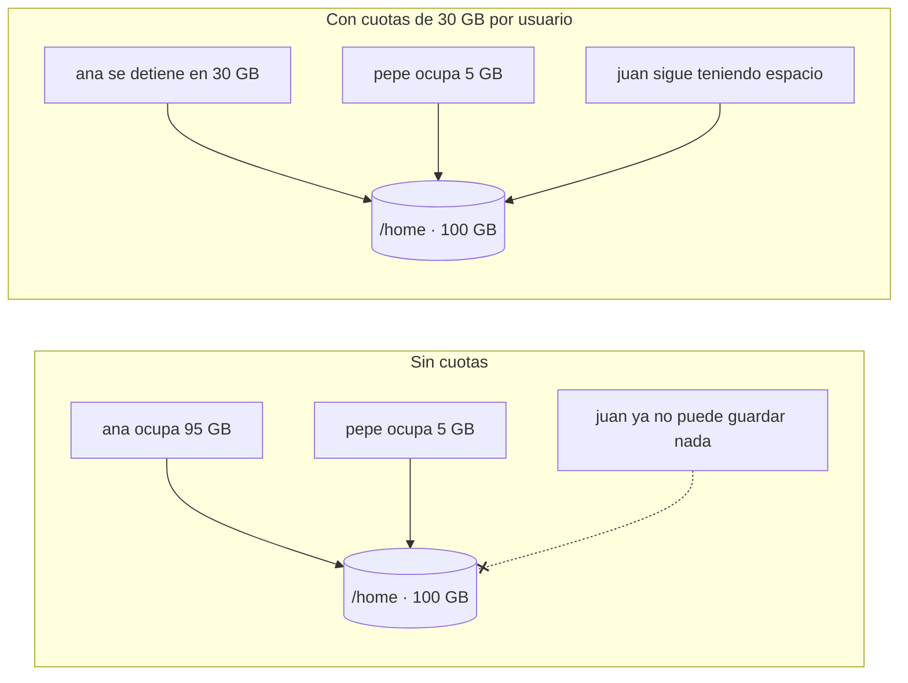
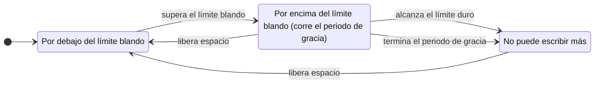
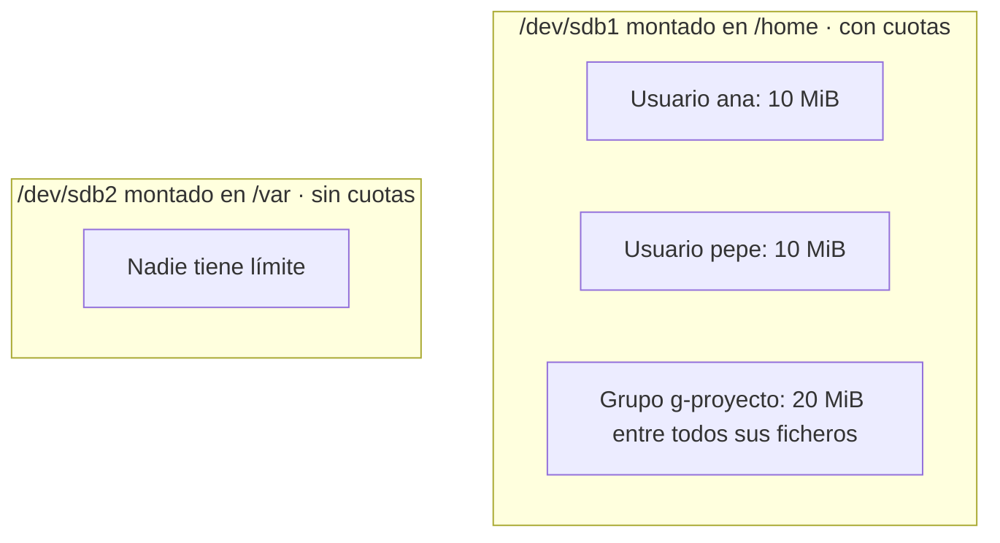
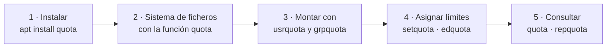

# Cuotas de disco

## Índice

1. [Qué son las cuotas de disco](#1-qué-son-las-cuotas-de-disco)
2. [Qué se limita: bloques e inodos](#2-qué-se-limita-bloques-e-inodos)
3. [Límite blando, límite duro y periodo de gracia](#3-límite-blando-límite-duro-y-periodo-de-gracia)
4. [Dónde se aplican: sistemas de ficheros, usuarios y grupos](#4-dónde-se-aplican-sistemas-de-ficheros-usuarios-y-grupos)
5. [Dos formas de activar las cuotas en ext4](#5-dos-formas-de-activar-las-cuotas-en-ext4)
6. [Práctica paso a paso](#6-práctica-paso-a-paso)
   1. [Instalar las herramientas](#61-instalar-las-herramientas)
   2. [Preparar un sistema de ficheros de pruebas](#62-preparar-un-sistema-de-ficheros-de-pruebas)
   3. [Montar con cuotas y comprobar el estado](#63-montar-con-cuotas-y-comprobar-el-estado)
   4. [Crear los usuarios y carpetas de la práctica](#64-crear-los-usuarios-y-carpetas-de-la-práctica)
   5. [Asignar cuotas con setquota](#65-asignar-cuotas-con-setquota)
   6. [Consultar cuotas con quota](#66-consultar-cuotas-con-quota)
   7. [Superar el límite blando](#67-superar-el-límite-blando)
   8. [Alcanzar el límite duro](#68-alcanzar-el-límite-duro)
   9. [Cuotas de inodos](#69-cuotas-de-inodos)
   10. [El periodo de gracia en acción](#610-el-periodo-de-gracia-en-acción)
   11. [Editar cuotas con edquota](#611-editar-cuotas-con-edquota)
   12. [Cuotas de grupo](#612-cuotas-de-grupo)
   13. [Informes con repquota](#613-informes-con-repquota)
   14. [Desactivar y eliminar las cuotas](#614-desactivar-y-eliminar-las-cuotas)
7. [El método clásico: quotacheck y ficheros de cuotas](#7-el-método-clásico-quotacheck-y-ficheros-de-cuotas)
8. [Cuotas en un sistema real](#8-cuotas-en-un-sistema-real)
9. [Resumen de órdenes](#9-resumen-de-órdenes)

---

## 1. Qué son las cuotas de disco

En un sistema con muchos usuarios, todos comparten el mismo disco. Si uno de ellos guarda una cantidad enorme de datos, por descuido o a propósito, puede llenarlo, y a partir de ese momento **nadie** puede guardar nada: ni el resto de usuarios ni, en el peor caso, los propios servicios del sistema.

Las **cuotas de disco** resuelven este problema: permiten fijar, para cada usuario o grupo, **cuánto espacio** y **cuántos ficheros** puede ocupar como máximo en un sistema de ficheros. Cuando un usuario llega a su límite, solo él deja de poder escribir; el resto sigue trabajando con normalidad.



Las cuotas se usan sobre todo en servidores compartidos: las carpetas personales de un centro educativo o de una empresa, un servidor de ficheros (como el de Samba del [documento 06 de *Sistemas operativos en red*](../sistemas_operativos_en_red/06_samba_ad_dc.md)), o un servidor de alojamiento web donde cada cliente tiene contratado un espacio concreto.

> **Nota:** Las cuotas complementan la separación en particiones del apartado 15 del documento 01. Una partición separada impide que `/home` llene todo el disco; las cuotas impiden, además, que **un usuario** llene `/home` a costa de los demás.

---

## 2. Qué se limita: bloques e inodos

Cada fichero ocupa dos tipos de recursos en un sistema de ficheros, y las cuotas pueden limitar los dos:

| Recurso | Qué es | Qué limita la cuota |
|---|---|---|
| **Bloques** | El espacio que ocupan los datos del fichero. | El **espacio** total, medido en KiB (1 KiB = 1024 bytes). |
| **Inodos** | La ficha de cada fichero, con sus permisos, propietario y fechas (documento 03). Cada fichero o directorio usa exactamente un inodo. | El **número de ficheros** y directorios. |

Limitar solo el espacio no siempre basta: un usuario podría crear millones de ficheros vacíos, que no ocupan apenas espacio, y agotar los inodos del sistema de ficheros, con el mismo resultado que si se llenara el disco. La orden `df -i` (documento 13) muestra cuántos inodos quedan libres.

---

## 3. Límite blando, límite duro y periodo de gracia

Para cada recurso se fijan **dos límites**:

| Límite | Qué ocurre al superarlo |
|---|---|
| **Límite blando** (*soft limit*) | Es un **aviso**. El usuario puede seguir escribiendo por encima de él, pero solo durante un tiempo: el **periodo de gracia** (*grace period*), que por defecto es de 7 días. |
| **Límite duro** (*hard limit*) | Es el **máximo absoluto**. Ninguna escritura puede superarlo: el sistema la rechaza con el error *Se ha excedido la cuota de disco* (`Disk quota exceeded`). |

Con un límite blando de 10 MiB y uno duro de 12 MiB, el espacio de un usuario se divide así:

```text
0 MiB                          10 MiB (blando)          12 MiB (duro)
|-------------------------------|------------------------|
   Escritura libre                 Aviso: corre el          Escritura
                                   periodo de gracia        imposible
```

Si cuando termina el periodo de gracia el usuario sigue por encima del límite blando, este pasa a comportarse **como si fuera el duro**: ya no puede escribir nada más hasta que libere espacio. El periodo de gracia da margen para trabajar con un pico puntual, pero obliga a corregirlo.



> **Nota:** Un límite con valor `0` significa **sin límite**. Así se puede limitar, por ejemplo, el espacio de un usuario sin limitar su número de ficheros.

---

## 4. Dónde se aplican: sistemas de ficheros, usuarios y grupos

Las cuotas se configuran **por sistema de ficheros**, es decir, por partición o volumen montado, y no por carpeta. Un usuario puede tener una cuota en `/home` y ninguna en `/var` si están en sistemas de ficheros distintos. Dentro de cada sistema de ficheros, las cuotas se pueden aplicar:

| Tipo | Qué cuenta |
|---|---|
| **Cuota de usuario** | Todo lo que pertenece al usuario (su UID es el **propietario** del fichero), esté en la carpeta que esté de ese sistema de ficheros. |
| **Cuota de grupo** | Todo lo que pertenece al grupo (su GID es el **grupo propietario** del fichero), lo haya creado quien lo haya creado. |



Si un usuario tiene cuota de usuario y además su grupo tiene cuota de grupo, se aplican **las dos a la vez**: el primer límite que se alcance es el que impide seguir escribiendo.

> **Importante:** `root` no está sujeto a las cuotas. Aunque tenga límites asignados, los procesos de `root` pueden seguir escribiendo por encima de ellos. Así se garantiza que el administrador siempre puede trabajar, incluso con los usuarios al límite.

> **Nota:** ext4 y XFS admiten además **cuotas de proyecto** (*project quotas*), que sí limitan el espacio de una carpeta concreta, sin importar de quién sean los ficheros. Son un uso más avanzado que no se trata en este documento.

---

## 5. Dos formas de activar las cuotas en ext4

En ext4, el sistema de ficheros habitual en Debian y Ubuntu, las cuotas se pueden guardar de dos formas:

| | Método moderno: función `quota` de ext4 | Método clásico: ficheros de cuotas |
|---|---|---|
| Dónde se guardan las cuotas | En inodos internos y ocultos del propio sistema de ficheros. | En dos ficheros visibles en su raíz: `aquota.user` y `aquota.group`. |
| Cómo se activa | Con `mkfs.ext4 -O quota` al crear el sistema de ficheros, o con `tune2fs -O quota` sobre uno ya creado (desmontado). | Con las opciones de montaje y la orden `quotacheck`, que crea los ficheros. |
| Recuento del uso | Siempre al día: lo lleva el propio sistema de ficheros, protegido por su *journal*. | Lo calcula `quotacheck` recorriendo todo el disco, y puede desajustarse tras un apagado brusco. |
| Situación | **Recomendado.** | **Obsoleto en ext4**: las propias herramientas de cuotas avisan de ello. Sigue funcionando y aparece en mucha documentación y en exámenes. |

La práctica de este documento usa el método moderno. El clásico se explica en el apartado 7, y las órdenes para asignar y consultar las cuotas (`setquota`, `edquota`, `quota`, `repquota`) son **las mismas** en los dos.

---

## 6. Práctica paso a paso

La práctica se hace en Debian 13 (o en Ubuntu Server, con `sudo`) y se puede seguir de principio a fin mientras se estudia. Para no tocar los discos del sistema, se usa un **fichero que hace de disco**: se crea un fichero de 1 GiB, se formatea como ext4 y se monta como si fuera una partición, gracias a un dispositivo *loop* (documento 25).



> **Nota:** Las herramientas de cuotas muestran sus mensajes en inglés, mientras que los errores de otros programas como `dd` o `touch` aparecen en castellano si el sistema está en ese idioma. Los números de las salidas de ejemplo pueden variar ligeramente.

### 6.1 Instalar las herramientas

```bash
root@debian:~# apt -y install quota
```

El paquete `quota` aporta todas las órdenes para gestionar las cuotas: `setquota`, `edquota`, `quota`, `repquota`, `quotaon`, `quotaoff` y `quotacheck`.

### 6.2 Preparar un sistema de ficheros de pruebas

Se crea el fichero y se formatea en ext4 activando la función `quota`:

```bash
root@debian:~# fallocate -l 1G /srv/cuotas.img
root@debian:~# mkfs.ext4 -q -O quota /srv/cuotas.img
root@debian:~# tune2fs -l /srv/cuotas.img | grep -i 'quota inode'
User quota inode:         3
Group quota inode:        4
```

| Orden | Qué hace |
|---|---|
| `fallocate -l 1G /srv/cuotas.img` | Crea un fichero de 1 GiB que hará de disco. |
| `mkfs.ext4 -q -O quota` | Lo formatea en ext4 (`-q`, sin mostrar detalles) con la función `quota` (`-O quota`). |
| `tune2fs -l ... \| grep -i 'quota inode'` | Comprueba que existen los inodos internos donde se guardan las cuotas de usuarios (el 3) y de grupos (el 4). |

> **Nota:** En un sistema real se haría lo mismo sobre una partición, por ejemplo `mkfs.ext4 -O quota /dev/sdb1`. Para crear particiones en un disco virtual adicional, ver el documento 37; con LVM, el documento 42.

### 6.3 Montar con cuotas y comprobar el estado

La función `quota` hace que el sistema de ficheros **lleve la cuenta** del uso de cada usuario y grupo, pero los límites solo se **aplican** si se monta con las opciones `usrquota` (usuarios) y `grpquota` (grupos). Se monta de forma permanente en `/etc/fstab`:

```bash
root@debian:~# mkdir /mnt/cuotas
root@debian:~# echo '/srv/cuotas.img /mnt/cuotas ext4 loop,usrquota,grpquota 0 0' >> /etc/fstab
root@debian:~# systemctl daemon-reload
root@debian:~# mount /mnt/cuotas
root@debian:~# quotaon -pug /mnt/cuotas
user quota on /mnt/cuotas (/dev/loop0) is on (enforced)
group quota on /mnt/cuotas (/dev/loop0) is on (enforced)
```

| Elemento | Significado |
|---|---|
| `loop` | Monta un fichero como si fuera un disco. |
| `usrquota`, `grpquota` | Activan la aplicación de las cuotas de usuarios y de grupos. |
| `systemctl daemon-reload` | Tras modificar `/etc/fstab`, avisa a `systemd` del cambio; si no, `mount` muestra un aviso. |
| `quotaon -pug` | Muestra (`-p`, *print*) el estado de las cuotas de usuarios (`-u`) y grupos (`-g`). |

El estado puede ser:

| Estado | Significado |
|---|---|
| `on (enforced)` | Se cuenta el uso y **se aplican** los límites. Es lo que se busca. |
| `on (accounting)` | Solo se cuenta el uso: los límites no se aplican. Ocurre si el sistema de ficheros tiene la función `quota`, pero se ha montado sin `usrquota` o `grpquota`. |
| `off` | Las cuotas están desactivadas. |

### 6.4 Crear los usuarios y carpetas de la práctica

```bash
root@debian:~# useradd -m -s /bin/bash ana && passwd ana
root@debian:~# useradd -m -s /bin/bash pepe && passwd pepe
root@debian:~# mkdir /mnt/cuotas/ana /mnt/cuotas/pepe
root@debian:~# chown ana: /mnt/cuotas/ana
root@debian:~# chown pepe: /mnt/cuotas/pepe
```

Cada usuario tiene una carpeta propia en el sistema de ficheros con cuotas.

### 6.5 Asignar cuotas con setquota

`setquota` asigna los cuatro límites de un usuario en una sola orden:

```bash
root@debian:~# setquota -u ana 10M 12M 0 0 /mnt/cuotas
root@debian:~# setquota -u pepe 0 0 50 60 /mnt/cuotas
```

```text
setquota -u USUARIO  BLANDO-BLOQUES  DURO-BLOQUES  BLANDO-INODOS  DURO-INODOS  SISTEMA-DE-FICHEROS
```

| Usuario | Espacio | Ficheros |
|---|---|---|
| `ana` | Blando 10 MiB, duro 12 MiB. | Sin límite (`0 0`). |
| `pepe` | Sin límite (`0 0`). | Blando 50, duro 60. |

Los límites de espacio se expresan por defecto en **KiB**, pero se pueden usar los sufijos `K`, `M`, `G` y `T`. Los de inodos son números de ficheros, a los que se pueden añadir los sufijos `k`, `m`, `g` y `t` (miles, millones...). Para un grupo se usa `-g` en lugar de `-u`.

### 6.6 Consultar cuotas con quota

```bash
root@debian:~# quota -v ana
Disk quotas for user ana (uid 1001):
     Filesystem  blocks   quota   limit   grace   files   quota   limit   grace
      /dev/loop0       4   10240   12288               1       0       0
```

| Columna | Significado |
|---|---|
| `blocks` | Espacio usado, en KiB. Los 4 KiB son los de la carpeta `/mnt/cuotas/ana`. |
| `quota` | Límite blando de espacio (10240 KiB = 10 MiB). |
| `limit` | Límite duro de espacio (12288 KiB = 12 MiB). |
| `grace` | Tiempo que queda del periodo de gracia, si se ha superado el límite blando. |
| `files` | Número de ficheros, es decir, de inodos usados: la carpeta de `ana`. |
| `quota`, `limit` | Límites blando y duro de ficheros. |

Cada usuario puede consultar sus propias cuotas ejecutando `quota` sin argumentos; solo `root` puede consultar las de otros. Con `quota -s`, los tamaños se muestran en unidades legibles (M, G...).

### 6.7 Superar el límite blando

Ahora `ana` crea un fichero de 11 MiB, por encima de su límite blando de 10 MiB:

```bash
root@debian:~# su - ana
ana@debian:~$ dd if=/dev/zero of=/mnt/cuotas/ana/f1 bs=1M count=11
11+0 registros leídos
11+0 registros escritos
11534336 bytes (12 MB, 11 MiB) copiados, 0,0212 s, 544 MB/s
ana@debian:~$ quota
Disk quotas for user ana (uid 1001):
     Filesystem  blocks   quota   limit   grace   files   quota   limit   grace
      /dev/loop0   11268*  10240   12288   6days       2       0       0
```

`dd` (documento 12) ha podido escribir todo el fichero, porque no ha llegado al límite duro. Pero `quota` lo señala: el **asterisco** junto al uso indica que se ha superado el límite blando, y en la columna `grace` empieza a descontarse el periodo de gracia, que por defecto es de 7 días.

### 6.8 Alcanzar el límite duro

Si `ana` intenta escribir 5 MiB más, solo puede escribir hasta llegar al límite duro:

```bash
ana@debian:~$ dd if=/dev/zero of=/mnt/cuotas/ana/f2 bs=1M count=5
dd: error al escribir en '/mnt/cuotas/ana/f2': Se ha excedido la cuota de disco
...
ana@debian:~$ quota
Disk quotas for user ana (uid 1001):
     Filesystem  blocks   quota   limit   grace   files   quota   limit   grace
      /dev/loop0   12288*  10240   12288   6days       3       0       0
```

El uso se ha quedado exactamente en el límite duro (12288 KiB), y `dd` ha terminado con el error *Se ha excedido la cuota de disco*. A partir de aquí, `ana` no puede escribir nada más hasta que borre algo.

### 6.9 Cuotas de inodos

`pepe` no tiene límite de espacio, pero sí de ficheros (blando 50, duro 60). Si intenta crear 70 ficheros vacíos:

```bash
root@debian:~# su - pepe
pepe@debian:~$ for i in $(seq 1 70); do touch /mnt/cuotas/pepe/f$i || break; done
touch: no se puede efectuar 'touch' sobre '/mnt/cuotas/pepe/f60': Se ha excedido la cuota de disco
pepe@debian:~$ ls /mnt/cuotas/pepe | wc -l
59
```

Solo ha podido crear 59 ficheros: con su carpeta, suman los 60 inodos de su límite duro. Los ficheros están vacíos y apenas ocupan espacio, pero `pepe` ha agotado su cuota de ficheros. El `|| break` detiene el bucle en el primer error.

### 6.10 El periodo de gracia en acción

El periodo de gracia por defecto es de 7 días, demasiado para comprobarlo en clase. Se reduce temporalmente a un minuto, tanto para el espacio como para los ficheros:

```bash
root@debian:~# setquota -t 60 60 /mnt/cuotas
root@debian:~# repquota /mnt/cuotas | head -n 2
*** Report for user quotas on device /dev/loop0
Block grace time: 00:01; Inode grace time: 00:01
```

`setquota -t` recibe los dos periodos de gracia en **segundos**: el de los bloques y el de los inodos. El nuevo periodo solo se aplica a partir de la próxima vez que un usuario supere su límite blando, así que `ana` libera su espacio y vuelve a superarlo:

```bash
ana@debian:~$ rm /mnt/cuotas/ana/f1 /mnt/cuotas/ana/f2
ana@debian:~$ dd if=/dev/zero of=/mnt/cuotas/ana/f1 bs=1M count=11
ana@debian:~$ quota | tail -n 1
      /dev/loop0   11268*  10240   12288   00:01       2       0       0
```

Pasado algo más de un minuto, el periodo de gracia se ha agotado (`none`) y `ana` ya no puede escribir, aunque esté **por debajo de su límite duro**:

```bash
ana@debian:~$ quota | tail -n 1
      /dev/loop0   11268*  10240   12288    none       2       0       0
ana@debian:~$ echo hola > /mnt/cuotas/ana/f3
-bash: echo: error de escritura: Se ha excedido la cuota de disco
```

Se devuelve el periodo de gracia a 7 días (604800 segundos):

```bash
root@debian:~# setquota -t 604800 604800 /mnt/cuotas
```

> **Nota:** El periodo de gracia también se puede editar de forma interactiva con `edquota -t` (el general) o `edquota -T ana` (solo el de `ana`).

### 6.11 Editar cuotas con edquota

`edquota` abre las cuotas de un usuario en un editor de texto, lo que resulta cómodo para revisarlas y cambiarlas. Usa el editor indicado en la variable `EDITOR`:

```bash
root@debian:~# EDITOR=nano edquota -u ana
```

```text
Disk quotas for user ana (uid 1001):
  Filesystem                   blocks       soft       hard     inodes     soft     hard
  /dev/loop0                    11268      10240      12288          3        0        0
```

Solo se modifican las columnas `soft` y `hard`; las columnas `blocks` e `inodes` muestran el uso actual, y cambiarlas no tiene efecto. Al guardar y salir del editor, las cuotas se aplican.

Para dar a muchos usuarios las mismas cuotas, `edquota -p` copia las de un usuario que sirve de **prototipo**:

```bash
root@debian:~# useradd -m -s /bin/bash juan
root@debian:~# edquota -p ana juan
root@debian:~# quota -v juan | tail -n 1
      /dev/loop0       0   10240   12288               0       0       0
```

`juan` tiene ahora los mismos límites que `ana`.

### 6.12 Cuotas de grupo

Antes se limpian las carpetas de la práctica, para empezar de cero:

```bash
root@debian:~# rm -f /mnt/cuotas/ana/* /mnt/cuotas/pepe/*
```

Se crea un grupo para un proyecto, con una carpeta compartida, y se le asigna una cuota de 20 MiB (blando) y 25 MiB (duro):

```bash
root@debian:~# groupadd g-proyecto
root@debian:~# usermod -aG g-proyecto ana && usermod -aG g-proyecto pepe
root@debian:~# mkdir /mnt/cuotas/proyecto
root@debian:~# chgrp g-proyecto /mnt/cuotas/proyecto && chmod 2770 /mnt/cuotas/proyecto
root@debian:~# setquota -g g-proyecto 20M 25M 0 0 /mnt/cuotas
```

El permiso `2770` incluye el bit **SGID**: todo lo que se cree dentro de la carpeta tendrá como grupo `g-proyecto`, y por tanto contará en la cuota del grupo, lo cree quien lo cree (documento 28). Ahora `ana` y `pepe` escriben en la carpeta común. Como acaban de ser añadidos al grupo, deben iniciar una sesión nueva:

```bash
ana@debian:~$ dd if=/dev/zero of=/mnt/cuotas/proyecto/ana1 bs=1M count=8
pepe@debian:~$ dd if=/dev/zero of=/mnt/cuotas/proyecto/pepe1 bs=1M count=8
pepe@debian:~$ dd if=/dev/zero of=/mnt/cuotas/proyecto/pepe2 bs=1M count=8
pepe@debian:~$ dd if=/dev/zero of=/mnt/cuotas/proyecto/pepe3 bs=1M count=2
dd: error al escribir en '/mnt/cuotas/proyecto/pepe3': Se ha excedido la cuota de disco
...
root@debian:~# quota -vg g-proyecto
Disk quotas for group g-proyecto (gid 1004):
     Filesystem  blocks   quota   limit   grace   files   quota   limit   grace
      /dev/loop0   25600*  20480   25600   6days       5       0       0
```

`pepe` no tiene ningún límite de espacio como usuario, pero no ha podido seguir escribiendo: entre los dos han llenado los 25 MiB de la **cuota del grupo**.

### 6.13 Informes con repquota

`repquota` muestra un informe con las cuotas y el uso de **todos** los usuarios de un sistema de ficheros, que es lo que necesita el administrador para vigilarlas:

```bash
root@debian:~# repquota /mnt/cuotas
*** Report for user quotas on device /dev/loop0
Block grace time: 7days; Inode grace time: 7days
                        Block limits                File limits
User            used    soft    hard  grace    used  soft  hard  grace
----------------------------------------------------------------------
root      --      24       0       0              3     0     0
ana       --    8196   10240   12288              2     0     0
pepe      --   17408       0       0              4    50    60
```

Las dos marcas que siguen a cada usuario indican si ha superado su límite blando: la primera para el espacio y la segunda para los ficheros. `-` significa que no, y `+` que sí. Por ejemplo, `+-` es un usuario por encima de su límite blando de espacio, pero no del de ficheros.

| Orden | Informe |
|---|---|
| `repquota /mnt/cuotas` | Cuotas de usuarios de ese sistema de ficheros. |
| `repquota -g /mnt/cuotas` | Cuotas de grupos. |
| `repquota -a` | Todos los sistemas de ficheros con cuotas. |
| `repquota -s` | Con los tamaños en unidades legibles. |
| `repquota -v` | Incluye también los usuarios que no usan nada. |

```bash
root@debian:~# repquota -g /mnt/cuotas | grep proyecto
g-proyecto +-   25600   20480   25600  6days       5     0     0
```

### 6.14 Desactivar y eliminar las cuotas

```bash
root@debian:~# quotaoff -v /mnt/cuotas
/dev/loop0 [/mnt/cuotas]: user quotas turned off
/dev/loop0 [/mnt/cuotas]: group quotas turned off
root@debian:~# quotaon -v /mnt/cuotas
/dev/loop0 [/mnt/cuotas]: user quotas turned on
/dev/loop0 [/mnt/cuotas]: group quotas turned on
```

| Orden | Acción |
|---|---|
| `quotaoff -v /mnt/cuotas` | Deja de aplicar las cuotas, sin borrar los límites asignados. |
| `quotaon -v /mnt/cuotas` | Vuelve a aplicarlas. |
| `setquota -u ana 0 0 0 0 /mnt/cuotas` | Elimina los límites de un usuario. |

Para desmontar el laboratorio por completo, se desmonta el sistema de ficheros, se borra su línea de `/etc/fstab` y se elimina el fichero:

```bash
root@debian:~# umount /mnt/cuotas
root@debian:~# sed -i '\|/srv/cuotas.img|d' /etc/fstab
root@debian:~# systemctl daemon-reload
root@debian:~# rm /srv/cuotas.img
```

---

## 7. El método clásico: quotacheck y ficheros de cuotas

El método clásico no necesita la función `quota` de ext4: las cuotas se guardan en dos ficheros, `aquota.user` y `aquota.group`, en la raíz del sistema de ficheros. Es el que aparece en mucha documentación, en exámenes y en el apartado de cuotas del [documento 06 de *Sistemas operativos en red*](../sistemas_operativos_en_red/06_samba_ad_dc.md). Sobre un sistema de ficheros creado **sin** `-O quota`, los pasos son:

```bash
root@debian:~# fallocate -l 1G /srv/clasico.img
root@debian:~# mkfs.ext4 -q /srv/clasico.img
root@debian:~# mkdir /mnt/clasico
root@debian:~# mount -o loop,usrquota,grpquota /srv/clasico.img /mnt/clasico
root@debian:~# quotacheck -cugm /mnt/clasico
quotacheck: Your kernel probably supports ext4 quota feature but you are using external quota files. Please switch your filesystem to use ext4 quota feature as external quota files on ext4 are deprecated. You can enable the feature by unmounting the file system and running 'tune2fs -O quota <device>'.
root@debian:~# ls /mnt/clasico
aquota.group  aquota.user  lost+found
root@debian:~# quotaon -v /mnt/clasico
/dev/loop1 [/mnt/clasico]: user quotas turned on
/dev/loop1 [/mnt/clasico]: group quotas turned on
```

1. Se monta con `usrquota` y `grpquota`, igual que en el método moderno.
2. **`quotacheck`** recorre todo el sistema de ficheros, calcula cuánto usa cada usuario y grupo, y **crea** los ficheros `aquota.user` y `aquota.group`.
3. **`quotaon`** activa las cuotas. En el método moderno no hace falta, porque se activan solas al montar.

El aviso de `quotacheck` es el que se mencionó en el apartado 5: en ext4 este método está obsoleto, y la propia herramienta recomienda pasar al moderno.

| Opción de `quotacheck` | Significado |
|---|---|
| `-c` | Crea los ficheros de cuotas desde cero. |
| `-u`, `-g` | Para usuarios y para grupos. |
| `-m` | No intenta volver a montar el sistema de ficheros en solo lectura mientras lo revisa. Necesario si está en uso. |
| `-a` | Revisa todos los sistemas de ficheros montados con cuotas. |
| `-v` | Muestra lo que va haciendo. |

Para pasar un sistema de ficheros del método clásico al moderno basta con desactivar las cuotas, desmontarlo, activar la función y volver a montarlo. Los ficheros `aquota.*` ya no se necesitan:

```bash
root@debian:~# quotaoff -v /mnt/clasico
root@debian:~# umount /mnt/clasico
root@debian:~# tune2fs -O quota /srv/clasico.img
root@debian:~# mount -o loop,usrquota,grpquota /srv/clasico.img /mnt/clasico
root@debian:~# rm /mnt/clasico/aquota.user /mnt/clasico/aquota.group
```

---

## 8. Cuotas en un sistema real

En un servidor, las cuotas se ponen normalmente en el sistema de ficheros de **`/home`**, que conviene tener en una partición independiente (apartado 15 del documento 01). Si `/home` está en `/dev/sdb1`, los pasos son los mismos que en la práctica:

1. Añadir `usrquota,grpquota` a las opciones de `/home` en `/etc/fstab`:

    ```text
    /dev/sdb1   /home   ext4   defaults,usrquota,grpquota   0   2
    ```

2. Activar la función `quota`, que exige que el sistema de ficheros esté **desmontado**. Se hace desde la consola, como `root` y sin ningún usuario conectado, porque no se puede desmontar `/home` mientras alguien lo esté usando:

    ```bash
    root@debian:~# umount /home
    root@debian:~# tune2fs -O quota /dev/sdb1
    root@debian:~# mount /home
    root@debian:~# quotaon -pug /home
    ```

3. Asignar los límites con `setquota` o `edquota -p`, como en la práctica.

> **Nota:** El sistema de ficheros raíz `/` no se puede desmontar con el sistema en marcha. Para activar en él la función `quota` habría que arrancar desde un sistema de rescate, o bien usar el método clásico, que funciona con el sistema de ficheros montado. Es otra razón para separar `/home`.

> **Nota:** En **XFS**, el sistema de ficheros por defecto de las distribuciones Red Hat, las cuotas funcionan de otra forma: se activan con las opciones de montaje `uquota` y `gquota` y se gestionan con la orden `xfs_quota`. Por ejemplo, `xfs_quota -x -c 'limit bsoft=10m bhard=12m ana' /home` asigna una cuota, y `xfs_quota -x -c 'report -h' /home` muestra el informe.

> **Recuerda:** El paquete `quota` incluye también **`warnquota`**, que envía un correo a los usuarios que han superado su límite blando. Programado con `cron` (documento 35), avisa a tiempo, antes de que se agote el periodo de gracia.

---

## 9. Resumen de órdenes

| Orden | Para qué sirve |
|---|---|
| `mkfs.ext4 -O quota dispositivo` | Crea un sistema de ficheros ext4 con la función de cuotas. |
| `tune2fs -O quota dispositivo` | Activa la función de cuotas en un ext4 ya creado y desmontado. |
| Opciones `usrquota,grpquota` | Al montar, hacen que se apliquen las cuotas de usuarios y de grupos. |
| `quotaon -pug punto` | Muestra si las cuotas están activas. |
| `quotaon -v` / `quotaoff -v` | Activa o desactiva la aplicación de las cuotas. |
| `quotacheck -cugm punto` | Método clásico: calcula el uso y crea `aquota.user` y `aquota.group`. |
| `setquota -u usuario bb bd ib id punto` | Asigna los límites de un usuario: bloques blando y duro, inodos blando y duro. |
| `setquota -g grupo bb bd ib id punto` | Asigna los límites de un grupo. |
| `setquota -t gracia-bloques gracia-inodos punto` | Cambia el periodo de gracia, en segundos. |
| `edquota -u usuario` | Edita las cuotas de un usuario en un editor de texto. |
| `edquota -p prototipo usuario` | Copia las cuotas de un usuario a otro. |
| `edquota -t` / `edquota -T usuario` | Edita el periodo de gracia general o el de un usuario. |
| `quota` / `quota -v usuario` | Muestra las cuotas propias o las de un usuario. |
| `quota -vg grupo` | Muestra las cuotas de un grupo. |
| `repquota punto` / `repquota -a` | Informe de las cuotas de todos los usuarios. |
| `warnquota` | Avisa por correo a los usuarios que superan su límite blando. |
