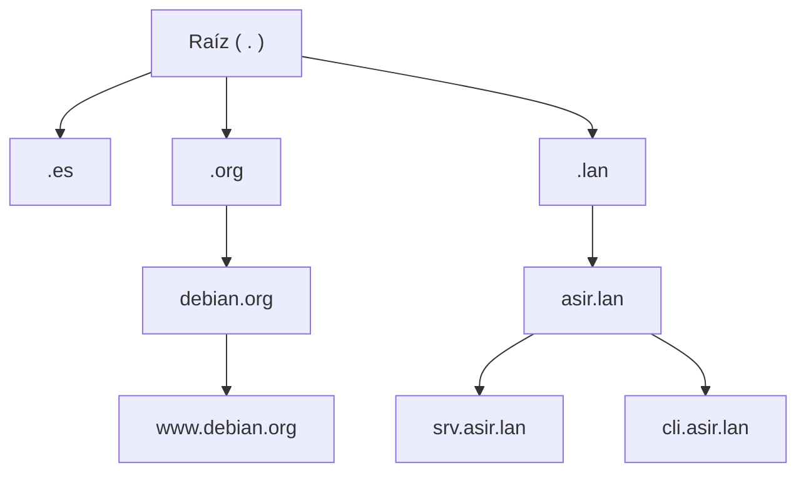
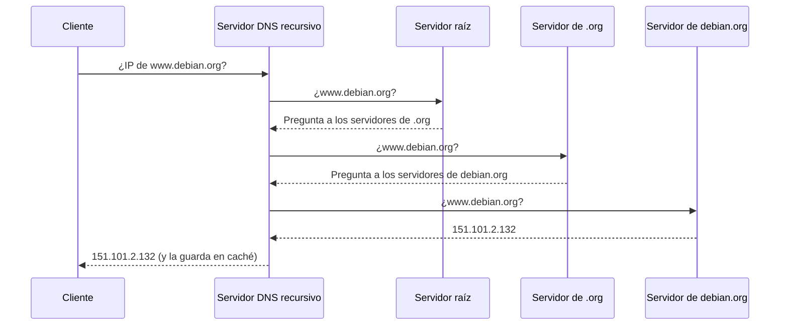
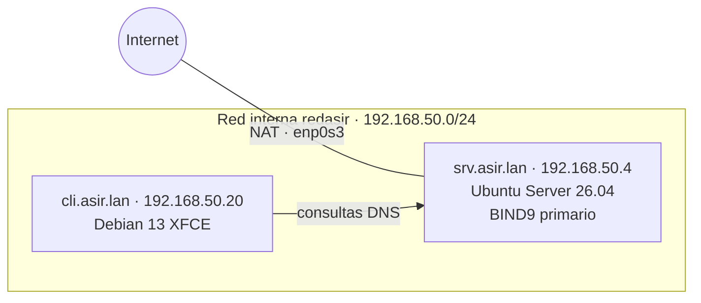

# DNS con BIND9

## Índice

1. [Qué es el DNS](#1-qué-es-el-dns)
2. [Conceptos básicos](#2-conceptos-básicos)
3. [Escenario](#3-escenario)
4. [Instalación de BIND9](#4-instalación-de-bind9)
5. [BIND9 como servidor caché y reenviador](#5-bind9-como-servidor-caché-y-reenviador)
6. [La zona directa](#6-la-zona-directa)
7. [La zona inversa](#7-la-zona-inversa)
8. [Configurar el servidor y los clientes para usar el DNS](#8-configurar-el-servidor-y-los-clientes-para-usar-el-dns)
9. [Servidor secundario](#9-servidor-secundario)
10. [Herramientas de consulta y administración](#10-herramientas-de-consulta-y-administración)
11. [Problemas frecuentes](#11-problemas-frecuentes)

---

## 1. Qué es el DNS

Los equipos de una red se comunican mediante direcciones IP, pero las personas recuerdan mucho mejor los nombres. El **DNS** (*Domain Name System*) es el servicio que traduce nombres como `www.debian.org` a direcciones IP como `151.101.2.132`, y al revés. Casi todos los demás servicios dependen de él: la web, el correo electrónico (que localiza los servidores de correo de cada dominio a través del DNS), los dominios de Active Directory o los certificados HTTPS.

El DNS es una **base de datos distribuida y jerárquica**. Ningún servidor conoce todos los nombres: cada uno es responsable de una parte del árbol de nombres y sabe a quién preguntar por el resto.



Un nombre completo como `srv.asir.lan.` se lee de derecha a izquierda, desde la raíz: es el equipo `srv`, dentro del dominio `asir`, dentro del dominio de primer nivel `lan`. A este nombre completo se le llama **FQDN** (*Fully Qualified Domain Name*), y su punto final representa la raíz del árbol.

**Cómo se resuelve un nombre**

Cuando un equipo necesita la IP de `www.debian.org`, no recorre él mismo el árbol: pregunta a su **servidor DNS recursivo**, que hace todo el trabajo. Ese servidor pregunta a la raíz, que le remite a los servidores de `.org`, que le remiten a los de `debian.org`, que son los que conocen la respuesta. Por último guarda la respuesta en su **caché** durante un tiempo, para responder al momento la próxima vez.



| Tipo de consulta | Quién la hace | Qué espera |
|---|---|---|
| **Recursiva** | El cliente a su servidor DNS | La respuesta final, sin tener que hacer nada más. |
| **Iterativa** | El servidor recursivo al resto de servidores | Que le digan a quién preguntar a continuación. |

---

## 2. Conceptos básicos

| Concepto | Significado |
|---|---|
| **Zona** | La parte del espacio de nombres de la que es responsable un servidor. Por ejemplo, la zona `asir.lan` contiene todos los nombres que terminan en `asir.lan`. |
| **Servidor autoritativo** | El que tiene los datos de una zona y responde sobre ella con autoridad. |
| **Servidor recursivo o caché** | El que resuelve nombres de cualquier zona por cuenta de sus clientes y guarda las respuestas. Un mismo servidor puede hacer los dos papeles. |
| **Servidor primario** (*primary*, antes *master*) | El que tiene el fichero original de la zona, donde se hacen los cambios. |
| **Servidor secundario** (*secondary*, antes *slave*) | El que guarda una copia de la zona, que obtiene del primario mediante una **transferencia de zona**. Si el primario falla, el secundario sigue respondiendo. |
| **Reenviador** (*forwarder*) | Servidor al que se pasan las consultas que no se saben resolver, en lugar de recorrer el árbol desde la raíz. |
| **TTL** (*Time To Live*) | Tiempo, en segundos, que un servidor puede guardar una respuesta en su caché. |
| **Zona directa** | Traduce nombres a direcciones IP. |
| **Zona inversa** | Traduce direcciones IP a nombres. |

Los datos de una zona se guardan como **registros de recurso** (*resource records*):

| Registro | Significado | Ejemplo |
|---|---|---|
| `SOA` | *Start of Authority*: datos de la zona, como su servidor primario, el correo de su responsable y su número de serie. Hay exactamente uno por zona. | `@ IN SOA ns1.asir.lan. admin.asir.lan. (...)` |
| `NS` | Un servidor DNS autoritativo de la zona. | `@ IN NS ns1.asir.lan.` |
| `A` | Nombre → dirección IPv4. | `srv IN A 192.168.50.4` |
| `AAAA` | Nombre → dirección IPv6. | `srv IN AAAA fd00::4` |
| `CNAME` | Alias: un nombre que apunta a otro nombre. | `www IN CNAME srv` |
| `MX` | Servidor de correo del dominio, con su prioridad (el número más bajo es el preferido). | `@ IN MX 10 mail.asir.lan.` |
| `PTR` | Dirección IP → nombre. Se usa en las zonas inversas. | `4 IN PTR srv.asir.lan.` |
| `TXT` | Texto libre. Se usa, por ejemplo, para las políticas antifraude del correo (SPF). | `@ IN TXT "v=spf1 mx -all"` |
| `SRV` | Localiza un servicio concreto, con su puerto. Lo usa, entre otros, Active Directory. | `_ldap._tcp IN SRV 0 100 389 srv` |

---

## 3. Escenario

| Equipo | Sistema | Nombre | Red interna `redasir` | Función |
|---|---|---|---|---|
| Servidor | Ubuntu Server 26.04 | `srv.asir.lan` | `192.168.50.4/24` | DNS primario de la zona `asir.lan`, recursivo para la red interna. |
| Cliente | Debian 13 con XFCE | `cli.asir.lan` | `192.168.50.20/24` | Cliente DNS y, en el apartado 9, DNS secundario. |

El servidor tiene dos tarjetas de red: una en **NAT** (`enp0s3`), con salida a Internet, y otra en la **red interna** `redasir` (`enp0s8`). El cliente solo está conectado a la red interna; los paquetes que necesite se instalan antes, con su tarjeta en modo NAT. Este mismo escenario se usa en los documentos 05 a 08 de servicios en red.



La zona `asir.lan` tendrá estos nombres:

| Nombre | Tipo | Apunta a | Para qué |
|---|---|---|---|
| `ns1.asir.lan` | `A` | `192.168.50.4` | Servidor DNS primario. |
| `ns2.asir.lan` | `A` | `192.168.50.20` | Servidor DNS secundario. |
| `srv.asir.lan` | `A` | `192.168.50.4` | El servidor. |
| `cli.asir.lan` | `A` | `192.168.50.20` | El cliente. |
| `mail.asir.lan` | `A` | `192.168.50.4` | Servidor de correo (documento 05). |
| `www.asir.lan` | `CNAME` | `srv.asir.lan` | Servidor web (documento 07). |
| `proxy.asir.lan` | `CNAME` | `srv.asir.lan` | Proxy (documento 06). |
| `asir.lan` | `MX` | `mail.asir.lan` | Correo del dominio. |

> **Nota:** El sufijo `.lan` no existe en Internet y es habitual en laboratorios y redes domésticas. En una red real conviene usar un subdominio de un dominio propio, como `int.iesmontedavila.es`.

---

## 4. Instalación de BIND9

**BIND9** (*Berkeley Internet Name Domain*) es el servidor DNS más extendido. Se instala junto con las herramientas de consulta:

```bash
usuario@srv:~$ sudo apt update && sudo apt -y install bind9 bind9-dnsutils
usuario@srv:~$ named -v
BIND 9.20.24-1ubuntu0.3-Ubuntu (Stable Release) <id:>
usuario@srv:~$ systemctl status named
● named.service - BIND Domain Name Server
     Loaded: loaded (/usr/lib/systemd/system/named.service; enabled; preset: enabled)
     Active: active (running) since mar 2026-10-13 10:12:31 CEST; 5s ago
```

El servicio se llama **`named`** (*name daemon*); `bind9` es un alias que sigue funcionando. Su configuración está en `/etc/bind/`:

| Fichero | Contenido |
|---|---|
| `named.conf` | Fichero principal. Solo incluye los demás. |
| `named.conf.options` | Opciones globales del servidor. |
| `named.conf.local` | Las zonas propias del servidor. |
| `named.conf.root-hints` | Dónde están los servidores raíz de Internet. |

> **Importante:** BIND 9.20, el de Debian 13 y Ubuntu 26.04, trae una configuración **mucho más corta** que las versiones anteriores. `named.conf.options` solo contiene la línea `directory "/var/cache/bind";`, y ya no existen los ficheros `named.conf.default-zones`, `db.local` ni `db.127` que aparecen en muchas guías de Internet. No hacen falta, porque los valores por defecto de BIND ya cubren lo básico: es recursivo para la red local (`allow-recursion { localnets; localhost; }`), valida las respuestas con DNSSEC y escucha en todas las interfaces.

---

## 5. BIND9 como servidor caché y reenviador

Lo primero es configurar el servidor para que resuelva cualquier nombre de Internet a los equipos de la red interna. Se sustituye el contenido de `/etc/bind/named.conf.options`:

```text
// /etc/bind/named.conf.options
acl "redasir" {
    192.168.50.0/24;
    localhost;
};

options {
    directory "/var/cache/bind";

    listen-on { 127.0.0.1; 192.168.50.4; };
    listen-on-v6 { none; };

    allow-query { redasir; };
    allow-recursion { redasir; };

    forwarders {
        8.8.8.8;
        1.1.1.1;
    };

    dnssec-validation auto;
};
```

| Directiva | Significado |
|---|---|
| `acl "redasir" { ... };` | Define un nombre para un grupo de direcciones, que después se usa en el resto de directivas. |
| `listen-on` | Direcciones IP en las que escucha el servidor: el bucle local y la red interna, pero no la tarjeta NAT. |
| `listen-on-v6 { none; };` | No escucha en IPv6, que no se usa en el laboratorio. |
| `allow-query` | Quién puede hacer consultas al servidor. |
| `allow-recursion` | Quién puede pedirle que resuelva nombres de **otras** zonas. |
| `forwarders` | Servidores a los que reenviar las consultas que no puede responder con sus propias zonas. |
| `dnssec-validation auto;` | Comprueba la firma DNSSEC de las respuestas, que garantiza que no han sido falsificadas. Es el valor por defecto; se escribe para dejarlo explícito. |

> **Advertencia:** Un servidor que acepta consultas recursivas de **cualquier** dirección es un *open resolver*: los atacantes lo usan para lanzar ataques de denegación de servicio contra terceros. Por eso `allow-recursion` debe limitarse siempre a la red propia.

Se comprueba la sintaxis y se reinicia el servicio:

```bash
usuario@srv:~$ sudo named-checkconf
usuario@srv:~$ sudo systemctl restart named
```

`named-checkconf` no muestra nada si la configuración es correcta. Se prueba con `dig` (apartado 10), preguntando directamente al servidor:

```bash
usuario@srv:~$ dig @192.168.50.4 www.debian.org

; <<>> DiG 9.20.24-1ubuntu0.3-Ubuntu <<>> @192.168.50.4 www.debian.org
...
;; ANSWER SECTION:
www.debian.org.		300	IN	A	151.101.2.132
www.debian.org.		300	IN	A	151.101.130.132

;; Query time: 41 msec
;; SERVER: 192.168.50.4#53(192.168.50.4) (UDP)
...
usuario@srv:~$ dig @192.168.50.4 www.debian.org | grep "Query time"
;; Query time: 0 msec
```

La primera consulta tarda 41 ms, porque el servidor tiene que preguntar a su reenviador. La segunda tarda 0 ms: la respuesta ya está en la **caché**. El número `300` es el TTL, en segundos, que va disminuyendo mientras la respuesta está guardada.

---

## 6. La zona directa

Las zonas propias del servidor se declaran en `/etc/bind/named.conf.local`:

```text
// /etc/bind/named.conf.local
zone "asir.lan" {
    type primary;
    file "/etc/bind/db.asir.lan";
    allow-transfer { 192.168.50.20; };
};
```

| Directiva | Significado |
|---|---|
| `type primary;` | El servidor es el primario de la zona. En configuraciones antiguas aparece como `type master;`, que sigue funcionando. |
| `file` | Fichero con los registros de la zona. |
| `allow-transfer` | Servidores que pueden pedir una copia completa de la zona: solo el secundario. Sin esta restricción, cualquiera podría descargarse la lista de todos los equipos de la red. |

Los registros se escriben en el **fichero de zona**, `/etc/bind/db.asir.lan`:

```text
; /etc/bind/db.asir.lan
$TTL 86400
@       IN      SOA     ns1.asir.lan. admin.asir.lan. (
                        2026101301  ; Serial
                        3600        ; Refresh
                        900         ; Retry
                        604800      ; Expire
                        3600 )      ; Negative cache TTL

; Servidores DNS de la zona
@       IN      NS      ns1.asir.lan.
@       IN      NS      ns2.asir.lan.

; Servidor de correo de la zona
@       IN      MX      10 mail.asir.lan.

; Equipos
ns1     IN      A       192.168.50.4
ns2     IN      A       192.168.50.20
srv     IN      A       192.168.50.4
cli     IN      A       192.168.50.20
mail    IN      A       192.168.50.4

; Alias
www     IN      CNAME   srv
proxy   IN      CNAME   srv
```

| Elemento | Significado |
|---|---|
| `$TTL 86400` | TTL por defecto de los registros: 86400 segundos, un día. |
| `@` | Representa el nombre de la propia zona, `asir.lan.`. |
| `;` | Comentario. |
| `ns1.asir.lan.` | El servidor primario de la zona. |
| `admin.asir.lan.` | El correo del responsable, `admin@asir.lan`, con un punto en lugar de la `@`. |
| `Serial` | **Número de serie** de la zona. Hay que **incrementarlo cada vez que se modifica**: los secundarios solo copian la zona si el número del primario es mayor que el suyo. El formato `AAAAMMDDNN` (fecha y número de cambio del día) es el habitual. |
| `Refresh` | Cada cuánto comprueban los secundarios si la zona ha cambiado. |
| `Retry` | Cada cuánto lo reintentan si el primario no responde. |
| `Expire` | Tiempo tras el cual un secundario deja de responder sobre la zona si no consigue contactar con el primario. |
| `Negative cache TTL` | Tiempo que se guarda en caché una respuesta de «ese nombre no existe». |

> **Importante:** El **punto final** de los nombres es fundamental. `ns1.asir.lan.` es un nombre completo. Sin el punto, BIND le añade el nombre de la zona: `ns1.asir.lan` se convertiría en `ns1.asir.lan.asir.lan.`. Por eso los nombres cortos (`srv`, `www`) se escriben sin punto y los completos, siempre con él. Es el error más frecuente en los ficheros de zona.

Se comprueba el fichero de zona, se recarga y se prueba:

```bash
usuario@srv:~$ sudo named-checkzone asir.lan /etc/bind/db.asir.lan
zone asir.lan/IN: loaded serial 2026101301
OK
usuario@srv:~$ sudo named-checkconf
usuario@srv:~$ sudo rndc reload
server reload successful
usuario@srv:~$ dig @192.168.50.4 srv.asir.lan +short
192.168.50.4
usuario@srv:~$ dig @192.168.50.4 www.asir.lan +short
srv.asir.lan.
192.168.50.4
usuario@srv:~$ dig @192.168.50.4 asir.lan MX +short
10 mail.asir.lan.
usuario@srv:~$ dig @192.168.50.4 asir.lan NS +short
ns1.asir.lan.
ns2.asir.lan.
```

`rndc reload` hace que BIND vuelva a leer la configuración y las zonas sin reiniciar el servicio. Al consultar `www.asir.lan`, el servidor devuelve el alias (`srv.asir.lan.`) y la dirección a la que apunta.

> **Nota:** Un registro `MX` o `NS` debe apuntar siempre a un nombre con registro `A`, nunca a un alias `CNAME`. Por eso `mail` es un registro `A` y no un alias de `srv`, aunque los dos tengan la misma IP.

---

## 7. La zona inversa

La zona inversa permite averiguar el nombre a partir de una IP. Su nombre se forma con la parte de **red** de la dirección escrita **al revés**, seguida de `in-addr.arpa`: para la red `192.168.50.0/24`, la zona es `50.168.192.in-addr.arpa`. Se declara en `named.conf.local`, a continuación de la zona directa:

```text
zone "50.168.192.in-addr.arpa" {
    type primary;
    file "/etc/bind/db.192.168.50";
    allow-transfer { 192.168.50.20; };
};
```

```text
; /etc/bind/db.192.168.50
$TTL 86400
@       IN      SOA     ns1.asir.lan. admin.asir.lan. (
                        2026101301  ; Serial
                        3600        ; Refresh
                        900         ; Retry
                        604800      ; Expire
                        3600 )      ; Negative cache TTL

@       IN      NS      ns1.asir.lan.
@       IN      NS      ns2.asir.lan.

4       IN      PTR     srv.asir.lan.
20      IN      PTR     cli.asir.lan.
```

Cada registro `PTR` asocia el último número de la IP con un nombre completo, con su punto final. `4` representa `4.50.168.192.in-addr.arpa`, es decir, la IP `192.168.50.4`.

```bash
usuario@srv:~$ sudo named-checkzone 50.168.192.in-addr.arpa /etc/bind/db.192.168.50
zone 50.168.192.in-addr.arpa/IN: loaded serial 2026101301
OK
usuario@srv:~$ sudo rndc reload
usuario@srv:~$ dig @192.168.50.4 -x 192.168.50.20 +short
cli.asir.lan.
```

`dig -x` hace una consulta inversa: construye por sí mismo el nombre `20.50.168.192.in-addr.arpa` y pregunta por su registro `PTR`.

> **Nota:** Aunque `srv` y `mail` tengan la misma IP, la zona inversa solo devuelve un nombre por IP, el principal. Para un servidor de correo real conviene que la IP resuelva justamente al nombre con el que se presenta, porque muchos servidores de correo lo comprueban.

---

## 8. Configurar el servidor y los clientes para usar el DNS

**El propio servidor (Ubuntu Server).** Ubuntu resuelve nombres a través de `systemd-resolved`, que toma los servidores DNS de la configuración de Netplan. Para que el servidor use su propio BIND, y no el DNS que le da el DHCP de la tarjeta NAT:

```yaml
# /etc/netplan/50-cloud-init.yaml
network:
  version: 2
  ethernets:
    enp0s3:
      dhcp4: true
      dhcp4-overrides:
        use-dns: false
    enp0s8:
      addresses:
        - 192.168.50.4/24
      nameservers:
        addresses:
          - 127.0.0.1
        search:
          - asir.lan
```

```bash
usuario@srv:~$ sudo netplan apply
usuario@srv:~$ resolvectl status | grep -E "DNS Servers|DNS Domain"
         DNS Servers: 127.0.0.1
          DNS Domain: asir.lan
usuario@srv:~$ ping -c 1 cli
PING cli.asir.lan (192.168.50.20) 56(84) bytes of data.
```

`use-dns: false` hace que se ignore el DNS que ofrece el DHCP de la tarjeta NAT, y `search` permite usar nombres cortos: `cli` se completa como `cli.asir.lan`.

**El cliente (Debian 13 con escritorio).** Con escritorio, la red la gestiona **NetworkManager** (apartado 4.5 del documento 31 de los apuntes). Se crea una conexión con IP fija que usa el servidor como DNS:

```bash
root@cli:~# nmcli connection add type ethernet ifname enp0s3 con-name redasir \
    ipv4.method manual ipv4.addresses 192.168.50.20/24 \
    ipv4.dns 192.168.50.4 ipv4.dns-search asir.lan
root@cli:~# nmcli connection up redasir
root@cli:~# cat /etc/resolv.conf
# Generated by NetworkManager
search asir.lan
nameserver 192.168.50.4
root@cli:~# getent hosts www.asir.lan
192.168.50.4    srv.asir.lan www.asir.lan
```

> **Nota:** Si en el cliente existe ya otra conexión automática sobre la misma tarjeta (por ejemplo, «Conexión cableada 1»), conviene borrarla o desactivar su conexión automática para que no compita con la nueva: `nmcli connection show` para ver su nombre y `nmcli connection delete "Conexión cableada 1"` para borrarla. `getent hosts` resuelve el nombre por el mismo camino que las aplicaciones (apartado 4.10 del documento 31).

---

## 9. Servidor secundario

Un segundo servidor DNS da **redundancia**: si el primario falla, los clientes siguen resolviendo nombres. En el laboratorio, el secundario se monta en el cliente Debian 13 (`ns2.asir.lan`, `192.168.50.20`), que debe tener instalado `bind9`.

En el secundario, `/etc/bind/named.conf.local` declara las mismas zonas, pero de tipo `secondary` y sin escribir ningún registro:

```text
// /etc/bind/named.conf.local en el secundario
zone "asir.lan" {
    type secondary;
    primaries { 192.168.50.4; };
    file "db.asir.lan";
};

zone "50.168.192.in-addr.arpa" {
    type secondary;
    primaries { 192.168.50.4; };
    file "db.192.168.50";
};
```

| Directiva | Significado |
|---|---|
| `type secondary;` | El servidor es secundario de la zona. Antes se escribía `type slave;`. |
| `primaries { 192.168.50.4; };` | Servidor del que copia la zona. Antes se escribía `masters`. |
| `file "db.asir.lan";` | Fichero donde guarda la copia. Al ser una ruta relativa, se guarda en el directorio de trabajo, `/var/cache/bind`, donde BIND puede escribir. |

```bash
root@cli:~# named-checkconf && systemctl restart named
root@cli:~# journalctl -u named | grep -i "transfer of"
oct 13 10:41:07 cli named[2210]: zone asir.lan/IN: Transfer started.
oct 13 10:41:07 cli named[2210]: transfer of 'asir.lan/IN' from 192.168.50.4#53: Transfer completed: 1 messages, 12 records, 343 bytes, 0.004 secs (85750 bytes/sec) (serial 2026101301)
root@cli:~# ls /var/cache/bind/
db.192.168.50  db.asir.lan  managed-keys.bind  managed-keys.bind.jnl
root@cli:~# dig @192.168.50.20 srv.asir.lan +short
192.168.50.4
```

El secundario ha copiado la zona y ya responde por sí mismo. Para comprobar la sincronización, se añade un registro en el primario y se **incrementa el número de serie**:

```text
; En /etc/bind/db.asir.lan del primario
                        2026101302  ; Serial
...
prueba  IN      A       192.168.50.99
```

```bash
usuario@srv:~$ sudo rndc reload
root@cli:~# dig @192.168.50.20 prueba.asir.lan +short
192.168.50.99
```

Al recargar la zona, el primario **notifica** a los secundarios (los servidores de sus registros `NS`) que ha cambiado, y estos la copian de nuevo al momento.

> **Advertencia:** Si se modifica la zona y **no** se incrementa el número de serie, el secundario considera que ya tiene la última versión y no la copia. Las dos copias quedan desincronizadas sin que se muestre ningún error.

> **Nota:** BIND guarda las copias de las zonas secundarias en formato binario (*raw*), así que no se pueden leer con `cat`. Para verlas como texto se usa `named-compilezone -f raw -F text -o - asir.lan /var/cache/bind/db.asir.lan`.

---

## 10. Herramientas de consulta y administración

**dig** es la herramienta más completa para hacer consultas DNS:

| Orden | Qué hace |
|---|---|
| `dig nombre` | Consulta el registro `A` del nombre al DNS configurado en el equipo. |
| `dig @servidor nombre` | Pregunta a un servidor concreto. |
| `dig nombre TIPO` | Consulta un tipo de registro: `MX`, `NS`, `SOA`, `TXT`, `AAAA`... |
| `dig nombre +short` | Muestra solo la respuesta. |
| `dig -x IP` | Consulta inversa. |
| `dig +trace nombre` | Muestra el recorrido completo desde la raíz, como en el diagrama del apartado 1. |
| `dig @servidor zona AXFR` | Pide una transferencia completa de la zona. Solo funciona desde las direcciones de `allow-transfer`. |

En la salida completa de `dig`, la sección `ANSWER SECTION` contiene la respuesta, y el indicador **`aa`** (*authoritative answer*) de la cabecera indica que el servidor es autoritativo para esa zona. Cuando la respuesta viene de la caché, ese indicador no aparece.

Otras órdenes útiles:

| Orden | Para qué sirve |
|---|---|
| `host nombre` | Consulta rápida, con una salida más sencilla que `dig`. |
| `nslookup nombre` | Herramienta clásica, también disponible en Windows. |
| `resolvectl query nombre` | Consulta a través de `systemd-resolved` (Ubuntu). |
| `named-checkconf` | Comprueba la sintaxis de la configuración de BIND. |
| `named-checkzone zona fichero` | Comprueba un fichero de zona. |
| `rndc reload` | Recarga la configuración y las zonas sin reiniciar. |
| `rndc flush` | Vacía la caché del servidor. |
| `rndc status` | Muestra el estado del servidor. |
| `journalctl -u named` | Muestra los registros del servicio, donde aparecen los errores de carga de las zonas y las transferencias. |

---

## 11. Problemas frecuentes

| Síntoma | Causa habitual |
|---|---|
| Un nombre aparece como `srv.asir.lan.asir.lan` | Falta el punto final en un nombre completo del fichero de zona. |
| El secundario no recibe los cambios | No se ha incrementado el número de serie, o el primario no lo permite en `allow-transfer`. |
| La zona no carga tras `rndc reload` | Error de sintaxis en el fichero de zona. `named-checkzone` y `journalctl -u named` indican la línea. |
| Los clientes reciben `REFUSED` | Su red no está en `allow-query` o `allow-recursion`. |
| Los nombres de Internet no se resuelven | El servidor no tiene salida a Internet o los `forwarders` no responden. Con `dig +trace` se ve dónde se corta. |
| Funciona `dig` pero no el navegador | El equipo no está usando ese servidor DNS: hay que revisar `/etc/resolv.conf` o `resolvectl status`. |

> **Nota:** En una red real, el DHCP puede **registrar automáticamente** en el DNS el nombre de cada equipo al darle su IP, lo que se conoce como DNS dinámico (DDNS). El documento 09 de servicios en red lo monta con Kea y BIND9.
