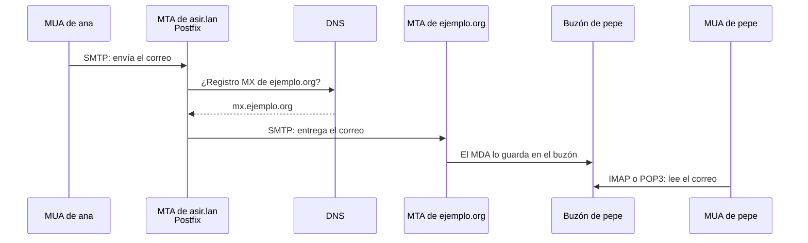

# Correo electrónico con Postfix y Dovecot

## Índice

1. [Cómo funciona el correo electrónico](#1-cómo-funciona-el-correo-electrónico)
2. [Escenario](#2-escenario)
3. [Postfix: el servidor SMTP](#3-postfix-el-servidor-smtp)
   1. [Instalación](#31-instalación)
   2. [Configuración](#32-configuración)
   3. [Probar el envío con una conversación SMTP](#33-probar-el-envío-con-una-conversación-smtp)
   4. [La cola de correo](#34-la-cola-de-correo)
4. [Dovecot: el servidor IMAP y POP3](#4-dovecot-el-servidor-imap-y-pop3)
   1. [Instalación](#41-instalación)
   2. [Buzones en formato Maildir](#42-buzones-en-formato-maildir)
   3. [Autenticación y cifrado](#43-autenticación-y-cifrado)
   4. [Probar IMAP desde el cliente](#44-probar-imap-desde-el-cliente)
   5. [Configurar un cliente de correo](#45-configurar-un-cliente-de-correo)
5. [Seguridad del correo](#5-seguridad-del-correo)
6. [Resumen y problemas frecuentes](#6-resumen-y-problemas-frecuentes)

---

## 1. Cómo funciona el correo electrónico

Enviar un correo parece una sola acción, pero en realidad intervienen varios programas, cada uno con su función, y varios protocolos:

| Componente | Nombre completo | Función | Ejemplo |
|---|---|---|---|
| **MUA** | *Mail User Agent* | El programa con el que el usuario lee y escribe sus correos. | Thunderbird, Outlook, un *webmail* |
| **MTA** | *Mail Transfer Agent* | El servidor que **transporta** los correos: los recibe y los envía hacia el servidor del destinatario. | **Postfix**, Exim, Sendmail |
| **MDA** | *Mail Delivery Agent* | El que **deja** el correo en el buzón del destinatario. | El agente `local` de Postfix |
| **Servidor de buzones** | | El que permite al destinatario **leer** su buzón desde su MUA. | **Dovecot** |

| Protocolo | Puerto | Para qué se usa |
|---|---|---|
| **SMTP** | 25/tcp | Enviar correo de un servidor a otro (MTA a MTA). |
| **Submission** | 587/tcp | Que los usuarios envíen su correo a su servidor, con autenticación y STARTTLS. |
| **SMTPS** | 465/tcp | Lo mismo que *submission*, pero cifrado desde el principio. |
| **POP3** / **POP3S** | 110 / 995 tcp | Descargar el correo del buzón al equipo. Normalmente se borra del servidor. |
| **IMAP** / **IMAPS** | 143 / 993 tcp | Leer el correo **en el servidor**: carpetas, leídos y borrados se sincronizan entre todos los dispositivos. |

Este es el recorrido de un correo que `ana@asir.lan` envía a `pepe@ejemplo.org`:



El paso clave es la consulta del **registro `MX`**: así sabe el servidor de origen a qué servidor debe entregar el correo de cada dominio (documento 04). Sin DNS, el correo entre dominios no funciona.

**Formatos de buzón**

| Formato | Cómo guarda el correo |
|---|---|
| **mbox** | Todos los mensajes de una carpeta en un único fichero, uno detrás de otro. Es el formato clásico de `/var/mail/usuario`. |
| **Maildir** | Cada mensaje en su propio fichero, dentro de una carpeta con tres subcarpetas: `new` (no leídos), `cur` (leídos) y `tmp` (en proceso de entrega). Es más robusto, porque dos programas pueden trabajar a la vez sin bloquear el buzón. |

En este documento se usa **Maildir**, en la carpeta `~/Maildir` de cada usuario.

---

## 2. Escenario

Se usa el escenario del documento 04: el servidor `srv.asir.lan` (Ubuntu Server 26.04, `192.168.50.4`), que hace también de servidor de correo con el nombre `mail.asir.lan`, y el cliente `cli.asir.lan` (Debian 13 con XFCE, `192.168.50.20`). La zona `asir.lan` del DNS debe tener ya estos registros:

```text
@       IN      MX      10 mail.asir.lan.
mail    IN      A       192.168.50.4
```

```bash
usuario@srv:~$ dig asir.lan MX +short
10 mail.asir.lan.
usuario@srv:~$ dig mail.asir.lan +short
192.168.50.4
```

Los usuarios de correo serán usuarios del sistema del servidor. Se crean `ana` y `pepe`:

```bash
usuario@srv:~$ sudo adduser ana
usuario@srv:~$ sudo adduser pepe
```

> **Nota:** El dominio `asir.lan` solo existe en el laboratorio, así que los correos solo podrán circular entre usuarios de `asir.lan`. Enviar a Internet exigiría un dominio real y, en la práctica, una IP fija con buena reputación, porque los grandes proveedores rechazan el correo de IP domésticas o dinámicas.

---

## 3. Postfix: el servidor SMTP

### 3.1 Instalación

El instalador de Postfix hace preguntas sobre el tipo de servidor. Se responden de antemano con `debconf-set-selections` (documento 05 de *Sistemas operativos en red*):

```bash
usuario@srv:~$ echo "postfix postfix/main_mailer_type select Internet Site" | sudo debconf-set-selections
usuario@srv:~$ echo "postfix postfix/mailname string asir.lan" | sudo debconf-set-selections
usuario@srv:~$ sudo apt -y install postfix
```

| Respuesta | Significado |
|---|---|
| `Internet Site` | El servidor envía y recibe correo directamente con SMTP, sin pasar por otro servidor intermedio (*relay*). |
| `mailname = asir.lan` | Dominio que se añade a los correos enviados desde el servidor. Se guarda en `/etc/mailname`. |

### 3.2 Configuración

La configuración principal está en **`/etc/postfix/main.cf`**. Se puede editar a mano, pero la orden **`postconf -e`** cambia una directiva sin abrir el fichero:

```bash
usuario@srv:~$ sudo postconf -e "myhostname = mail.asir.lan"
usuario@srv:~$ sudo postconf -e "mydomain = asir.lan"
usuario@srv:~$ sudo postconf -e "myorigin = \$mydomain"
usuario@srv:~$ sudo postconf -e "mydestination = \$myhostname, \$mydomain, localhost.\$mydomain, localhost"
usuario@srv:~$ sudo postconf -e "mynetworks = 127.0.0.0/8 192.168.50.0/24"
usuario@srv:~$ sudo postconf -e "inet_interfaces = all"
usuario@srv:~$ sudo postconf -e "inet_protocols = ipv4"
usuario@srv:~$ sudo postconf -e "home_mailbox = Maildir/"
usuario@srv:~$ sudo postfix check
usuario@srv:~$ sudo systemctl restart postfix
```

| Directiva | Significado |
|---|---|
| `myhostname` | Nombre completo con el que se presenta el servidor. |
| `mydomain` | Dominio del servidor. |
| `myorigin` | Dominio que se añade a los remitentes locales: `ana` envía como `ana@asir.lan`. El `\$` evita que el shell interprete `$mydomain` como una variable suya. |
| `mydestination` | Dominios cuyos correos se entregan **en este servidor**. Un correo para `pepe@asir.lan` se queda aquí; uno para otro dominio se reenvía. |
| `mynetworks` | Redes desde las que se permite enviar correo **a cualquier destino** (*relay*). |
| `inet_interfaces` | Interfaces en las que escucha. `all` permite recibir correo de la red; con `loopback-only` solo aceptaría correo local. |
| `inet_protocols` | Solo IPv4, que es lo que se usa en el laboratorio. |
| `home_mailbox = Maildir/` | Entrega el correo en formato **Maildir**, en `~/Maildir/` de cada usuario. La barra final es la que indica el formato Maildir; sin ella, sería un fichero mbox. |

> **Advertencia:** `mynetworks` debe incluir **solo** las redes propias. Si incluyera cualquier dirección, el servidor sería un **relé abierto** (*open relay*): cualquiera de Internet podría usarlo para enviar correo basura a terceros, y en poco tiempo su IP acabaría en las listas negras y nadie aceptaría su correo.

`postconf -n` muestra solo las directivas que tienen un valor distinto del de por defecto, que es la forma rápida de revisar la configuración:

```bash
usuario@srv:~$ postconf -n | grep -E "^(myhostname|mydomain|myorigin|mydestination|mynetworks|home_mailbox)"
home_mailbox = Maildir/
mydestination = $myhostname, $mydomain, localhost.$mydomain, localhost
mydomain = asir.lan
myhostname = mail.asir.lan
mynetworks = 127.0.0.0/8 192.168.50.0/24
myorigin = $mydomain
```

### 3.3 Probar el envío con una conversación SMTP

SMTP es un protocolo de texto, así que se puede «hablar» con el servidor a mano. Desde el cliente, con `nc` (documento 31 de los apuntes), se envía un correo de `ana` a `pepe`. Las líneas que empiezan por un número son las respuestas del servidor; el resto se escribe a mano:

```bash
usuario@cli:~$ nc -C mail.asir.lan 25
220 mail.asir.lan ESMTP Postfix (Ubuntu)
HELO cli.asir.lan
250 mail.asir.lan
MAIL FROM:<ana@asir.lan>
250 2.1.0 Ok
RCPT TO:<pepe@asir.lan>
250 2.1.5 Ok
DATA
354 End data with <CR><LF>.<CR><LF>
From: ana@asir.lan
To: pepe@asir.lan
Subject: Primera prueba

Hola pepe, este es el primer correo del servidor.
.
250 2.0.0 Ok: queued as 4F2A8120B3
QUIT
221 2.0.0 Bye
```

| Orden SMTP | Significado |
|---|---|
| `HELO` | El cliente se presenta. |
| `MAIL FROM:` | Remitente del sobre del correo. |
| `RCPT TO:` | Destinatario. Se puede repetir para varios. |
| `DATA` | Comienza el contenido: primero las cabeceras (`From`, `To`, `Subject`), una línea en blanco y el texto. Termina con una línea que solo contiene un punto. |
| `QUIT` | Cierra la conexión. |

La opción **`-C`** de `nc` envía los finales de línea en el formato que exige SMTP (`CR LF`, como en Windows). Los códigos de respuesta siguen una regla sencilla: los que empiezan por `2` indican éxito, por `3` que el servidor espera más datos, y por `4` o `5` un error temporal o permanente.

En el servidor se comprueba que se ha entregado. Postfix registra cada paso en el registro del sistema:

```bash
usuario@srv:~$ sudo journalctl -u postfix@- -n 4 --no-pager
oct 13 11:20:41 srv postfix/smtpd[3121]: 4F2A8120B3: client=cli.asir.lan[192.168.50.20]
oct 13 11:20:58 srv postfix/qmgr[2984]: 4F2A8120B3: from=<ana@asir.lan>, size=412, nrcpt=1 (queue active)
oct 13 11:20:58 srv postfix/local[3127]: 4F2A8120B3: to=<pepe@asir.lan>, relay=local, delay=17, delays=17/0.01/0/0.01, dsn=2.0.0, status=sent (delivered to maildir)
oct 13 11:21:02 srv postfix/smtpd[3121]: disconnect from cli.asir.lan[192.168.50.20] helo=1 mail=1 rcpt=1 data=1 quit=1 commands=5
usuario@srv:~$ sudo ls /home/pepe/Maildir/new/
1791883258.V802I4e21M118342.srv
usuario@srv:~$ sudo cat /home/pepe/Maildir/new/1791883258.V802I4e21M118342.srv
Return-Path: <ana@asir.lan>
X-Original-To: pepe@asir.lan
Delivered-To: pepe@asir.lan
Received: from cli.asir.lan (cli.asir.lan [192.168.50.20])
	by mail.asir.lan (Postfix) with SMTP id 4F2A8120B3
	for <pepe@asir.lan>; Tue, 13 Oct 2026 11:20:58 +0200 (CEST)
From: ana@asir.lan
To: pepe@asir.lan
Subject: Primera prueba

Hola pepe, este es el primer correo del servidor.
```

`status=sent (delivered to maildir)` confirma la entrega. Cada mensaje es un fichero en `~/Maildir/new/` mientras no se ha leído, y las cabeceras `Received` registran por qué servidores ha pasado.

> **Nota:** En Ubuntu Server, los mensajes de Postfix se guardan también en `/var/log/mail.log`. Para probar envíos más rápido, el paquete `swaks` hace toda la conversación SMTP en una sola orden: `swaks --to pepe@asir.lan --from ana@asir.lan --server mail.asir.lan`.

### 3.4 La cola de correo

Cuando un correo no se puede entregar al momento, por ejemplo porque el servidor de destino no responde, Postfix lo guarda en su **cola** y lo reintenta periódicamente:

| Orden | Acción |
|---|---|
| `mailq` o `postqueue -p` | Muestra los correos que están en la cola y por qué no se han entregado. |
| `postqueue -f` | Fuerza un reintento inmediato de todos los correos de la cola. |
| `postsuper -d ID` | Borra un correo concreto de la cola. |
| `postsuper -d ALL` | Vacía la cola. |
| `postfix check` | Comprueba la configuración y los permisos. |
| `postconf directiva` | Muestra el valor de una directiva. |

---

## 4. Dovecot: el servidor IMAP y POP3

### 4.1 Instalación

```bash
usuario@srv:~$ sudo apt -y install dovecot-imapd dovecot-pop3d
usuario@srv:~$ dovecot --version
2.4.2 (...)
```

> **Importante:** Ubuntu 26.04 y Debian 13 traen **Dovecot 2.4**, que cambió por completo el formato de la configuración respecto a la versión 2.3. La mayoría de las guías de Internet usan directivas que ya no existen, como `mail_location = maildir:~/Maildir`, `disable_plaintext_auth` o `ssl_cert = </etc/...`, y variables como `%u`. Si se copian en Dovecot 2.4, el servicio **no arranca**. En la versión 2.4 se usan `mail_driver` y `mail_path`, `auth_allow_cleartext`, `ssl_server_cert_file` y variables como `%{user}`.

La configuración está en `/etc/dovecot/`, repartida en ficheros dentro de `conf.d/`:

| Fichero | Contenido |
|---|---|
| `dovecot.conf` | Fichero principal. Declara la versión del formato de configuración (`dovecot_config_version`) e incluye el resto. |
| `conf.d/10-mail.conf` | Dónde y en qué formato están los buzones. |
| `conf.d/10-auth.conf` | Cómo se autentican los usuarios. Por defecto, con los usuarios y contraseñas del sistema (PAM). |
| `conf.d/10-ssl.conf` | Certificado para las conexiones cifradas. |
| `conf.d/10-master.conf` | Servicios y puertos. |
| `local.conf` | Fichero opcional para configuración propia. Se lee el último. |

### 4.2 Buzones en formato Maildir

Por defecto, Dovecot espera buzones **mbox** en `/var/mail`, pero Postfix los entrega en **Maildir**. Hay que cambiar estas tres líneas de `/etc/dovecot/conf.d/10-mail.conf`:

```text
# Antes
mail_driver = mbox
mail_path = %{home}/mail
mail_inbox_path = /var/mail/%{user}

# Después
mail_driver = maildir
mail_path = ~/Maildir
#mail_inbox_path = /var/mail/%{user}
```

Se puede hacer con un solo `sed` (documento 15 de los apuntes):

```bash
usuario@srv:~$ sudo sed -i \
    -e 's|^mail_driver = mbox|mail_driver = maildir|' \
    -e 's|^mail_path = %{home}/mail|mail_path = ~/Maildir|' \
    -e 's|^mail_inbox_path = /var/mail/%{user}|#&|' \
    /etc/dovecot/conf.d/10-mail.conf
usuario@srv:~$ sudo doveconf -n | grep -E "^mail_(driver|path|inbox_path)"
mail_driver = maildir
mail_path = ~/Maildir
usuario@srv:~$ sudo systemctl restart dovecot
```

| Directiva | Significado |
|---|---|
| `mail_driver = maildir` | Formato de los buzones. |
| `mail_path = ~/Maildir` | Carpeta de los buzones: la misma en la que entrega Postfix. |
| `mail_inbox_path` | Solo hace falta con mbox, donde la bandeja de entrada está en otro sitio (`/var/mail`). Con Maildir, la bandeja de entrada es la propia carpeta `~/Maildir`. |

`doveconf -n` muestra la configuración efectiva, solo con los valores distintos de los de por defecto. Es la primera orden que hay que ejecutar si Dovecot no arranca.

### 4.3 Autenticación y cifrado

Dovecot autentica a los usuarios con sus usuarios y contraseñas del sistema, así que `ana` y `pepe` acceden a su correo con la misma contraseña con la que entrarían en el servidor. Por seguridad, Dovecot 2.4 **no admite contraseñas sin cifrar** salvo desde la propia máquina (`auth_allow_cleartext = no`, el valor por defecto). Desde la red, el cliente debe usar **STARTTLS** en los puertos 143 (IMAP) y 110 (POP3), o los puertos cifrados desde el principio, 993 y 995.

Al instalarse, Dovecot genera un **certificado autofirmado**, que es el que indica `10-ssl.conf`:

```text
ssl = yes
ssl_server_cert_file = /etc/dovecot/private/dovecot.pem
ssl_server_key_file = /etc/dovecot/private/dovecot.key
ssl_min_protocol = TLSv1.2
```

El certificado es suficiente para el laboratorio. Los clientes avisarán de que no está firmado por una autoridad de confianza, igual que con Webmin (tarea 1.6), y habrá que aceptarlo. En un servidor real se usaría un certificado válido, como los de Let's Encrypt (documento 07).

```bash
usuario@srv:~$ sudo ss -tlnp | grep dovecot
LISTEN 0  100  0.0.0.0:110  0.0.0.0:*  users:(("dovecot",pid=3402,fd=24))
LISTEN 0  100  0.0.0.0:143  0.0.0.0:*  users:(("dovecot",pid=3402,fd=37))
LISTEN 0  100  0.0.0.0:993  0.0.0.0:*  users:(("dovecot",pid=3402,fd=38))
LISTEN 0  100  0.0.0.0:995  0.0.0.0:*  users:(("dovecot",pid=3402,fd=25))
```

### 4.4 Probar IMAP desde el cliente

`curl` (documento 33 de los apuntes) habla también IMAP, lo que permite probar el servidor sin instalar un cliente de correo. `--ssl-reqd` exige STARTTLS y `-k` acepta el certificado autofirmado:

```bash
usuario@cli:~$ curl -k --ssl-reqd --user pepe imap://mail.asir.lan/
Enter host password for user 'pepe':
* LIST (\HasNoChildren) "." INBOX
usuario@cli:~$ curl -k --ssl-reqd --user pepe 'imap://mail.asir.lan/INBOX;UID=1'
Enter host password for user 'pepe':
Return-Path: <ana@asir.lan>
...
Subject: Primera prueba

Hola pepe, este es el primer correo del servidor.
```

La primera orden lista las carpetas del buzón de `pepe`, y la segunda descarga el mensaje con identificador `1` de la bandeja de entrada.

### 4.5 Configurar un cliente de correo

Con **Thunderbird** en el cliente, al añadir una cuenta se indican los datos a mano:

| Dato | Valor |
|---|---|
| Nombre y correo | `Pepe`, `pepe@asir.lan` |
| Servidor entrante | IMAP, `mail.asir.lan`, puerto `143`, seguridad **STARTTLS**, contraseña normal |
| Servidor saliente | SMTP, `mail.asir.lan`, puerto `25`, sin seguridad ni autenticación |
| Usuario | `pepe` |

Thunderbird pedirá aceptar una excepción de seguridad por el certificado autofirmado. El envío funciona sin autenticación porque el cliente está en la red de `mynetworks`.

> **Nota:** En un servidor real no se envía por el puerto 25 sin autenticar. Los usuarios envían por el puerto **587** (*submission*), con STARTTLS y usuario y contraseña. Postfix delega esa autenticación en Dovecot mediante **SASL**, de modo que los usuarios usan la misma contraseña para leer y para enviar. Esta configuración es una ampliación natural de este documento.

---

## 5. Seguridad del correo

El protocolo SMTP se diseñó sin ninguna comprobación de identidad: cualquiera puede escribir `MAIL FROM:<director@banco.es>`, como se ha visto en la conversación SMTP del apartado 3.3. Para combatir la suplantación y el correo basura se usan tres mecanismos, todos publicados en el **DNS** como registros `TXT`:

| Mecanismo | Qué hace | Ejemplo de registro |
|---|---|---|
| **SPF** | Indica qué servidores pueden enviar correo en nombre del dominio. | `asir.lan. IN TXT "v=spf1 mx -all"`: solo los servidores `MX` del dominio. |
| **DKIM** | El servidor **firma** cada correo que envía con una clave privada; los destinatarios comprueban la firma con la clave pública publicada en el DNS (documento 34 de los apuntes, cifrado asimétrico). | `mail._domainkey.asir.lan. IN TXT "v=DKIM1; k=rsa; p=MIIBIjAN..."` |
| **DMARC** | Indica qué hacer con los correos que no superan SPF ni DKIM: aceptarlos, marcarlos como sospechosos o rechazarlos. | `_dmarc.asir.lan. IN TXT "v=DMARC1; p=reject"` |

Hoy en día, los grandes proveedores de correo rechazan o marcan como basura cualquier correo de un dominio que no tenga configurados SPF, DKIM y DMARC.

---

## 6. Resumen y problemas frecuentes

| Orden | Para qué sirve |
|---|---|
| `postconf -e "directiva = valor"` | Cambia una directiva de Postfix. |
| `postconf -n` | Muestra la configuración de Postfix distinta de la de por defecto. |
| `postfix check` | Comprueba la configuración de Postfix. |
| `mailq` / `postqueue -f` | Muestra la cola de correo / fuerza su reenvío. |
| `doveconf -n` | Muestra la configuración efectiva de Dovecot. |
| `journalctl -u postfix@- -u dovecot` | Registros de los dos servicios. |
| `nc -C mail.asir.lan 25` | Conversación SMTP a mano. |
| `curl -k --ssl-reqd --user usuario imap://servidor/` | Prueba de IMAP. |

| Síntoma | Causa habitual |
|---|---|
| `Relay access denied` | El cliente no está en `mynetworks` y no se ha autenticado. |
| `User unknown in local recipient table` | El destinatario no existe en el servidor, o su dominio no está en `mydestination`. |
| El correo se entrega pero el usuario no lo ve | Postfix entrega en un formato y Dovecot lee otro: `home_mailbox` y `mail_driver`/`mail_path` deben coincidir. |
| Dovecot no arranca tras editar la configuración | Directivas de Dovecot 2.3 en un Dovecot 2.4. `doveconf -n` indica la línea con el error. |
| El cliente no puede iniciar sesión en IMAP | Está usando el puerto 143 sin STARTTLS: Dovecot no admite contraseñas sin cifrar desde la red. |
| El correo a otro dominio se queda en la cola | No se encuentra su registro `MX` en el DNS, o el servidor de destino no es alcanzable. |
