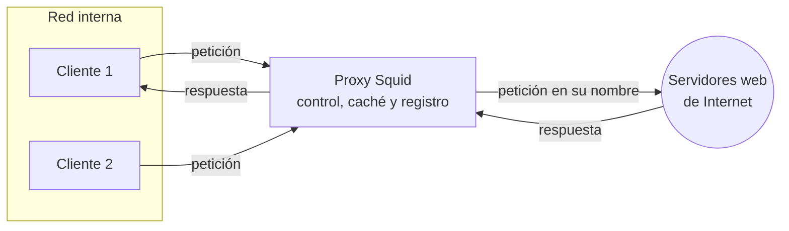
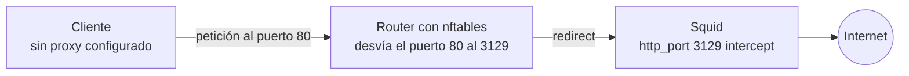

# Proxy web con Squid

## Índice

1. [Qué es un proxy](#1-qué-es-un-proxy)
2. [Escenario](#2-escenario)
3. [Instalación](#3-instalación)
4. [Listas de control de acceso (ACL)](#4-listas-de-control-de-acceso-acl)
5. [Configurar los clientes](#5-configurar-los-clientes)
6. [Bloquear sitios web](#6-bloquear-sitios-web)
7. [Restricción por horario](#7-restricción-por-horario)
8. [Autenticación de usuarios](#8-autenticación-de-usuarios)
9. [La caché](#9-la-caché)
10. [Los registros de acceso](#10-los-registros-de-acceso)
11. [Proxy transparente](#11-proxy-transparente)
12. [Resumen y problemas frecuentes](#12-resumen-y-problemas-frecuentes)

---

## 1. Qué es un proxy

Un **proxy** es un servidor intermediario: los clientes no se conectan directamente a los servidores web de Internet, sino que le piden al proxy que lo haga por ellos. El proxy recibe la petición, la reenvía al servidor de destino y devuelve la respuesta al cliente.



Al pasar todo el tráfico web por un único punto, el proxy permite:

| Función | En qué consiste |
|---|---|
| **Control de acceso** | Decidir quién puede navegar, cuándo y a qué sitios. |
| **Autenticación** | Exigir usuario y contraseña para navegar, y saber quién ha hecho cada petición. |
| **Caché** | Guardar las páginas y ficheros descargados para servirlos al instante la siguiente vez, ahorrando ancho de banda. |
| **Registro** | Dejar constancia de todas las peticiones: quién, cuándo y a dónde. |

El proxy del instituto (`192.168.0.1`, puerto `3128`) es justamente un proxy de este tipo; el puerto **3128** es el de Squid por defecto. **Squid** es el proxy libre más extendido.

| Tipo | Quién lo usa y para qué |
|---|---|
| **Proxy directo** (*forward proxy*) | Los **clientes** de una red, para salir a Internet. Es el de este documento. |
| **Proxy inverso** (*reverse proxy*) | Los **servidores**: recibe las peticiones de Internet y las reparte entre servidores internos. Se ve en el documento 07 con Nginx. |
| **Proxy transparente** | Un proxy directo que los clientes usan **sin saberlo**, porque el router desvía su tráfico hacia él (apartado 11). |

---

## 2. Escenario

Se usa el escenario del documento 04: el servidor `srv.asir.lan` (Ubuntu Server 26.04, `192.168.50.4`), con salida a Internet por su tarjeta NAT, y el cliente `cli.asir.lan` (Debian 13 con XFCE, `192.168.50.20`), conectado **solo** a la red interna. El nombre `proxy.asir.lan` es un alias de `srv` en el DNS.

El cliente no tiene ninguna ruta hacia Internet: la única forma de navegar será a través del proxy. Es la situación ideal para comprobar su funcionamiento.

```bash
usuario@cli:~$ curl -I http://www.debian.org
curl: (7) Failed to connect to www.debian.org port 80 after 0 ms: Could not connect to server
```

El cliente resuelve el nombre, gracias al DNS del servidor, pero no puede conectarse: no tiene puerta de enlace.

---

## 3. Instalación

```bash
usuario@srv:~$ sudo apt update && sudo apt -y install squid
usuario@srv:~$ squid -v | head -n 1
Squid Cache: Version 7.2
usuario@srv:~$ sudo ss -tlnp | grep squid
LISTEN 0  256  *:3128  *:*  users:(("squid",pid=4120,fd=14))
```

Squid escucha en el puerto **3128** y se gestiona como cualquier servicio (`systemctl status squid`). Su configuración y sus ficheros están en:

| Ruta | Contenido |
|---|---|
| `/etc/squid/squid.conf` | Configuración principal: varios miles de líneas, casi todas comentarios que documentan cada directiva. |
| `/etc/squid/conf.d/` | Ficheros de configuración propios. Debian y Ubuntu los incluyen justo en el punto donde se escriben las reglas de acceso. |
| `/var/log/squid/access.log` | Registro de todas las peticiones. |
| `/var/log/squid/cache.log` | Registro de funcionamiento y errores del propio Squid. |
| `/var/spool/squid/` | Caché en disco, si se configura. |

> **Nota:** En lugar de editar `squid.conf`, toda la configuración de este documento se escribe en un fichero propio, `/etc/squid/conf.d/asir.conf`. Así, `squid.conf` queda como referencia y la configuración propia está separada y es fácil de revisar.

Con la configuración por defecto, Squid **solo** admite peticiones de la propia máquina (`localhost`). Desde el cliente se obtiene un error de acceso denegado:

```bash
usuario@cli:~$ curl -x http://proxy.asir.lan:3128 -I http://www.debian.org
HTTP/1.1 403 Forbidden
Server: squid/7.2
X-Squid-Error: ERR_ACCESS_DENIED 0
...
```

La opción `-x` de `curl` indica el proxy que debe usar.

---

## 4. Listas de control de acceso (ACL)

Squid decide qué hacer con cada petición mediante dos tipos de directivas:

- **`acl`** define un **criterio** con un nombre: «la red interna», «estos dominios», «este horario»...
- **`http_access`** decide si se **permite** (`allow`) o **deniega** (`deny`) una petición que cumple uno o varios criterios.

Se crea el fichero `/etc/squid/conf.d/asir.conf` para permitir navegar a la red interna:

```text
# /etc/squid/conf.d/asir.conf
acl redasir src 192.168.50.0/24
http_access allow redasir
```

Se comprueba la sintaxis y se aplica la configuración sin reiniciar el servicio:

```bash
usuario@srv:~$ sudo squid -k parse
usuario@srv:~$ sudo squid -k reconfigure
```

Ahora el cliente navega a través del proxy, tanto por HTTP como por HTTPS:

```bash
usuario@cli:~$ curl -x http://proxy.asir.lan:3128 -I http://www.debian.org
HTTP/1.1 301 Moved Permanently
...
Via: 1.1 srv (squid/7.2)
X-Cache: MISS from srv
usuario@cli:~$ curl -x http://proxy.asir.lan:3128 -sI https://www.debian.org | head -n 1
HTTP/1.1 200 Connection established
```

La cabecera `Via` demuestra que la respuesta ha pasado por Squid. Con HTTPS, el cliente pide al proxy que abra un **túnel** hacia el servidor (método `CONNECT`), por el que viaja la conexión cifrada.

**Tipos de ACL más habituales**

| Tipo | Qué comprueba | Ejemplo |
|---|---|---|
| `src` | IP o red de **origen** (el cliente). | `acl redasir src 192.168.50.0/24` |
| `dst` | IP de **destino**. | `acl servidores dst 10.0.0.0/8` |
| `dstdomain` | **Dominio** de destino. Un punto inicial incluye los subdominios. | `acl redes dstdomain .tiktok.com` |
| `url_regex` | Expresión regular sobre la URL completa (documento 09 de los apuntes). | `acl juegos url_regex -i juego` |
| `time` | Días y horas. | `acl horario time MTWHF 08:00-14:30` |
| `port` | Puerto de destino. | `acl seguro port 443` |
| `proxy_auth` | Usuario autenticado. | `acl autenticados proxy_auth REQUIRED` |

**Cómo se aplican las reglas**

| Regla | Consecuencia |
|---|---|
| Las líneas `http_access` se evalúan **en orden, de arriba abajo**, y se aplica la **primera** que coincide. | Las prohibiciones (`deny`) deben ir **antes** que los permisos generales (`allow`). |
| En una misma línea `http_access`, todas las ACL deben cumplirse a la vez (**Y lógico**). | `http_access allow redasir horario` solo permite a la red interna dentro del horario. |
| Una misma ACL con varios valores, o repetida en varias líneas `acl`, se cumple si coincide cualquiera de ellos (**O lógico**). | `acl redes dstdomain .tiktok.com .instagram.com` incluye los dos dominios. |
| Al final de `squid.conf` hay un `http_access deny all`. | Todo lo que no se haya permitido expresamente queda denegado, igual que una política `DROP` en un cortafuegos (documento 46 de los apuntes). |

---

## 5. Configurar los clientes

Los programas deben configurarse para usar el proxy:

| Programa | Configuración |
|---|---|
| **Firefox** | Ajustes → General → Configuración de red → Configuración manual del proxy: `proxy.asir.lan`, puerto `3128`, y marcar «Usar también este proxy para HTTPS». |
| **Herramientas de consola** (`curl`, `wget`...) | Variables de entorno `http_proxy` y `https_proxy`, como en el apartado 5 del documento 31 de los apuntes: `export http_proxy=http://proxy.asir.lan:3128/` |
| **`apt`** | Fichero `/etc/apt/apt.conf.d/95proxy` con `Acquire::http::Proxy "http://proxy.asir.lan:3128/";`, también explicado en ese apartado. |

```bash
usuario@cli:~$ export http_proxy=http://proxy.asir.lan:3128/ https_proxy=http://proxy.asir.lan:3128/
usuario@cli:~$ curl -sI https://www.debian.org | head -n 1
HTTP/1.1 200 Connection established
```

Con `apt` configurado para usar el proxy, el cliente puede incluso instalar paquetes sin tener salida directa a Internet.

---

## 6. Bloquear sitios web

Para impedir el acceso a determinados sitios, se guardan sus dominios en un fichero, uno por línea:

```bash
usuario@srv:~$ printf '.tiktok.com\n.instagram.com\n.facebook.com\n' | sudo tee /etc/squid/bloqueados.txt
```

Y se añade la regla **antes** del permiso general:

```text
# /etc/squid/conf.d/asir.conf
acl redasir src 192.168.50.0/24
acl bloqueados dstdomain "/etc/squid/bloqueados.txt"

http_access deny bloqueados
http_access allow redasir
```

```bash
usuario@srv:~$ sudo squid -k parse && sudo squid -k reconfigure
usuario@cli:~$ curl -x http://proxy.asir.lan:3128 -I https://www.tiktok.com
curl: (56) CONNECT tunnel failed, response 403
usuario@cli:~$ curl -x http://proxy.asir.lan:3128 -sI https://www.debian.org | head -n 1
HTTP/1.1 200 Connection established
```

Las comillas en `"/etc/squid/bloqueados.txt"` indican a Squid que los valores de la ACL están en ese fichero. El punto inicial de `.tiktok.com` hace que se bloqueen también todos sus subdominios, como `www.tiktok.com`.

> **Importante:** Con HTTPS, el proxy solo ve el **nombre del dominio** al que se abre el túnel, no la URL completa, porque el resto de la petición va cifrado. Por eso con HTTPS se puede bloquear un dominio entero, pero no una página concreta de ese dominio, y las ACL `url_regex` solo funcionan sobre las peticiones HTTP sin cifrar. Inspeccionar el contenido de HTTPS (*SSL bump*) es posible, pero exige instalar un certificado del proxy en todos los clientes y plantea problemas legales y de privacidad.

---

## 7. Restricción por horario

La ACL `time` permite limitar la navegación a un horario. Los días se indican con letras: `S` domingo, `M` lunes, `T` martes, `W` miércoles, `H` jueves, `F` viernes y `A` sábado.

```text
# /etc/squid/conf.d/asir.conf
acl redasir src 192.168.50.0/24
acl bloqueados dstdomain "/etc/squid/bloqueados.txt"
acl horario time MTWHF 08:00-14:30

http_access deny bloqueados
http_access allow redasir horario
```

La red interna solo puede navegar de lunes a viernes, de 8:00 a 14:30. Fuera de ese horario, ninguna regla `allow` coincide y se aplica el `deny all` final.

---

## 8. Autenticación de usuarios

Para que cada usuario se identifique antes de navegar, Squid usa un **programa auxiliar** que comprueba las contraseñas. El más sencillo, `basic_ncsa_auth`, las lee de un fichero creado con `htpasswd`, del paquete `apache2-utils` (documento 01 de servicios en red):

```bash
usuario@srv:~$ sudo apt -y install apache2-utils
usuario@srv:~$ sudo htpasswd -c /etc/squid/passwd ana
usuario@srv:~$ sudo htpasswd /etc/squid/passwd pepe
usuario@srv:~$ sudo chown root:proxy /etc/squid/passwd
usuario@srv:~$ sudo chmod 640 /etc/squid/passwd
```

`-c` crea el fichero; solo se usa con el primer usuario. Squid se ejecuta con el usuario `proxy`, que necesita poder leer el fichero. Después se añade a la configuración:

```text
# /etc/squid/conf.d/asir.conf
auth_param basic program /usr/lib/squid/basic_ncsa_auth /etc/squid/passwd
auth_param basic realm Proxy de asir.lan

acl redasir src 192.168.50.0/24
acl bloqueados dstdomain "/etc/squid/bloqueados.txt"
acl autenticados proxy_auth REQUIRED

http_access deny bloqueados
http_access allow redasir autenticados
```

| Directiva | Significado |
|---|---|
| `auth_param basic program` | Programa que comprueba las contraseñas y fichero donde están. |
| `auth_param basic realm` | Texto que muestra el navegador al pedir las credenciales. |
| `acl autenticados proxy_auth REQUIRED` | Se cumple con cualquier usuario que se haya autenticado correctamente. |

```bash
usuario@cli:~$ curl -x http://proxy.asir.lan:3128 -I http://www.debian.org
HTTP/1.1 407 Proxy Authentication Required
...
usuario@cli:~$ curl -x http://proxy.asir.lan:3128 -U ana -I http://www.debian.org
Enter proxy password for user 'ana':
HTTP/1.1 301 Moved Permanently
```

El código **407** indica que el proxy exige autenticación. El navegador muestra en ese momento una ventana para pedir usuario y contraseña.

> **Advertencia:** La autenticación `basic` envía la contraseña sin cifrar (solo codificada en Base64) entre el cliente y el proxy. Es aceptable dentro de una red interna de confianza, pero no a través de redes no seguras. En organizaciones con un dominio, Squid puede autenticar contra el directorio (LDAP o Kerberos) para que los usuarios usen la contraseña de su cuenta del dominio.

---

## 9. La caché

Por defecto, Squid en Debian y Ubuntu solo guarda la caché **en memoria**. Para usar también el disco se añade la directiva `cache_dir`:

```text
# /etc/squid/conf.d/asir.conf
cache_mem 256 MB
cache_dir ufs /var/spool/squid 2000 16 256
maximum_object_size 200 MB
```

| Directiva | Significado |
|---|---|
| `cache_mem 256 MB` | Memoria RAM dedicada a guardar los objetos más usados. |
| `cache_dir ufs /var/spool/squid 2000 16 256` | Caché en disco: formato `ufs`, en `/var/spool/squid`, con un máximo de 2000 MB, organizada en 16 directorios con 256 subdirectorios cada uno. |
| `maximum_object_size 200 MB` | Tamaño máximo de un objeto que se guarda en caché. Se aumenta para poder guardar, por ejemplo, paquetes `.deb` grandes. |

Antes de usar la caché en disco hay que crear su estructura de directorios con `squid -z`, con el servicio parado:

```bash
usuario@srv:~$ sudo squid -k parse
usuario@srv:~$ sudo systemctl stop squid
usuario@srv:~$ sudo squid -z --foreground
usuario@srv:~$ sudo systemctl start squid
```

Para comprobar la caché, se descarga dos veces el mismo fichero por HTTP:

```bash
usuario@cli:~$ curl -x http://proxy.asir.lan:3128 -U ana:clave -sI http://deb.debian.org/debian/README | grep X-Cache
X-Cache: MISS from srv
usuario@cli:~$ curl -x http://proxy.asir.lan:3128 -U ana:clave -sI http://deb.debian.org/debian/README | grep X-Cache
X-Cache: HIT from srv
```

`MISS` indica que el fichero no estaba en caché y se ha descargado de Internet; `HIT`, que se ha servido directamente desde la caché.

> **Nota:** Los contenidos HTTPS **no se guardan en caché**, porque viajan cifrados por el túnel y el proxy no puede ver qué contienen. Como la mayoría de la web actual es HTTPS, la caché de un proxy es hoy mucho menos útil que hace unos años. Sigue siendo muy eficaz con los repositorios de paquetes, que se descargan por HTTP: el `squid.conf` de Ubuntu incluye reglas (`refresh_pattern`) pensadas para los ficheros de los repositorios.

---

## 10. Los registros de acceso

Cada petición queda registrada en `/var/log/squid/access.log`:

```bash
usuario@srv:~$ sudo tail -f /var/log/squid/access.log
1791886215.123    245 192.168.50.20 TCP_TUNNEL/200 6230 CONNECT www.debian.org:443 ana HIER_DIRECT/151.101.2.132 -
1791886301.456     87 192.168.50.20 TCP_MISS/200 8432 HEAD http://deb.debian.org/debian/README ana HIER_DIRECT/151.101.2.132 text/plain
1791886305.912      1 192.168.50.20 TCP_MEM_HIT/200 8440 HEAD http://deb.debian.org/debian/README ana HIER_NONE/- text/plain
1791886322.004      0 192.168.50.20 TCP_DENIED/403 3987 CONNECT www.tiktok.com:443 ana HIER_NONE/- text/html
1791886340.778      0 192.168.50.20 TCP_DENIED/407 4112 HEAD http://www.debian.org/ - HIER_NONE/- text/html
```

| Campo | Ejemplo | Significado |
|---|---|---|
| Fecha | `1791886215.123` | Momento de la petición, en segundos desde 1970 (formato Unix). Con `date -d @1791886215` se convierte a una fecha legible. |
| Duración | `245` | Milisegundos que tardó en atenderse. |
| Cliente | `192.168.50.20` | IP del equipo que hizo la petición. |
| Resultado | `TCP_MISS/200` | Cómo se atendió (código de Squid) y código HTTP de la respuesta. |
| Tamaño | `8432` | Bytes enviados al cliente. |
| Método y URL | `HEAD http://deb.debian.org/...` | Qué se pidió. Con HTTPS solo aparece `CONNECT` y el dominio. |
| Usuario | `ana` | Usuario autenticado, o `-` si no lo hay. |
| Origen | `HIER_DIRECT/151.101.2.132` | De dónde obtuvo Squid la respuesta: directamente del servidor, o de ninguno (`HIER_NONE`) si salió de la caché o se denegó. |
| Tipo | `text/plain` | Tipo de contenido de la respuesta. |

| Código de Squid | Significado |
|---|---|
| `TCP_MISS` | No estaba en caché; se ha pedido al servidor. |
| `TCP_HIT` / `TCP_MEM_HIT` | Servido desde la caché en disco o en memoria. |
| `TCP_TUNNEL` | Túnel HTTPS (`CONNECT`). |
| `TCP_DENIED` | Petición denegada por las reglas de acceso (`403`) o por falta de autenticación (`407`). |

---

## 11. Proxy transparente

En un proxy **transparente**, los clientes no tienen configurado ningún proxy: es el **router** de la red el que desvía hacia Squid su tráfico web. Así nadie puede saltarse el proxy simplemente quitando la configuración del navegador. Requiere que el servidor de Squid sea la **puerta de enlace** de los clientes, como el router Ubuntu del documento 09 de servicios en red.



1. Squid escucha en un puerto adicional en modo **intercept**:

    ```text
    # /etc/squid/conf.d/asir.conf
    http_port 3129 intercept
    ```

2. El cortafuegos del router redirige a ese puerto el tráfico HTTP que llega desde la red interna, con nftables (documento 44 de los apuntes):

    ```bash
    usuario@srv:~$ sudo nft add table ip nat
    usuario@srv:~$ sudo nft add chain ip nat prerouting '{ type nat hook prerouting priority dstnat; }'
    usuario@srv:~$ sudo nft add rule ip nat prerouting iifname "enp0s8" tcp dport 80 redirect to :3129
    ```

La acción `redirect` es un DNAT hacia el propio router (documento 46 de los apuntes): el cliente cree que habla con el servidor web, pero en realidad le responde Squid.

> **Importante:** El modo transparente solo funciona con **HTTP**. Una conexión HTTPS no se puede desviar hacia el proxy sin que el navegador lo detecte, porque el certificado no coincidiría con el del sitio. Por eso, en las redes actuales, donde casi todo es HTTPS, se usa el proxy explícito con la configuración repartida a los equipos, o un proxy transparente combinado con *SSL bump* y un certificado propio instalado en todos los clientes.

---

## 12. Resumen y problemas frecuentes

| Orden | Para qué sirve |
|---|---|
| `squid -k parse` | Comprueba la sintaxis de la configuración. |
| `squid -k reconfigure` | Aplica la configuración sin reiniciar el servicio. |
| `squid -z` | Crea la estructura de la caché en disco. |
| `squid -v` | Muestra la versión y las opciones de compilación. |
| `tail -f /var/log/squid/access.log` | Muestra las peticiones en tiempo real. |
| `curl -x http://proxy:3128 -I URL` | Prueba una petición a través del proxy. |
| `htpasswd /etc/squid/passwd usuario` | Añade un usuario o cambia su contraseña. |

| Síntoma | Causa habitual |
|---|---|
| `403 Forbidden` con `ERR_ACCESS_DENIED` | Ninguna regla `allow` coincide con la petición: el cliente no está en la ACL de la red, está fuera de horario, o el destino está bloqueado. |
| Una regla `deny` no tiene efecto | Está **después** de un `allow` que ya coincide con la petición. |
| `407 Proxy Authentication Required` en bucle | El usuario no existe en el fichero de contraseñas, o Squid no puede leerlo por sus permisos. |
| Squid no arranca tras añadir `cache_dir` | No se ha creado la caché con `squid -z`. `/var/log/squid/cache.log` indica el motivo. |
| Una página concreta HTTPS no se puede bloquear | Con HTTPS el proxy solo ve el dominio, no la URL completa. |
