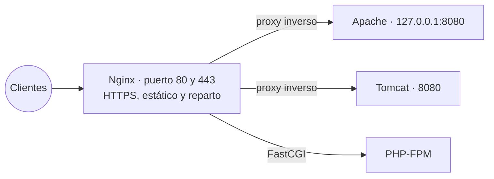

# Nginx: servidor web, proxy inverso y HTTPS

## Índice

1. [Qué es Nginx](#1-qué-es-nginx)
2. [Escenario](#2-escenario)
3. [Instalación y estructura](#3-instalación-y-estructura)
4. [Bloques server: los sitios web](#4-bloques-server-los-sitios-web)
5. [PHP con PHP-FPM y MariaDB](#5-php-con-php-fpm-y-mariadb)
6. [Proxy inverso](#6-proxy-inverso)
7. [Balanceo de carga](#7-balanceo-de-carga)
8. [HTTPS](#8-https)
   1. [Certificados y autoridades de certificación](#81-certificados-y-autoridades-de-certificación)
   2. [Certificado autofirmado](#82-certificado-autofirmado)
   3. [Confiar en el certificado desde el cliente](#83-confiar-en-el-certificado-desde-el-cliente)
   4. [Let's Encrypt](#84-lets-encrypt)
9. [Resumen y problemas frecuentes](#9-resumen-y-problemas-frecuentes)

---

## 1. Qué es Nginx

**Nginx** (se pronuncia *engine-ex*) es un servidor web libre que hoy atiende una gran parte de los sitios web del mundo. Además de servir páginas, se usa muchísimo como **proxy inverso** y como **balanceador de carga**: se coloca delante de otros servidores, recibe las peticiones de Internet y las reparte entre ellos.

Su diferencia fundamental con Apache (documento 01) está en cómo atiende las conexiones:

| | Apache | Nginx |
|---|---|---|
| Modelo | Un proceso o hilo por cada conexión (según el módulo MPM elegido). | Unos pocos procesos que atienden miles de conexiones cada uno, por **eventos**. |
| Consumo con muchas conexiones | Crece con cada conexión. | Se mantiene bajo y estable. |
| Configuración por directorio | Ficheros `.htaccess` en cada carpeta. | No existe: toda la configuración está centralizada. |
| Contenido dinámico (PHP) | Puede ejecutarlo dentro del propio servidor (`mod_php`). | Lo pasa siempre a un programa externo, como **PHP-FPM**. |
| Uso más habitual | Servidor de aplicaciones, alojamiento compartido. | Contenido estático, proxy inverso, balanceador de carga. |

No es raro usarlos juntos: Nginx delante, recibiendo las peticiones y sirviendo lo estático, y Apache detrás, ejecutando la aplicación. Es justamente lo que se monta en el apartado 6.



---

## 2. Escenario

Se usa el escenario del documento 04: el servidor `srv.asir.lan` (Ubuntu Server 26.04, `192.168.50.4`) y el cliente `cli.asir.lan` (Debian 13 con XFCE, `192.168.50.20`). En la zona `asir.lan` del DNS ya existe el alias `www`; para este documento se añaden dos más, incrementando el número de serie de la zona (apartado 6 del documento 04):

```text
; En /etc/bind/db.asir.lan
app     IN      CNAME   srv
lb      IN      CNAME   srv
```

```bash
usuario@srv:~$ sudo rndc reload
usuario@cli:~$ dig +short app.asir.lan lb.asir.lan
srv.asir.lan.
192.168.50.4
srv.asir.lan.
192.168.50.4
```

| Nombre | Uso en este documento |
|---|---|
| `www.asir.lan` | Sitio web servido por Nginx, con PHP y, al final, con HTTPS. |
| `app.asir.lan` | Aplicación de Apache publicada a través de Nginx como proxy inverso. |
| `lb.asir.lan` | Balanceo de carga entre dos servidores. |

---

## 3. Instalación y estructura

Si en el servidor está instalado Apache escuchando en el puerto 80, Nginx no podrá arrancar: dos servicios no pueden usar el mismo puerto. Como Apache se usará más adelante como servidor de fondo, se cambia antes a la dirección `127.0.0.1` y al puerto `8080`:

```bash
usuario@srv:~$ sudo apt -y install apache2
usuario@srv:~$ sudo sed -i 's/^Listen 80$/Listen 127.0.0.1:8080/' /etc/apache2/ports.conf
usuario@srv:~$ sudo sed -i 's/<VirtualHost \*:80>/<VirtualHost *:8080>/' /etc/apache2/sites-available/000-default.conf
usuario@srv:~$ echo '<h1>Respuesta de Apache</h1>' | sudo tee /var/www/html/index.html
usuario@srv:~$ sudo systemctl restart apache2
```

Al escuchar solo en `127.0.0.1`, Apache ya no es accesible desde la red: solo Nginx, desde la propia máquina, podrá hablar con él. Ahora se instala Nginx:

```bash
usuario@srv:~$ sudo apt -y install nginx
usuario@srv:~$ nginx -v
nginx version: nginx/1.28.3 (Ubuntu)
usuario@srv:~$ sudo ss -tlnp | grep -E ':(80|8080) '
LISTEN 0  511        0.0.0.0:80     0.0.0.0:*  users:(("nginx",pid=5210,fd=5))
LISTEN 0  511      127.0.0.1:8080   0.0.0.0:*  users:(("apache2",pid=4987,fd=4))
```

La configuración tiene una estructura muy parecida a la de Apache en Debian y Ubuntu:

| Ruta | Contenido | Equivalente en Apache |
|---|---|---|
| `/etc/nginx/nginx.conf` | Configuración global. | `apache2.conf` |
| `/etc/nginx/sites-available/` | Un fichero por sitio. | `sites-available/` |
| `/etc/nginx/sites-enabled/` | Enlaces a los sitios activos. | `sites-enabled/` |
| `/etc/nginx/snippets/` | Fragmentos de configuración reutilizables. | `conf-available/` |
| `/var/www/html/` | Sitio por defecto. | El mismo. |
| `/var/log/nginx/` | `access.log` y `error.log`. | `/var/log/apache2/` |

| Orden | Para qué sirve |
|---|---|
| `nginx -t` | Comprueba la sintaxis de la configuración. Hay que ejecutarla **siempre** antes de aplicar un cambio. |
| `systemctl reload nginx` | Aplica la configuración sin cortar las conexiones en curso. |
| `nginx -T` | Muestra la configuración completa que se está usando, con todos los ficheros incluidos. |

> **Nota:** Nginx no tiene órdenes como `a2ensite` o `a2dissite`. Un sitio se activa creando un **enlace simbólico** (documento 03 de los apuntes) de `sites-available` a `sites-enabled`, y se desactiva borrando el enlace.

---

## 4. Bloques server: los sitios web

Cada sitio se define con un bloque **`server`**, el equivalente al `VirtualHost` de Apache. Se crea el contenido del sitio y su configuración:

```bash
usuario@srv:~$ sudo mkdir -p /var/www/asir
usuario@srv:~$ echo '<h1>Sitio www.asir.lan servido por Nginx</h1>' | sudo tee /var/www/asir/index.html
usuario@srv:~$ sudo nano /etc/nginx/sites-available/www.asir.lan
```

```text
# /etc/nginx/sites-available/www.asir.lan
server {
    listen 80;
    server_name www.asir.lan;

    root /var/www/asir;
    index index.html index.php;

    access_log /var/log/nginx/www.asir.lan.access.log;
    error_log  /var/log/nginx/www.asir.lan.error.log;

    location / {
        try_files $uri $uri/ =404;
    }

    location /privado/ {
        allow 192.168.50.0/24;
        deny all;
    }
}
```

| Directiva | Significado | Equivalente en Apache |
|---|---|---|
| `listen 80;` | Puerto en el que atiende el sitio. | `<VirtualHost *:80>` |
| `server_name` | Nombre o nombres del sitio. Nginx elige el bloque comparando este nombre con la cabecera `Host` de la petición. | `ServerName` |
| `root` | Carpeta con los ficheros del sitio. | `DocumentRoot` |
| `index` | Ficheros que se sirven al pedir una carpeta. | `DirectoryIndex` |
| `location` | Configuración para las URL que empiezan por una ruta. | `<Location>` y `<Directory>` |
| `try_files $uri $uri/ =404;` | Busca un fichero con ese nombre; si no existe, una carpeta; si tampoco, devuelve un error 404. | Comportamiento por defecto de Apache. |
| `allow` / `deny` | Control de acceso por IP. | `Require ip` |

Se activa el sitio, se comprueba la sintaxis y se recarga:

```bash
usuario@srv:~$ sudo ln -s /etc/nginx/sites-available/www.asir.lan /etc/nginx/sites-enabled/
usuario@srv:~$ sudo nginx -t
nginx: the configuration file /etc/nginx/nginx.conf syntax is ok
nginx: configuration file /etc/nginx/nginx.conf test is successful
usuario@srv:~$ sudo systemctl reload nginx
usuario@cli:~$ curl http://www.asir.lan
<h1>Sitio www.asir.lan servido por Nginx</h1>
usuario@cli:~$ curl http://192.168.50.4
...
<h1>Welcome to nginx!</h1>
```

Al pedir `www.asir.lan`, Nginx sirve el nuevo sitio; al pedir directamente la IP, ningún `server_name` coincide y responde el **sitio por defecto** (`sites-enabled/default`), que tiene la directiva `default_server`.

**Tipos de location**

| Forma | Coincide con | Ejemplo |
|---|---|---|
| `location /ruta/` | Las URL que **empiezan** por esa ruta. Se elige la más larga que coincida. | `location /privado/` |
| `location = /ruta` | Exactamente esa URL. | `location = /favicon.ico` |
| `location ~ expresión` | Una expresión regular, distinguiendo mayúsculas (documento 09 de los apuntes). | `location ~ \.php$` |
| `location ~* expresión` | Una expresión regular, sin distinguir mayúsculas. | `location ~* \.(jpg\|png)$` |

---

## 5. PHP con PHP-FPM y MariaDB

Nginx no ejecuta PHP por sí mismo: pasa los ficheros `.php` a **PHP-FPM** (*FastCGI Process Manager*), un servicio aparte con sus propios procesos de PHP, a través de un *socket*. Con una base de datos **MariaDB** se tiene la pila conocida como **LEMP** (Linux, Nginx, MariaDB, PHP).

```bash
usuario@srv:~$ sudo apt -y install php-fpm php-mysql mariadb-server
usuario@srv:~$ ls /run/php/
php-fpm.sock  php8.4-fpm.pid  php8.4-fpm.sock
```

`php-fpm.sock` es un enlace genérico al *socket* de la versión de PHP instalada, cuyo número puede variar. Si no existiera, se usaría el de la versión, por ejemplo `php8.4-fpm.sock`. Se añade al bloque `server` de `www.asir.lan`:

```text
    location ~ \.php$ {
        include snippets/fastcgi-php.conf;
        fastcgi_pass unix:/run/php/php-fpm.sock;
    }
```

`snippets/fastcgi-php.conf` es un fragmento que trae Nginx con todo lo que necesita PHP-FPM, y `fastcgi_pass` indica a qué *socket* enviar los ficheros PHP.

Para la base de datos se crea un usuario propio de la aplicación, con permisos solo sobre su base de datos, y una tabla de ejemplo. En Debian y Ubuntu, `root` entra en MariaDB sin contraseña desde la propia máquina:

```bash
usuario@srv:~$ sudo mariadb <<'EOF'
CREATE DATABASE tienda;
CREATE USER 'tienda'@'localhost' IDENTIFIED BY 'Tienda123.';
GRANT ALL PRIVILEGES ON tienda.* TO 'tienda'@'localhost';
USE tienda;
CREATE TABLE productos (id INT AUTO_INCREMENT PRIMARY KEY, nombre VARCHAR(50), precio DECIMAL(6,2));
INSERT INTO productos (nombre, precio) VALUES ('Teclado', 19.90), ('Ratón', 9.50), ('Monitor', 129.00);
EOF
```

Y una página PHP que la consulta:

```bash
usuario@srv:~$ sudo nano /var/www/asir/productos.php
```

```php
<?php
$bd = new mysqli('localhost', 'tienda', 'Tienda123.', 'tienda');
$resultado = $bd->query('SELECT nombre, precio FROM productos');
echo "<h1>Productos</h1><ul>";
while ($fila = $resultado->fetch_assoc()) {
    echo "<li>{$fila['nombre']}: {$fila['precio']} €</li>";
}
echo "</ul>";
```

```bash
usuario@srv:~$ sudo nginx -t && sudo systemctl reload nginx
usuario@cli:~$ curl http://www.asir.lan/productos.php
<h1>Productos</h1><ul><li>Teclado: 19.90 €</li><li>Ratón: 9.50 €</li><li>Monitor: 129.00 €</li></ul>
```

> **Advertencia:** En una aplicación real, la contraseña de la base de datos no se escribe en un fichero que esté dentro de la carpeta pública del sitio, y las consultas que incluyen datos del usuario se hacen con **consultas preparadas**, para evitar la inyección SQL.

---

## 6. Proxy inverso

Un **proxy inverso** recibe las peticiones de los clientes y las reenvía a uno o varios servidores internos, devolviendo después su respuesta. Para el cliente, todo parece venir de Nginx: no sabe qué hay detrás. Se publica la aplicación de Apache, que escucha en `127.0.0.1:8080`, con el nombre `app.asir.lan`:

```text
# /etc/nginx/sites-available/app.asir.lan
server {
    listen 80;
    server_name app.asir.lan;

    location / {
        proxy_pass http://127.0.0.1:8080;
        proxy_set_header Host $host;
        proxy_set_header X-Real-IP $remote_addr;
        proxy_set_header X-Forwarded-For $proxy_add_x_forwarded_for;
        proxy_set_header X-Forwarded-Proto $scheme;
    }
}
```

| Directiva | Significado |
|---|---|
| `proxy_pass` | Servidor al que se reenvían las peticiones. |
| `proxy_set_header Host $host` | Envía al servidor de fondo el nombre que pidió el cliente (`app.asir.lan`), para que pueda elegir su propio sitio. |
| `X-Real-IP`, `X-Forwarded-For` | Pasan la **IP real del cliente**. Sin ellas, el servidor de fondo vería todas las peticiones como si vinieran de Nginx (`127.0.0.1`). |
| `X-Forwarded-Proto` | Indica si el cliente usó HTTP o HTTPS. |

```bash
usuario@srv:~$ sudo ln -s /etc/nginx/sites-available/app.asir.lan /etc/nginx/sites-enabled/
usuario@srv:~$ sudo nginx -t && sudo systemctl reload nginx
usuario@cli:~$ curl -I http://app.asir.lan
HTTP/1.1 200 OK
Server: nginx/1.28.3 (Ubuntu)
...
usuario@cli:~$ curl http://app.asir.lan
<h1>Respuesta de Apache</h1>
```

La respuesta es la página de Apache, pero la cabecera `Server` dice `nginx`: el cliente solo habla con Nginx. Así, por ejemplo, se podría publicar el Tomcat de la tarea 4.3 de los apuntes, cambiando solo el puerto de `proxy_pass`.

> **Nota:** El registro de Apache seguirá mostrando `127.0.0.1` como cliente, porque registra la IP de quien le conecta, que es Nginx. Para que use la IP de `X-Forwarded-For`, se activa en Apache el módulo `remoteip` (`a2enmod remoteip`) con la directiva `RemoteIPHeader X-Forwarded-For`.

---

## 7. Balanceo de carga

Cuando un servidor no basta para atender todas las peticiones, se ponen varios iguales detrás de Nginx, que **reparte** las peticiones entre ellos. Para el ejemplo se crean dos servidores web mínimos con el módulo `http.server` de Python, cada uno con una página distinta para saber cuál responde:

```bash
usuario@srv:~$ mkdir -p ~/nodo1 ~/nodo2
usuario@srv:~$ echo 'Respuesta del nodo 1' > ~/nodo1/index.html
usuario@srv:~$ echo 'Respuesta del nodo 2' > ~/nodo2/index.html
usuario@srv:~$ nohup python3 -m http.server 8081 --bind 127.0.0.1 --directory ~/nodo1 >/dev/null 2>&1 &
usuario@srv:~$ nohup python3 -m http.server 8082 --bind 127.0.0.1 --directory ~/nodo2 >/dev/null 2>&1 &
```

El bloque **`upstream`** define el grupo de servidores, y `proxy_pass` apunta a él por su nombre:

```text
# /etc/nginx/sites-available/lb.asir.lan
upstream nodos {
    server 127.0.0.1:8081;
    server 127.0.0.1:8082;
}

server {
    listen 80;
    server_name lb.asir.lan;

    location / {
        proxy_pass http://nodos;
    }
}
```

```bash
usuario@srv:~$ sudo ln -s /etc/nginx/sites-available/lb.asir.lan /etc/nginx/sites-enabled/
usuario@srv:~$ sudo nginx -t && sudo systemctl reload nginx
usuario@cli:~$ for i in 1 2 3 4; do curl -s http://lb.asir.lan; done
Respuesta del nodo 1
Respuesta del nodo 2
Respuesta del nodo 1
Respuesta del nodo 2
```

Las peticiones se reparten alternativamente entre los dos nodos. Si se detiene uno (`kill %1`), Nginx deja de enviarle peticiones y el otro atiende todas: es la **alta disponibilidad** que da el balanceo.

| Método de reparto | Directiva en `upstream` | Funcionamiento |
|---|---|---|
| Turno rotatorio | (por defecto) | Las peticiones se reparten por turnos. |
| Por peso | `server 127.0.0.1:8081 weight=3;` | Un servidor más potente recibe más peticiones. |
| Menos conexiones | `least_conn;` | Cada petición va al servidor con menos conexiones abiertas. |
| Por IP del cliente | `ip_hash;` | Cada cliente va siempre al mismo servidor, lo que mantiene sus sesiones. |
| Servidor de reserva | `server 127.0.0.1:8083 backup;` | Solo recibe peticiones si fallan todos los demás. |

---

## 8. HTTPS

### 8.1 Certificados y autoridades de certificación

HTTPS cifra la comunicación entre el navegador y el servidor con TLS, que combina cifrado asimétrico y simétrico (apartado 1.1 del documento 34 de los apuntes). Para que el navegador sepa que habla con el servidor auténtico y no con un impostor, el servidor presenta un **certificado**: su clave pública, con su nombre, firmada por una **autoridad de certificación** (CA) en la que confía el navegador.

| Tipo de certificado | Quién lo firma | Qué ve el navegador |
|---|---|---|
| **Autofirmado** | El propio servidor. | Un aviso de seguridad: nadie de confianza garantiza la identidad del servidor. |
| **De una CA propia** | Una autoridad creada por la organización. | Confianza total, pero solo en los equipos donde se ha instalado esa CA. |
| **De una CA pública** | Una autoridad reconocida, como Let's Encrypt. | Confianza total en cualquier equipo, sin hacer nada. |

### 8.2 Certificado autofirmado

Se genera el certificado y su clave privada con `openssl`. La extensión `subjectAltName` es imprescindible: los navegadores actuales solo comprueban el nombre en ella.

```bash
usuario@srv:~$ sudo openssl req -x509 -newkey rsa:3072 -nodes -days 365 \
    -keyout /etc/ssl/private/www.asir.lan.key \
    -out /etc/ssl/certs/www.asir.lan.crt \
    -subj "/CN=www.asir.lan" \
    -addext "subjectAltName=DNS:www.asir.lan"
```

| Opción | Significado |
|---|---|
| `req -x509` | Genera directamente un certificado autofirmado, en lugar de una solicitud para que lo firme una CA. |
| `-newkey rsa:3072` | Crea a la vez una clave RSA de 3072 bits. |
| `-nodes` | No cifra la clave privada con contraseña, para que Nginx pueda arrancar sin pedirla. |
| `-days 365` | Validez del certificado. |
| `-subj "/CN=..."` | Nombre del certificado, sin preguntas interactivas. |
| `-addext "subjectAltName=..."` | Nombres válidos del certificado. |

Se modifica el bloque `server` de `www.asir.lan` para atender por HTTPS y redirigir a él todas las peticiones HTTP:

```text
# /etc/nginx/sites-available/www.asir.lan
server {
    listen 80;
    server_name www.asir.lan;
    return 301 https://$host$request_uri;
}

server {
    listen 443 ssl;
    http2 on;
    server_name www.asir.lan;

    ssl_certificate     /etc/ssl/certs/www.asir.lan.crt;
    ssl_certificate_key /etc/ssl/private/www.asir.lan.key;
    ssl_protocols       TLSv1.2 TLSv1.3;

    root /var/www/asir;
    index index.html index.php;

    location / {
        try_files $uri $uri/ =404;
    }

    location ~ \.php$ {
        include snippets/fastcgi-php.conf;
        fastcgi_pass unix:/run/php/php-fpm.sock;
    }
}
```

| Directiva | Significado |
|---|---|
| `return 301 https://$host$request_uri;` | Redirección permanente de HTTP a HTTPS, conservando el nombre y la ruta pedidos. |
| `listen 443 ssl;` | Atiende en el puerto de HTTPS. |
| `http2 on;` | Activa HTTP/2, más eficiente que HTTP/1.1. |
| `ssl_certificate`, `ssl_certificate_key` | Certificado y clave privada. |
| `ssl_protocols` | Solo las versiones seguras de TLS. |

```bash
usuario@srv:~$ sudo nginx -t && sudo systemctl reload nginx
usuario@cli:~$ curl -I http://www.asir.lan
HTTP/1.1 301 Moved Permanently
Location: https://www.asir.lan/
usuario@cli:~$ curl https://www.asir.lan
curl: (60) SSL certificate problem: self-signed certificate
usuario@cli:~$ curl -k https://www.asir.lan
<h1>Sitio www.asir.lan servido por Nginx</h1>
```

`curl` rechaza el certificado porque nadie de confianza lo ha firmado, y con `-k` se acepta igualmente. Para ver el certificado que presenta el servidor:

```bash
usuario@cli:~$ openssl s_client -connect www.asir.lan:443 -servername www.asir.lan </dev/null 2>/dev/null | openssl x509 -noout -subject -issuer -dates
subject=CN=www.asir.lan
issuer=CN=www.asir.lan
notBefore=Oct 13 11:42:10 2026 GMT
notAfter=Oct 13 11:42:10 2027 GMT
```

El emisor (`issuer`) es el propio certificado (`subject`): por eso es **autofirmado**.

### 8.3 Confiar en el certificado desde el cliente

En un laboratorio o una red interna, se puede hacer que el cliente confíe en el certificado añadiéndolo a sus certificados de confianza:

```bash
usuario@cli:~$ scp usuario@srv.asir.lan:/etc/ssl/certs/www.asir.lan.crt .
root@cli:~# cp /home/usuario/www.asir.lan.crt /usr/local/share/ca-certificates/
root@cli:~# update-ca-certificates
Updating certificates in /etc/ssl/certs...
1 added, 0 removed; done.
usuario@cli:~$ curl https://www.asir.lan
<h1>Sitio www.asir.lan servido por Nginx</h1>
```

Ahora `curl` y las herramientas del sistema confían en el certificado sin `-k`. Firefox usa su propio almacén de certificados, así que en él hay que importarlo aparte desde Ajustes → Privacidad y seguridad → Certificados.

### 8.4 Let's Encrypt

En un servidor real con un dominio público, lo habitual es obtener certificados gratuitos de **Let's Encrypt** con **`certbot`**, que además configura Nginx y renueva los certificados automáticamente:

```bash
usuario@servidor:~$ sudo apt -y install certbot python3-certbot-nginx
usuario@servidor:~$ sudo certbot --nginx -d www.ejemplo.es
```

Para comprobar que el dominio es realmente de quien pide el certificado, Let's Encrypt le pide a `certbot` que publique un fichero en el servidor y lo descarga **desde Internet** (protocolo ACME). Por eso no se puede usar en el laboratorio: el dominio `asir.lan` no existe en Internet y el servidor no es accesible desde fuera. Los certificados duran 90 días, y el temporizador `certbot.timer` de `systemd` los renueva solo antes de que caduquen.

---

## 9. Resumen y problemas frecuentes

| Orden | Para qué sirve |
|---|---|
| `nginx -t` | Comprueba la configuración. |
| `systemctl reload nginx` | Aplica la configuración sin cortar conexiones. |
| `nginx -T` | Muestra la configuración completa en uso. |
| `ln -s /etc/nginx/sites-available/sitio /etc/nginx/sites-enabled/` | Activa un sitio. |
| `tail -f /var/log/nginx/error.log` | Muestra los errores en tiempo real. |
| `openssl req -x509 ...` | Genera un certificado autofirmado. |
| `openssl s_client -connect servidor:443` | Muestra el certificado y la conexión TLS de un servidor. |

| Síntoma | Causa habitual |
|---|---|
| Nginx no arranca: `Address already in use` | Otro servicio, normalmente Apache, ocupa el puerto 80 o el 443. |
| Aparece la página de bienvenida de Nginx en lugar del sitio | El nombre pedido no coincide con ningún `server_name`, o el sitio no está enlazado en `sites-enabled`. |
| `502 Bad Gateway` | El servidor de fondo (Apache, PHP-FPM, un nodo) no está en marcha o la dirección de `proxy_pass` o `fastcgi_pass` es incorrecta. |
| Se descarga el fichero `.php` en vez de ejecutarse | Falta el bloque `location ~ \.php$`. |
| `403 Forbidden` | La carpeta no tiene fichero índice, o Nginx (usuario `www-data`) no tiene permisos para leerla. |
| El servidor de fondo registra siempre `127.0.0.1` | Faltan las cabeceras `X-Forwarded-For` o su configuración en el servidor de fondo. |
