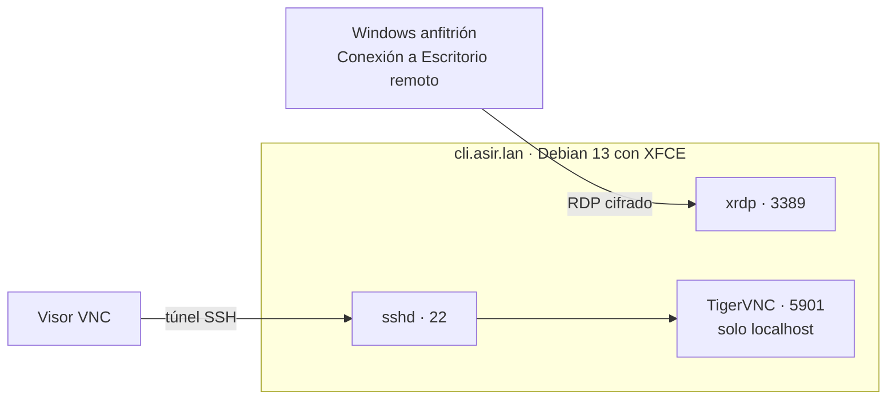
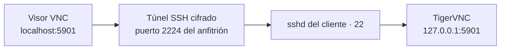

# Acceso remoto gráfico: RDP con xrdp y VNC

## Índice

1. [Formas de acceso remoto](#1-formas-de-acceso-remoto)
2. [Escenario](#2-escenario)
3. [Escritorio remoto RDP con xrdp](#3-escritorio-remoto-rdp-con-xrdp)
   1. [Instalación](#31-instalación)
   2. [Conectar desde Windows](#32-conectar-desde-windows)
4. [VNC con TigerVNC y un túnel SSH](#4-vnc-con-tigervnc-y-un-túnel-ssh)
   1. [Por qué VNC necesita un túnel](#41-por-qué-vnc-necesita-un-túnel)
   2. [Crear el escritorio VNC](#42-crear-el-escritorio-vnc)
   3. [Conectar a través del túnel SSH](#43-conectar-a-través-del-túnel-ssh)
   4. [Compartir la pantalla real del equipo](#44-compartir-la-pantalla-real-del-equipo)
5. [Seguridad del acceso remoto](#5-seguridad-del-acceso-remoto)
6. [Resumen y problemas frecuentes](#6-resumen-y-problemas-frecuentes)

---

## 1. Formas de acceso remoto

**SSH** (documento 34 de los apuntes) es la forma habitual de administrar un servidor Linux a distancia, pero solo ofrece una terminal de texto. Cuando se necesita trabajar con el **escritorio** de un equipo remoto, por ejemplo para dar soporte a un usuario o usar una aplicación gráfica, se usan protocolos de acceso remoto gráfico:

| Método | Qué se ve | Puerto | Cifrado | Uso típico |
|---|---|---|---|---|
| **SSH** | Una terminal de texto. | 22/tcp | Sí | Administración de servidores. |
| **SSH con X11** (`ssh -X`) | Ventanas sueltas de aplicaciones, que se dibujan en el equipo local (apartado 3.2 del documento 34). | 22/tcp | Sí | Abrir una aplicación gráfica concreta. |
| **RDP** | Un escritorio completo. | 3389/tcp | Sí (TLS) | Escritorio remoto de Windows; en Linux, con **xrdp**. |
| **VNC** | Un escritorio completo: uno nuevo o la pantalla real del equipo. | 5900+N/tcp | **No**, en su forma básica | Soporte remoto, entornos sin RDP. |



**RDP** (*Remote Desktop Protocol*) es el protocolo de Microsoft para el Escritorio remoto de Windows. **xrdp** es un servidor libre que lo implementa en Linux, de modo que se puede entrar al escritorio de un equipo Linux con el mismo cliente que se usa para Windows. **VNC** (*Virtual Network Computing*) es un protocolo más antiguo y multiplataforma, que funciona básicamente enviando imágenes de la pantalla.

---

## 2. Escenario

El equipo al que se accede es el cliente del laboratorio, `cli.asir.lan` (Debian 13 con escritorio **XFCE**), porque es el que tiene entorno gráfico. Se accede a él desde el **equipo anfitrión Windows**.

Como el cliente solo está conectado a la red interna del laboratorio, que el anfitrión no alcanza, se le añade para este documento un **segundo adaptador en modo NAT**, con dos reglas de reenvío de puertos en VirtualBox (la IP del invitado se deja en blanco):

| Regla | Puerto anfitrión | Puerto invitado | Para qué |
|---|---|---|---|
| RDP | `33890` | `3389` | Conectar con xrdp. |
| SSH | `2224` | `22` | Conectar por SSH y crear el túnel para VNC. |

Se usa el puerto `33890` en el anfitrión, y no el `3389`, porque Windows ya puede tener su propio servidor de Escritorio remoto en el `3389`.

> **Nota:** En el cliente debe estar instalado el servidor SSH (`apt install openssh-server`) para el apartado 4. Si la red interna del laboratorio fuera de tipo **solo anfitrión** de VirtualBox, el anfitrión alcanzaría directamente la IP del cliente y no harían falta las reglas de reenvío.

---

## 3. Escritorio remoto RDP con xrdp

### 3.1 Instalación

```bash
root@cli:~# apt -y install xrdp
root@cli:~# adduser xrdp ssl-cert
root@cli:~# systemctl restart xrdp
root@cli:~# ss -tlnp | grep 3389
LISTEN 0  2  *:3389  *:*  users:(("xrdp",pid=2810,fd=11))
```

| Orden | Qué hace |
|---|---|
| `apt -y install xrdp` | Instala xrdp y `xorgxrdp`, el módulo con el que crea los escritorios remotos. |
| `adduser xrdp ssl-cert` | Añade el usuario `xrdp` al grupo `ssl-cert`, que es el que puede leer la clave privada del certificado del sistema (`/etc/ssl/private/ssl-cert-snakeoil.key`). xrdp la usa para **cifrar** las conexiones con TLS. |

xrdp tiene dos servicios: `xrdp`, que atiende las conexiones RDP, y `xrdp-sesman`, el gestor de sesiones que inicia el escritorio de cada usuario. Su configuración está en `/etc/xrdp/`, con `xrdp.ini` y `sesman.ini` como ficheros principales.

### 3.2 Conectar desde Windows

En el anfitrión se abre **Conexión a Escritorio remoto** (`mstsc`) y se conecta a `localhost:33890`:

1. Windows avisa de que no puede comprobar la identidad del equipo remoto: es el **certificado autofirmado** de Debian. Se acepta, igual que con Webmin (tarea 1.6 de los apuntes).
2. Aparece la pantalla de inicio de sesión de xrdp. Con la sesión `Xorg`, se escriben el usuario y la contraseña del cliente Debian.
3. Se abre un escritorio **XFCE nuevo**, independiente de la pantalla física del equipo.

Desde un equipo Linux, el cliente equivalente es **Remmina** (paquetes `remmina` y `remmina-plugin-rdp`) o la orden `xfreerdp3`.

> **Importante:** xrdp crea una sesión gráfica **nueva** para el usuario. Si ese mismo usuario tiene abierta a la vez una sesión en la pantalla física del equipo, algunos escritorios no permiten la segunda sesión y la conexión se cierra nada más iniciarse. XFCE suele funcionar, pero GNOME no. La solución es cerrar la sesión local antes de conectar, o entrar con otro usuario.

> **Nota:** Si el equipo tiene instalados varios escritorios, xrdp abre el que esté configurado por defecto en el sistema. Para indicar uno concreto para un usuario, se escribe en su fichero `~/.xsession`: `echo xfce4-session > ~/.xsession`.

---

## 4. VNC con TigerVNC y un túnel SSH

### 4.1 Por qué VNC necesita un túnel

VNC envía las imágenes de la pantalla y las pulsaciones del teclado **sin cifrar**, y su contraseña es muy débil: solo se usan sus 8 primeros caracteres. Por eso **nunca debe exponerse directamente a la red**. La forma segura de usarlo es hacer que el servidor VNC escuche solo en `localhost` y llegar a él a través de un **túnel SSH** (apartado 7.1 del documento 34), que cifra toda la conexión.

Cada escritorio VNC se identifica con un **número de pantalla** (`:1`, `:2`...), y su puerto es `5900` más ese número: la pantalla `:1` escucha en el puerto `5901`.

### 4.2 Crear el escritorio VNC

```bash
root@cli:~# apt -y install tigervnc-standalone-server tigervnc-tools
usuario@cli:~$ tigervncpasswd
Password:
Verify:
Would you like to enter a view-only password (y/n)? n
usuario@cli:~$ tigervncserver :1 -localhost yes -geometry 1280x800
New Xtigervnc server 'cli:1 (usuario)' on port 5901 for display :1.
usuario@cli:~$ tigervncserver -list
TigerVNC server sessions:

X DISPLAY #	RFB PORT #	RFB UNIX PATH	PROCESS ID #	SERVER
1         	5901      	              	3311        	Xtigervnc
usuario@cli:~$ ss -tlnp | grep 5901
LISTEN 0  5  127.0.0.1:5901  0.0.0.0:*  users:(("Xtigervnc",pid=3311,fd=7))
```

| Orden | Qué hace |
|---|---|
| `tigervncpasswd` | Define la contraseña de VNC del usuario. Una contraseña de «solo lectura» permitiría ver el escritorio sin poder manejarlo. |
| `tigervncserver :1` | Crea un escritorio virtual nuevo en la pantalla `:1`, con la sesión gráfica por defecto del sistema (XFCE). |
| `-localhost yes` | Solo acepta conexiones desde la propia máquina: imprescindible para obligar a usar el túnel SSH. |
| `-geometry 1280x800` | Resolución del escritorio. |
| `tigervncserver -list` | Lista los escritorios VNC del usuario. |
| `tigervncserver -kill :1` | Cierra el escritorio de la pantalla `:1`. |

`ss` confirma que el puerto `5901` solo escucha en `127.0.0.1`: desde la red no se puede conectar directamente.

### 4.3 Conectar a través del túnel SSH

Desde el anfitrión Windows se abre el túnel con el cliente SSH que incluye Windows. La conexión SSH llega al cliente Debian por el reenvío de puertos `2224`, y el túnel lleva el puerto `5901` local del anfitrión hasta el `5901` del cliente:

```powershell
PS C:\> ssh -L 5901:localhost:5901 -p 2224 usuario@localhost
usuario@localhost's password:
usuario@cli:~$
```

Mientras esa sesión SSH esté abierta, se conecta un **visor VNC** del anfitrión (por ejemplo, el TigerVNC Viewer para Windows) a `localhost:5901`, y se escribe la contraseña de VNC.



| Elemento de `ssh -L 5901:localhost:5901` | Significado |
|---|---|
| Primer `5901` | Puerto del **anfitrión** en el que se abre el túnel. Es al que se conecta el visor VNC. |
| `localhost:5901` | Destino, visto **desde el cliente Debian**: su propio puerto `5901`, el de TigerVNC. |

> **Nota:** Para que el escritorio VNC arranque automáticamente con el sistema, TigerVNC incluye el servicio `tigervncserver@.service`. Se asigna la pantalla a cada usuario en `/etc/tigervnc/vncserver.users` (por ejemplo, `:1=usuario`) y se habilita con `systemctl enable --now tigervncserver@:1`.

### 4.4 Compartir la pantalla real del equipo

TigerVNC crea escritorios **nuevos**, independientes de lo que se ve en el monitor. Para el **soporte remoto**, en el que el técnico necesita ver la misma pantalla que el usuario, se usa `x11vnc`, que comparte la sesión gráfica que ya está abierta en el equipo:

```bash
root@cli:~# apt -y install x11vnc
usuario@cli:~$ x11vnc -display :0 -localhost -usepw
```

`-display :0` comparte la pantalla física, `-localhost` vuelve a obligar a usar el túnel SSH y `-usepw` pide la contraseña de VNC. El técnico se conecta de la misma forma, a través del túnel. Hay que tener en cuenta que, en este caso, el usuario ve todo lo que hace el técnico, y viceversa.

---

## 5. Seguridad del acceso remoto

| Recomendación | Motivo |
|---|---|
| No exponer nunca RDP ni VNC directamente a Internet. | Son objetivos constantes de ataques automáticos de fuerza bruta, y los fallos en servidores RDP han permitido ataques muy graves sin contraseña. Desde fuera se accede a través de una **VPN** o de un túnel SSH. |
| Usar siempre VNC a través de un túnel SSH. | VNC no cifra la conexión y su contraseña es débil. |
| Limitar en el cortafuegos quién puede conectarse a los puertos 3389 y 22 (documentos 44 y 46 de los apuntes). | Reduce la superficie de ataque a los equipos que realmente lo necesitan. |
| Preferir la autenticación por clave en SSH (apartado 3.4 del documento 34). | Elimina los ataques de fuerza bruta contra las contraseñas. |

---

## 6. Resumen y problemas frecuentes

| Orden | Para qué sirve |
|---|---|
| `apt install xrdp` y `adduser xrdp ssl-cert` | Instala el servidor RDP y le permite usar el certificado del sistema. |
| `systemctl status xrdp xrdp-sesman` | Estado de los servicios de xrdp. |
| `tigervncpasswd` | Define la contraseña de VNC. |
| `tigervncserver :1 -localhost yes` | Crea un escritorio VNC accesible solo por túnel. |
| `tigervncserver -list` / `-kill :1` | Lista o cierra los escritorios VNC. |
| `ssh -L 5901:localhost:5901 usuario@equipo` | Crea el túnel SSH para VNC. |
| `x11vnc -display :0 -localhost -usepw` | Comparte la pantalla real del equipo. |

| Síntoma | Causa habitual |
|---|---|
| La conexión RDP se cierra nada más iniciar sesión | El usuario tiene una sesión abierta en la pantalla física, o el escritorio no admite varias sesiones. |
| Pantalla negra o gris al conectar por RDP | No se encuentra el escritorio que debe iniciarse: hay que indicarlo en `~/.xsession`. |
| `xrdp` no arranca o rechaza las conexiones cifradas | El usuario `xrdp` no pertenece al grupo `ssl-cert` y no puede leer la clave del certificado. |
| El visor VNC no conecta | El túnel SSH no está abierto, o se intenta conectar directamente a la IP del equipo cuando el servidor solo escucha en `localhost`. |

> **Nota:** Los registros de xrdp están en `/var/log/xrdp.log` y `/var/log/xrdp-sesman.log`, y en ellos aparece el motivo de cualquier fallo de conexión.
