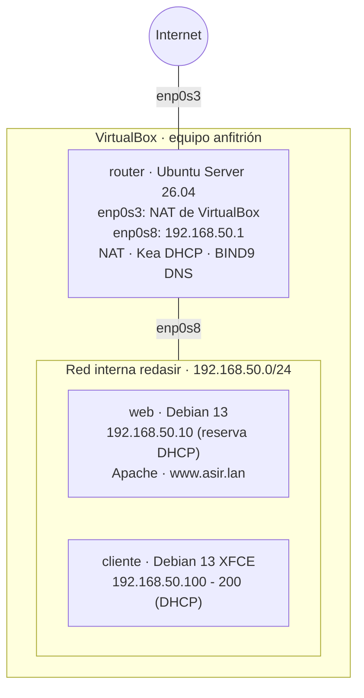
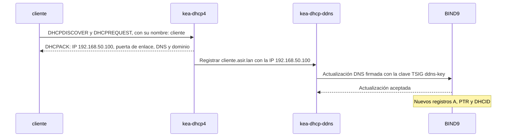

# Laboratorio: router con DHCP y DNS, servidor web y cliente

## Índice

1. [Objetivo y esquema de la red](#1-objetivo-y-esquema-de-la-red)
2. [Plan de direccionamiento y nombres](#2-plan-de-direccionamiento-y-nombres)
3. [Paso 1: preparar VirtualBox](#3-paso-1-preparar-virtualbox)
   1. [Crear las máquinas virtuales](#31-crear-las-máquinas-virtuales)
   2. [Configurar los adaptadores de red](#32-configurar-los-adaptadores-de-red)
   3. [Orden de trabajo](#33-orden-de-trabajo)
4. [Paso 2: el router (Ubuntu Server)](#4-paso-2-el-router-ubuntu-server)
   1. [Instalación del sistema y de los paquetes](#41-instalación-del-sistema-y-de-los-paquetes)
   2. [Nombre del equipo](#42-nombre-del-equipo)
   3. [Configuración de red con Netplan](#43-configuración-de-red-con-netplan)
   4. [Reenvío IP](#44-reenvío-ip)
   5. [NAT con nftables](#45-nat-con-nftables)
   6. [DNS con BIND9](#46-dns-con-bind9)
   7. [DHCP con Kea](#47-dhcp-con-kea)
5. [Paso 3: el servidor web (Debian 13)](#5-paso-3-el-servidor-web-debian-13)
   1. [Instalación y comprobación de la red](#51-instalación-y-comprobación-de-la-red)
   2. [Apache con una pequeña web](#52-apache-con-una-pequeña-web)
6. [Paso 4: el cliente (Debian 13 con escritorio)](#6-paso-4-el-cliente-debian-13-con-escritorio)
   1. [Instalación y comprobación de la red](#61-instalación-y-comprobación-de-la-red)
   2. [Comprobaciones desde el cliente](#62-comprobaciones-desde-el-cliente)
   3. [El cliente registrado en el DNS](#63-el-cliente-registrado-en-el-dns)
7. [Paso 5: cómo funciona el DNS dinámico](#7-paso-5-cómo-funciona-el-dns-dinámico)
8. [Comprobación final](#8-comprobación-final)
9. [Problemas frecuentes](#9-problemas-frecuentes)
10. [Resumen de ficheros y órdenes](#10-resumen-de-ficheros-y-órdenes)

---

## 1. Objetivo y esquema de la red

En este laboratorio se monta, en VirtualBox y dentro de una **red interna**, una pequeña red completa como la de una empresa:

- Un **router Ubuntu Server** que da salida a Internet a toda la red (NAT), reparte las direcciones IP (DHCP con **Kea**) y resuelve los nombres (DNS con **BIND9**).
- Un **servidor web Debian 13** con Apache y una pequeña web, que recibe siempre la misma IP gracias a una **reserva DHCP**.
- Un **cliente Debian 13** con escritorio, que obtiene toda su configuración de red automáticamente y navega tanto por la web interna como por Internet.

Además, el DHCP **registra automáticamente en el DNS** el nombre de cada equipo al darle su IP (**DNS dinámico**), igual que en una red real con un dominio.



Los documentos de servicios en red explican en detalle cada pieza: DHCP (documento 02), DNS (documento 04) y Apache (documento 01). Este laboratorio las combina, paso a paso.

---

## 2. Plan de direccionamiento y nombres

| Equipo | Sistema | Adaptadores de VirtualBox | Dirección IP | Nombre |
|---|---|---|---|---|
| `router` | Ubuntu Server 26.04 | 1: **NAT** (`enp0s3`)<br>2: **Red interna** `redasir` (`enp0s8`) | `enp0s3`: la que da VirtualBox (`10.0.2.15`)<br>`enp0s8`: `192.168.50.1/24`, fija | `router.asir.lan` |
| `web` | Debian 13, sin escritorio | 1: **Red interna** `redasir` (`enp0s3`), con la MAC fija `08:00:27:00:00:10` | `192.168.50.10`, reservada en el DHCP | `web.asir.lan` y el alias `www.asir.lan` |
| `cliente` | Debian 13 con XFCE | 1: **Red interna** `redasir` (`enp0s3`) | Una del rango `192.168.50.100` a `192.168.50.200`, por DHCP | `cliente.asir.lan` |

| Parámetro de la red | Valor |
|---|---|
| Red interna | `192.168.50.0/24` |
| Puerta de enlace y DNS | `192.168.50.1` (el router) |
| Rango del DHCP | `192.168.50.100` - `192.168.50.200` |
| Dominio | `asir.lan` |
| DNS al que reenvía el router | `8.8.8.8` y `1.1.1.1` |
| Clave TSIG del DNS dinámico | `ddns-key` |

Solo el router tiene un adaptador NAT. El servidor web y el cliente están conectados **únicamente a la red interna**: todo su tráfico hacia Internet pasa por el router.

---

## 3. Paso 1: preparar VirtualBox

### 3.1 Crear las máquinas virtuales

| Máquina | Memoria | Disco | Imagen de instalación |
|---|---|---|---|
| `router` | 2 GB | 20 GB | Ubuntu Server 26.04 LTS |
| `web` | 1 GB | 15 GB | Debian 13 (*netinst*) |
| `cliente` | 4 GB | 25 GB | Debian 13 (*netinst*) |

Las redes internas de VirtualBox no hay que crearlas: existen en cuanto una tarjeta se conecta a una red interna con ese nombre.

### 3.2 Configurar los adaptadores de red

Con las máquinas apagadas, desde la configuración de red de cada máquina (**Configuración → Red**) o desde el anfitrión con `VBoxManage`:

```powershell
PS C:\> VBoxManage modifyvm "router"  --nic1 nat --nic2 intnet --intnet2 redasir
PS C:\> VBoxManage modifyvm "web"     --nic1 intnet --intnet1 redasir --macaddress1 080027000010
PS C:\> VBoxManage modifyvm "cliente" --nic1 intnet --intnet1 redasir
```

| Máquina | Adaptador 1 | Adaptador 2 |
|---|---|---|
| `router` | Conectado a: **NAT** | Conectado a: **Red interna**, nombre: `redasir` |
| `web` | Conectado a: **Red interna**, nombre: `redasir`. En **Avanzadas → Dirección MAC**: `080027000010` | - |
| `cliente` | Conectado a: **Red interna**, nombre: `redasir` | - |

> **Importante:** La MAC del servidor web se fija a mano para conocerla de antemano: el DHCP la usará para reconocerlo y darle siempre la misma IP. Las MAC que empiezan por `08:00:27` son las que usa VirtualBox para sus tarjetas virtuales. Si se clona una máquina, hay que comprobar que no queden dos con la misma MAC.

### 3.3 Orden de trabajo

El router es el único con salida directa a Internet, y además es el DHCP y el DNS de los demás. Por eso se configura **primero y por completo**; después, el servidor web y el cliente se instalan ya directamente en la red interna, obteniendo su IP y su salida a Internet a través del router.

---

## 4. Paso 2: el router (Ubuntu Server)

### 4.1 Instalación del sistema y de los paquetes

Se instala Ubuntu Server 26.04 con la opción de instalar el servidor OpenSSH. Durante la instalación, el adaptador NAT obtiene su IP automáticamente, y el de la red interna se puede dejar sin configurar.

Antes de cambiar el DNS del router por el suyo propio, se instalan **todos** los paquetes que va a necesitar, mientras el sistema todavía resuelve nombres con el DNS de VirtualBox:

```bash
usuario@router:~$ sudo apt update && sudo apt -y upgrade
usuario@router:~$ sudo apt -y install bind9 bind9-dnsutils kea-dhcp4-server kea-dhcp-ddns-server nftables
```

| Paquete | Función |
|---|---|
| `bind9`, `bind9-dnsutils` | Servidor DNS y herramientas como `dig`. |
| `kea-dhcp4-server` | Servidor DHCP para IPv4. |
| `kea-dhcp-ddns-server` | Servicio que envía al DNS los registros de los equipos (DNS dinámico). |
| `nftables` | Cortafuegos con el que se hace el NAT. |

### 4.2 Nombre del equipo

```bash
usuario@router:~$ sudo hostnamectl hostname router
usuario@router:~$ sudo sed -i '/^127\.0\.1\.1/d' /etc/hosts
usuario@router:~$ echo '192.168.50.1 router.asir.lan router' | sudo tee -a /etc/hosts
usuario@router:~$ hostname -f
router.asir.lan
```

Se elimina la línea `127.0.1.1` que crea el instalador y se asocia el nombre a la IP real del router en la red interna (apartado 3.2 del documento 06 de *Sistemas operativos en red*).

### 4.3 Configuración de red con Netplan

Se sustituye el contenido del fichero de Netplan que creó el instalador:

```bash
usuario@router:~$ ls /etc/netplan/
50-cloud-init.yaml
usuario@router:~$ sudo nano /etc/netplan/50-cloud-init.yaml
```

```yaml
# /etc/netplan/50-cloud-init.yaml
network:
  version: 2
  ethernets:
    enp0s3:
      dhcp4: true
      dhcp4-overrides:
        use-dns: false
    enp0s8:
      addresses:
        - 192.168.50.1/24
      nameservers:
        addresses:
          - 127.0.0.1
        search:
          - asir.lan
```

| Elemento | Significado |
|---|---|
| `enp0s3`, `dhcp4: true` | La tarjeta NAT obtiene su IP del DHCP de VirtualBox, y con ella la puerta de enlace hacia Internet. |
| `use-dns: false` | Ignora el DNS que ofrece VirtualBox: el router usará su propio BIND9. |
| `enp0s8`, `addresses` | IP fija del router en la red interna. Sin puerta de enlace: la única ruta por defecto es la de la tarjeta NAT. |
| `nameservers` | El router se pregunta a sí mismo (`127.0.0.1`), y completa los nombres cortos con `asir.lan`. |

Todavía **no** se aplica: hasta que BIND9 esté configurado (apartado 4.6), el router se quedaría sin DNS. Se aplicará al final de ese paso. Mientras tanto se corrigen sus permisos, para evitar el aviso de Netplan:

```bash
usuario@router:~$ sudo chmod 600 /etc/netplan/50-cloud-init.yaml
```

### 4.4 Reenvío IP

Para que el router pase paquetes de la red interna a Internet, debe tener activado el **reenvío IP** (apartado 3.1 del documento 31 de los apuntes):

```bash
usuario@router:~$ echo 'net.ipv4.ip_forward = 1' | sudo tee /etc/sysctl.d/99-router.conf
usuario@router:~$ sudo sysctl -p /etc/sysctl.d/99-router.conf
net.ipv4.ip_forward = 1
```

### 4.5 NAT con nftables

Los equipos de la red interna tienen IP privadas, que no sirven para salir a Internet. El router las **enmascara** (*masquerade*): sustituye la IP de origen de los paquetes que salen por `enp0s3` por la suya propia, y deshace el cambio en las respuestas. Es un SNAT con la IP que tenga la interfaz en cada momento (apartado 9 del documento 46 de los apuntes). Se sustituye el contenido de `/etc/nftables.conf`:

```text
#!/usr/sbin/nft -f
# /etc/nftables.conf
flush ruleset

table ip nat {
    chain postrouting {
        type nat hook postrouting priority srcnat; policy accept;
        oifname "enp0s3" ip saddr 192.168.50.0/24 masquerade
    }
}
```

```bash
usuario@router:~$ sudo nft -c -f /etc/nftables.conf
usuario@router:~$ sudo systemctl enable --now nftables
usuario@router:~$ sudo nft list ruleset
table ip nat {
	chain postrouting {
		type nat hook postrouting priority srcnat; policy accept;
		oifname "enp0s3" ip saddr 192.168.50.0/24 masquerade
	}
}
```

| Elemento | Significado |
|---|---|
| `flush ruleset` | Borra cualquier regla anterior al cargar el fichero. |
| `table ip nat` / `chain postrouting` | Cadena de NAT que se aplica justo antes de que el paquete salga. |
| `oifname "enp0s3"` | Solo a los paquetes que salen hacia Internet. |
| `ip saddr 192.168.50.0/24` | Solo a los que vienen de la red interna. |
| `masquerade` | Cambia su IP de origen por la de `enp0s3`. |
| `nft -c -f` | Comprueba el fichero sin aplicarlo. |
| `systemctl enable --now nftables` | Carga las reglas ahora y en cada arranque. |

> **Nota:** El router no filtra el tráfico: solo hace NAT. En una red real se añadiría un cortafuegos con políticas restrictivas, como en los documentos 44 y 46 de los apuntes. Además, `ufw` debe seguir **inactivo** (`sudo ufw status`), para que no interfiera con estas reglas.

### 4.6 DNS con BIND9

El DNS tendrá dos zonas, la directa `asir.lan` y la inversa `50.168.192.in-addr.arpa`, que serán **dinámicas**: Kea podrá añadir y borrar registros en ellas. Para que solo Kea pueda hacerlo, las actualizaciones se firman con una **clave TSIG** (*Transaction SIGnature*), una clave secreta compartida entre BIND9 y Kea.

**1. Generar la clave TSIG**

```bash
usuario@router:~$ sudo tsig-keygen -a hmac-sha256 ddns-key | sudo tee /etc/bind/ddns.key
key "ddns-key" {
	algorithm hmac-sha256;
	secret "Q0pT7m2Kx8rVh9bF3sLwY1nA6cE4dG5jH0iU2oP8qRs=";
};
usuario@router:~$ sudo chown root:bind /etc/bind/ddns.key
usuario@router:~$ sudo chmod 640 /etc/bind/ddns.key
```

El secreto de la salida es solo un ejemplo: cada `tsig-keygen` genera uno distinto, que es el que habrá que copiar después en la configuración de Kea. Los permisos `640` impiden que otros usuarios lean la clave.

**2. Opciones del servidor**

```text
// /etc/bind/named.conf.options
acl "redasir" {
    192.168.50.0/24;
    localhost;
};

options {
    directory "/var/cache/bind";

    listen-on { 127.0.0.1; 192.168.50.1; };
    listen-on-v6 { none; };

    allow-query { redasir; };
    allow-recursion { redasir; };

    forwarders {
        8.8.8.8;
        1.1.1.1;
    };

    dnssec-validation auto;
};
```

El DNS solo escucha en el bucle local y en la red interna, solo responde a la red interna, y reenvía a `8.8.8.8` y `1.1.1.1` lo que no son sus propias zonas. Cada directiva se explica en el apartado 5 del documento 04.

**3. Declarar las zonas**

```text
// /etc/bind/named.conf.local
include "/etc/bind/ddns.key";

zone "asir.lan" {
    type primary;
    file "/var/lib/bind/db.asir.lan";
    update-policy { grant ddns-key zonesub ANY; };
};

zone "50.168.192.in-addr.arpa" {
    type primary;
    file "/var/lib/bind/db.192.168.50";
    update-policy { grant ddns-key zonesub ANY; };
};
```

| Elemento | Significado |
|---|---|
| `include "/etc/bind/ddns.key";` | Carga la clave TSIG. |
| `file "/var/lib/bind/..."` | Las zonas dinámicas se guardan en `/var/lib/bind`, donde BIND9 **puede escribir**. En `/etc/bind` no podría guardar los cambios que envía Kea. |
| `update-policy { grant ddns-key zonesub ANY; };` | Permite a quien firme con la clave `ddns-key` añadir, cambiar o borrar cualquier tipo de registro (`ANY`) de cualquier nombre dentro de la zona (`zonesub`). |

**4. Ficheros de zona**

La zona directa solo contiene los registros fijos: el propio router y el alias `www`. El registro del servidor web lo añadirá Kea automáticamente.

```bash
usuario@router:~$ sudo nano /var/lib/bind/db.asir.lan
```

```text
; /var/lib/bind/db.asir.lan
$TTL 3600
@       IN      SOA     router.asir.lan. admin.asir.lan. (
                        2026101301  ; Serial
                        3600        ; Refresh
                        900         ; Retry
                        604800      ; Expire
                        3600 )      ; Negative cache TTL

@       IN      NS      router.asir.lan.
router  IN      A       192.168.50.1
www     IN      CNAME   web
```

```bash
usuario@router:~$ sudo nano /var/lib/bind/db.192.168.50
```

```text
; /var/lib/bind/db.192.168.50
$TTL 3600
@       IN      SOA     router.asir.lan. admin.asir.lan. (
                        2026101301  ; Serial
                        3600        ; Refresh
                        900         ; Retry
                        604800      ; Expire
                        3600 )      ; Negative cache TTL

@       IN      NS      router.asir.lan.
1       IN      PTR     router.asir.lan.
```

El alias `www` apunta a `web`, que todavía no existe: el nombre empezará a resolverse en cuanto el servidor web obtenga su IP y Kea lo registre. Los ficheros deben pertenecer al usuario `bind`, para que BIND9 pueda modificarlos:

```bash
usuario@router:~$ sudo chown bind:bind /var/lib/bind/db.asir.lan /var/lib/bind/db.192.168.50
```

**5. Comprobar y arrancar**

```bash
usuario@router:~$ sudo named-checkconf
usuario@router:~$ sudo named-checkzone asir.lan /var/lib/bind/db.asir.lan
zone asir.lan/IN: loaded serial 2026101301
OK
usuario@router:~$ sudo named-checkzone 50.168.192.in-addr.arpa /var/lib/bind/db.192.168.50
zone 50.168.192.in-addr.arpa/IN: loaded serial 2026101301
OK
usuario@router:~$ sudo systemctl restart named
usuario@router:~$ dig @127.0.0.1 router.asir.lan +short
192.168.50.1
usuario@router:~$ dig @127.0.0.1 www.debian.org +short
151.101.2.132
```

El DNS ya responde a sus propias zonas y resuelve los nombres de Internet a través de los reenviadores.

**6. El router usa su propio DNS**

Ahora que BIND9 funciona, se aplica la configuración de Netplan del apartado 4.3, y se reinicia BIND9 para que escuche también en la nueva IP de la red interna:

```bash
usuario@router:~$ sudo netplan apply
usuario@router:~$ sudo systemctl restart named
usuario@router:~$ ip -4 -br address
lo               UNKNOWN        127.0.0.1/8
enp0s3           UP             10.0.2.15/24
enp0s8           UP             192.168.50.1/24
usuario@router:~$ resolvectl status | grep -E "DNS Servers|DNS Domain"
         DNS Servers: 127.0.0.1
          DNS Domain: asir.lan
usuario@router:~$ ping -c 1 www.debian.org
```

> **Importante:** Una zona dinámica **no se debe editar a mano** mientras BIND9 está en marcha, porque BIND guarda los cambios dinámicos primero en un fichero de diario (`.jnl`) y la edición manual se perdería o entraría en conflicto. Para modificarla: `sudo rndc freeze asir.lan`, editar el fichero incrementando el número de serie, y `sudo rndc thaw asir.lan`.

### 4.7 DHCP con Kea

**Kea** es el sucesor del ISC DHCP del documento 02, que dejó de mantenerse en 2022. Su configuración está en formato **JSON**. Se guarda una copia del fichero de ejemplo y se escribe uno nuevo:

```bash
usuario@router:~$ sudo mv /etc/kea/kea-dhcp4.conf /etc/kea/kea-dhcp4.conf.orig
usuario@router:~$ sudo nano /etc/kea/kea-dhcp4.conf
```

```json
{
"Dhcp4": {
    "interfaces-config": {
        "interfaces": [ "enp0s8" ]
    },
    "lease-database": {
        "type": "memfile",
        "persist": true,
        "lfc-interval": 3600
    },
    "valid-lifetime": 3600,
    "option-data": [
        { "name": "domain-name-servers", "data": "192.168.50.1" },
        { "name": "domain-name", "data": "asir.lan" },
        { "name": "domain-search", "data": "asir.lan" }
    ],
    "dhcp-ddns": {
        "enable-updates": true
    },
    "ddns-send-updates": true,
    "ddns-qualifying-suffix": "asir.lan.",
    "ddns-override-client-update": true,
    "ddns-override-no-update": true,
    "ddns-replace-client-name": "never",
    "subnet4": [
        {
            "id": 1,
            "subnet": "192.168.50.0/24",
            "pools": [
                { "pool": "192.168.50.100 - 192.168.50.200" }
            ],
            "option-data": [
                { "name": "routers", "data": "192.168.50.1" }
            ],
            "reservations": [
                {
                    "hw-address": "08:00:27:00:00:10",
                    "ip-address": "192.168.50.10",
                    "hostname": "web"
                }
            ]
        }
    ]
}
}
```

| Elemento | Significado |
|---|---|
| `interfaces` | El DHCP **solo** atiende en `enp0s8`, la red interna. Nunca debe atender en la tarjeta NAT. |
| `lease-database` | Las concesiones se guardan en un fichero de texto (`memfile`), en `/var/lib/kea/kea-leases4.csv`, y se conservan aunque se reinicie el servicio (`persist`). |
| `valid-lifetime` | Duración de cada concesión: 3600 segundos, una hora. |
| `option-data` (global) | Opciones para todos los clientes: el DNS, el dominio y el dominio de búsqueda. |
| `dhcp-ddns` → `enable-updates` | Activa el envío de los registros al servicio de DNS dinámico. |
| `ddns-send-updates` | Envía las actualizaciones para los clientes. |
| `ddns-qualifying-suffix` | Dominio que se añade al nombre del cliente: `cliente` pasa a ser `cliente.asir.lan.`. |
| `ddns-override-client-update`, `ddns-override-no-update` | El propio DHCP se encarga de registrar el nombre y la IP, aunque el cliente pida hacerlo él o pida que no se haga. |
| `ddns-replace-client-name: never` | Respeta el nombre de equipo que envía el cliente. |
| `subnet4` → `id` | Identificador numérico de la subred, obligatorio. |
| `pools` | Rango de IP que se reparte. |
| `option-data` (de la subred) | Opciones propias de esta subred: la puerta de enlace (`routers`). |
| `reservations` | El equipo con esa MAC recibe **siempre** la IP `192.168.50.10` y el nombre `web`, que es el que se registra en el DNS. |

> **Nota:** La IP reservada (`192.168.50.10`) está **fuera** del rango del `pool`. Así nunca se puede dar a otro equipo, aunque el servidor web esté apagado.

**DNS dinámico con kea-dhcp-ddns**

El servicio `kea-dhcp-ddns` recibe de `kea-dhcp4` las altas y bajas de equipos y las envía a BIND9, firmadas con la clave TSIG. Se escribe su configuración en `/etc/kea/kea-dhcp-ddns.conf`, con el **mismo secreto** que generó `tsig-keygen`:

```bash
usuario@router:~$ sudo mv /etc/kea/kea-dhcp-ddns.conf /etc/kea/kea-dhcp-ddns.conf.orig
usuario@router:~$ sudo nano /etc/kea/kea-dhcp-ddns.conf
```

```json
{
"DhcpDdns": {
    "ip-address": "127.0.0.1",
    "port": 53001,
    "tsig-keys": [
        {
            "name": "ddns-key",
            "algorithm": "HMAC-SHA256",
            "secret": "SECRETO"
        }
    ],
    "forward-ddns": {
        "ddns-domains": [
            {
                "name": "asir.lan.",
                "key-name": "ddns-key",
                "dns-servers": [ { "ip-address": "127.0.0.1", "port": 53 } ]
            }
        ]
    },
    "reverse-ddns": {
        "ddns-domains": [
            {
                "name": "50.168.192.in-addr.arpa.",
                "key-name": "ddns-key",
                "dns-servers": [ { "ip-address": "127.0.0.1", "port": 53 } ]
            }
        ]
    }
}
}
```

En lugar de copiar el secreto a mano, se puede sustituir automáticamente la palabra `SECRETO` por el que hay en `/etc/bind/ddns.key`:

```bash
usuario@router:~$ SECRETO=$(sudo awk -F'"' '/secret/ {print $2}' /etc/bind/ddns.key)
usuario@router:~$ sudo sed -i "s|SECRETO|$SECRETO|" /etc/kea/kea-dhcp-ddns.conf
usuario@router:~$ sudo grep secret /etc/kea/kea-dhcp-ddns.conf
            "secret": "Q0pT7m2Kx8rVh9bF3sLwY1nA6cE4dG5jH0iU2oP8qRs="
```

`awk -F'"'` usa las comillas como separador y extrae el segundo campo de la línea `secret` (documento 19 de los apuntes).

| Elemento | Significado |
|---|---|
| `ip-address`, `port` | Dónde escucha `kea-dhcp-ddns` las peticiones de `kea-dhcp4`: solo en la propia máquina. |
| `tsig-keys` | La clave TSIG, con el mismo nombre, algoritmo y secreto que en BIND9. |
| `forward-ddns` | Zona directa que se actualiza y servidor DNS al que se envían los cambios. |
| `reverse-ddns` | Lo mismo para la zona inversa. |

Los dos ficheros de Kea se dejan legibles solo por `root` y por el usuario con el que se ejecuta Kea, `_kea`, sobre todo el que contiene el secreto:

```bash
usuario@router:~$ sudo chown root:_kea /etc/kea/kea-dhcp4.conf /etc/kea/kea-dhcp-ddns.conf
usuario@router:~$ sudo chmod 640 /etc/kea/kea-dhcp4.conf /etc/kea/kea-dhcp-ddns.conf
```

**Comprobar y arrancar**

```bash
usuario@router:~$ sudo kea-dhcp4 -t /etc/kea/kea-dhcp4.conf
usuario@router:~$ sudo kea-dhcp-ddns -t /etc/kea/kea-dhcp-ddns.conf
usuario@router:~$ sudo systemctl restart kea-dhcp-ddns-server kea-dhcp4-server
usuario@router:~$ sudo systemctl enable kea-dhcp-ddns-server kea-dhcp4-server
usuario@router:~$ systemctl is-active kea-dhcp4-server kea-dhcp-ddns-server named nftables
active
active
active
active
```

`-t` comprueba la sintaxis de cada fichero sin arrancar el servicio. Por último, se comprueba que cada servicio escucha en su puerto:

```bash
usuario@router:~$ sudo ss -ulnp | grep -E ':(53|67|53001) '
UNCONN 0  0  192.168.50.1:53     0.0.0.0:*  users:(("named",pid=1820,fd=30))
UNCONN 0  0     127.0.0.1:53     0.0.0.0:*  users:(("named",pid=1820,fd=24))
UNCONN 0  0  192.168.50.1:67     0.0.0.0:*  users:(("kea-dhcp4",pid=1902,fd=14))
UNCONN 0  0     127.0.0.1:53001  0.0.0.0:*  users:(("kea-dhcp-ddns",pid=1895,fd=10))
```

| Puerto | Servicio |
|---|---|
| `53/udp` | DNS (BIND9), en la red interna y en el bucle local. |
| `67/udp` | DHCP (Kea), solo en la red interna. |
| `53001/udp` | Comunicación interna entre `kea-dhcp4` y `kea-dhcp-ddns`. |

El router está terminado.

---

## 5. Paso 3: el servidor web (Debian 13)

### 5.1 Instalación y comprobación de la red

Se arranca la máquina `web` con la imagen de Debian 13. Como su única tarjeta está en la red interna, el instalador obtiene la configuración de red del DHCP del router y descarga los paquetes de Internet a través de él. Durante la instalación:

| Pantalla del instalador | Respuesta |
|---|---|
| Configurar la red | Automática (DHCP). Recibe la IP `192.168.50.10` por la reserva. |
| Nombre de la máquina | `web` |
| Nombre de dominio | `asir.lan` |
| Selección de programas | Sin entorno de escritorio. Marcar **servidor SSH** y **utilidades estándar del sistema**. |

Tras el primer arranque, se comprueba la configuración de red que ha recibido:

```bash
root@web:~# ip -4 -br address
lo               UNKNOWN        127.0.0.1/8
enp0s3           UP             192.168.50.10/24
root@web:~# ip route
default via 192.168.50.1 dev enp0s3
192.168.50.0/24 dev enp0s3 proto kernel scope link src 192.168.50.10
root@web:~# cat /etc/resolv.conf
domain asir.lan
search asir.lan
nameserver 192.168.50.1
root@web:~# ping -c 2 deb.debian.org
```

Toda la configuración (IP, puerta de enlace, DNS y dominio) viene del DHCP del router, y el `ping` a Internet demuestra que el NAT funciona.

Desde el router se comprueba que Kea ha registrado el servidor web en el DNS:

```bash
usuario@router:~$ dig web.asir.lan +short
192.168.50.10
usuario@router:~$ dig www.asir.lan +short
web.asir.lan.
192.168.50.10
usuario@router:~$ dig -x 192.168.50.10 +short
web.asir.lan.
```

### 5.2 Apache con una pequeña web

```bash
root@web:~# apt update && apt -y install apache2
root@web:~# mkdir -p /var/www/asir
root@web:~# nano /var/www/asir/index.html
```

```html
<!DOCTYPE html>
<html lang="es">
<head>
    <meta charset="UTF-8">
    <title>Laboratorio asir.lan</title>
    <link rel="stylesheet" href="estilos.css">
</head>
<body>
    <header>
        <h1>Red del laboratorio asir.lan</h1>
        <p>Página servida por Apache desde web.asir.lan</p>
    </header>
    <main>
        <h2>Equipos de la red</h2>
        <table>
            <tr><th>Equipo</th><th>IP</th><th>Función</th></tr>
            <tr><td>router.asir.lan</td><td>192.168.50.1</td><td>NAT, DHCP (Kea) y DNS (BIND9)</td></tr>
            <tr><td>web.asir.lan</td><td>192.168.50.10</td><td>Servidor web Apache</td></tr>
            <tr><td>cliente.asir.lan</td><td>192.168.50.100 - 200</td><td>Cliente con escritorio</td></tr>
        </table>
    </main>
    <footer>
        <p>Servicios en red · IES Monte da Vila</p>
    </footer>
</body>
</html>
```

```bash
root@web:~# nano /var/www/asir/estilos.css
```

```css
body {
    font-family: sans-serif;
    margin: 0;
    background: #f4f6f8;
    color: #222;
}
header {
    background: #1f4e79;
    color: white;
    padding: 1.5em;
}
main {
    padding: 1.5em;
}
table {
    border-collapse: collapse;
    background: white;
}
th, td {
    border: 1px solid #ccc;
    padding: 0.5em 1em;
}
th {
    background: #dbe6f1;
}
footer {
    padding: 1em 1.5em;
    color: #666;
}
```

Se crea un `VirtualHost` para el sitio, con los nombres `www.asir.lan` y `web.asir.lan` (documento 01):

```bash
root@web:~# nano /etc/apache2/sites-available/www.asir.lan.conf
```

```text
<VirtualHost *:80>
    ServerName www.asir.lan
    ServerAlias web.asir.lan
    DocumentRoot /var/www/asir

    ErrorLog ${APACHE_LOG_DIR}/www.asir.lan-error.log
    CustomLog ${APACHE_LOG_DIR}/www.asir.lan-access.log combined
</VirtualHost>
```

```bash
root@web:~# a2ensite www.asir.lan
root@web:~# apache2ctl configtest
Syntax OK
root@web:~# systemctl reload apache2
root@web:~# curl -s http://www.asir.lan | grep '<h1>'
        <h1>Red del laboratorio asir.lan</h1>
```

| Orden | Qué hace |
|---|---|
| `a2ensite www.asir.lan` | Activa el sitio, creando su enlace en `sites-enabled`. |
| `apache2ctl configtest` | Comprueba la sintaxis de la configuración. |
| `systemctl reload apache2` | Aplica la configuración sin cortar las conexiones. |

---

## 6. Paso 4: el cliente (Debian 13 con escritorio)

### 6.1 Instalación y comprobación de la red

Se instala Debian 13 en la máquina `cliente`, que también obtiene su red del router:

| Pantalla del instalador | Respuesta |
|---|---|
| Configurar la red | Automática (DHCP). Recibe una IP del rango `192.168.50.100` a `192.168.50.200`. |
| Nombre de la máquina | `cliente` |
| Nombre de dominio | `asir.lan` |
| Selección de programas | Entorno de escritorio **XFCE** y utilidades estándar del sistema. |

Con escritorio, la red la gestiona **NetworkManager** (apartado 4.5 del documento 31 de los apuntes):

```bash
usuario@cliente:~$ ip -4 -br address
lo               UNKNOWN        127.0.0.1/8
enp0s3           UP             192.168.50.100/24
usuario@cliente:~$ nmcli device show enp0s3 | grep -E "IP4.(ADDRESS|GATEWAY|DNS|DOMAIN)"
IP4.ADDRESS[1]:                         192.168.50.100/24
IP4.GATEWAY:                            192.168.50.1
IP4.DNS[1]:                             192.168.50.1
IP4.DOMAIN[1]:                          asir.lan
```

### 6.2 Comprobaciones desde el cliente

```bash
usuario@cliente:~$ ping -c 2 router
usuario@cliente:~$ ping -c 2 www.debian.org
usuario@cliente:~$ getent hosts www.asir.lan
192.168.50.10   web.asir.lan www.asir.lan
usuario@cliente:~$ curl -s http://www.asir.lan | grep '<h1>'
        <h1>Red del laboratorio asir.lan</h1>
```

| Prueba | Qué demuestra |
|---|---|
| `ping router` | El cliente completa el nombre corto con el dominio de búsqueda que le dio el DHCP. |
| `ping www.debian.org` | El DNS resuelve nombres de Internet y el NAT del router da salida. |
| `getent hosts www.asir.lan` | El alias `www` del DNS apunta al servidor web. |
| `curl http://www.asir.lan` | El servidor web responde con la página del laboratorio. |

Por último, se abre **Firefox** en el cliente y se visita `http://www.asir.lan` para ver la web con su hoja de estilos.

### 6.3 El cliente registrado en el DNS

Desde el router, se comprueba que el cliente también se ha registrado solo en el DNS, con el nombre que envió al pedir su IP:

```bash
usuario@router:~$ dig cliente.asir.lan +short
192.168.50.100
usuario@router:~$ dig -x 192.168.50.100 +short
cliente.asir.lan.
```

---

## 7. Paso 5: cómo funciona el DNS dinámico

Cuando un equipo obtiene su IP, se encadenan los tres servicios del router:



Cada paso deja su rastro en los registros del router:

```bash
usuario@router:~$ sudo cat /var/lib/kea/kea-leases4.csv
address,hwaddr,client_id,valid_lifetime,expire,subnet_id,fqdn_fwd,fqdn_rev,hostname,state,user_context,pool_id
192.168.50.10,08:00:27:00:00:10,01:08:00:27:00:00:10,3600,1792323051,1,1,1,web.asir.lan,0,,0
192.168.50.100,08:00:27:5c:9e:41,01:08:00:27:5c:9e:41,3600,1792323484,1,1,1,cliente.asir.lan,0,,0
usuario@router:~$ sudo journalctl -u kea-dhcp-ddns-server -n 4 --no-pager
... DHCP_DDNS_ADD_SUCCEEDED DHCP_DDNS Request ID ...: successfully added the DNS mapping addition for this request: ... cliente.asir.lan. ...
usuario@router:~$ sudo journalctl -u named -n 5 --no-pager
... client @0x7f3a... 127.0.0.1#41823/key ddns-key: updating zone 'asir.lan/IN': adding an RR at 'cliente.asir.lan' A 192.168.50.100
... client @0x7f3a... 127.0.0.1#41823/key ddns-key: updating zone 'asir.lan/IN': adding an RR at 'cliente.asir.lan' DHCID ...
```

| Registro | Qué muestra |
|---|---|
| `kea-leases4.csv` | Cada concesión: IP, MAC, duración, si se registraron los nombres directo e inverso (`fqdn_fwd`, `fqdn_rev`) y el nombre. |
| `kea-dhcp-ddns` | Que la actualización del DNS se completó. |
| `named` | Los registros que se añadieron a la zona, firmados con la clave `ddns-key`. |

Además del registro `A` (y del `PTR` en la zona inversa), Kea añade un registro **`DHCID`**: una huella que identifica qué cliente DHCP es el «propietario» de ese nombre. Así, si otro equipo pidiera el mismo nombre, Kea no sobrescribiría el registro del primero. Cuando una concesión caduca o el equipo la libera, Kea borra sus registros del DNS.

---

## 8. Comprobación final

| Comprobación | Dónde | Orden | Resultado esperado |
|---|---|---|---|
| Servicios del router en marcha | router | `systemctl is-active kea-dhcp4-server kea-dhcp-ddns-server named nftables` | Cuatro veces `active`. |
| Reenvío IP activo | router | `sysctl net.ipv4.ip_forward` | `net.ipv4.ip_forward = 1` |
| Regla de NAT cargada | router | `sudo nft list ruleset` | La regla `masquerade`. |
| IP reservada del servidor web | web | `ip -4 -br address` | `192.168.50.10/24` |
| IP del rango para el cliente | cliente | `ip -4 -br address` | Una IP entre `.100` y `.200`. |
| Salida a Internet | web y cliente | `ping -c 2 www.debian.org` | Responde. |
| Registro dinámico | router | `dig web.asir.lan +short` y `dig cliente.asir.lan +short` | Las IP de cada equipo. |
| Resolución inversa | router | `dig -x 192.168.50.10 +short` | `web.asir.lan.` |
| Web por nombre | cliente | `curl http://www.asir.lan` o Firefox | La página del laboratorio. |
| Persistencia | todos | Reiniciar las tres máquinas y repetir las comprobaciones. | Todo sigue funcionando. |

---

## 9. Problemas frecuentes

| Síntoma | Causa habitual | Cómo comprobarlo |
|---|---|---|
| Un equipo no obtiene IP | Kea no está en marcha, o no escucha en `enp0s8`. El equipo no está en la red interna `redasir`. | `journalctl -u kea-dhcp4-server` en el router; nombre de la red interna en VirtualBox. |
| El servidor web no recibe la `192.168.50.10` | Su MAC no coincide con la de la reserva. | `ip link show enp0s3` en el servidor web. |
| Los equipos tienen IP pero no salen a Internet | Falta el reenvío IP o la regla de NAT, o el router no tiene salida. | `sysctl net.ipv4.ip_forward`, `nft list ruleset`, `ping 8.8.8.8` desde el router. |
| Salen a Internet por IP pero no por nombre | BIND9 no responde a la red interna, o no tiene salida hacia sus reenviadores. | `dig @192.168.50.1 www.debian.org` desde el equipo; `journalctl -u named`. |
| Los equipos no aparecen en el DNS | El secreto TSIG no es igual en BIND9 y en Kea, o BIND9 no puede escribir en `/var/lib/bind`. | `journalctl -u kea-dhcp-ddns-server` (errores `BADKEY` o `BADSIG`) y `journalctl -u named`. |
| `www.asir.lan` no resuelve, pero `web.asir.lan` sí | Falta el alias `www` en la zona, o se editó la zona dinámica a mano sin `rndc freeze`. | `dig www.asir.lan`. |
| El navegador muestra la página por defecto de Apache | El nombre pedido no coincide con el `ServerName` ni el `ServerAlias` del `VirtualHost`, o el sitio no está activado. | `apache2ctl -S` en el servidor web. |

---

## 10. Resumen de ficheros y órdenes

| Fichero | Equipo | Contenido |
|---|---|---|
| `/etc/netplan/50-cloud-init.yaml` | router | IP de la red interna y DNS propio. |
| `/etc/sysctl.d/99-router.conf` | router | Reenvío IP. |
| `/etc/nftables.conf` | router | NAT (`masquerade`). |
| `/etc/bind/ddns.key` | router | Clave TSIG compartida con Kea. |
| `/etc/bind/named.conf.options` | router | Opciones del DNS. |
| `/etc/bind/named.conf.local` | router | Declaración de las zonas dinámicas. |
| `/var/lib/bind/db.asir.lan`, `db.192.168.50` | router | Zonas directa e inversa. |
| `/etc/kea/kea-dhcp4.conf` | router | DHCP: rango, opciones, reserva y DNS dinámico. |
| `/etc/kea/kea-dhcp-ddns.conf` | router | Envío de los registros a BIND9. |
| `/var/lib/kea/kea-leases4.csv` | router | Concesiones entregadas. |
| `/var/www/asir/` | web | La web. |
| `/etc/apache2/sites-available/www.asir.lan.conf` | web | `VirtualHost` del sitio. |

| Orden | Para qué sirve |
|---|---|
| `sudo netplan apply` | Aplica la configuración de red de Ubuntu. |
| `sudo nft -c -f /etc/nftables.conf` | Comprueba las reglas de nftables. |
| `tsig-keygen -a hmac-sha256 nombre` | Genera una clave TSIG. |
| `named-checkconf` / `named-checkzone` | Comprueban la configuración y las zonas de BIND9. |
| `rndc freeze zona` / `rndc thaw zona` | Congelan y descongelan una zona dinámica para editarla a mano. |
| `kea-dhcp4 -t fichero` / `kea-dhcp-ddns -t fichero` | Comprueban la configuración de Kea. |
| `dig nombre +short` / `dig -x IP +short` | Consultas DNS directa e inversa. |
| `a2ensite` / `apache2ctl configtest` | Activa un sitio de Apache / comprueba su configuración. |
