# LDAP con OpenLDAP (slapd) en Ubuntu Server 26.04 LTS
### Escenario práctico: Centro Educativo IES Ejemplo

## Índice

1. [Introducción a LDAP](#1-introducción-a-ldap)
   - 1.1. [¿Qué es LDAP?](#11-qué-es-ldap)
   - 1.2. [Conceptos clave del directorio](#12-conceptos-clave-del-directorio)
   - 1.3. [Estructura del árbol DIT del centro educativo](#13-estructura-del-árbol-dit-del-centro-educativo)
2. [Instalación del servidor slapd](#2-instalación-del-servidor-slapd)
   - 2.1. [Requisitos previos](#21-requisitos-previos)
   - 2.2. [Instalación de paquetes](#22-instalación-de-paquetes)
   - 2.3. [Configuración inicial con dpkg-reconfigure](#23-configuración-inicial-con-dpkg-reconfigure)
3. [Verificación del servicio](#3-verificación-del-servicio)
4. [Gestión de Unidades Organizativas (OU)](#4-gestión-de-unidades-organizativas-ou)
   - 4.1. [Planificación de las OUs del centro](#41-planificación-de-las-ous-del-centro)
   - 4.2. [Crear las OUs principales](#42-crear-las-ous-principales)
   - 4.3. [Crear las subunidades dentro de usuarios](#43-crear-las-subunidades-dentro-de-usuarios)
   - 4.4. [Listar OUs existentes](#44-listar-ous-existentes)
   - 4.5. [Eliminar una OU](#45-eliminar-una-ou)
   - 4.6. [Modificar objetos en una OU](#46-modificar-objetos-en-una-ou)
5. [Gestión de Usuarios](#5-gestión-de-usuarios)
   - 5.1. [Sobre los identificadores numéricos UID y GID en LDAP](#51-sobre-los-identificadores-numéricos-uid-y-gid-en-ldap)
   - 5.2. [Generar una contraseña cifrada](#52-generar-una-contraseña-cifrada)
   - 5.3. [Crear un alumno de FP](#53-crear-un-alumno-de-fp)
   - 5.4. [Crear varios alumnos en un solo fichero LDIF](#54-crear-varios-alumnos-en-un-solo-fichero-ldif)
   - 5.5. [Crear los profesores del departamento de informática](#55-crear-los-profesores-del-departamento-de-informática)
   - 5.6. [Provisionar los directorios home en el servidor](#56-provisionar-los-directorios-home-en-el-servidor)
   - 5.7. [Comprobar las credenciales con ldapwhoami](#57-comprobar-las-credenciales-con-ldapwhoami)
   - 5.8. [Modificar atributos de un usuario](#58-modificar-atributos-de-un-usuario)
   - 5.9. [Cambiar la contraseña de un usuario](#59-cambiar-la-contraseña-de-un-usuario)
   - 5.10. [Eliminar un usuario](#510-eliminar-un-usuario)
6. [Gestión de Grupos](#6-gestión-de-grupos)
   - 6.1. [Grupos principales, grupos de curso y OUs](#61-grupos-principales-grupos-de-curso-y-ous)
   - 6.2. [Crear los grupos](#62-crear-los-grupos)
   - 6.3. [Añadir un alumno a un grupo de curso](#63-añadir-un-alumno-a-un-grupo-de-curso)
   - 6.4. [Eliminar un alumno de un grupo](#64-eliminar-un-alumno-de-un-grupo)
   - 6.5. [Paso de curso: mover un alumno de OU y de grupo](#65-paso-de-curso-mover-un-alumno-de-ou-y-de-grupo)
   - 6.6. [Eliminar un grupo](#66-eliminar-un-grupo)
7. [Búsquedas con ldapsearch](#7-búsquedas-con-ldapsearch)
   - 7.1. [Buscar todos los objetos del directorio](#71-buscar-todos-los-objetos-del-directorio)
   - 7.2. [Buscar un usuario concreto](#72-buscar-un-usuario-concreto)
   - 7.3. [Buscar todos los alumnos de un curso](#73-buscar-todos-los-alumnos-de-un-curso)
   - 7.4. [Buscar todos los profesores](#74-buscar-todos-los-profesores)
   - 7.5. [Buscar grupos y sus miembros](#75-buscar-grupos-y-sus-miembros)
   - 7.6. [Filtros avanzados](#76-filtros-avanzados)
8. [Administración gráfica de OpenLDAP](#8-administración-gráfica-de-openldap)
9. [Carga total de datos en OpenLDAP](#9-carga-total-de-datos-en-openldap)
   - 9.1. [Copia de seguridad con slapcat](#91-copia-de-seguridad-con-slapcat)
   - 9.2. [Eliminar la estructura actual](#92-eliminar-la-estructura-actual)
   - 9.3. [Fichero LDIF con la estructura completa](#93-fichero-ldif-con-la-estructura-completa)
   - 9.4. [Importar el fichero](#94-importar-el-fichero)
10. [Configuración del cliente LDAP con SSSD](#10-configuración-del-cliente-ldap-con-sssd)
    - 10.1. [Cómo se autentica un usuario en Linux](#101-cómo-se-autentica-un-usuario-en-linux)
    - 10.2. [Qué es SSSD y por qué se usa](#102-qué-es-sssd-y-por-qué-se-usa)
    - 10.3. [Instalación de paquetes en el cliente](#103-instalación-de-paquetes-en-el-cliente)
    - 10.4. [Configuración de SSSD](#104-configuración-de-sssd)
    - 10.5. [Configuración de NSS para usar SSSD](#105-configuración-de-nss-para-usar-sssd)
    - 10.6. [Configuración de PAM para usar SSSD](#106-configuración-de-pam-para-usar-sssd)
    - 10.7. [Creación automática del directorio home](#107-creación-automática-del-directorio-home)
    - 10.8. [Verificación desde el cliente](#108-verificación-desde-el-cliente)

---

> **Convención de etiquetas usada en estos apuntes:**
>
> **SERVIDOR** — El paso se realiza en la máquina Ubuntu Server 26.04 LTS con `slapd` instalado (`192.168.100.10`).
>
> **CLIENTE** — El paso se realiza en la máquina cliente del alumno o profesor (`192.168.100.20`). El cliente es Debian 13 y su nombre de host es `cliente`.

---

## 1. Introducción a LDAP

### 1.1. ¿Qué es LDAP?

**LDAP** (*Lightweight Directory Access Protocol*) es un protocolo de red estándar utilizado para acceder y mantener servicios de directorio distribuidos. Un directorio LDAP funciona como una base de datos especializada, optimizada para lecturas frecuentes, que almacena información estructurada sobre usuarios, grupos y otros recursos de una organización.

A diferencia de una base de datos relacional tradicional (como MySQL), el directorio LDAP no está diseñado para gestionar transacciones complejas ni grandes volúmenes de escrituras. Su punto fuerte es permitir que **miles de equipos consulten simultáneamente** quién es un usuario, cuál es su contraseña o a qué grupos pertenece, de forma muy rápida y eficiente.

En el contexto de un **centro educativo**, LDAP permite que todos los ordenadores del aula consulten al mismo servidor para autenticar a alumnos y profesores. Cuando un alumno se sienta ante cualquier PC del centro e introduce su usuario y contraseña, ese equipo pregunta al servidor LDAP si las credenciales son correctas. Si lo son, el alumno entra. No hay que crear su cuenta en cada máquina individualmente.

**OpenLDAP** es la implementación de código abierto más extendida en Linux. El paquete principal es `slapd` (*Stand-alone LDAP Daemon*), que actúa como servidor del directorio y escucha las consultas de los clientes. En Ubuntu Server 26.04 LTS, OpenLDAP se instala desde los repositorios oficiales de Ubuntu y funciona con systemd de la misma forma que en otras distribuciones modernas.

> **Nota:** LDAP usa por defecto el puerto **389** (TCP) para conexiones no cifradas, y el puerto **636** para LDAPS (LDAP sobre TLS/SSL). En redes internas de prácticas se suele usar el 389; en producción se recomienda siempre cifrar con LDAPS o StartTLS.

---

### 1.2. Conceptos clave del directorio

Antes de trabajar con LDAP es imprescindible entender su terminología, ya que es muy diferente a la de otros servicios. Cada objeto del directorio se identifica y describe mediante un conjunto de atributos y clases estandarizados.

| Término | Significado | Ejemplo en nuestro centro |
|---------|-------------|--------------------------|
| **DN** (*Distinguished Name*) | Identificador único y completo de una entrada. Es la "ruta completa" del objeto en el árbol | `uid=a.garcia,ou=SMR1,ou=alumnos,ou=usuarios,dc=ies,dc=local` |
| **RDN** (*Relative Distinguished Name*) | La parte más específica del DN, sin el resto de la ruta | `uid=a.garcia` |
| **dc** (*Domain Component*) | Componente del dominio. Cada parte del nombre de dominio separada por puntos se convierte en un `dc` | `ies.local` → `dc=ies,dc=local` |
| **ou** (*Organizational Unit*) | Unidad Organizativa. Es un contenedor que agrupa objetos relacionados | `ou=SMR1`, `ou=profesores`, `ou=grupos` |
| **cn** (*Common Name*) | Nombre común del objeto. En personas es el nombre completo; en grupos el nombre identificativo | `cn=Ana García López`, `cn=smr1` |
| **uid** (*User ID*) | Identificador de usuario. Será el nombre con el que el usuario hace login en el sistema | `uid=a.garcia` |
| **sn** (*Surname*) | Apellido/s de una persona. Es obligatorio en el `objectClass inetOrgPerson` | `sn=García López` |
| **objectClass** | Define el "tipo" de objeto y determina qué atributos son obligatorios u opcionales para ese objeto | `posixAccount`, `inetOrgPerson`, `posixGroup` |
| **LDIF** (*LDAP Data Interchange Format*) | Formato de fichero de texto plano que se usa para describir entradas del directorio e importarlas/exportarlas | Ficheros `.ldif` que crearemos a lo largo de la práctica |

> **Recuerda:** El **DN** funciona como una dirección postal completa: identifica de forma única a cada objeto dentro del árbol del directorio. Si dos objetos tienen el mismo DN, son el mismo objeto. No pueden existir dos entradas con el mismo DN.

---

### 1.3. Estructura del árbol DIT del centro educativo

El directorio LDAP se organiza en forma de árbol jerárquico llamado **DIT** (*Directory Information Tree*). La raíz del árbol representa el dominio de la organización. En nuestro caso, el dominio del centro será `ies.local`, por lo que la raíz del árbol será `dc=ies,dc=local`.

A partir de esa raíz, construiremos una estructura lógica que refleje la organización del centro. Cada curso tiene su propia Unidad Organizativa dentro de `ou=alumnos`, lo que hace el árbol navegable e intuitivo desde cualquier herramienta gráfica como LAM.

```text
dc=ies,dc=local
├── ou=usuarios
│   ├── ou=alumnos
│   │   ├── ou=SMR1
│   │   │   ├── uid=a.garcia        ← uidNumber: 10001, gidNumber: 10000 (alumnos)
│   │   │   └── uid=c.lopez         ← uidNumber: 10002, gidNumber: 10000 (alumnos)
│   │   ├── ou=SMR2
│   │   │   └── uid=l.moreno        ← uidNumber: 10003, gidNumber: 10000 (alumnos)
│   │   ├── ou=FPB1
│   │   │   └── uid=m.fernandez     ← uidNumber: 10004, gidNumber: 10000 (alumnos)
│   │   └── ou=FPB2
│   │       └── uid=j.martin        ← uidNumber: 10005, gidNumber: 10000 (alumnos)
│   └── ou=profesores
│       ├── uid=p.rodriguez         ← uidNumber: 20001, gidNumber: 20000 (profesores)
│       └── uid=l.sanchez           ← uidNumber: 20002, gidNumber: 20000 (profesores)
└── ou=grupos
    ├── cn=alumnos      ← gidNumber: 10000  (grupo principal de todos los alumnos)
    ├── cn=profesores   ← gidNumber: 20000  (grupo principal de todos los profesores)
    ├── cn=smr1         ← gidNumber: 30001  (grupo de curso: a.garcia, c.lopez)
    ├── cn=smr2         ← gidNumber: 30002  (grupo de curso: l.moreno)
    ├── cn=fpb1         ← gidNumber: 30003  (grupo de curso: m.fernandez)
    └── cn=fpb2         ← gidNumber: 30004  (grupo de curso: j.martin)
```

Esta estructura combina tres mecanismos complementarios, que se explican en detalle en el apartado 6.1:

- Las **OUs de curso** (`ou=SMR1`, `ou=FPB1`…) organizan visualmente el árbol: permiten ver de un vistazo qué alumnos pertenecen a cada curso.
- Los **grupos principales** (`cn=alumnos` y `cn=profesores`) son el grupo con el que el sistema operativo crea los ficheros de cada usuario. Se indican con el atributo `gidNumber` del propio usuario y **no cambian nunca**.
- Los **grupos de curso** (`cn=smr1`, `cn=fpb1`…) son grupos secundarios, como los que se añaden en Linux con `usermod -aG`. Sirven para dar permisos a los alumnos de un curso y se cambian cuando el alumno pasa de curso.

> **Importante:** Los números de usuario y de grupo principal **no dependen del curso**. Así, cuando un alumno pasa de SMR1 a SMR2, basta con moverlo de OU y de grupo de curso (apartado 6.5): su `uidNumber` y su `gidNumber` siguen siendo los mismos, y los ficheros que ya tiene creados siguen siendo suyos. Si los números dependieran del curso, habría que cambiarlos y hacer `chown` de todos sus ficheros cada vez que un alumno pasara de curso.

> **Nota:** En LDAP las unidades organizativas pueden anidarse tanto como sea necesario. Una OU dentro de otra OU es completamente válido y es la forma recomendada de organizar directorios con múltiples subcolectivos.

> **Advertencia:** Se usa el dominio `ies.local` por sencillez, pero en una red real **no conviene usar `.local`**: ese sufijo está reservado para mDNS (Avahi en Linux, Bonjour en macOS), y algunos equipos lo resuelven por multidifusión en lugar de preguntar al DNS. Lo recomendable es usar un subdominio de un dominio propio, como `ldap.ies-montedavila.es`.

---

## 2. Instalación del servidor slapd

### 2.1. Requisitos previos

**SERVIDOR**

Antes de instalar `slapd` hay que dejar preparadas dos cosas en el servidor: una **IP estática**, para que los clientes lo encuentren siempre en la misma dirección, y un **nombre de host completo** (FQDN), que OpenLDAP usa internamente.

**La red del escenario**

Las máquinas del escenario están en una **Red NAT** de VirtualBox con el prefijo `192.168.100.0/24`, que se crea en *Archivo > Herramientas > Gestor de red > Redes NAT*. En esa red, VirtualBox hace de router en la dirección `192.168.100.1` y tiene un servidor DHCP que reparte direcciones a partir de la `.4`. Las direcciones del escenario se reparten así:

| Dirección | Equipo |
|-----------|--------|
| `192.168.100.1` | Puerta de enlace (el router de VirtualBox) |
| `192.168.100.10` | Servidor `ldap.ies.local` |
| `192.168.100.20` | Cliente Debian (`cliente`) |
| `192.168.100.21` | Clon del cliente (`cliente2`), del [documento 03](./03_perfiles_moviles.md) |

> **Nota:** El cliente también debe tener la IP configurada de forma estática (documento 31 de los apuntes de Linux): si se deja por DHCP, el servidor DHCP de VirtualBox le dará la primera dirección libre de la red, y no la `.20`.

**Configuración de la IP estática con Netplan**

Recién instalado, el servidor obtiene su IP por DHCP:

```bash
root@ubuntu-server:~# ip -c a show enp0s3
2: enp0s3: <BROADCAST,MULTICAST,UP,LOWER_UP> mtu 1500 qdisc pfifo_fast state UP group default qlen 1000
    link/ether 08:00:27:07:19:99 brd ff:ff:ff:ff:ff:ff
    altname enx080027071999
    inet 192.168.100.4/24 metric 1024 brd 192.168.100.255 scope global dynamic enp0s3
       valid_lft 574sec preferred_lft 574sec
    inet6 fe80::a00:27ff:fe07:1999/64 scope link proto kernel_ll
       valid_lft forever preferred_lft forever
```

| Dato | Significado |
|------|-------------|
| `enp0s3` | Nombre de la interfaz de red. Es el que se usará en la configuración |
| `link/ether 08:00:27:07:19:99` | Dirección MAC de la tarjeta de red |
| `altname enx080027071999` | Nombre alternativo de la interfaz, formado a partir de su MAC |
| `inet 192.168.100.4/24 ... dynamic` | IP actual. La palabra `dynamic` y el `valid_lft` en segundos indican que se ha obtenido por DHCP y caduca si no se renueva |

En Ubuntu Server 26.04, la red se configura con **Netplan**, a partir de los ficheros `.yaml` del directorio `/etc/netplan/`. Primero se comprueba qué ficheros hay:

```bash
root@ubuntu-server:~# ls -l /etc/netplan/
-rw------- 1 root root 189 nov 17 06:20 00-installer-config.yaml
```

El fichero que aparezca lo ha creado el instalador. Según cómo se haya instalado el sistema, se llamará `00-installer-config.yaml` o `50-cloud-init.yaml`. Su contenido es parecido a este:

```bash
root@ubuntu-server:~# cat /etc/netplan/00-installer-config.yaml
# This is the network config written by 'subiquity'
network:
  ethernets:
    enp0s3:
      dhcp4: true
      dhcp6: true
      match:
        macaddress: 08:00:27:57:12:97
      set-name: enp0s3
  version: 2
```

| Opción | Significado |
|--------|-------------|
| `dhcp4: true` y `dhcp6: true` | Obtiene la IP por DHCP, tanto en IPv4 como en IPv6 |
| `match: macaddress` | La configuración solo se aplica a la tarjeta de red que tenga **esa MAC** |
| `set-name: enp0s3` | Da el nombre `enp0s3` a la tarjeta que tenga esa MAC |

La MAC que aparece en `match` es la que tenía la tarjeta **cuando se instaló el sistema**. Si se compara con la de `ip a`, en este ejemplo no coinciden (`08:00:27:57:12:97` frente a `08:00:27:07:19:99`): la máquina virtual se ha clonado, o VirtualBox le ha generado una MAC nueva. En ese caso, la configuración del instalador ya no se aplica a ninguna tarjeta, y cualquier opción que se combine con ella tampoco.

> **Importante:** Netplan lee **todos** los ficheros `.yaml` de `/etc/netplan/` en orden alfabético y combina su contenido. Si dos ficheros configuran la misma interfaz, sus opciones se suman, y si los dos dan valor a la misma opción, gana el que se lee **después**. Si se deja el fichero del instalador y se añade otro, la interfaz recibe una mezcla de los dos: por ejemplo, el `match: macaddress` del instalador seguiría ahí. Para evitar sorpresas, cada interfaz debe configurarse en **un único fichero**.

Por eso se aparta el fichero del instalador, moviéndolo fuera de `/etc/netplan/`. Netplan solo lee los ficheros acabados en `.yaml`, así que basta con guardarlo con otro nombre en el directorio de `root`, por si hubiera que recuperarlo:

```bash
root@ubuntu-server:~# mv /etc/netplan/00-installer-config.yaml /root/00-installer-config.yaml.bak
```

Si el fichero era `50-cloud-init.yaml`, se aparta igual, y hay que impedir además que cloud-init lo vuelva a crear en el siguiente arranque:

```bash
root@ubuntu-server:~# mv /etc/netplan/50-cloud-init.yaml /root/50-cloud-init.yaml.bak
root@ubuntu-server:~# echo 'network: {config: disabled}' > /etc/cloud/cloud.cfg.d/99-disable-network-config.cfg
```

Se crea un fichero propio para la interfaz `enp0s3`. El nombre indica la interfaz que configura, y el número `01` el orden en que se lee:

```bash
root@ubuntu-server:~# nano /etc/netplan/01-enp0s3.yaml
```

Contenido del fichero `/etc/netplan/01-enp0s3.yaml`:

```yaml
network:
  version: 2
  ethernets:
    enp0s3:
      dhcp4: false
      addresses:
        - 192.168.100.10/24
      routes:
        - to: default
          via: 192.168.100.1
      nameservers:
        addresses:
          - 8.8.8.8
          - 1.1.1.1
```

| Opción | Descripción |
|--------|-------------|
| `enp0s3` | Nombre de la interfaz que se configura, el que aparece en `ip a` |
| `dhcp4: false` | Desactiva el DHCP: la IP se fija a mano |
| `addresses` | IP del servidor con su máscara en notación CIDR (`/24` = `255.255.255.0`) |
| `routes` | La ruta por defecto (`default`): todo el tráfico que no es de la red local sale por la puerta de enlace `192.168.100.1` |
| `nameservers` | Servidores DNS que usará el equipo |

A diferencia del fichero del instalador, este no usa `match` ni `set-name`: identifica la interfaz por su nombre, `enp0s3`, así que sigue funcionando aunque cambie la MAC de la tarjeta.

> **Advertencia:** En YAML la sangría forma parte de la sintaxis: se hace siempre con **espacios**, nunca con tabuladores, y cada nivel debe estar alineado exactamente con los de su mismo nivel. Un espacio de más o de menos hace que Netplan rechace el fichero.

Netplan exige que sus ficheros solo los pueda leer `root`, porque pueden contener contraseñas, por ejemplo las de una red wifi. Si los permisos son más abiertos, avisa con `Permissions for /etc/netplan/01-enp0s3.yaml are too open`:

```bash
root@ubuntu-server:~# chmod 600 /etc/netplan/01-enp0s3.yaml
root@ubuntu-server:~# ls -l /etc/netplan/
-rw------- 1 root root 254 nov 17 06:27 01-enp0s3.yaml
```

En `/etc/netplan/` solo debe quedar este fichero.

Antes de aplicar nada, se comprueba la configuración que resulta de combinar todos los ficheros:

```bash
root@ubuntu-server:~# netplan get ethernets.enp0s3
addresses:
- "192.168.100.10/24"
nameservers:
  addresses:
  - 8.8.8.8
  - 1.1.1.1
dhcp4: false
routes:
- to: "default"
  via: "192.168.100.1"
```

El resultado debe contener **solo** lo que hay en `01-enp0s3.yaml`, aunque Netplan puede mostrar las opciones en otro orden.

> **Importante:** Si `netplan get` muestra opciones que no están en `01-enp0s3.yaml`, como `match: macaddress`, `set-name` o `dhcp6`, es que **sigue habiendo otro fichero** que configura la interfaz y Netplan lo está combinando con el nuestro. Hay que localizarlo y apartarlo antes de seguir:
>
> ```bash
> root@ubuntu-server:~# grep -rl enp0s3 /etc/netplan /run/netplan /lib/netplan 2>/dev/null
> ```
>
> Si se aplica la configuración sin apartarlo y su `match: macaddress` no coincide con la MAC real de la tarjeta, la configuración no se aplica a ninguna interfaz: `netplan apply` avisa con `Cannot find unique matching interface for enp0s3` y el servidor se queda con la IP que tenía por DHCP.

Se aplica la configuración. `netplan try` la aplica y, si no se confirma pulsando `Enter` en 120 segundos, la deshace sola. Así, si un error deja la máquina sin red, se recupera el acceso sin hacer nada:

```bash
root@ubuntu-server:~# netplan try
Do you want to keep these settings?


Press ENTER before the timeout to accept the new configuration


Changes will revert in 110 seconds
Configuration accepted.
```

Una vez comprobado que todo funciona, la orden habitual para aplicar los cambios es `netplan apply`, que los aplica de forma definitiva y no muestra nada si todo es correcto:

```bash
root@ubuntu-server:~# netplan apply
```

> **Advertencia:** Si se está conectado al servidor por SSH a través de su IP antigua, la conexión se corta al aplicar los cambios. Hay que volver a conectarse a la `192.168.100.10`, o hacer este paso desde la consola de VirtualBox.

Se comprueba que la interfaz tiene la nueva IP:

```bash
root@ubuntu-server:~# ip -c a show enp0s3
2: enp0s3: <BROADCAST,MULTICAST,UP,LOWER_UP> mtu 1500 qdisc pfifo_fast state UP group default qlen 1000
    link/ether 08:00:27:07:19:99 brd ff:ff:ff:ff:ff:ff
    altname enx080027071999
    inet 192.168.100.10/24 brd 192.168.100.255 scope global enp0s3
       valid_lft forever preferred_lft forever
```

La IP debe ser la `192.168.100.10/24`, con `valid_lft forever` y **sin** la palabra `dynamic`.

> **Nota:** Si después de `netplan apply` la interfaz sigue mostrando la IP antigua con `dynamic`, se puede borrar a mano y reiniciar el servicio de red con `ip addr flush dev enp0s3` y `systemctl restart systemd-networkd`, o simplemente reiniciar la máquina.

También se comprueban la puerta de enlace, la salida a Internet y la resolución de nombres:

```bash
root@ubuntu-server:~# ip r
default via 192.168.100.1 dev enp0s3 proto static
192.168.100.0/24 dev enp0s3 proto kernel scope link src 192.168.100.10
root@ubuntu-server:~# ping -c 2 8.8.8.8
root@ubuntu-server:~# ping -c 2 archive.ubuntu.com
```

Si el primer `ping` funciona y el segundo no, la conexión es correcta pero falla el DNS: hay que revisar el apartado `nameservers` del fichero.

**Nombre de host y fichero /etc/hosts**

OpenLDAP utiliza el FQDN (*Fully Qualified Domain Name*) del servidor para construir internamente algunas referencias, y un hostname incorrecto puede causar errores en el arranque del servicio o en la conexión de los clientes.

En Ubuntu Server 26.04, el nombre de host se gestiona con `hostnamectl`, igual que en otras distribuciones modernas basadas en systemd. En nuestro escenario, el servidor se llamará `ldap.ies.local`. Establecer el hostname:

```bash
root@ubuntu-server:~# hostnamectl set-hostname ldap.ies.local
```

Verificar que el cambio se ha aplicado correctamente:

```bash
root@ubuntu-server:~# hostnamectl
```

La salida debe mostrar `Static hostname: ldap.ies.local` entre otros datos del sistema. El prompt seguirá mostrando `ubuntu-server` hasta que se abra una nueva sesión, y a partir de entonces mostrará `root@ldap`.

> **Nota:** Que el prompt muestre `root@ldap` y no `root@ldap.ies.local` no indica ningún error: el prompt de Bash muestra el nombre del equipo solo **hasta el primer punto**. El nombre completo se comprueba con `hostnamectl` o con `hostname -f`.

A continuación, editar el fichero `/etc/hosts` para que el propio servidor pueda resolver su nombre sin depender de un servidor DNS externo. Este fichero asocia nombres de host a direcciones IP de forma estática y es consultado antes que el DNS:

```bash
root@ubuntu-server:~# nano /etc/hosts
```

El fichero debe contener al menos las siguientes líneas:

```
127.0.0.1       localhost
127.0.1.1       ldap.ies.local ldap
192.168.100.10  ldap.ies.local ldap
```

> **Nota:** En Ubuntu, la línea `127.0.1.1` es añadida automáticamente por el instalador y sirve para que el hostname resuelva incluso sin interfaz de red activa. Mantenerla y añadir también la línea con la IP estática del servidor (`192.168.100.10`), que es la que se acaba de configurar con Netplan.

Guardar el fichero con `Ctrl+O`, confirmar con `Enter` y salir con `Ctrl+X`.

Verificar que el FQDN se resuelve correctamente:

```bash
root@ubuntu-server:~# hostname -f
ldap.ies.local
```

La salida debe ser exactamente `ldap.ies.local`. Si devuelve solo `ldap` o algo diferente, revisar el fichero `/etc/hosts`.

> **Snapshot:** Con el hostname y la red ya configurados, y antes de instalar ningún paquete, crear una instantánea de la máquina virtual del servidor (por ejemplo, `pre-slapd`). Si la configuración del directorio saliera mal, bastará con restaurarla en lugar de intentar deshacer los cambios a mano.

---

### 2.2. Instalación de paquetes

**SERVIDOR**

Actualizar la lista de paquetes disponibles y el sistema operativo antes de instalar cualquier servicio. Esto garantiza que se instalan las versiones más recientes disponibles en los repositorios de Ubuntu 26.04:

```bash
root@ubuntu-server:~# apt update && apt upgrade -y
```

Instalar el servidor OpenLDAP (`slapd`) y las herramientas de línea de comandos (`ldap-utils`):

```bash
root@ubuntu-server:~# apt install slapd ldap-utils -y
```

| Paquete | Descripción |
|---------|-------------|
| `slapd` | El servidor OpenLDAP principal. Proporciona el demonio `slapd` que gestiona el directorio y escucha en el puerto 389 |
| `ldap-utils` | Conjunto de herramientas de línea de comandos: `ldapsearch` (consultas), `ldapadd` (añadir entradas), `ldapmodify` (modificar), `ldapdelete` (eliminar), `ldappasswd` (cambiar contraseñas), `ldapwhoami` (comprobar credenciales) |

> **Importante:** Durante la instalación, el asistente de `slapd` solo hace las preguntas imprescindibles (normalmente, la contraseña del administrador) y deduce el dominio del directorio a partir del nombre de host. Como en el paso anterior el servidor ya se llamó `ldap.ies.local`, lo normal es que el DN base quede como `dc=ies,dc=local`, pero el nombre de la organización y el resto de opciones quedan con valores por defecto. Para fijar todos los valores, se ejecuta a continuación `dpkg-reconfigure slapd`, que hace todas las preguntas del asistente. Si la instalación no llegara a preguntar nada, este paso es imprescindible.

---

### 2.3. Configuración inicial con dpkg-reconfigure

**SERVIDOR**

El comando `dpkg-reconfigure` permite reconfigurar un paquete ya instalado lanzando de nuevo su asistente interactivo, esta vez con todas sus preguntas:

```bash
root@ldap:~# dpkg-reconfigure slapd
```

Aparecerá una pantalla de configuración de texto (interfaz ncurses, fondo azul). Responder a cada pregunta de la siguiente manera para nuestro centro educativo:

**Pantalla 1 — "Omit OpenLDAP server configuration?"**
Seleccionar **`<No>`** y pulsar `Enter`. Si se seleccionase `<Yes>`, el asistente terminaría sin hacer nada y el directorio quedaría sin configurar.

**Pantalla 2 — "DNS domain name:"**
Borrar el valor que aparezca por defecto y escribir:
```
ies.local
```
Este valor es el que determina el DN base del directorio. OpenLDAP construirá automáticamente `dc=ies,dc=local` a partir de este dato.

**Pantalla 3 — "Organization name:"**
Escribir el nombre del centro:
```
IES
```
Este nombre se usa como descripción de la raíz del árbol y puede contener espacios y caracteres especiales.

**Pantalla 4 — "Administrator password:"**
Introducir la contraseña deseada para la cuenta `cn=admin,dc=ies,dc=local`. Esta es la cuenta con privilegios máximos sobre el directorio. En este caso usaremos la contraseña `administrador`.

**Pantalla 5 — "Confirm password:"**
Repetir exactamente la misma contraseña para confirmar.

**Pantalla 6 — "Do you want the database to be removed when slapd is purged?"**
Seleccionar **`<No>`**. Si algún día se desinstala el paquete con `apt purge slapd`, los datos del directorio se conservarán en `/var/lib/ldap/`.

**Pantalla 7 — "Move old database?"**
Seleccionar **`<Yes>`**. Esto mueve los archivos de datos existentes (con la configuración por defecto) a una ubicación de respaldo (`/var/backups/`) antes de crear la nueva base de datos limpia con el dominio correcto.

Al terminar el asistente, `slapd` se reinicia automáticamente con la nueva configuración.

> **Nota:** El DN base `dc=ies,dc=local` es el punto de partida de todo el directorio. Cualquier objeto que creemos (usuarios, grupos) colgará de esta raíz. Cambiar el DN base después de haber creado objetos en el directorio requeriría migrar todos los datos, así que es importante definirlo correctamente desde el principio.

---

## 3. Verificación del servicio

**SERVIDOR**

Una vez configurado, verificar que el servicio `slapd` está activo y funcionando correctamente. En Ubuntu 26.04, `slapd` se gestiona como un servicio de systemd:

```bash
root@ldap:~# systemctl status slapd
```

La salida debe mostrar `active (running)` en verde. Si el servicio aparece como `inactive` o `failed`, revisar los logs para identificar el error y arrancarlo manualmente:

```bash
root@ldap:~# journalctl -u slapd --no-pager | tail -20
root@ldap:~# systemctl start slapd
root@ldap:~# systemctl enable slapd
```

Con `systemctl enable` se crea un enlace simbólico en los targets de arranque de systemd, garantizando que `slapd` se inicie automáticamente cada vez que el servidor arranque.

Verificar que el servidor está escuchando conexiones en el puerto 389 (TCP). En Ubuntu 26.04, el comando `ss` muestra los sockets de red activos:

```bash
root@ldap:~# ss -putan | grep 389
```

La salida esperada será similar a la siguiente. La columna `Local Address:Port` debe mostrar `0.0.0.0:389`, lo que indica que el servidor acepta conexiones desde cualquier interfaz de red:

```
tcp   LISTEN 0      2048         0.0.0.0:389       0.0.0.0:*     users:(("slapd",pid=882,fd=8))
tcp   LISTEN 0      2048            [::]:389          [::]:*     users:(("slapd",pid=882,fd=9))
```

> **Nota:** La segunda línea con `[::]:389` indica que `slapd` también escucha en IPv6. Esto es normal en Ubuntu 26.04, que tiene IPv6 habilitado por defecto.

Realizar una búsqueda de prueba anónima (sin autenticarse) para confirmar que el directorio responde correctamente a consultas:

```bash
root@ldap:~# ldapsearch -x -H ldap://localhost -b "dc=ies,dc=local"
# extended LDIF
#
# LDAPv3
# base <dc=ies,dc=local> with scope subtree
# filter: (objectclass=*)
# requesting: ALL
#

# ies.local
dn: dc=ies,dc=local
objectClass: top
objectClass: dcObject
objectClass: organization
o: IES
dc: ies

# search result
search: 2
result: 0 Success

# numResponses: 2
# numEntries: 1
```

| Parámetro | Descripción |
|-----------|-------------|
| `-x` | Usa autenticación simple en lugar de SASL. Es el modo estándar para la mayoría de operaciones |
| `-H ldap://localhost` | Especifica la URI del servidor LDAP al que conectarse. También se puede usar `ldap://192.168.100.10` |
| `-b "dc=ies,dc=local"` | Define el punto de partida (*base*) de la búsqueda en el árbol. La búsqueda incluirá este nodo y todos sus descendientes |

> **Nota — autenticación simple y SASL:** Antes de hacer cualquier operación, el cliente se identifica ante el servidor; en LDAP, esto se llama hacer un *bind*. La opción `-x` indica que se use la **autenticación simple**: el cliente envía un DN y una contraseña, y el servidor comprueba si coinciden. Es la que se usa en todos estos apuntes:
>
> | Forma | Ejemplo | Quién se identifica |
> |-------|---------|---------------------|
> | `-x` sin `-D` | `ldapsearch -x -H ldap://localhost -b "dc=ies,dc=local"` | Nadie: la conexión es **anónima**, como en la búsqueda anterior |
> | `-x` con `-D` y `-W` | `ldapadd -x -D "cn=admin,dc=ies,dc=local" -W -f fichero.ldif` | El DN indicado con `-D`, con la contraseña que pide `-W` |
>
> La alternativa es **SASL** (*Simple Authentication and Security Layer*), un sistema que admite otros métodos de autenticación, como `EXTERNAL`, que identifica al usuario del sistema que se conecta en el propio servidor (`-Y EXTERNAL -H ldapi:///`), o `GSSAPI`, que usa los tickets de Kerberos del [documento 04](./04_seguridad_del_escenario_y_kerberos.md). Si no se pone `-x`, las herramientas intentan usar SASL por defecto y, como en la práctica no hay ningún mecanismo SASL configurado para ellas, fallan con un error como este:
>
> ```text
> ldap_sasl_interactive_bind: Unknown authentication method (-6)
>         additional info: SASL(-4): no mechanism available: No worthy mechs found
> ```
>
> Con la autenticación simple, la contraseña viaja por la red **sin cifrar**, salvo que la conexión use TLS (`ldaps://` o StartTLS). En el servidor no importa, porque las órdenes se ejecutan contra `localhost`, pero sí cuando un cliente se autentica a través de la red: es una de las debilidades que se analizan en el documento 04.

La respuesta mostrará la entrada raíz del directorio y finalizará con `result: 0 Success`, lo que confirma que el servidor está operativo.

> **Nota:** La búsqueda anónima funciona porque la configuración por defecto de `slapd` permite a cualquiera **leer** el directorio, salvo las contraseñas. Es cómodo para la práctica, pero significa que cualquier equipo de la red puede consultar los datos de los usuarios. Las debilidades de seguridad del escenario se analizan en el [documento 04](./04_seguridad_del_escenario_y_kerberos.md).

Verificar también que el firewall de Ubuntu (`ufw`) no está bloqueando el puerto 389. En Ubuntu 26.04, `ufw` viene instalado por defecto aunque puede estar desactivado:

```bash
root@ldap:~# ufw status
Status: inactive
```

Si `ufw` está activo (`Status: active`), permitir el puerto LDAP:

```bash
root@ldap:~# ufw allow 389/tcp
root@ldap:~# ufw allow 636/tcp
```

> **Nota:** Si `ufw` está `inactive`, no es necesario hacer nada con el firewall en este momento. En entornos de producción se recomienda activarlo y configurarlo adecuadamente, pero para la práctica de aula con una red interna es suficiente con tenerlo desactivado.

> **Snapshot:** El servidor LDAP está instalado, configurado con el dominio correcto y respondiendo a consultas. Es un buen momento para crear una segunda instantánea (por ejemplo, `slapd-operativo`): si al crear la estructura del directorio se comete algún error difícil de deshacer, se podrá volver a este punto sin repetir la instalación.

---

## 4. Gestión de Unidades Organizativas (OU)

### 4.1. Planificación de las OUs del centro

**SERVIDOR**

Antes de crear ningún objeto en el directorio, es importante planificar bien la estructura de Unidades Organizativas. Las OUs son los **contenedores** del directorio: no almacenan información de usuarios o recursos por sí mismas, sino que agrupan objetos de forma lógica, igual que las carpetas agrupan ficheros en un sistema de ficheros.

Una buena planificación de OUs facilita enormemente la administración futura: permite buscar usuarios por curso directamente usando la ruta del DN, aplicar permisos a una rama completa del árbol y mantener el directorio ordenado y visualmente navegable desde herramientas gráficas.

Para nuestro centro educativo, la estructura de OUs completa será la siguiente:

- `ou=usuarios,dc=ies,dc=local` → Contenedor principal de todos los usuarios del centro.
  - `ou=alumnos,ou=usuarios,dc=ies,dc=local` → Contenedor de todos los alumnos, dividido por curso.
    - `ou=SMR1,ou=alumnos,ou=usuarios,dc=ies,dc=local` → Alumnos de Sistemas Microinformáticos y Redes 1º.
    - `ou=SMR2,ou=alumnos,ou=usuarios,dc=ies,dc=local` → Alumnos de Sistemas Microinformáticos y Redes 2º.
    - `ou=FPB1,ou=alumnos,ou=usuarios,dc=ies,dc=local` → Alumnos de FP Básica 1º.
    - `ou=FPB2,ou=alumnos,ou=usuarios,dc=ies,dc=local` → Alumnos de FP Básica 2º.
  - `ou=profesores,ou=usuarios,dc=ies,dc=local` → Todos los profesores del departamento de informática.
- `ou=grupos,dc=ies,dc=local` → Grupos posixGroup: los grupos principales (`alumnos` y `profesores`) y los grupos de curso (`smr1`, `smr2`, `fpb1` y `fpb2`).

Los objetos en LDAP se crean siempre a través de ficheros en formato **LDIF** (*LDAP Data Interchange Format*). Un fichero LDIF es un fichero de texto plano donde cada entrada del directorio se describe mediante pares `atributo: valor`, separando distintas entradas con una línea en blanco. Se importan al directorio con el comando `ldapadd`.

Crear un directorio dedicado para guardar todos los ficheros LDIF del centro de forma organizada:

```bash
root@ldap:~# mkdir -p /root/ldif_ies
```

---

### 4.2. Crear las OUs principales

Crear el fichero LDIF que define las dos OUs de primer nivel: `usuarios` y `grupos`. En un mismo fichero LDIF se pueden definir varias entradas, separadas por líneas en blanco:

```bash
root@ldap:~# nano /root/ldif_ies/ous-principales.ldif
```

Contenido del fichero `/root/ldif_ies/ous-principales.ldif`:

```ldif
# Unidad Organizativa: usuarios
# Contendrá a su vez las subOUs de alumnos (con OUs de curso) y profesores
dn: ou=usuarios,dc=ies,dc=local
objectClass: organizationalUnit
ou: usuarios

# Unidad Organizativa: grupos
# Contendrá los grupos posixGroup (grupos principales y grupos de curso)
dn: ou=grupos,dc=ies,dc=local
objectClass: organizationalUnit
ou: grupos
```

> **Nota:** Las líneas que empiezan por `#` son comentarios en el formato LDIF. Son ignoradas durante la importación, pero ayudan a documentar el contenido del fichero.

Importar las OUs al directorio. El comando `ldapadd` requiere autenticarse como administrador con `-D` (bind DN) y `-W` (solicitar contraseña de forma interactiva):

```bash
root@ldap:~# ldapadd -c -x -H ldap://localhost -D "cn=admin,dc=ies,dc=local" -W -f /root/ldif_ies/ous-principales.ldif
Enter LDAP Password:
adding new entry "ou=usuarios,dc=ies,dc=local"

adding new entry "ou=grupos,dc=ies,dc=local"

```

Si la importación es correcta, se verá una línea `adding new entry` por cada entrada del fichero.

| Parámetro | Descripción |
|-----------|-------------|
| `-c` | Continuar con la importación aunque haya errores en algunas entradas |
| `-x` | Autenticación simple (sin SASL) |
| `-H ldap://localhost` | URI del servidor LDAP |
| `-D "cn=admin,dc=ies,dc=local"` | DN del usuario administrador que realiza la operación (bind DN) |
| `-W` | Solicitar la contraseña del bind DN de forma interactiva |
| `-f /root/ldif_ies/ous-principales.ldif` | Fichero LDIF a importar |

> **Importante:** El parámetro `-W` es siempre preferible a escribir la contraseña directamente con `-w mipassword` en la línea de comandos. Con `-w`, la contraseña queda almacenada en texto claro en el historial del shell (`~/.bash_history`) y sería visible para otros usuarios con acceso al sistema.

---

### 4.3. Crear las subunidades dentro de usuarios

La OU `usuarios` contendrá `alumnos` y `profesores`. Dentro de `alumnos`, cada curso tiene su propia OU. Todo se crea en un único fichero respetando el orden jerárquico: primero las OUs padre y después las OUs hijo.

```bash
root@ldap:~# nano /root/ldif_ies/ous-usuarios.ldif
```

Contenido del fichero `/root/ldif_ies/ous-usuarios.ldif`:

```ldif
# SubOU alumnos — contenedor de las OUs de curso
dn: ou=alumnos,ou=usuarios,dc=ies,dc=local
objectClass: organizationalUnit
ou: alumnos

# SubOU profesores — profesores del departamento de informática
dn: ou=profesores,ou=usuarios,dc=ies,dc=local
objectClass: organizationalUnit
ou: profesores

# OU de curso: SMR1 — Sistemas Microinformáticos y Redes 1º
# Los alumnos de este curso se crearán directamente aquí dentro
dn: ou=SMR1,ou=alumnos,ou=usuarios,dc=ies,dc=local
objectClass: organizationalUnit
ou: SMR1

# OU de curso: SMR2 — Sistemas Microinformáticos y Redes 2º
dn: ou=SMR2,ou=alumnos,ou=usuarios,dc=ies,dc=local
objectClass: organizationalUnit
ou: SMR2

# OU de curso: FPB1 — Formación Profesional Básica 1º
dn: ou=FPB1,ou=alumnos,ou=usuarios,dc=ies,dc=local
objectClass: organizationalUnit
ou: FPB1

# OU de curso: FPB2 — Formación Profesional Básica 2º
dn: ou=FPB2,ou=alumnos,ou=usuarios,dc=ies,dc=local
objectClass: organizationalUnit
ou: FPB2
```

Importar todas las subOUs de una sola pasada:

```bash
root@ldap:~# ldapadd -c -x -H ldap://localhost -D "cn=admin,dc=ies,dc=local" -W -f /root/ldif_ies/ous-usuarios.ldif
Enter LDAP Password:
adding new entry "ou=alumnos,ou=usuarios,dc=ies,dc=local"

adding new entry "ou=profesores,ou=usuarios,dc=ies,dc=local"

adding new entry "ou=SMR1,ou=alumnos,ou=usuarios,dc=ies,dc=local"

adding new entry "ou=SMR2,ou=alumnos,ou=usuarios,dc=ies,dc=local"

adding new entry "ou=FPB1,ou=alumnos,ou=usuarios,dc=ies,dc=local"

adding new entry "ou=FPB2,ou=alumnos,ou=usuarios,dc=ies,dc=local"

```

> **Recuerda:** Para poder crear `ou=SMR1` dentro de `ou=alumnos`, la OU padre (`ou=alumnos,ou=usuarios,dc=ies,dc=local`) debe existir ya en el directorio. LDAP no crea las OUs padre automáticamente si no existen. Por eso las entradas del fichero están ordenadas de forma jerárquica: primero `ou=alumnos`, después sus OUs hijas.

---

### 4.4. Listar OUs existentes

Para verificar que todas las OUs se han creado correctamente, realizar una búsqueda filtrando por `objectClass=organizationalUnit`. La salida mostrará todos los DNs de las OUs existentes:

```bash
root@ldap:~# ldapsearch -x -H ldap://localhost -b "dc=ies,dc=local" "(objectClass=organizationalUnit)" dn
# extended LDIF
#
# LDAPv3
# base <dc=ies,dc=local> with scope subtree
# filter: (objectClass=organizationalUnit)
# requesting: dn
#

# usuarios, ies.local
dn: ou=usuarios,dc=ies,dc=local

# grupos, ies.local
dn: ou=grupos,dc=ies,dc=local

# alumnos, usuarios, ies.local
dn: ou=alumnos,ou=usuarios,dc=ies,dc=local

# profesores, usuarios, ies.local
dn: ou=profesores,ou=usuarios,dc=ies,dc=local

# SMR1, alumnos, usuarios, ies.local
dn: ou=SMR1,ou=alumnos,ou=usuarios,dc=ies,dc=local

# SMR2, alumnos, usuarios, ies.local
dn: ou=SMR2,ou=alumnos,ou=usuarios,dc=ies,dc=local

# FPB1, alumnos, usuarios, ies.local
dn: ou=FPB1,ou=alumnos,ou=usuarios,dc=ies,dc=local

# FPB2, alumnos, usuarios, ies.local
dn: ou=FPB2,ou=alumnos,ou=usuarios,dc=ies,dc=local

# search result
search: 2
result: 0 Success

# numResponses: 9
# numEntries: 8
```

También se puede ver la información de una forma más resumida con `-LLL`, que quita los comentarios de la salida:

```bash
root@ldap:~# ldapsearch -xLLL -H ldap://localhost -b "dc=ies,dc=local" dn
dn: dc=ies,dc=local

dn: ou=usuarios,dc=ies,dc=local

dn: ou=grupos,dc=ies,dc=local

dn: ou=alumnos,ou=usuarios,dc=ies,dc=local

dn: ou=profesores,ou=usuarios,dc=ies,dc=local

dn: ou=SMR1,ou=alumnos,ou=usuarios,dc=ies,dc=local

dn: ou=SMR2,ou=alumnos,ou=usuarios,dc=ies,dc=local

dn: ou=FPB1,ou=alumnos,ou=usuarios,dc=ies,dc=local

dn: ou=FPB2,ou=alumnos,ou=usuarios,dc=ies,dc=local

```

> **Nota:** `slapd` devuelve las entradas en el **orden en que se crearon**, no ordenadas por nombre ni por nivel del árbol. Si se borra una OU y se vuelve a crear, como en el apartado siguiente, pasará a aparecer al final del listado.

---

### 4.5. Eliminar una OU

Una OU solo puede eliminarse si está **vacía**, es decir, si no contiene ningún objeto hijo (ni usuarios, ni grupos, ni otras OUs). Intentar borrar una OU con contenido devolverá el error `ldap_delete: Not Allowed On Non-leaf (66)`.

Podemos probar a eliminar la OU `ou=SMR2` del siguiente modo:

```bash
root@ldap:~# ldapdelete -x -H ldap://localhost -D "cn=admin,dc=ies,dc=local" -W "ou=SMR2,ou=alumnos,ou=usuarios,dc=ies,dc=local"
```

`ldapdelete` no muestra nada si el borrado es correcto. Después de hacerlo es necesario volver a crear la OU para seguir con el ejercicio, importando de nuevo el fichero `ous-usuarios.ldif`. En esta situación se hace fundamental el parámetro `-c` del comando `ldapadd`: sin él, LDAP detectaría que parte de los elementos del archivo LDIF ya existen en el directorio y detendría la importación. Con el parámetro `-c` se le indica que ignore los errores y continúe con la importación.

> **Advertencia:** Si es necesario eliminar una OU que contiene objetos, primero hay que eliminar todos los objetos que contiene, de dentro hacia afuera, empezando por los más profundos del árbol. El protocolo LDAP no contempla el borrado recursivo; no obstante, la herramienta `ldapdelete` ofrece la opción `-r`, que realiza esa recursión desde el lado del cliente borrando primero los descendientes (se utilizará en la sección de carga total de datos). Debe usarse con muchísimo cuidado: elimina ramas completas sin pedir confirmación.

---

### 4.6. Modificar objetos en una OU

Además de crear y borrar objetos de la base de datos del directorio LDAP, también se pueden modificar. Las modificaciones se realizan sobre los atributos de los objetos. Para hacer las modificaciones, se usa el comando `ldapmodify` y las modificaciones se cargan a partir de un archivo LDIF de forma idéntica a como se hace con `ldapadd`. Respecto a los atributos, se pueden hacer tres acciones:

- Comando `add`: Añadir un nuevo atributo.
- Comando `replace`: Modificar un atributo existente.
- Comando `delete`: Eliminar un atributo.

**Ejemplo: Modificar una Unidad Organizativa existente (OU SMR1)**

Estos comandos no solo se aplican a usuarios, sino a cualquier objeto del directorio, incluidas las propias Unidades Organizativas. Por ejemplo, vamos a modificar la OU `SMR1` que creamos previamente para añadirle un atributo nuevo: una descripción (`description`) que explique qué contiene.

Recordemos que la entrada original de la OU es la siguiente:
```ldif
dn: ou=SMR1,ou=alumnos,ou=usuarios,dc=ies,dc=local
objectClass: organizationalUnit
ou: SMR1
```

Para añadir la descripción, creamos un archivo LDIF específico para la modificación:

```bash
root@ldap:~# nano /root/ldif_ies/mod-ou-smr1.ldif
```

Contenido del fichero `/root/ldif_ies/mod-ou-smr1.ldif`:

```ldif
# Añadir una descripción a la OU SMR1
dn: ou=SMR1,ou=alumnos,ou=usuarios,dc=ies,dc=local
changetype: modify
add: description
description: Alumnos de 1º de Sistemas Microinformáticos y Redes
```

> **Nota:** En este caso usamos `add` porque el atributo `description` no existía previamente en la OU. Si la OU ya tuviera una descripción y quisiéramos actualizarla, deberíamos cambiar la directiva a `replace: description`.

Una vez guardado el fichero, aplicamos los cambios en el servidor ejecutando `ldapmodify`:

```bash
root@ldap:~# ldapmodify -x -H ldap://localhost -D "cn=admin,dc=ies,dc=local" -W -f /root/ldif_ies/mod-ou-smr1.ldif
Enter LDAP Password:
modifying entry "ou=SMR1,ou=alumnos,ou=usuarios,dc=ies,dc=local"

```

---

## 5. Gestión de Usuarios

**SERVIDOR**

Los usuarios en LDAP se representan combinando varias `objectClass`. En nuestro caso usaremos tres clases complementarias:

- **`inetOrgPerson`**: proporciona atributos de directorio corporativo/personal: nombre completo (`cn`), apellidos (`sn`), nombre de pila (`givenName`), correo electrónico (`mail`), número de teléfono, etc. Es el estándar para representar personas en directorios LDAP.
- **`posixAccount`**: añade los atributos necesarios para que el usuario pueda iniciar sesión en sistemas Unix/Linux: identificador numérico de usuario (`uidNumber`), identificador numérico de grupo primario (`gidNumber`), directorio personal (`homeDirectory`) y shell de inicio de sesión (`loginShell`).
- **`shadowAccount`**: gestiona las políticas de contraseñas (caducidad, bloqueo, etc.) compatibles con el sistema de Unix/Linux.

---

### 5.1. Sobre los identificadores numéricos UID y GID en LDAP

Una pregunta habitual al empezar a trabajar con LDAP es: **¿por qué hay que asignar manualmente el `uidNumber` y el `gidNumber`? ¿No puede LDAP asignarlos automáticamente como haría una base de datos SQL con un campo autoincremental?**

La respuesta es que **LDAP no tiene mecanismo de autoincremento nativo**. Es una limitación de diseño del protocolo: LDAP es un directorio de lectura optimizada, no una base de datos transaccional. El cliente que crea la entrada siempre es responsable de proporcionar todos los valores, incluidos los numéricos únicos.

Esto tiene una implicación práctica importante: si el `uidNumber` de dos usuarios coincide, el sistema operativo los tratará como la misma persona, con consecuencias impredecibles en permisos de ficheros y acceso a recursos.

La solución adoptada en estos apuntes es reservar **un rango de números para cada colectivo** y asignar dentro de él números consecutivos:

| Colectivo | Rango de `uidNumber` | Grupo principal (`gidNumber`) | Ejemplos |
|-----------|-----------|-------------------|-------------------|
| Alumnos (de todos los cursos) | `10001 – 19999` | `alumnos` (`10000`) | `10001`, `10002`, `10003`… |
| Profesores | `20001 – 29999` | `profesores` (`20000`) | `20001`, `20002`… |

Los grupos de curso usan su propio rango de GID, a partir del `30001` (apartado 6.1).

> **Importante:** El `uidNumber` de un alumno **no depende de su curso**: es como su DNI, y no cambia nunca. Los alumnos de SMR1 y de FPB2 comparten el mismo rango, y cada nuevo alumno recibe el siguiente número libre. El curso se indica de otras dos formas, que sí se pueden cambiar: la OU donde está su entrada y el grupo de curso al que pertenece. Así, al pasar de curso, el alumno conserva su número y sus ficheros siguen siendo suyos (apartado 6.5).

> **Nota:** Los números de los usuarios de LDAP deben estar fuera de los que usa cada equipo para sus cuentas locales. En Debian y Ubuntu, las cuentas locales empiezan en el UID `1000`, así que un rango que empieza en el `10000` deja margen de sobra.

Para dar de alta un usuario hay que conocer el último número usado en su rango. Esta orden muestra el `uidNumber` más alto de los alumnos. Su salida corresponde al momento en que ya se han creado los alumnos de los apartados 5.3 y 5.4; antes de crearlos, no devuelve nada:

```bash
root@ldap:~# ldapsearch -xLLL -H ldap://localhost -b "ou=alumnos,ou=usuarios,dc=ies,dc=local" "(objectClass=posixAccount)" uidNumber | awk '/^uidNumber/ {print $2}' | sort -n | tail -1
10005
```

`ldapsearch` lista el `uidNumber` de todos los alumnos, `awk` se queda solo con los números, `sort -n` los ordena de menor a mayor y `tail -1` muestra el último. El siguiente alumno recibiría el `10006`.

> **Nota práctica:** Cuando se use el fichero LDIF de carga total (sección 9), los UID ya van asignados en el propio fichero siguiendo los rangos, eliminando el riesgo de duplicados. LAM, la herramienta gráfica de la sección 8, puede asignarlos automáticamente dentro de cada rango.

---

### 5.2. Generar una contraseña cifrada

Las contraseñas en LDAP **nunca se almacenan en texto plano**. Se almacena un hash criptográfico de la contraseña. Para generar el hash de una contraseña, usar la herramienta `slappasswd`, que viene incluida con el paquete `slapd`:

```bash
root@ldap:~# slappasswd
New password:
Re-enter new password:
{SSHA}QCGzA6uUNc2QC0Y4NVAGMOJj92D6mv85
```

El comando pide la contraseña dos veces para confirmarla y devuelve el hash. Copiar esa cadena completa (incluyendo el prefijo `{SSHA}`) y pegarla en el campo `userPassword` del fichero LDIF del usuario.

> **Importante:** En todos los ficheros LDIF de estos apuntes se usa el hash que aparece arriba, que corresponde a la contraseña de prácticas **`abc123.`**. Así, los ficheros funcionan tal cual al copiarlos, y todos los usuarios entran con esa contraseña. En un directorio real, cada usuario tendría su propia contraseña y su propio hash.

| Esquema | Descripción |
|---------|-------------|
| `{SSHA}` | *Salted SHA-1*. Añade una sal aleatoria al hash SHA-1. Es el esquema que usa `slappasswd` por defecto |
| `{SHA}` | SHA-1 sin sal. Menos seguro que SSHA |
| `{MD5}` | MD5 sin sal. No recomendado, es criptográficamente débil |
| `{CRYPT}` | Usa el sistema de cifrado del SO. Útil para compatibilidad con `/etc/shadow` |

> **Nota:** Cada vez que se ejecuta `slappasswd` con la misma contraseña, genera un hash diferente porque la sal aleatoria varía. Todos esos hashes distintos representan la misma contraseña y son igualmente válidos. LDAP los verificará correctamente todos.

> **Nota:** SHA-1 es un algoritmo rápido, y eso facilita los ataques de fuerza bruta si alguien consigue los hashes. OpenLDAP 2.5 y posteriores incluyen el módulo `argon2`, que ofrece el esquema `{ARGON2}`, diseñado precisamente para ser lento de calcular. Usarlo requiere cargar ese módulo en `slapd`, así que en esta práctica nos quedamos con `{SSHA}`.

---

### 5.3. Crear un alumno de FP

Vamos a crear el primer alumno del centro: **Ana García López**, alumna de SMR1. Fíjate en que el DN incluye la OU de su curso (`ou=SMR1`), en que el `uidNumber` es el primero del rango de alumnos (`10001`) y en que el `gidNumber` es el del grupo principal `alumnos` (`10000`).

```bash
root@ldap:~# nano /root/ldif_ies/alumno-a.garcia.ldif
```

Contenido del fichero `/root/ldif_ies/alumno-a.garcia.ldif`:

```ldif
# Alumna: Ana García López
# Curso: SMR1 — Sistemas Microinformáticos y Redes 1º
# DN: ubicada dentro de ou=SMR1,ou=alumnos,ou=usuarios
dn: uid=a.garcia,ou=SMR1,ou=alumnos,ou=usuarios,dc=ies,dc=local
objectClass: inetOrgPerson
objectClass: posixAccount
objectClass: shadowAccount
# --- Atributos de inetOrgPerson ---
uid: a.garcia
cn: Ana García López
sn: García López
givenName: Ana
mail: a.garcia@ies.local
telephoneNumber: 600000001
# --- Atributos de posixAccount ---
# uidNumber: rango de alumnos → 10001–19999. Primer alumno: 10001
uidNumber: 10001
# gidNumber: grupo principal alumnos = 10000
gidNumber: 10000
homeDirectory: /home/alumnos/a.garcia
loginShell: /bin/bash
# --- Contraseña ---
# Hash de la contraseña de prácticas abc123. generado con slappasswd
userPassword: {SSHA}QCGzA6uUNc2QC0Y4NVAGMOJj92D6mv85
```

| Atributo | Valor en el ejemplo | Descripción |
|----------|---------------------|-------------|
| `uid` | `a.garcia` | Nombre de login. Convención: inicial del nombre + punto + primer apellido |
| `cn` | `Ana García López` | Nombre completo. Obligatorio en `inetOrgPerson` |
| `sn` | `García López` | Apellidos. Obligatorio en `inetOrgPerson` |
| `givenName` | `Ana` | Nombre de pila |
| `mail` | `a.garcia@ies.local` | Correo electrónico institucional |
| `uidNumber` | `10001` | UID único. Rango de alumnos: 10001–19999 |
| `gidNumber` | `10000` | GID del grupo principal `alumnos` |
| `homeDirectory` | `/home/alumnos/a.garcia` | Ruta del directorio personal. No incluye el curso, así que tampoco cambia al pasar de curso |
| `loginShell` | `/bin/bash` | Shell por defecto al iniciar sesión |
| `userPassword` | `{SSHA}...` | Hash de la contraseña generado con `slappasswd` |

Importar el alumno al directorio:

```bash
root@ldap:~# ldapadd -c -x -H ldap://localhost -D "cn=admin,dc=ies,dc=local" -W -f /root/ldif_ies/alumno-a.garcia.ldif
Enter LDAP Password:
adding new entry "uid=a.garcia,ou=SMR1,ou=alumnos,ou=usuarios,dc=ies,dc=local"

```

> **Nota:** Los ficheros LDIF admiten caracteres con tilde o eñe (`García`) si se guardan en UTF-8, que es la codificación por defecto de `nano`. Al consultarlos después con `ldapsearch`, esos valores aparecerán codificados en base64 (apartado 7.2).

---

### 5.4. Crear varios alumnos en un solo fichero LDIF

En la práctica, es más eficiente crear todos los alumnos en un único fichero LDIF. Las entradas en el fichero se separan con **una línea en blanco**. Obsérvese cómo cada alumno va en la OU de su curso, pero todos comparten el grupo principal `alumnos` y reciben números consecutivos, sea cual sea su curso:

```bash
root@ldap:~# nano /root/ldif_ies/alumnos-todos.ldif
```

Contenido del fichero `/root/ldif_ies/alumnos-todos.ldif`:

```ldif
# === ALUMNOS (uidNumber: 10001-19999 | gidNumber: 10000 alumnos) ===

# --- SMR1 ---
dn: uid=c.lopez,ou=SMR1,ou=alumnos,ou=usuarios,dc=ies,dc=local
objectClass: inetOrgPerson
objectClass: posixAccount
objectClass: shadowAccount
uid: c.lopez
cn: Carlos López Martínez
sn: López Martínez
givenName: Carlos
mail: c.lopez@ies.local
telephoneNumber: 600000002
uidNumber: 10002
gidNumber: 10000
homeDirectory: /home/alumnos/c.lopez
loginShell: /bin/bash
userPassword: {SSHA}QCGzA6uUNc2QC0Y4NVAGMOJj92D6mv85

# --- SMR2 ---
dn: uid=l.moreno,ou=SMR2,ou=alumnos,ou=usuarios,dc=ies,dc=local
objectClass: inetOrgPerson
objectClass: posixAccount
objectClass: shadowAccount
uid: l.moreno
cn: Laura Moreno Ruiz
sn: Moreno Ruiz
givenName: Laura
mail: l.moreno@ies.local
telephoneNumber: 600000003
uidNumber: 10003
gidNumber: 10000
homeDirectory: /home/alumnos/l.moreno
loginShell: /bin/bash
userPassword: {SSHA}QCGzA6uUNc2QC0Y4NVAGMOJj92D6mv85

# --- FPB1 ---
dn: uid=m.fernandez,ou=FPB1,ou=alumnos,ou=usuarios,dc=ies,dc=local
objectClass: inetOrgPerson
objectClass: posixAccount
objectClass: shadowAccount
uid: m.fernandez
cn: Miguel Fernández Torres
sn: Fernández Torres
givenName: Miguel
mail: m.fernandez@ies.local
telephoneNumber: 600000004
uidNumber: 10004
gidNumber: 10000
homeDirectory: /home/alumnos/m.fernandez
loginShell: /bin/bash
userPassword: {SSHA}QCGzA6uUNc2QC0Y4NVAGMOJj92D6mv85

# --- FPB2 ---
dn: uid=j.martin,ou=FPB2,ou=alumnos,ou=usuarios,dc=ies,dc=local
objectClass: inetOrgPerson
objectClass: posixAccount
objectClass: shadowAccount
uid: j.martin
cn: Julia Martín Díaz
sn: Martín Díaz
givenName: Julia
mail: j.martin@ies.local
telephoneNumber: 600000005
uidNumber: 10005
gidNumber: 10000
homeDirectory: /home/alumnos/j.martin
loginShell: /bin/bash
userPassword: {SSHA}QCGzA6uUNc2QC0Y4NVAGMOJj92D6mv85
```

Importar todos los alumnos de una sola vez:

```bash
root@ldap:~# ldapadd -c -x -H ldap://localhost -D "cn=admin,dc=ies,dc=local" -W -f /root/ldif_ies/alumnos-todos.ldif
```

---

### 5.5. Crear los profesores del departamento de informática

Los profesores se crean en `ou=profesores`, con el rango de UID `20001–29999` y el grupo principal `profesores` (`20000`):

```bash
root@ldap:~# nano /root/ldif_ies/profesores-informatica.ldif
```

Contenido del fichero `/root/ldif_ies/profesores-informatica.ldif`:

```ldif
# Profesor: Pedro Rodríguez Gómez
# Departamento: Informática — Imparte Redes Locales y Servicios en Red (SMR)
dn: uid=p.rodriguez,ou=profesores,ou=usuarios,dc=ies,dc=local
objectClass: inetOrgPerson
objectClass: posixAccount
objectClass: shadowAccount
uid: p.rodriguez
cn: Pedro Rodríguez Gómez
sn: Rodríguez Gómez
givenName: Pedro
mail: p.rodriguez@ies.local
departmentNumber: Informática
telephoneNumber: 600100001
# Rango de UID para profesores: 20001–29999 | grupo principal profesores = 20000
uidNumber: 20001
gidNumber: 20000
homeDirectory: /home/profesores/p.rodriguez
loginShell: /bin/bash
userPassword: {SSHA}QCGzA6uUNc2QC0Y4NVAGMOJj92D6mv85

# Profesora: Lucía Sánchez Vega
# Departamento: Informática — Imparte Sistemas Operativos y FOL (FPB)
dn: uid=l.sanchez,ou=profesores,ou=usuarios,dc=ies,dc=local
objectClass: inetOrgPerson
objectClass: posixAccount
objectClass: shadowAccount
uid: l.sanchez
cn: Lucía Sánchez Vega
sn: Sánchez Vega
givenName: Lucía
mail: l.sanchez@ies.local
departmentNumber: Informática
telephoneNumber: 600100002
uidNumber: 20002
gidNumber: 20000
homeDirectory: /home/profesores/l.sanchez
loginShell: /bin/bash
userPassword: {SSHA}QCGzA6uUNc2QC0Y4NVAGMOJj92D6mv85
```

Importar los profesores:

```bash
root@ldap:~# ldapadd -c -x -H ldap://localhost -D "cn=admin,dc=ies,dc=local" -W -f /root/ldif_ies/profesores-informatica.ldif
```

---

### 5.6. Provisionar los directorios home en el servidor

**SERVIDOR**

LDAP almacena el atributo `homeDirectory` de cada usuario, pero **no crea el directorio**: eso es responsabilidad del administrador. Por tanto, el alta completa de un usuario consta de dos pasos: crear su entrada en el directorio (LDIF) y **provisionar su home en el servidor**. Estos directorios serán los que en el [documento 03](./03_perfiles_moviles.md) se exporten por NFS para los perfiles móviles, de modo que el alumno encuentre siempre sus ficheros inicie sesión donde inicie sesión.

Crear primero la estructura base:

```bash
root@ldap:~# mkdir -p /home/alumnos /home/profesores
```

Provisionar el home de `a.garcia`: se crea el directorio, se copia la plantilla de `/etc/skel` (ficheros de configuración iniciales como `.bashrc` o `.profile`) y se asigna propietario y permisos. Obsérvese que el `chown` usa directamente los **números** UID:GID de la alumna:

```bash
root@ldap:~# mkdir /home/alumnos/a.garcia
root@ldap:~# cp -r /etc/skel/. /home/alumnos/a.garcia/
root@ldap:~# chown -R 10001:10000 /home/alumnos/a.garcia
root@ldap:~# chmod 700 /home/alumnos/a.garcia
```

> **Nota:** El `chown` se hace con los números en crudo (`10001:10000`) porque el servidor no es cliente de su propio LDAP: no sabe resolver el nombre `a.garcia`. No es ningún problema: en los permisos de Linux lo único que existe realmente son los números, como se vio al estudiar los UID. Por el mismo motivo, `ls -l` en el servidor mostrará los propietarios como números y no como nombres.

Para el resto de usuarios puede repetirse el proceso uno a uno o utilizar un pequeño bucle que lea `nombre:uid:gid` de cada usuario:

```bash
root@ldap:~# for u in c.lopez:10002:10000 l.moreno:10003:10000 m.fernandez:10004:10000 j.martin:10005:10000; do
  IFS=: read nombre uid gid <<< "$u"
  mkdir -p /home/alumnos/$nombre
  cp -r /etc/skel/. /home/alumnos/$nombre/
  chown -R $uid:$gid /home/alumnos/$nombre
  chmod 700 /home/alumnos/$nombre
done
```

```bash
root@ldap:~# for u in p.rodriguez:20001:20000 l.sanchez:20002:20000; do
  IFS=: read nombre uid gid <<< "$u"
  mkdir -p /home/profesores/$nombre
  cp -r /etc/skel/. /home/profesores/$nombre/
  chown -R $uid:$gid /home/profesores/$nombre
  chmod 700 /home/profesores/$nombre
done
```

Verificar el resultado; los propietarios aparecen como UID/GID numéricos, tal y como se explicó en la nota anterior:

```bash
root@ldap:~# ls -ln /home/alumnos/
total 20
drwx------ 2 10001 10000 4096 ago 19 18:02 a.garcia
drwx------ 2 10002 10000 4096 ago 19 18:04 c.lopez
drwx------ 2 10005 10000 4096 ago 19 18:04 j.martin
drwx------ 2 10003 10000 4096 ago 19 18:04 l.moreno
drwx------ 2 10004 10000 4096 ago 19 18:04 m.fernandez
```

> **Importante:** A partir de ahora, cada vez que se dé de alta un usuario nuevo en LDAP debe provisionarse también su home siguiendo estos pasos. Un usuario sin home provisionado podrá autenticarse, pero no tendrá dónde guardar sus ficheros cuando los homes se sirvan por NFS.

---

### 5.7. Comprobar las credenciales con ldapwhoami

Antes de configurar ningún cliente conviene comprobar, en el propio servidor, que la contraseña de un usuario funciona. `ldapwhoami` se autentica contra el directorio con el DN y la contraseña indicados y, si son correctos, responde con la identidad con la que ha entrado:

```bash
root@ldap:~# ldapwhoami -x -H ldap://localhost -D "uid=a.garcia,ou=SMR1,ou=alumnos,ou=usuarios,dc=ies,dc=local" -W
Enter LDAP Password:
dn:uid=a.garcia,ou=SMR1,ou=alumnos,ou=usuarios,dc=ies,dc=local
```

Si la contraseña es incorrecta, la respuesta es un error:

```bash
root@ldap:~# ldapwhoami -x -H ldap://localhost -D "uid=a.garcia,ou=SMR1,ou=alumnos,ou=usuarios,dc=ies,dc=local" -W
Enter LDAP Password:
ldap_bind: Invalid credentials (49)
```

> **Recuerda:** Si `ldapwhoami` falla en el servidor, el inicio de sesión en el cliente también fallará, así que no tiene sentido seguir adelante. Este paso permite separar los problemas del directorio de los problemas de configuración del cliente (SSSD y PAM).

---

### 5.8. Modificar atributos de un usuario

Como indicamos antes, para modificar una entrada existente se usa `ldapmodify` con un fichero LDIF especial que describe qué atributo se quiere cambiar y cómo. La sintaxis incluye el campo `changetype: modify` y la operación concreta.

Ejemplo: el alumno `c.lopez` ha cambiado de número de teléfono y se le quiere añadir un segundo correo electrónico:

```bash
root@ldap:~# nano /root/ldif_ies/mod-c.lopez.ldif
```

Contenido del fichero `/root/ldif_ies/mod-c.lopez.ldif`:

```ldif
# Modificación de atributos del alumno c.lopez
dn: uid=c.lopez,ou=SMR1,ou=alumnos,ou=usuarios,dc=ies,dc=local
changetype: modify
# Operación 1: sustituir el valor actual de telephoneNumber
replace: telephoneNumber
telephoneNumber: 611222333
-
# Operación 2: añadir un atributo mail adicional
add: mail
mail: carlos.lopez.alumno@gmail.com
```

> **Nota:** El guion `-` en una línea sola separa operaciones distintas dentro de un mismo bloque de modificación. Es obligatorio cuando se realizan múltiples operaciones sobre la misma entrada en el mismo fichero.

Aplicar la modificación:

```bash
root@ldap:~# ldapmodify -x -H ldap://localhost -D "cn=admin,dc=ies,dc=local" -W -f /root/ldif_ies/mod-c.lopez.ldif
```

| Operación | Descripción | Cuándo usarla |
|-----------|-------------|---------------|
| `replace` | Sustituye todos los valores actuales del atributo por el nuevo valor | Cambiar el teléfono, el email principal, el shell... |
| `add` | Añade un nuevo valor al atributo sin eliminar los existentes | Añadir un segundo correo, un segundo teléfono... |
| `delete` | Elimina un valor concreto del atributo, o todos si no se especifica ninguno | Quitar un correo alternativo, vaciar un campo... |

---

### 5.9. Cambiar la contraseña de un usuario

El comando `ldappasswd` gestiona el cambio de contraseñas en el directorio. Es preferible a modificar el atributo `userPassword` directamente con `ldapmodify`, ya que `ldappasswd` se encarga automáticamente de generar el hash correcto.

Un administrador puede cambiar la contraseña de cualquier usuario:

```bash
root@ldap:~# ldappasswd -x -H ldap://localhost -D "cn=admin,dc=ies,dc=local" -W -S "uid=a.garcia,ou=SMR1,ou=alumnos,ou=usuarios,dc=ies,dc=local"
```

El parámetro `-S` hace que el comando solicite la nueva contraseña de forma interactiva, pidiéndola dos veces para confirmar.

Un usuario puede cambiar su propia contraseña autenticándose con sus propias credenciales:

```bash
root@ldap:~# ldappasswd -x -H ldap://localhost -D "uid=a.garcia,ou=SMR1,ou=alumnos,ou=usuarios,dc=ies,dc=local" -W -S "uid=a.garcia,ou=SMR1,ou=alumnos,ou=usuarios,dc=ies,dc=local"
```

| Parámetro | Descripción |
|-----------|-------------|
| `-D` | DN del usuario que se autentica para realizar la operación |
| `-W` | Solicitar la contraseña actual del usuario que hace el bind |
| `-S` | Solicitar la nueva contraseña de forma interactiva (recomendado) |
| `-s nueva_pass` | Establecer la nueva contraseña directamente (evitar, queda en el historial) |
| Último argumento | DN del usuario cuya contraseña se va a cambiar |

> **Nota:** Si se cambia la contraseña de algún usuario en este apartado, recordar que el resto de los apuntes da por hecho que todos entran con `abc123.`. Para volver a ella, basta con repetir la orden de administrador e introducir `abc123.` como nueva contraseña.

---

### 5.10. Eliminar un usuario

El comando `ldapdelete` elimina una entrada del directorio indicando su DN completo. La operación es instantánea e irreversible. Para no perder a ninguno de los usuarios del centro, crearemos primero un usuario desechable de prueba, `b.temporal`, con el siguiente número libre del rango de alumnos, y lo eliminaremos a continuación:

```bash
root@ldap:~# nano /root/ldif_ies/alumno-b.temporal.ldif
```

Contenido del fichero `/root/ldif_ies/alumno-b.temporal.ldif`:

```ldif
# Usuario desechable para practicar la eliminación
dn: uid=b.temporal,ou=SMR1,ou=alumnos,ou=usuarios,dc=ies,dc=local
objectClass: inetOrgPerson
objectClass: posixAccount
objectClass: shadowAccount
uid: b.temporal
cn: Usuario Temporal
sn: Temporal
givenName: Usuario
uidNumber: 10006
gidNumber: 10000
homeDirectory: /home/alumnos/b.temporal
loginShell: /bin/bash
```

```bash
root@ldap:~# ldapadd -c -x -H ldap://localhost -D "cn=admin,dc=ies,dc=local" -W -f /root/ldif_ies/alumno-b.temporal.ldif
Enter LDAP Password:
adding new entry "uid=b.temporal,ou=SMR1,ou=alumnos,ou=usuarios,dc=ies,dc=local"

```

Una vez creado, lo eliminamos indicando su DN completo:

```bash
root@ldap:~# ldapdelete -x -H ldap://localhost -D "cn=admin,dc=ies,dc=local" -W "uid=b.temporal,ou=SMR1,ou=alumnos,ou=usuarios,dc=ies,dc=local"
```

> **Advertencia:** LDAP no tiene papelera de reciclaje ni pide confirmación. Antes de ejecutar `ldapdelete`, verificar el DN exacto realizando primero una búsqueda con `ldapsearch` para visualizar la entrada que se va a eliminar.

> **Nota:** Al dar de baja un usuario real hay que completar la baja a mano: borrar o archivar su home en el servidor y quitarlo de los grupos de curso a los que perteneciera (apartado 6.4). LDAP no hace nada de esto automáticamente.

En estos momentos, el estado del directorio debería ser similar al siguiente:

```bash
root@ldap:~# ldapsearch -xLLL -H ldap://localhost -b "dc=ies,dc=local" dn
dn: dc=ies,dc=local

dn: ou=usuarios,dc=ies,dc=local

dn: ou=grupos,dc=ies,dc=local

dn: ou=alumnos,ou=usuarios,dc=ies,dc=local

dn: ou=profesores,ou=usuarios,dc=ies,dc=local

dn: ou=SMR1,ou=alumnos,ou=usuarios,dc=ies,dc=local

dn: ou=SMR2,ou=alumnos,ou=usuarios,dc=ies,dc=local

dn: ou=FPB1,ou=alumnos,ou=usuarios,dc=ies,dc=local

dn: ou=FPB2,ou=alumnos,ou=usuarios,dc=ies,dc=local

dn: uid=a.garcia,ou=SMR1,ou=alumnos,ou=usuarios,dc=ies,dc=local

dn: uid=c.lopez,ou=SMR1,ou=alumnos,ou=usuarios,dc=ies,dc=local

dn: uid=l.moreno,ou=SMR2,ou=alumnos,ou=usuarios,dc=ies,dc=local

dn: uid=m.fernandez,ou=FPB1,ou=alumnos,ou=usuarios,dc=ies,dc=local

dn: uid=j.martin,ou=FPB2,ou=alumnos,ou=usuarios,dc=ies,dc=local

dn: uid=p.rodriguez,ou=profesores,ou=usuarios,dc=ies,dc=local

dn: uid=l.sanchez,ou=profesores,ou=usuarios,dc=ies,dc=local

```

---

## 6. Gestión de Grupos

### 6.1. Grupos principales, grupos de curso y OUs

**SERVIDOR**

En el árbol conviven tres formas de agrupar a los usuarios, y es importante no confundirlas:

| | OU de curso | Grupo principal | Grupo de curso |
|--|------------------------|------------------------------|------------------------------|
| **Ejemplo** | `ou=SMR1,ou=alumnos,ou=usuarios,dc=ies,dc=local` | `cn=alumnos,ou=grupos,dc=ies,dc=local` | `cn=smr1,ou=grupos,dc=ies,dc=local` |
| **Para qué sirve** | Organizar el árbol | Es el grupo con el que se crean los ficheros del usuario | Dar permisos a los alumnos de un curso |
| **Cómo se pertenece a él** | La entrada del usuario está dentro de la OU (forma parte de su DN) | Con el atributo `gidNumber` **del usuario** | Con un atributo `memberUid` **en el grupo** |
| **Equivale en Linux a** | No tiene equivalente | El grupo principal (campo 4 de `/etc/passwd`, `useradd -g`) | Un grupo secundario (campo 4 de `/etc/group`, `usermod -aG`) |
| **¿Quién lo usa?** | Administradores y herramientas gráficas (LAM) | El sistema operativo | El sistema operativo |
| **¿Cambia al pasar de curso?** | Sí: se mueve la entrada a otra OU | No | Sí: se cambia de grupo |

La entrada `posixGroup` de un grupo principal aporta el **nombre** que corresponde a ese GID. Si no existiera `cn=alumnos`, los alumnos podrían iniciar sesión igualmente, porque el `gidNumber` está en su propia entrada, pero `id` y `ls -l` mostrarían el número `10000` en lugar del nombre `alumnos`.

Esquema de GID de los grupos posixGroup:

| Grupo | GID | Tipo | Miembros |
|-------|-----|------|----------|
| `alumnos` | `10000` | Principal | Todos los alumnos, por su `gidNumber` |
| `profesores` | `20000` | Principal | Todos los profesores, por su `gidNumber` |
| `smr1` | `30001` | De curso | Alumnos de SMR1, con `memberUid` |
| `smr2` | `30002` | De curso | Alumnos de SMR2, con `memberUid` |
| `fpb1` | `30003` | De curso | Alumnos de FPB1, con `memberUid` |
| `fpb2` | `30004` | De curso | Alumnos de FPB2, con `memberUid` |

> **Nota:** Los grupos principales no necesitan atributos `memberUid`: sus miembros son los usuarios que lo tienen como `gidNumber`. Es lo mismo que ocurre en `/etc/group` con el grupo principal de cada usuario, que normalmente aparece sin miembros. Por eso, `getent group alumnos` mostrará el grupo con la lista de miembros vacía, aunque todos los alumnos pertenezcan a él.

> **Nota:** Los nombres de grupo se escriben en **minúsculas** (`smr1`), que es la convención en Linux: algunas herramientas no aceptan nombres de grupo con mayúsculas. Las OUs, que solo sirven para organizar el árbol, mantienen las mayúsculas (`ou=SMR1`).

---

### 6.2. Crear los grupos

```bash
root@ldap:~# nano /root/ldif_ies/grupos.ldif
```

Contenido del fichero `/root/ldif_ies/grupos.ldif`:

```ldif
# --- Grupos principales: sin memberUid, sus miembros son quienes lo tienen como gidNumber ---

dn: cn=alumnos,ou=grupos,dc=ies,dc=local
objectClass: posixGroup
cn: alumnos
gidNumber: 10000
description: Grupo principal de todos los alumnos

dn: cn=profesores,ou=grupos,dc=ies,dc=local
objectClass: posixGroup
cn: profesores
gidNumber: 20000
description: Grupo principal de todos los profesores

# --- Grupos de curso: grupos secundarios, con un memberUid por cada alumno ---

dn: cn=smr1,ou=grupos,dc=ies,dc=local
objectClass: posixGroup
cn: smr1
gidNumber: 30001
description: Alumnos de 1º de Sistemas Microinformáticos y Redes
memberUid: a.garcia
memberUid: c.lopez

dn: cn=smr2,ou=grupos,dc=ies,dc=local
objectClass: posixGroup
cn: smr2
gidNumber: 30002
description: Alumnos de 2º de Sistemas Microinformáticos y Redes
memberUid: l.moreno

dn: cn=fpb1,ou=grupos,dc=ies,dc=local
objectClass: posixGroup
cn: fpb1
gidNumber: 30003
description: Alumnos de 1º de Formación Profesional Básica
memberUid: m.fernandez

dn: cn=fpb2,ou=grupos,dc=ies,dc=local
objectClass: posixGroup
cn: fpb2
gidNumber: 30004
description: Alumnos de 2º de Formación Profesional Básica
memberUid: j.martin
```

Importar todos los grupos:

```bash
root@ldap:~# ldapadd -c -x -H ldap://localhost -D "cn=admin,dc=ies,dc=local" -W -f /root/ldif_ies/grupos.ldif
```

> **Nota:** En `posixGroup`, el atributo `memberUid` almacena únicamente el `uid` del usuario (por ejemplo `a.garcia`), **no su DN completo**. Se repite una línea `memberUid` por cada miembro del grupo. Como no guarda el DN, el grupo no hay que tocarlo aunque el usuario se mueva de OU.

---

### 6.3. Añadir un alumno a un grupo de curso

Cuando se matricula un nuevo alumno, hay que crearlo en la OU de su curso y añadirlo como `memberUid` en el grupo de su curso. Por ejemplo, para añadir al alumno `r.perez` al grupo `smr1`:

```bash
root@ldap:~# nano /root/ldif_ies/add-r.perez-smr1.ldif
```

Contenido del fichero `/root/ldif_ies/add-r.perez-smr1.ldif`:

```ldif
# Añadir al alumno r.perez como miembro del grupo smr1
dn: cn=smr1,ou=grupos,dc=ies,dc=local
changetype: modify
add: memberUid
memberUid: r.perez
```

```bash
root@ldap:~# ldapmodify -x -H ldap://localhost -D "cn=admin,dc=ies,dc=local" -W -f /root/ldif_ies/add-r.perez-smr1.ldif
Enter LDAP Password:
modifying entry "cn=smr1,ou=grupos,dc=ies,dc=local"

```

> **Importante:** `r.perez` no existe en el directorio, y aun así la operación funciona. `memberUid` es un simple texto: LDAP **no comprueba** que haya un usuario con ese `uid`. Es responsabilidad del administrador no dejar en los grupos nombres de usuarios que no existen, por ejemplo al dar de baja a un alumno.

---

### 6.4. Eliminar un alumno de un grupo

Cuando un alumno cambia de curso o se da de baja, hay que quitarlo del grupo. Eliminamos a `r.perez`, que añadimos en el apartado anterior:

```bash
root@ldap:~# nano /root/ldif_ies/del-r.perez-smr1.ldif
```

Contenido del fichero `/root/ldif_ies/del-r.perez-smr1.ldif`:

```ldif
# Eliminar al alumno r.perez del grupo smr1
dn: cn=smr1,ou=grupos,dc=ies,dc=local
changetype: modify
delete: memberUid
memberUid: r.perez
```

```bash
root@ldap:~# ldapmodify -x -H ldap://localhost -D "cn=admin,dc=ies,dc=local" -W -f /root/ldif_ies/del-r.perez-smr1.ldif
```

> **Advertencia:** Si se usa `delete: memberUid` sin especificar el valor concreto debajo, LDAP eliminará **todos** los miembros del grupo de una sola vez. Especificar siempre el `uid` del miembro concreto que se quiere eliminar.

---

### 6.5. Paso de curso: mover un alumno de OU y de grupo

Al terminar el curso, el alumno `m.fernandez` aprueba FPB1 y pasa a FPB2. En el directorio hay que hacer dos cambios:

1. **Mover su entrada** de `ou=FPB1` a `ou=FPB2`. Como el DN incluye la OU, esto cambia su DN.
2. **Cambiarlo de grupo de curso**: quitarlo de `fpb1` y añadirlo a `fpb2`.

Su `uidNumber`, su grupo principal y su `homeDirectory` no cambian. Los tres cambios pueden ir en un mismo fichero LDIF, uno detrás de otro:

```bash
root@ldap:~# nano /root/ldif_ies/paso-curso-m.fernandez.ldif
```

Contenido del fichero `/root/ldif_ies/paso-curso-m.fernandez.ldif`:

```ldif
# 1. Mover la entrada de ou=FPB1 a ou=FPB2
dn: uid=m.fernandez,ou=FPB1,ou=alumnos,ou=usuarios,dc=ies,dc=local
changetype: modrdn
newrdn: uid=m.fernandez
deleteoldrdn: 1
newsuperior: ou=FPB2,ou=alumnos,ou=usuarios,dc=ies,dc=local

# 2. Quitarlo del grupo fpb1
dn: cn=fpb1,ou=grupos,dc=ies,dc=local
changetype: modify
delete: memberUid
memberUid: m.fernandez

# 3. Añadirlo al grupo fpb2
dn: cn=fpb2,ou=grupos,dc=ies,dc=local
changetype: modify
add: memberUid
memberUid: m.fernandez
```

| Línea | Significado |
|-------|-------------|
| `changetype: modrdn` | La operación cambia el nombre (RDN) de la entrada o la mueve de sitio en el árbol |
| `newrdn: uid=m.fernandez` | El nuevo RDN. Es el mismo que tenía, porque el alumno no cambia de nombre |
| `deleteoldrdn: 1` | Elimina el valor del RDN antiguo. Como el RDN no cambia, aquí no tiene efecto, pero es obligatorio indicarlo |
| `newsuperior: ou=FPB2,...` | La nueva entrada padre: la entrada se mueve debajo de `ou=FPB2` |

```bash
root@ldap:~# ldapmodify -x -H ldap://localhost -D "cn=admin,dc=ies,dc=local" -W -f /root/ldif_ies/paso-curso-m.fernandez.ldif
Enter LDAP Password:
modifying rdn of entry "uid=m.fernandez,ou=FPB1,ou=alumnos,ou=usuarios,dc=ies,dc=local"

modifying entry "cn=fpb1,ou=grupos,dc=ies,dc=local"

modifying entry "cn=fpb2,ou=grupos,dc=ies,dc=local"

```

Comprobamos el resultado:

```bash
root@ldap:~# ldapsearch -xLLL -H ldap://localhost -b "ou=alumnos,ou=usuarios,dc=ies,dc=local" "(uid=m.fernandez)" uidNumber gidNumber homeDirectory
dn: uid=m.fernandez,ou=FPB2,ou=alumnos,ou=usuarios,dc=ies,dc=local
uidNumber: 10004
gidNumber: 10000
homeDirectory: /home/alumnos/m.fernandez

root@ldap:~# ldapsearch -xLLL -H ldap://localhost -b "ou=grupos,dc=ies,dc=local" "(memberUid=m.fernandez)" cn
dn: cn=fpb2,ou=grupos,dc=ies,dc=local
cn: fpb2

```

El DN ya incluye `ou=FPB2` y el único grupo de curso de `m.fernandez` es `fpb2`, pero su `uidNumber` (`10004`), su grupo principal (`10000`) y su home siguen siendo los mismos. Sus ficheros siguen siendo suyos sin hacer ningún `chown`.

> **Recuerda:** Esta es la razón por la que los números no dependen del curso (apartado 5.1). Si el `uidNumber` o el `gidNumber` indicaran el curso, habría que cambiarlos al pasar de curso, y todos los ficheros que el alumno ya tuviera seguirían a nombre de los números antiguos.

---

### 6.6. Eliminar un grupo

> **Advertencia:** Eliminar un grupo no elimina a los usuarios que lo tienen como grupo principal (`gidNumber`). Esos usuarios quedarán con un GID que ya no existe en el directorio, y los clientes mostrarán el número en lugar del nombre del grupo. Antes de eliminar un grupo principal, hay que reasignar a sus miembros a otro grupo.

Para no romper ninguno de los grupos del centro, practicamos con un grupo desechable, `pruebas`:

```bash
root@ldap:~# nano /root/ldif_ies/grupo-pruebas.ldif
```

Contenido del fichero `/root/ldif_ies/grupo-pruebas.ldif`:

```ldif
# Grupo desechable para practicar la eliminación
dn: cn=pruebas,ou=grupos,dc=ies,dc=local
objectClass: posixGroup
cn: pruebas
gidNumber: 30999
```

```bash
root@ldap:~# ldapadd -c -x -H ldap://localhost -D "cn=admin,dc=ies,dc=local" -W -f /root/ldif_ies/grupo-pruebas.ldif
root@ldap:~# ldapdelete -x -H ldap://localhost -D "cn=admin,dc=ies,dc=local" -W "cn=pruebas,ou=grupos,dc=ies,dc=local"
```

---

## 7. Búsquedas con ldapsearch

**SERVIDOR** (también ejecutable desde **CLIENTE** una vez configurado, sustituyendo `localhost` por `192.168.100.10`)

`ldapsearch` es la herramienta principal para consultar el directorio LDAP. La sintaxis general es:

```bash
root@ldap:~# ldapsearch -x -H ldap://SERVIDOR -b "BASE_DN" "FILTRO" [atributo1 atributo2 ...]
```

Si no se especifican atributos al final, se devuelven **todos** los atributos de cada entrada encontrada.

---

### 7.1. Buscar todos los objetos del directorio

```bash
root@ldap:~# ldapsearch -x -H ldap://localhost -b "dc=ies,dc=local"
```

---

### 7.2. Buscar un usuario concreto

Se puede buscar especificando la OU del curso para mayor eficiencia, o buscar en toda la rama de alumnos si no se sabe el curso:

```bash
root@ldap:~# ldapsearch -x -H ldap://localhost -b "ou=SMR1,ou=alumnos,ou=usuarios,dc=ies,dc=local" "(uid=c.lopez)" cn mail uidNumber gidNumber homeDirectory
```

Para buscar sin conocer el curso, LDAP desciende automáticamente por todas las subOUs:

```bash
root@ldap:~# ldapsearch -x -H ldap://localhost -b "ou=alumnos,ou=usuarios,dc=ies,dc=local" "(uid=c.lopez)" cn mail uidNumber
```

**Valores con tildes: codificación base64**

Los valores que contienen caracteres que no son ASCII, como las tildes o la eñe, aparecen en la salida codificados en base64. Se reconocen porque el atributo va seguido de **dos** puntos (`::`) en lugar de uno:

```bash
root@ldap:~# ldapsearch -xLLL -H ldap://localhost -b "ou=alumnos,ou=usuarios,dc=ies,dc=local" "(uid=a.garcia)" cn sn uidNumber
dn: uid=a.garcia,ou=SMR1,ou=alumnos,ou=usuarios,dc=ies,dc=local
cn:: QW5hIEdhcmPDrWEgTMOzcGV6
sn:: R2FyY8OtYSBMw7NwZXo=
uidNumber: 10001

```

No es un error ni el valor está cifrado: el formato LDIF solo permite escribir directamente texto ASCII, y el resto de valores los codifica en base64. Para leerlos se descodifican con `base64 -d`:

```bash
root@ldap:~# echo QW5hIEdhcmPDrWEgTMOzcGV6 | base64 -d
Ana García López
```

---

### 7.3. Buscar todos los alumnos de un curso

Con las OUs de curso, buscar los alumnos de un grupo concreto es tan sencillo como usar su OU como base de búsqueda:

```bash
root@ldap:~# ldapsearch -x -H ldap://localhost -b "ou=SMR1,ou=alumnos,ou=usuarios,dc=ies,dc=local" "(objectClass=posixAccount)" uid cn mail
```

Para buscar todos los alumnos del centro independientemente del curso:

```bash
root@ldap:~# ldapsearch -x -H ldap://localhost -b "ou=alumnos,ou=usuarios,dc=ies,dc=local" "(objectClass=posixAccount)" uid cn mail
```

---

### 7.4. Buscar todos los profesores

```bash
root@ldap:~# ldapsearch -x -H ldap://localhost -b "ou=profesores,ou=usuarios,dc=ies,dc=local" "(objectClass=posixAccount)" uid cn mail departmentNumber
```

---

### 7.5. Buscar grupos y sus miembros

Para ver todos los grupos con sus miembros:

```bash
root@ldap:~# ldapsearch -x -H ldap://localhost -b "ou=grupos,dc=ies,dc=local" "(objectClass=posixGroup)" cn gidNumber memberUid
```

Para buscar únicamente el grupo `smr1`:

```bash
root@ldap:~# ldapsearch -x -H ldap://localhost -b "ou=grupos,dc=ies,dc=local" "(cn=smr1)" memberUid
```

Para saber a qué grupos de curso pertenece un usuario, se busca al revés: los grupos que tienen su `uid` en `memberUid`:

```bash
root@ldap:~# ldapsearch -xLLL -H ldap://localhost -b "ou=grupos,dc=ies,dc=local" "(memberUid=a.garcia)" cn
dn: cn=smr1,ou=grupos,dc=ies,dc=local
cn: smr1

```

---

### 7.6. Filtros avanzados

Los filtros LDAP siguen la **notación polaca prefija** (el operador va antes de los operandos) y se encierran entre paréntesis:

| Operador | Sintaxis | Descripción |
|----------|----------|-------------|
| AND | `(&(filtro1)(filtro2))` | Ambas condiciones deben cumplirse |
| OR | `(\|(filtro1)(filtro2))` | Al menos una condición debe cumplirse |
| NOT | `(!(filtro))` | La condición no debe cumplirse |
| Presencia | `(atributo=*)` | El atributo existe y tiene algún valor |
| Comparación | `(atributo>=valor)`, `(atributo<=valor)` | Mayor o igual, menor o igual. No existen `>` ni `<`: para «mayor que» se usa `(!(atributo<=valor))` |
| Comodín | `(atributo=a*)` | El atributo empieza por "a" |

**Ejemplo 1** — Buscar alumnos de SMR1 con email asignado usando la OU como base:

```bash
root@ldap:~# ldapsearch -x -H ldap://localhost -b "ou=SMR1,ou=alumnos,ou=usuarios,dc=ies,dc=local" "(&(objectClass=posixAccount)(mail=*))" uid cn mail
```

**Ejemplo 2** — Buscar todos los usuarios (alumnos y profesores) en toda la OU usuarios:

```bash
root@ldap:~# ldapsearch -x -H ldap://localhost -b "ou=usuarios,dc=ies,dc=local" "(objectClass=posixAccount)" uid cn
```

**Ejemplo 3** — Buscar usuarios cuyo login empiece por la letra "a":

```bash
root@ldap:~# ldapsearch -x -H ldap://localhost -b "ou=usuarios,dc=ies,dc=local" "(uid=a*)" uid cn
```

**Ejemplo 4** — Buscar los alumnos de SMR1 o de SMR2, combinando OR con el grupo de curso:

```bash
root@ldap:~# ldapsearch -x -H ldap://localhost -b "ou=grupos,dc=ies,dc=local" "(|(cn=smr1)(cn=smr2))" cn memberUid
```

> **Nota:** Los filtros LDAP son muy sensibles a los paréntesis. Un paréntesis mal cerrado o mal colocado devolverá inmediatamente el error `Invalid filter`. Comprobar siempre que cada paréntesis de apertura tiene su correspondiente cierre y que los operadores lógicos (`&`, `|`, `!`) están dentro de su propio paréntesis exterior.

---

## 8. Administración gráfica de OpenLDAP

**SERVIDOR**

Primero de todo tenemos que instalar **LAM** (*LDAP Account Manager*). Este paso implicará la instalación del servidor web Apache y PHP, y podremos acceder a la administración gráfica de OpenLDAP a través de un navegador web.

```bash
root@ldap:~# apt update && apt install ldap-account-manager -y
```

Vemos que tenemos el servicio web Apache corriendo.

```bash
root@ldap:~# ss -putan | grep apache2
tcp   LISTEN    0      511                *:80               *:*     users:(("apache2",pid=29550,fd=4),("apache2",pid=29549,fd=4),("apache2",pid=29548,fd=4),("apache2",pid=29547,fd=4),("apache2",pid=29546,fd=4),("apache2",pid=29532,fd=4))
```

En este momento podremos visualizar la interfaz de administración del servicio. En nuestro caso la dirección será `http://192.168.100.10/lam/` desde un equipo de la red NAT. También se puede usar una redirección de puertos de VirtualBox para acceder desde el navegador del anfitrión, por ejemplo `http://localhost:8000/lam`.

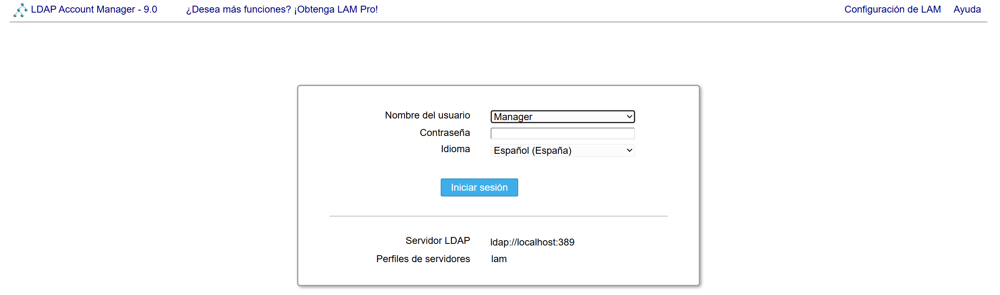

La primera vez, el campo *Nombre del usuario* muestra `Manager`, que es el administrador de la configuración de ejemplo de LAM (`cn=Manager,dc=my-domain,dc=com`) y no existe en nuestro directorio. Antes de iniciar sesión hay que adaptar el perfil del servidor a nuestro directorio. Para ello, se pulsa **Configuración de LAM**, arriba a la derecha, y después **Editar perfiles del servidor**.

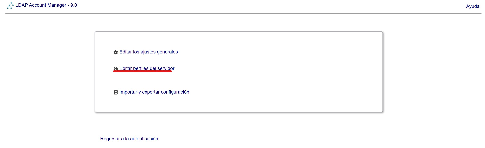

En la siguiente vista introduciremos la contraseña de configuración por defecto, `lam`, que debe cambiarse lo antes posible.

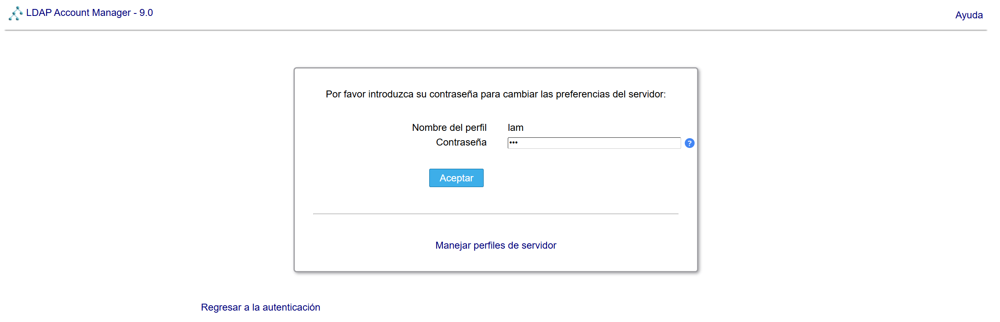

**Configuración general.** En la pestaña de configuración del servidor se indican estos valores:

| Opción | Valor |
|--------|-------|
| Dirección del servidor | `ldap://localhost:389` |
| Activar TLS | `no` |
| Método del inicio de sesión | `Lista fijada` |
| Lista de usuarios válidos | `cn=admin,dc=ies,dc=local` |
| Idioma por defecto y zona horaria | `Español (España)` y `Europe/Madrid` |
| Sufijo del árbol | `dc=ies,dc=local` |
| Contraseña del perfil | Una contraseña propia, distinta de `lam` |

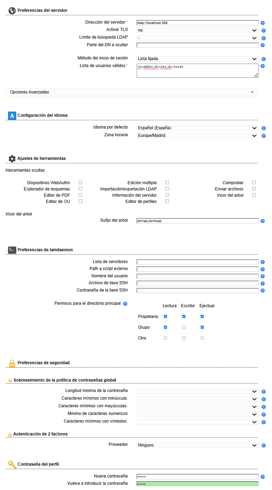

**Tipos de cuentas.** Indicamos los tipos de cuentas existentes en nuestro LDAP y la rama del árbol donde está cada uno:

| Tipo | Sufijo LDAP | Atributos del listado |
|------|-------------|-----------------------|
| Usuarios (`usuarios`) | `ou=usuarios,dc=ies,dc=local` | `#uid;#givenName;#sn;#uidNumber;#gidNumber` |
| Grupos (`grupos`) | `ou=grupos,dc=ies,dc=local` | `#cn;#gidNumber;#memberUID;#description` |
| Usuarios (`alumnos`) | `ou=alumnos,ou=usuarios,dc=ies,dc=local` | `#uid;#givenName;#sn;#uidNumber;#gidNumber` |
| Usuarios (`profesores`) | `ou=profesores,ou=usuarios,dc=ies,dc=local` | `#uid;#givenName;#sn;#uidNumber;#gidNumber` |

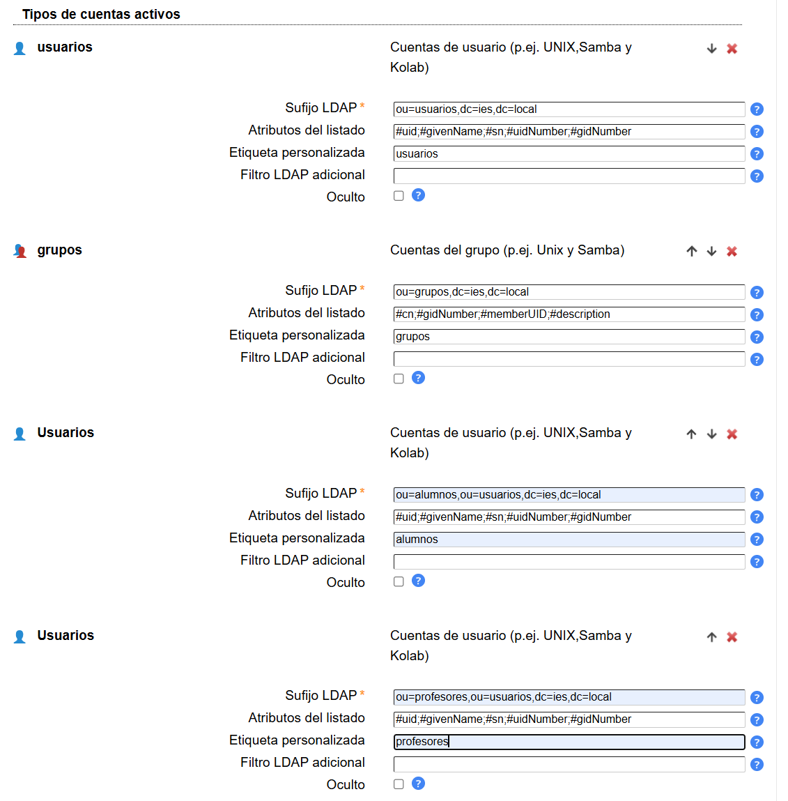

**Módulos.** Establecemos los módulos de cada tipo de cuenta, que son las mismas `objectClass` que usan nuestros ficheros LDIF:

| Tipo | Módulos |
|------|---------|
| `usuarios`, `alumnos` y `profesores` | Personal (`inetOrgPerson`), Unix (`posixAccount`) y Sombra (`shadowAccount`) |
| `grupos` | Unix (`posixGroup`) |

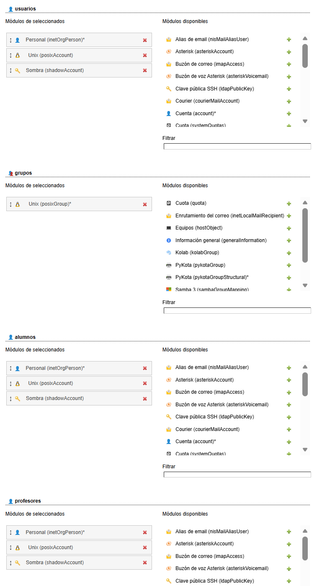

**Preferencias de los módulos.** En la pestaña de módulos, dentro del módulo Unix, se configuran los rangos con los que LAM asignará automáticamente el `uidNumber` y el `gidNumber` a las cuentas nuevas. Deben coincidir con los rangos del apartado 5.1:

| Tipo | Generador | Mínimo | Máximo |
|------|-----------|--------|--------|
| `alumnos` (UID) | Rango fijo | `10001` | `19999` |
| `profesores` (UID) | Rango fijo | `20001` | `29999` |
| `usuarios` (UID) | Rango fijo | `40001` | `40999` |
| Grupos (GID) | Rango fijo | `10000` | `30999` |

En las opciones del mismo módulo:

| Opción | Valor |
|--------|-------|
| Tipo de hash para la contraseña | `SSHA` |
| Intérpretes del inicio de sesión | Lista de shells que se ofrecen al crear un usuario. Debe incluir `/bin/bash` |
| El grupo principal como memberUid | **Desmarcada**: los grupos principales no llevan `memberUid` (apartado 6.1) |

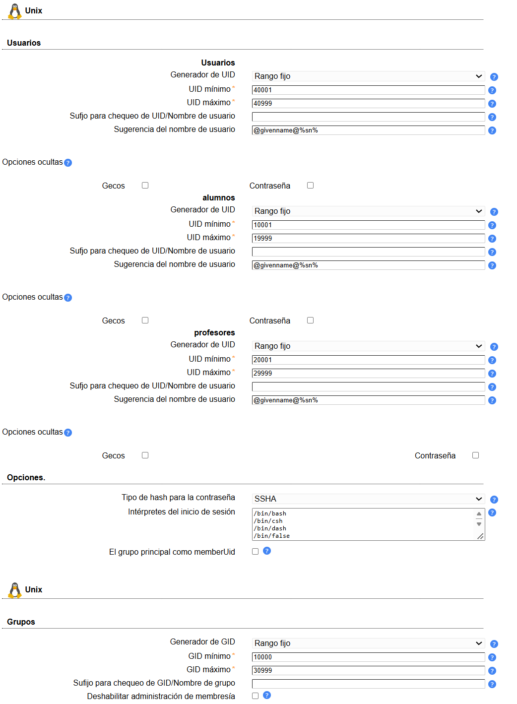

> **Nota:** El tipo `usuarios` abarca todo `ou=usuarios`, así que se reserva para cuentas que no sean ni de alumnos ni de profesores, con su propio rango a partir del `40001`. Los rangos de alumnos y profesores no se solapan entre sí, y el `uidNumber` y el `gidNumber` son espacios de números independientes, así que tampoco hay conflicto entre el rango de UID de `usuarios` y los GID de los grupos.

Una vez guardado el perfil, se vuelve a la pantalla de inicio de sesión. Ahora el campo *Nombre del usuario* muestra `admin`, que corresponde a `cn=admin,dc=ies,dc=local`, y se entra con su contraseña, `administrador`.

**El árbol del directorio.** En *Herramientas > Visor del árbol* se ve el árbol completo. Al terminar la sección 6 debe tener este aspecto: los grupos principales y los grupos de curso en `ou=grupos`, y `m.fernandez` ya en `ou=FPB2` tras el paso de curso del apartado 6.5. LAM ordena las entradas alfabéticamente:

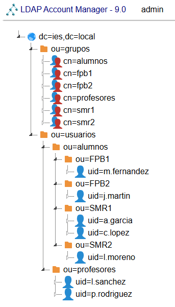

**Crear un alumno desde LAM.** A través de la interfaz se pueden crear, modificar y eliminar usuarios y grupos. Para dar de alta un alumno respetando la estructura del centro, se entra en la pestaña **alumnos**, se pulsa *Nuevo usuario* y se rellenan estos datos:

| Dónde | Dato | Valor para un alumno de SMR1 |
|-------|------|------------------------------|
| Parte superior | Sufijo | `ou=SMR1,ou=alumnos,ou=usuarios,dc=ies,dc=local`: la OU de su curso |
| Personal | Nombre y apellidos | Rellenan `givenName`, `sn` y `cn` |
| Unix | Nombre de usuario | El `uid`, por ejemplo `r.perez` |
| Unix | UID | Lo propone LAM: el siguiente número libre del rango de alumnos |
| Unix | Grupo principal | `alumnos` |
| Unix | Grupos adicionales | El grupo de su curso, `smr1` |
| Unix | Directorio personal | `/home/alumnos/r.perez` |
| Unix | Shell de inicio de sesión | `/bin/bash` |
| Unix | Contraseña | La contraseña del alumno. LAM la guarda con el hash `SSHA` configurado |

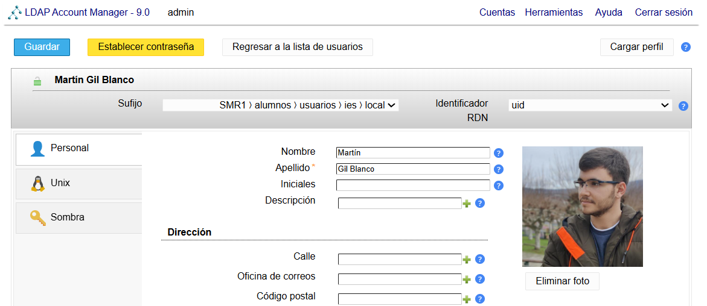
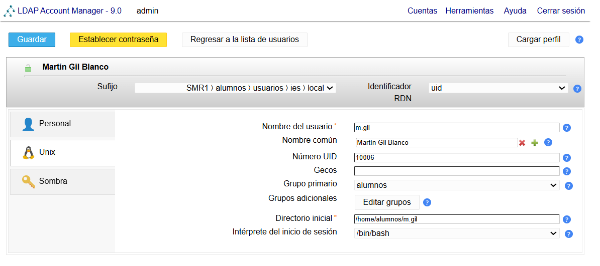
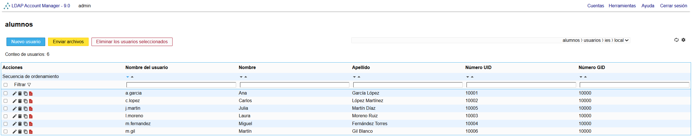
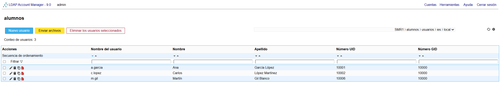

> **Importante:** LAM crea la entrada del usuario en el directorio, pero no su home en el servidor. Después de crear un usuario desde LAM, hay que provisionar su home como se explica en el apartado 5.6, con su `uidNumber` y el GID `10000`.

---

## 9. Carga total de datos en OpenLDAP

En esta sección se borra todo el árbol y se vuelve a crear de una sola vez a partir de un único fichero LDIF. Es la forma habitual de montar un directorio desde cero o de restaurar un escenario de prácticas.

### 9.1. Copia de seguridad con slapcat

**SERVIDOR**

Antes de borrar nada hay que hacer una copia de seguridad del directorio. `slapcat` vuelca todo el contenido de una base de datos de `slapd` a un fichero LDIF:

```bash
root@ldap:~# slapcat -n 1 -l /root/ldif_ies/copia-directorio-$(date +%F).ldif
root@ldap:~# ls /root/ldif_ies/copia-directorio-*
/root/ldif_ies/copia-directorio-2026-11-17.ldif
```

| Parámetro | Descripción |
|-----------|-------------|
| `-n 1` | Número de la base de datos que se vuelca. La `1` es la de los datos del directorio (`dc=ies,dc=local`); la `0` es la de la configuración de `slapd` (`cn=config`) |
| `-l fichero` | Fichero LDIF donde se guarda la copia |

A diferencia de `ldapsearch`, `slapcat` lee directamente los ficheros de la base de datos, así que incluye **todas** las entradas y todos sus atributos, también las contraseñas y los atributos internos que añade el servidor. Con la base de datos que usa Ubuntu (MDB) se puede ejecutar con `slapd` en marcha.

Para restaurar la copia en un directorio vacío, se para el servicio y se carga con `slapadd`:

```bash
root@ldap:~# systemctl stop slapd
root@ldap:~# slapadd -n 1 -l /root/ldif_ies/copia-directorio-2026-11-17.ldif
root@ldap:~# chown -R openldap:openldap /var/lib/ldap
root@ldap:~# systemctl start slapd
```

> **Importante:** `slapadd` solo funciona sobre una base de datos que no contenga ya esas entradas, por ejemplo tras borrar el árbol como en el apartado siguiente. El `chown` es necesario porque `slapadd` se ejecuta como `root` y los ficheros que crea deben pertenecer al usuario `openldap`, con el que funciona `slapd`.

---

### 9.2. Eliminar la estructura actual

Eliminamos toda la estructura LDAP creada anteriormente. Con la opción `-r`, `ldapdelete` borra cada rama completa, empezando por las entradas más profundas:

```bash
root@ldap:~# ldapdelete -x -H ldap://localhost -D "cn=admin,dc=ies,dc=local" -W -r "ou=usuarios,dc=ies,dc=local" "ou=grupos,dc=ies,dc=local"
```

Como alternativa, se pueden borrar todas las entradas una a una, siempre de dentro hacia afuera: primero los usuarios y los grupos, después las OUs de curso y por último las OUs principales. La lista corresponde al estado del directorio al terminar la sección 6, con `m.fernandez` ya en `ou=FPB2`. La opción `-c` hace que continúe aunque alguna entrada no exista:

```bash
root@ldap:~# ldapdelete -c -x -H ldap://localhost -D "cn=admin,dc=ies,dc=local" -W \
"uid=a.garcia,ou=SMR1,ou=alumnos,ou=usuarios,dc=ies,dc=local" \
"uid=c.lopez,ou=SMR1,ou=alumnos,ou=usuarios,dc=ies,dc=local" \
"uid=l.moreno,ou=SMR2,ou=alumnos,ou=usuarios,dc=ies,dc=local" \
"uid=m.fernandez,ou=FPB2,ou=alumnos,ou=usuarios,dc=ies,dc=local" \
"uid=j.martin,ou=FPB2,ou=alumnos,ou=usuarios,dc=ies,dc=local" \
"uid=p.rodriguez,ou=profesores,ou=usuarios,dc=ies,dc=local" \
"uid=l.sanchez,ou=profesores,ou=usuarios,dc=ies,dc=local" \
"ou=SMR1,ou=alumnos,ou=usuarios,dc=ies,dc=local" \
"ou=SMR2,ou=alumnos,ou=usuarios,dc=ies,dc=local" \
"ou=FPB1,ou=alumnos,ou=usuarios,dc=ies,dc=local" \
"ou=FPB2,ou=alumnos,ou=usuarios,dc=ies,dc=local" \
"ou=alumnos,ou=usuarios,dc=ies,dc=local" \
"ou=profesores,ou=usuarios,dc=ies,dc=local" \
"cn=alumnos,ou=grupos,dc=ies,dc=local" \
"cn=profesores,ou=grupos,dc=ies,dc=local" \
"cn=smr1,ou=grupos,dc=ies,dc=local" \
"cn=smr2,ou=grupos,dc=ies,dc=local" \
"cn=fpb1,ou=grupos,dc=ies,dc=local" \
"cn=fpb2,ou=grupos,dc=ies,dc=local" \
"ou=usuarios,dc=ies,dc=local" \
"ou=grupos,dc=ies,dc=local"
```

---

### 9.3. Fichero LDIF con la estructura completa

A continuación, crearemos un fichero LDIF con todos los datos que queremos insertar. El mismo fichero está disponible para descargar en [`recursos/LDAP/codigos/estructura_completa.ldif`](./recursos/LDAP/codigos/estructura_completa.ldif):

```bash
root@ldap:~# nano /root/ldif_ies/estructura-completa-ies.ldif
```

Contenido del fichero `/root/ldif_ies/estructura-completa-ies.ldif`:

```ldif
# =============================================================================
# FICHERO: estructura-completa-ies.ldif
# DESCRIPCIÓN: Crea de una sola vez toda la estructura del directorio LDAP
#              del Centro Educativo IES Ejemplo.
# CONTRASEÑA: todos los usuarios tienen la contraseña de prácticas abc123.
# =============================================================================

# =============================================================================
# BLOQUE 1 — UNIDADES ORGANIZATIVAS PRINCIPALES
# =============================================================================

dn: ou=usuarios,dc=ies,dc=local
objectClass: organizationalUnit
ou: usuarios
description: Contenedor principal de todos los usuarios del centro

dn: ou=grupos,dc=ies,dc=local
objectClass: organizationalUnit
ou: grupos
description: Grupos principales y grupos de curso del centro educativo

# =============================================================================
# BLOQUE 2 — SUBUNIDADES ORGANIZATIVAS DE USUARIOS
# =============================================================================

dn: ou=alumnos,ou=usuarios,dc=ies,dc=local
objectClass: organizationalUnit
ou: alumnos
description: Alumnos matriculados en el centro

dn: ou=profesores,ou=usuarios,dc=ies,dc=local
objectClass: organizationalUnit
ou: profesores
description: Profesores del departamento de informática

# =============================================================================
# BLOQUE 3 — SUBUNIDADES ORGANIZATIVAS DE CURSOS (DENTRO DE ALUMNOS)
# =============================================================================

dn: ou=SMR1,ou=alumnos,ou=usuarios,dc=ies,dc=local
objectClass: organizationalUnit
ou: SMR1
description: Alumnos de 1º de Sistemas Microinformáticos y Redes

dn: ou=SMR2,ou=alumnos,ou=usuarios,dc=ies,dc=local
objectClass: organizationalUnit
ou: SMR2
description: Alumnos de 2º de Sistemas Microinformáticos y Redes

dn: ou=FPB1,ou=alumnos,ou=usuarios,dc=ies,dc=local
objectClass: organizationalUnit
ou: FPB1
description: Alumnos de 1º de Formación Profesional Básica

dn: ou=FPB2,ou=alumnos,ou=usuarios,dc=ies,dc=local
objectClass: organizationalUnit
ou: FPB2
description: Alumnos de 2º de Formación Profesional Básica

# =============================================================================
# BLOQUE 4 — GRUPOS
# Grupos principales: alumnos (10000), profesores (20000)
# Grupos de curso:    smr1 (30001), smr2 (30002), fpb1 (30003), fpb2 (30004)
# =============================================================================

dn: cn=alumnos,ou=grupos,dc=ies,dc=local
objectClass: posixGroup
cn: alumnos
gidNumber: 10000
description: Grupo principal de todos los alumnos

dn: cn=profesores,ou=grupos,dc=ies,dc=local
objectClass: posixGroup
cn: profesores
gidNumber: 20000
description: Grupo principal de todos los profesores

dn: cn=smr1,ou=grupos,dc=ies,dc=local
objectClass: posixGroup
cn: smr1
gidNumber: 30001
description: Alumnos de 1º de Sistemas Microinformáticos y Redes
memberUid: a.garcia
memberUid: c.lopez

dn: cn=smr2,ou=grupos,dc=ies,dc=local
objectClass: posixGroup
cn: smr2
gidNumber: 30002
description: Alumnos de 2º de Sistemas Microinformáticos y Redes
memberUid: l.moreno

dn: cn=fpb1,ou=grupos,dc=ies,dc=local
objectClass: posixGroup
cn: fpb1
gidNumber: 30003
description: Alumnos de 1º de Formación Profesional Básica
memberUid: m.fernandez

dn: cn=fpb2,ou=grupos,dc=ies,dc=local
objectClass: posixGroup
cn: fpb2
gidNumber: 30004
description: Alumnos de 2º de Formación Profesional Básica
memberUid: j.martin

# =============================================================================
# BLOQUE 5 — ALUMNOS (en la OU de su curso, todos con gidNumber 10000)
# =============================================================================

# --- SMR1 ---

dn: uid=a.garcia,ou=SMR1,ou=alumnos,ou=usuarios,dc=ies,dc=local
objectClass: inetOrgPerson
objectClass: posixAccount
objectClass: shadowAccount
uid: a.garcia
cn: Ana García López
sn: García López
givenName: Ana
mail: a.garcia@ies.local
telephoneNumber: 600000001
uidNumber: 10001
gidNumber: 10000
homeDirectory: /home/alumnos/a.garcia
loginShell: /bin/bash
userPassword: {SSHA}QCGzA6uUNc2QC0Y4NVAGMOJj92D6mv85

dn: uid=c.lopez,ou=SMR1,ou=alumnos,ou=usuarios,dc=ies,dc=local
objectClass: inetOrgPerson
objectClass: posixAccount
objectClass: shadowAccount
uid: c.lopez
cn: Carlos López Martínez
sn: López Martínez
givenName: Carlos
mail: c.lopez@ies.local
telephoneNumber: 600000002
uidNumber: 10002
gidNumber: 10000
homeDirectory: /home/alumnos/c.lopez
loginShell: /bin/bash
userPassword: {SSHA}QCGzA6uUNc2QC0Y4NVAGMOJj92D6mv85

# --- SMR2 ---

dn: uid=l.moreno,ou=SMR2,ou=alumnos,ou=usuarios,dc=ies,dc=local
objectClass: inetOrgPerson
objectClass: posixAccount
objectClass: shadowAccount
uid: l.moreno
cn: Laura Moreno Ruiz
sn: Moreno Ruiz
givenName: Laura
mail: l.moreno@ies.local
telephoneNumber: 600000003
uidNumber: 10003
gidNumber: 10000
homeDirectory: /home/alumnos/l.moreno
loginShell: /bin/bash
userPassword: {SSHA}QCGzA6uUNc2QC0Y4NVAGMOJj92D6mv85

# --- FPB1 ---

dn: uid=m.fernandez,ou=FPB1,ou=alumnos,ou=usuarios,dc=ies,dc=local
objectClass: inetOrgPerson
objectClass: posixAccount
objectClass: shadowAccount
uid: m.fernandez
cn: Miguel Fernández Torres
sn: Fernández Torres
givenName: Miguel
mail: m.fernandez@ies.local
telephoneNumber: 600000004
uidNumber: 10004
gidNumber: 10000
homeDirectory: /home/alumnos/m.fernandez
loginShell: /bin/bash
userPassword: {SSHA}QCGzA6uUNc2QC0Y4NVAGMOJj92D6mv85

# --- FPB2 ---

dn: uid=j.martin,ou=FPB2,ou=alumnos,ou=usuarios,dc=ies,dc=local
objectClass: inetOrgPerson
objectClass: posixAccount
objectClass: shadowAccount
uid: j.martin
cn: Julia Martín Díaz
sn: Martín Díaz
givenName: Julia
mail: j.martin@ies.local
telephoneNumber: 600000005
uidNumber: 10005
gidNumber: 10000
homeDirectory: /home/alumnos/j.martin
loginShell: /bin/bash
userPassword: {SSHA}QCGzA6uUNc2QC0Y4NVAGMOJj92D6mv85

# =============================================================================
# BLOQUE 6 — PROFESORES (todos con gidNumber 20000)
# =============================================================================

dn: uid=p.rodriguez,ou=profesores,ou=usuarios,dc=ies,dc=local
objectClass: inetOrgPerson
objectClass: posixAccount
objectClass: shadowAccount
uid: p.rodriguez
cn: Pedro Rodríguez Gómez
sn: Rodríguez Gómez
givenName: Pedro
mail: p.rodriguez@ies.local
departmentNumber: Informática
telephoneNumber: 600100001
uidNumber: 20001
gidNumber: 20000
homeDirectory: /home/profesores/p.rodriguez
loginShell: /bin/bash
userPassword: {SSHA}QCGzA6uUNc2QC0Y4NVAGMOJj92D6mv85

dn: uid=l.sanchez,ou=profesores,ou=usuarios,dc=ies,dc=local
objectClass: inetOrgPerson
objectClass: posixAccount
objectClass: shadowAccount
uid: l.sanchez
cn: Lucía Sánchez Vega
sn: Sánchez Vega
givenName: Lucía
mail: l.sanchez@ies.local
departmentNumber: Informática
telephoneNumber: 600100002
uidNumber: 20002
gidNumber: 20000
homeDirectory: /home/profesores/l.sanchez
loginShell: /bin/bash
userPassword: {SSHA}QCGzA6uUNc2QC0Y4NVAGMOJj92D6mv85
```

El fichero recrea el escenario inicial: `m.fernandez` vuelve a estar en FPB1, como antes del paso de curso del apartado 6.5.

---

### 9.4. Importar el fichero

El fichero se puede importar con `ldapadd`, igual que los anteriores:

```bash
root@ldap:~# ldapadd -c -x -H ldap://localhost -D "cn=admin,dc=ies,dc=local" -W -f /root/ldif_ies/estructura-completa-ies.ldif
```

También se puede importar desde LAM, con la herramienta *Importación/exportación LDAP* del menú *Herramientas*, subiendo el fichero LDIF.

Después de la importación, el *Visor del árbol* de LAM muestra el escenario inicial completo, con `m.fernandez` de nuevo en `ou=FPB1`:

```text
dc=ies,dc=local
├── ou=grupos
│   ├── cn=alumnos
│   ├── cn=fpb1
│   ├── cn=fpb2
│   ├── cn=profesores
│   ├── cn=smr1
│   └── cn=smr2
└── ou=usuarios
    ├── ou=alumnos
    │   ├── ou=FPB1
    │   │   └── uid=m.fernandez
    │   ├── ou=FPB2
    │   │   └── uid=j.martin
    │   ├── ou=SMR1
    │   │   ├── uid=a.garcia
    │   │   └── uid=c.lopez
    │   └── ou=SMR2
    │       └── uid=l.moreno
    └── ou=profesores
        ├── uid=l.sanchez
        └── uid=p.rodriguez
```

Desde la consola se puede comprobar que se han creado las 22 entradas: la raíz, 8 OUs, 6 grupos y 7 usuarios:

```bash
root@ldap:~# ldapsearch -xLLL -H ldap://localhost -b "dc=ies,dc=local" dn | grep -c '^dn:'
22
```

> **Recuerda:** La carga total recrea exactamente los mismos usuarios, con los mismos UID y GID, por lo que los homes provisionados en el apartado 5.6 siguen siendo válidos sin cambios. Si se añaden usuarios nuevos (por LDIF o desde LAM), hay que provisionar su home en el servidor como se explicó en dicho apartado.

---

## 10. Configuración del cliente LDAP con SSSD

**CLIENTE**

El objetivo de esta sección es que el equipo cliente reconozca a los usuarios del directorio **como si fueran usuarios locales**: que `a.garcia` pueda iniciar sesión en el cliente con su contraseña de LDAP, aunque no exista en sus ficheros `/etc/passwd` ni `/etc/shadow`. Para entender qué hay que configurar y por qué, primero hay que ver cómo comprueba Linux quién es un usuario.

### 10.1. Cómo se autentica un usuario en Linux

Cuando alguien inicia sesión, el sistema tiene que responder a **dos preguntas distintas**, y para cada una usa un mecanismo diferente:

| Pregunta | Mecanismo | Qué aporta | Dónde se configura |
|----------|-----------|------------|--------------------|
| **¿Quién es este usuario?** | **NSS** (*Name Service Switch*) | Su identidad: UID, grupo principal, grupos, home y shell | `/etc/nsswitch.conf` |
| **¿Es quien dice ser?** | **PAM** (*Pluggable Authentication Modules*) | La comprobación de la contraseña y las condiciones para entrar | `/etc/pam.d/` |

En un equipo sin LDAP, las dos preguntas se responden con los ficheros locales: NSS consulta `/etc/passwd` y `/etc/group`, y PAM compara la contraseña con el hash guardado en `/etc/shadow`.

**NSS: la identidad del usuario**

Cualquier programa que necesite datos de un usuario o de un grupo se los pide a NSS, y NSS los busca en las **fuentes** indicadas en `/etc/nsswitch.conf`. No solo lo usan los programas de inicio de sesión: también `ls -l`, para traducir el UID de cada fichero al nombre de su propietario, o `id`, `getent` y `chown`. La orden `getent` permite hacer esas consultas a mano:

```bash
usuario@cliente:~$ getent passwd usuario
usuario:x:1000:1000:usuario,,,:/home/usuario:/bin/bash
```

`getent` no lee `/etc/passwd` directamente, sino que pregunta a NSS, que consulta **todas** las fuentes configuradas. Por eso es la orden adecuada para comprobar si el sistema reconoce a un usuario de LDAP.

**PAM: la autenticación**

Los programas que piden una contraseña (`login`, `su`, `sudo`, `ssh`, la pantalla de inicio de sesión gráfica...) no la comprueban por sí mismos: se la pasan a PAM. PAM está formado por **módulos**, pequeñas bibliotecas que hacen cada una una tarea y que se pueden añadir o quitar sin modificar los programas. Su trabajo se divide en cuatro fases, y cada línea de un fichero de PAM pertenece a una de ellas:

| Fase | Qué comprueba o hace | Fichero común en Debian | Módulo de ejemplo |
|------|----------------------|-------------------------|-------------------|
| `auth` | Si la contraseña es correcta | `/etc/pam.d/common-auth` | `pam_unix.so` compara la contraseña con `/etc/shadow` |
| `account` | Si la cuenta puede entrar en este momento: que no esté caducada ni bloqueada | `/etc/pam.d/common-account` | `pam_unix.so` mira las fechas de caducidad de `/etc/shadow` |
| `password` | Cómo se cambia la contraseña, por ejemplo con `passwd` | `/etc/pam.d/common-password` | `pam_unix.so` guarda el nuevo hash en `/etc/shadow` |
| `session` | Qué se prepara al abrir y al cerrar la sesión | `/etc/pam.d/common-session` | `pam_mkhomedir.so` crea el home si no existe |

Cada programa tiene su propio fichero en `/etc/pam.d/` (`sshd`, `su`, `login`...), pero en Debian casi todos incluyen los cuatro ficheros `common-*`. Así, un cambio en ellos afecta a la vez a todas las formas de iniciar sesión.

**Qué hay que añadir para los usuarios de LDAP**

Con esta arquitectura, para que el cliente acepte a los usuarios del directorio no hace falta modificar ningún programa. Basta con añadir:

- una **fuente más a NSS**, para que encuentre a `a.garcia` en LDAP además de en `/etc/passwd`;
- un **módulo más a PAM**, para que compruebe la contraseña de `a.garcia` contra LDAP además de contra `/etc/shadow`.

Las dos piezas las proporciona **SSSD**. Este es el recorrido completo cuando `a.garcia` inicia sesión en el cliente con la configuración terminada:

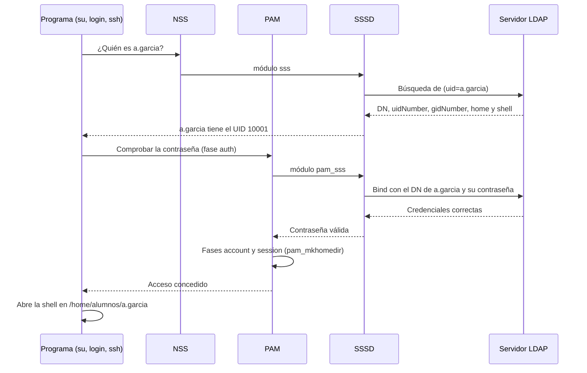

1. El programa pregunta a NSS quién es `a.garcia`. No está en `/etc/passwd`, así que NSS pasa la pregunta a SSSD, que la busca en LDAP y devuelve sus datos POSIX.
2. El programa pide a PAM que compruebe la contraseña. `pam_unix` no conoce al usuario, así que la comprobación llega a `pam_sss`, que se la pasa a SSSD.
3. SSSD comprueba la contraseña haciendo un *bind* contra el servidor con el DN de `a.garcia` y la contraseña que ha escrito: la autenticación simple del apartado 3. Si el servidor la acepta, la contraseña es correcta. El cliente **nunca ve el hash** de la contraseña: quien la valida es el servidor.
4. PAM completa las fases `account` y `session`, en la que `pam_mkhomedir` crea el home si no existe, y el usuario entra.

---

### 10.2. Qué es SSSD y por qué se usa

**SSSD** (*System Security Services Daemon*) es un servicio que hace de **intermediario** entre el sistema y el directorio. NSS y PAM no hablan con LDAP directamente: se lo piden a SSSD, y SSSD consulta el servidor y guarda las respuestas en una caché local.

```text
getent, id, ls -l ──► NSS (módulo sss) ──► servicio nss ──┐
                                                          ├──► SSSD ──► caché ──► servidor LDAP
su, login, ssh ─────► PAM (pam_sss) ─────► servicio pam ──┘
```

| Parte de SSSD | Qué hace |
|---------------|----------|
| Servicio `nss` | Atiende las peticiones de NSS: datos de usuarios y grupos |
| Servicio `pam` | Atiende las peticiones de PAM: comprobación de contraseñas y de cuentas |
| Dominio (`[domain/ies.local]`) | Indica de dónde salen los datos (en nuestro caso, un servidor LDAP) y cómo consultarlos |
| Caché (`/var/lib/sss/db/`) | Guarda los usuarios, grupos y credenciales ya consultados, para no preguntar al servidor cada vez y para poder seguir trabajando si el servidor no responde |

En versiones antiguas de Ubuntu y Debian se usaba la combinación `libnss-ldap` + `libpam-ldap`, en la que NSS y PAM consultaban LDAP directamente. **SSSD** es el método **recomendado actualmente en Debian 13 y Ubuntu 26.04** para integrar clientes Linux con directorios LDAP, y también con Active Directory o Kerberos. Sus ventajas frente al enfoque clásico son:

| Característica | libnss-ldap + libpam-ldap | SSSD |
|----------------|--------------------------|------|
| Caché integrada | No (depende de nscd) | Sí, incorporada |
| Configuración | Múltiples ficheros | Un único fichero `/etc/sssd/sssd.conf` |
| Soporte offline | No | Sí (usa caché cuando el servidor no está disponible) |
| Rendimiento | Bajo en redes lentas | Alto gracias a la caché |
| Mantenimiento activo | Abandonado | Activamente mantenido |

> **Nota:** En Debian 13 y Ubuntu 26.04 LTS, los paquetes `libnss-ldap` y `libpam-ldap` están disponibles en los repositorios pero su uso ya no se recomienda. SSSD es la solución oficial y moderna para esta tarea.

---

### 10.3. Instalación de paquetes en el cliente

**CLIENTE**

Instalar SSSD y los paquetes auxiliares necesarios:

```bash
root@cliente:~# apt update
root@cliente:~# apt install sssd sssd-ldap sssd-tools ldap-utils libpam-sss libnss-sss -y
```

| Paquete | Para qué se instala |
|---------|---------------------|
| `sssd` | El servicio SSSD, con sus servicios `nss` y `pam` y su caché |
| `sssd-ldap` | El proveedor que permite a SSSD consultar un servidor LDAP. Sin él, SSSD no sabría hablar con `slapd` |
| `sssd-tools` | Herramientas de administración de SSSD, como `sss_cache`, que vacía la caché |
| `ldap-utils` | Las mismas órdenes del servidor (`ldapsearch`, `ldapwhoami`...), para comprobar desde el cliente que el servidor responde antes de configurar SSSD |
| `libnss-sss` | El módulo `sss` de NSS: la «fuente más» que se añade a `/etc/nsswitch.conf` |
| `libpam-sss` | El módulo `pam_sss.so` de PAM: el «módulo más» que se añade a `/etc/pam.d/` |

> **Nota:** Al instalarse, `libnss-sss` añade la fuente `sss` a `/etc/nsswitch.conf`, y `libpam-sss` añade `pam_sss.so` a los ficheros `common-*` de PAM mediante `pam-auth-update`. Por eso, en los apartados 10.5 y 10.6 normalmente solo habrá que **comprobar** la configuración, no escribirla.

Antes de configurar SSSD conviene comprobar que el cliente llega al servidor LDAP. Si esta búsqueda falla, SSSD tampoco funcionará, y el problema es de red o del servidor, no del cliente:

```bash
root@cliente:~# ldapsearch -x -LLL -H ldap://192.168.100.10 -b "dc=ies,dc=local" -s base dn
dn: dc=ies,dc=local

```

`-s base` limita la búsqueda a la propia raíz, así que basta con que devuelva su DN. También se puede comprobar una contraseña desde el cliente con `ldapwhoami`, igual que en el servidor (apartado 5.7), cambiando `localhost` por `192.168.100.10`.

---

### 10.4. Configuración de SSSD

**CLIENTE**

Toda la configuración de SSSD se centraliza en el fichero `/etc/sssd/sssd.conf`. Este fichero **no existe tras la instalación** y debe crearse manualmente. Tiene un formato tipo `ini`, con secciones entre corchetes:

```bash
root@cliente:~# nano /etc/sssd/sssd.conf
```

Contenido completo del fichero `/etc/sssd/sssd.conf`:

```ini
[sssd]
domains = ies.local
services = nss, pam

[domain/ies.local]
id_provider = ldap
auth_provider = ldap
ldap_uri = ldap://192.168.100.10
ldap_search_base = dc=ies,dc=local
ldap_schema = rfc2307
ldap_user_search_base = ou=usuarios,dc=ies,dc=local
ldap_user_name = uid
ldap_group_search_base = ou=grupos,dc=ies,dc=local
cache_credentials = true
entry_cache_timeout = 300
enumerate = true
chpass_provider = ldap
ldap_chpass_uri = ldap://192.168.100.10
ldap_tls_reqcert = never
ldap_chpass_update_last_change = true
ldap_id_use_start_tls = false
ldap_auth_disable_tls_never_use_in_production = true
```

El fichero tiene dos secciones:

- **`[sssd]`** es la configuración general del servicio: qué dominios hay y qué servicios se activan.
- **`[domain/ies.local]`** describe el dominio: de dónde se sacan los usuarios y cómo se comprueban sus contraseñas. Si el equipo usara varios directorios, habría una sección `[domain/...]` por cada uno.

| Opción | Descripción |
|--------|-------------|
| `domains = ies.local` | Nombre del dominio de SSSD, que debe coincidir con el de la sección `[domain/ies.local]`. Es un nombre interno: no tiene por qué coincidir con el DNS |
| `services = nss, pam` | Servicios que se activan: `nss` para resolver usuarios y grupos, y `pam` para autenticar. Sin `nss`, el sistema no sabría que `a.garcia` existe; sin `pam`, existiría pero no podría iniciar sesión |
| `id_provider = ldap` | Las **identidades** (usuarios y grupos) se sacan de LDAP |
| `auth_provider = ldap` | Las **contraseñas** se comprueban contra LDAP, haciendo un *bind* con el DN del usuario |
| `chpass_provider = ldap` y `ldap_chpass_uri` | Los **cambios de contraseña** (por ejemplo, con `passwd` en el cliente) se hacen en LDAP, en ese servidor |
| `ldap_uri` | Dirección del servidor LDAP |
| `ldap_search_base` | Rama del árbol a partir de la que se busca, por defecto. Es el DN base del directorio |
| `ldap_schema = rfc2307` | Esquema de los grupos: los miembros se guardan con `memberUid`, que contiene el nombre de usuario y no el DN, como en nuestros `posixGroup` |
| `ldap_user_search_base` y `ldap_group_search_base` | Ramas concretas donde se buscan los usuarios y los grupos |
| `ldap_user_name = uid` | Atributo que contiene el nombre de inicio de sesión. Es el valor por defecto, pero se deja explícito |
| `cache_credentials = true` | Guarda en caché las credenciales de los usuarios que ya han entrado, para que puedan iniciar sesión aunque el servidor no responda |
| `entry_cache_timeout = 300` | Segundos que una entrada se considera válida en la caché antes de volver a consultarla en el servidor |
| `enumerate = true` | Permite listar **todos** los usuarios y grupos del directorio, por ejemplo con `getent passwd`. Sin esta opción, solo se resuelven los usuarios por los que se pregunta expresamente |
| `ldap_chpass_update_last_change = true` | Al cambiar la contraseña, actualiza también el atributo `shadowLastChange`, que guarda la fecha del último cambio |
| `ldap_tls_reqcert`, `ldap_id_use_start_tls` y `ldap_auth_disable_tls_never_use_in_production` | Desactivan el cifrado TLS, que esta práctica no configura. Sin la última, SSSD se niega a enviar contraseñas por una conexión sin cifrar |

> **Importante:** Gracias a que SSSD realiza búsquedas en profundidad (*subtree*), con `ldap_user_search_base = ou=usuarios,dc=ies,dc=local` encuentra correctamente a todos los alumnos independientemente de en qué OU de curso estén. No es necesario configurar una `search_base` por cada curso.

> **Nota:** SSSD busca a los usuarios en LDAP sin identificarse, aprovechando que el servidor permite las búsquedas anónimas (apartado 3). En un directorio que no las permitiera, habría que darle a SSSD un usuario con permiso de lectura, con las opciones `ldap_default_bind_dn` y `ldap_default_authtok`.

> **Nota:** `enumerate = true` es cómodo en el aula, pero no se recomienda en directorios grandes: obliga a SSSD a descargar periódicamente todos los usuarios y grupos. La autenticación sin cifrar que permiten las tres últimas opciones es una de las debilidades que se analizan en el [documento 04](./04_seguridad_del_escenario_y_kerberos.md).

El fichero debe tener permisos estrictamente `600` y pertenecer a `root`. Puede contener información delicada, como la contraseña de un usuario de lectura del directorio, y SSSD **se niega a arrancar** si otros usuarios pueden leerlo:

```bash
root@cliente:~# chmod 600 /etc/sssd/sssd.conf
root@cliente:~# chown root:root /etc/sssd/sssd.conf
```

Se arranca el servicio, para que lea la configuración, y se habilita, para que arranque solo en cada inicio del equipo:

```bash
root@cliente:~# systemctl start sssd
root@cliente:~# systemctl enable sssd
```

Se comprueba que está activo:

```bash
root@cliente:~# systemctl status sssd
```

Si el servicio aparece como `failed`, los registros indican el motivo. Los más habituales son un error de sintaxis en el fichero o unos permisos distintos de `600`:

```bash
root@cliente:~# journalctl -u sssd --no-pager | tail -30
```

> **Importante:** SSSD solo lee `sssd.conf` al arrancar. Cada vez que se modifique el fichero hay que reiniciar el servicio con `systemctl restart sssd`.

---

### 10.5. Configuración de NSS para usar SSSD

**CLIENTE**

El fichero `/etc/nsswitch.conf` indica a NSS **en qué fuentes** debe buscar cada tipo de información, y **en qué orden**. Al instalar el paquete `libnss-sss`, Debian ya añade la fuente `sss` a las líneas necesarias, así que normalmente basta con comprobarlo:

```bash
root@cliente:~# grep -E '^(passwd|group|shadow|gshadow):' /etc/nsswitch.conf
passwd:         files systemd sss
group:          files systemd sss
shadow:         files systemd sss
gshadow:        files systemd
```

| Línea | Qué información | Fuentes |
|-------|-----------------|---------|
| `passwd` | Usuarios: UID, grupo principal, home y shell | `files` (`/etc/passwd`), `systemd` y `sss` (LDAP a través de SSSD) |
| `group` | Grupos y sus miembros | `files` (`/etc/group`), `systemd` y `sss` |
| `shadow` | Datos de las contraseñas: caducidad y bloqueo | `files` (`/etc/shadow`), `systemd` y `sss`. SSSD responde con los datos de caducidad, pero **nunca entrega el hash**: la contraseña la valida el servidor |
| `gshadow` | Contraseñas de los grupos | Solo locales: SSSD no las proporciona |

| Fuente | Significado |
|--------|-------------|
| `files` | Los ficheros locales del equipo |
| `systemd` | Usuarios que crea `systemd` sobre la marcha para algunos servicios, y que no están en ningún fichero |
| `sss` | SSSD, que a su vez consulta su caché o el servidor LDAP |

Si alguna de las líneas `passwd`, `group` o `shadow` no incluye `sss`, se añade al final de esa línea editando el fichero con `nano /etc/nsswitch.conf`.

El orden `files ... sss` es importante: NSS consulta las fuentes de izquierda a derecha y se queda con la primera que conoce al usuario. Así, `root` y el resto de cuentas locales se resuelven siempre con los ficheros del equipo, incluso si el servidor LDAP no está disponible, y nunca podrían ser suplantadas por un usuario del directorio con el mismo nombre.

En cuanto SSSD está funcionando y `sss` está en `/etc/nsswitch.conf`, el cliente ya reconoce a los usuarios del directorio. Se puede comprobar en este momento, aunque todavía no puedan iniciar sesión:

```bash
root@cliente:~# getent passwd a.garcia
a.garcia:*:10001:10000:Ana García López:/home/alumnos/a.garcia:/bin/bash
```

---

### 10.6. Configuración de PAM para usar SSSD

**CLIENTE**

> **Snapshot:** Antes de tocar ningún fichero de PAM, crear una instantánea de la máquina cliente (por ejemplo, `pre-pam`). Un error en la configuración de PAM puede impedir por completo el inicio de sesión en el equipo, incluido `root`, y la instantánea es la única vuelta atrás sencilla.

En Debian, los ficheros `common-*` de `/etc/pam.d/` no se suelen editar a mano: los genera la orden **`pam-auth-update`** a partir de los **perfiles** que instalan los paquetes en `/usr/share/pam-configs/`. Al instalar `libpam-sss`, su perfil se activó automáticamente y `pam_sss.so` quedó añadido a los cuatro ficheros. Lo que se hace en este apartado es comprobarlo y entender cada línea.

Para ver solo las líneas activas, sin los comentarios ni las líneas vacías:

```bash
root@cliente:~# grep -Ev '^#|^$' /etc/pam.d/common-auth
auth    [success=2 default=ignore]      pam_unix.so nullok
auth    [success=1 default=ignore]      pam_sss.so use_first_pass
auth    requisite                       pam_deny.so
auth    required                        pam_permit.so
auth    optional                        pam_cap.so
```

Cada línea tiene tres partes: la **fase** (`auth`), el **control**, que indica qué pasa según el resultado del módulo, y el **módulo** con sus opciones. Los módulos se ejecutan de arriba abajo:

| Control | Significado |
|---------|-------------|
| `required` | El módulo debe tener éxito. Si falla, el resultado final será un fallo, pero se siguen ejecutando los demás |
| `requisite` | Igual que `required`, pero si falla se detiene todo inmediatamente |
| `sufficient` | Si tiene éxito, basta: se acepta sin consultar los siguientes. Si falla, se ignora y se sigue |
| `optional` | Su resultado no influye, salvo que sea el único módulo |
| `[success=N default=ignore]` | Si tiene éxito, se **saltan** las `N` líneas siguientes. Si falla, se ignora su resultado y se pasa a la línea siguiente |

| Línea | Qué hace |
|-------|----------|
| `pam_unix.so nullok` | Comprueba la contraseña en `/etc/shadow`. Si acierta, salta 2 líneas (`pam_sss` y `pam_deny`) y llega a `pam_permit`. `nullok` permite las cuentas locales sin contraseña |
| `pam_sss.so use_first_pass` | Comprueba la contraseña a través de SSSD. `use_first_pass` hace que use la contraseña que ya se escribió para `pam_unix`, en lugar de pedirla otra vez. Si acierta, salta 1 línea (`pam_deny`) |
| `pam_deny.so` | Siempre falla. Solo se llega a ella si ni `pam_unix` ni `pam_sss` han aceptado la contraseña, y como es `requisite`, el acceso se deniega en ese momento |
| `pam_permit.so` | Siempre tiene éxito. Es el punto de llegada de los saltos: deja un resultado positivo cuando la contraseña ha sido aceptada |
| `pam_cap.so` | Asigna capacidades (*capabilities*) a la sesión del usuario, si están configuradas. No interviene en la comprobación de la contraseña |

Siguiendo los saltos, se ve qué ocurre en cada caso:

| Usuario | `pam_unix` | `pam_sss` | Resultado |
|---------|------------|-----------|-----------|
| `usuario` (local), contraseña correcta | Éxito: salta a `pam_permit` | No se ejecuta | Acceso concedido |
| `a.garcia` (LDAP), contraseña correcta | Falla: no está en `/etc/shadow` | Éxito: salta a `pam_permit` | Acceso concedido |
| Cualquiera, contraseña incorrecta | Falla | Falla | Llega a `pam_deny`: acceso denegado |

La fase `account` comprueba, una vez aceptada la contraseña, si la cuenta puede entrar:

```bash
root@cliente:~# grep -Ev '^#|^$' /etc/pam.d/common-account
account [success=1 new_authtok_reqd=done default=ignore]        pam_unix.so
account requisite                       pam_deny.so
account required                        pam_permit.so
account sufficient                      pam_localuser.so
account [default=bad success=ok user_unknown=ignore]    pam_sss.so
```

| Línea | Qué hace |
|-------|----------|
| `pam_unix.so` | Comprueba la caducidad de la cuenta y de la contraseña con los datos de `shadow`. Si todo es correcto, salta `pam_deny`. Si la contraseña ha caducado (`new_authtok_reqd`), termina aquí y obliga a cambiarla |
| `pam_deny.so` y `pam_permit.so` | El mismo mecanismo de salto que en `common-auth` |
| `pam_localuser.so` | Tiene éxito si el usuario está en `/etc/passwd`. Como es `sufficient`, los usuarios locales se aceptan aquí sin consultar a SSSD |
| `pam_sss.so` | Para los usuarios de LDAP, pregunta a SSSD si la cuenta está habilitada. Si SSSD dice que no, se deniega (`default=bad`); si no conoce al usuario, se ignora (`user_unknown=ignore`) |

Los otros dos ficheros también incluyen `pam_sss.so`: en `common-password`, para que `passwd` cambie en LDAP la contraseña de los usuarios del directorio, y en `common-session`, para que SSSD sepa cuándo se abre y se cierra cada sesión.

Si `pam_sss.so` no aparece en estos ficheros, **no hay que añadirlo a mano**: el bloque comprendido entre las líneas `here are the per-package modules` y `end of pam-auth-update config` lo regenera `pam-auth-update` y perdería los cambios manuales. Basta con ejecutar la orden y marcar la opción *SSS authentication* en el menú:

```bash
root@cliente:~# pam-auth-update
```

> **Recuerda:** Los ficheros de `/etc/pam.d/` son extremadamente delicados. Un error en la configuración de PAM puede impedir completamente el acceso al sistema, incluyendo a `root`. Antes de modificarlos, abrir una segunda sesión de terminal como `root` y no cerrarla hasta comprobar que se puede iniciar sesión de nuevo.

---

### 10.7. Creación automática del directorio home

**CLIENTE**

Cuando un usuario inicia sesión, el sistema lo sitúa en el directorio de su atributo `homeDirectory`. Los homes definitivos de los usuarios están provisionados en el **servidor** (apartado 5.6) y en el [documento 03](./03_perfiles_moviles.md) se servirán por NFS. Sin embargo, mientras no exista ese montaje, el directorio `/home/alumnos/a.garcia` no existe en el disco del cliente, y la sesión empezaría en un directorio inexistente.

Para que la práctica funcione de forma autónoma, se añade a la fase `session` el módulo `pam_mkhomedir.so`, que crea automáticamente el directorio la primera vez que el usuario inicia sesión, copiando la plantilla de `/etc/skel`:

```bash
root@cliente:~# nano /etc/pam.d/common-session
```

Añadir la siguiente línea al **final** del fichero, después de la línea `# end of pam-auth-update config`, para que `pam-auth-update` la respete si se vuelve a ejecutar:

```
session required    pam_mkhomedir.so skel=/etc/skel umask=077
```

| Parte | Descripción |
|-------|-------------|
| `session` | Se ejecuta en la fase de apertura de la sesión, después de aceptar la contraseña y la cuenta |
| `required` | Si no puede crear el directorio, la sesión falla, en lugar de entrar en un directorio inexistente |
| `skel=/etc/skel` | Plantilla que se copia en el nuevo home. Contiene `.bashrc`, `.profile`, `.bash_logout`, etc. |
| `umask=077` | Permisos del directorio creado. Con `077` solo el propietario tiene acceso (permisos `700`) |

> **Nota:** El módulo también se puede activar con `pam-auth-update`, marcando la opción *Create home directory on login*. En ese caso no se le pasa `umask=077`, y los permisos del home los decide la configuración de `/etc/login.defs`. El [documento 03](./03_perfiles_moviles.md) explica cómo desactivarlo de las dos formas.

`pam_mkhomedir` crea el directorio del usuario, pero no los directorios padre intermedios. Por eso hay que crear en el cliente los directorios base de los homes:

```bash
root@cliente:~# mkdir -p /home/alumnos
root@cliente:~# mkdir -p /home/profesores
```

> **Nota — de cara a los perfiles móviles:** Con esta configuración provisional, cada cliente crea el home localmente en su propio disco: el alumno tiene un home distinto en cada equipo. En el [documento 03](./03_perfiles_moviles.md), el servidor exportará `/home/alumnos` y `/home/profesores` por NFS y los clientes los montarán en esas mismas rutas: los homes reales pasarán a ser los provisionados en el servidor (apartado 5.6), y los homes locales creados por `pam_mkhomedir` quedarán ocultos bajo el montaje. Esta es la razón por la que los homes se provisionan en el servidor: `pam_mkhomedir` se ejecuta como root en el cliente y, con la opción por defecto `root_squash` de NFS, no podría crear directorios dentro del montaje. Al existir ya los homes (el módulo solo actúa cuando el directorio no existe), la exportación NFS puede mantener `root_squash` sin renunciar a la seguridad.

---

### 10.8. Verificación desde el cliente

**CLIENTE**

Antes de las pruebas, vaciar la caché de SSSD y reiniciar el servicio, para que aplique la configuración más reciente y consulte de nuevo el servidor:

```bash
root@cliente:~# sss_cache -E
root@cliente:~# systemctl restart sssd
```

`sss_cache -E` marca como caducadas todas las entradas de la caché de SSSD, de modo que la siguiente consulta de cada usuario o grupo se hace otra vez al servidor LDAP. Es útil siempre que se cambia algo en el directorio y el cliente sigue mostrando los datos antiguos.

Cada prueba comprueba una pieza distinta, en el mismo orden en que intervienen al iniciar sesión:

| Prueba | Qué comprueba |
|--------|---------------|
| 1. `getent passwd` | NSS: el cliente encuentra a los usuarios del directorio |
| 2. `getent group` | NSS: el cliente encuentra los grupos y sus miembros |
| 3. `su` desde un usuario normal | PAM: la contraseña se valida contra LDAP y se crea el home |
| 4. `ssh` | PAM en otro programa distinto |
| 5. `id` y `groups` | NSS: el grupo principal y los grupos de curso del usuario |
| 6. Inicio de sesión gráfico | Todo el conjunto, como lo usaría un alumno |

**Prueba 1 — Verificar que NSS resuelve usuarios LDAP a través de SSSD:**

```bash
root@cliente:~# getent passwd a.garcia
a.garcia:*:10001:10000:Ana García López:/home/alumnos/a.garcia:/bin/bash
```

El usuario no está en `/etc/passwd`, así que estos datos vienen de LDAP a través de SSSD. El segundo campo es un `*` y no una `x`: SSSD no da acceso a la contraseña, que solo conoce el servidor. Como el usuario no tiene atributo `gecos`, SSSD muestra su `cn` en el quinto campo.

**Prueba 2 — Verificar que NSS resuelve grupos LDAP:**

```bash
root@cliente:~# getent group smr1
smr1:*:30001:a.garcia,c.lopez
root@cliente:~# getent group alumnos
alumnos:*:10000:
```

El grupo de curso muestra sus miembros (`memberUid`). El grupo principal `alumnos` aparece sin miembros, porque sus miembros lo son por su `gidNumber` (apartado 6.1).

**Prueba 3 — Verificar que PAM autentica usuarios LDAP a través de SSSD:**

La prueba debe hacerse **desde un usuario normal**, como `usuario`. Cuando es `root` quien ejecuta `su`, PAM no pide la contraseña del otro usuario, así que no se comprobaría la autenticación:

```bash
usuario@cliente:~$ su - a.garcia
Contraseña:
Creando directorio '/home/alumnos/a.garcia'.
a.garcia@cliente:~$ pwd
/home/alumnos/a.garcia
a.garcia@cliente:~$ exit
```

En esta sola orden intervienen las tres fases de PAM vistas antes:

- **`auth`:** `pam_unix` no conoce a `a.garcia`, y `pam_sss` valida la contraseña `abc123.` contra LDAP.
- **`account`:** `pam_sss` confirma que la cuenta está habilitada.
- **`session`:** `pam_mkhomedir` crea `/home/alumnos/a.garcia` y muestra el mensaje `Creando directorio`.

La segunda vez que `a.garcia` entre, el directorio ya existirá y el mensaje no aparecerá.

**Prueba 4 — Verificar login por SSH:**

Si el cliente tiene instalado el servidor SSH (`openssh-server`), se puede probar también una conexión con el usuario del directorio. Es otro programa distinto, pero usa los mismos ficheros `common-*` de PAM, así que debe funcionar sin configurar nada más:

```bash
root@cliente:~# ssh a.garcia@localhost
a.garcia@localhost's password:
...
a.garcia@cliente:~$ exit
cerrar sesión
Connection to localhost closed.
```

**Prueba 5 — Verificar los grupos del usuario:**

```bash
root@cliente:~# id a.garcia
uid=10001(a.garcia) gid=10000(alumnos) grupos=10000(alumnos),30001(smr1)
root@cliente:~# groups a.garcia
a.garcia : alumnos smr1
```

El comando `id` devuelve el UID, el grupo principal (`alumnos`, de su `gidNumber`) y todos sus grupos, incluido el grupo de curso `smr1`, que SSSD obtiene buscando los grupos que tienen `memberUid: a.garcia`.

**Prueba 6 — Acceso desde GUI (GNOME)**

Como prueba definitiva, se inicia sesión con un usuario del directorio desde la pantalla de inicio de sesión gráfica del cliente. En la captura se entra con `j.martin` y, como es la primera vez, `pam_mkhomedir` avisa de que está creando su directorio personal.

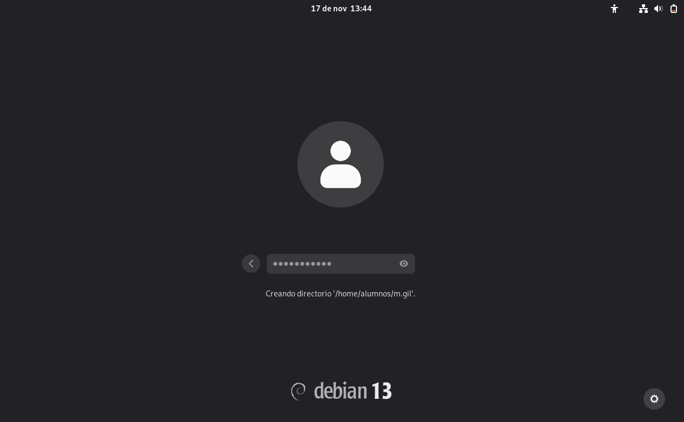

**Diagnóstico de problemas**

Si alguna prueba falla, lo primero es saber qué pieza falla, siguiendo el mismo orden del recorrido del apartado 10.1:

| Síntoma | Pieza que falla | Qué comprobar |
|---------|-----------------|---------------|
| `ldapsearch` desde el cliente no responde | Red o servidor | `ping 192.168.100.10` y que `slapd` esté activo en el servidor |
| `getent passwd a.garcia` no devuelve nada | SSSD o NSS | `systemctl status sssd`, los permisos de `sssd.conf`, la línea `passwd` de `/etc/nsswitch.conf` y `journalctl -u sssd -f` |
| `getent` funciona, pero la contraseña no se acepta | La contraseña o PAM | Primero, `ldapwhoami` con ese usuario (apartado 5.7): si falla, el problema es la contraseña en el directorio; si funciona, revisar `pam_sss` en `/etc/pam.d/common-auth` |
| La contraseña se acepta, pero aparece `No directory, logging in with HOME=/` | La fase `session` | La línea de `pam_mkhomedir` en `common-session` y que exista `/home/alumnos` |
| Se ha cambiado algo en el directorio y el cliente sigue mostrando lo anterior | La caché de SSSD | `sss_cache -E` y `systemctl restart sssd` |
